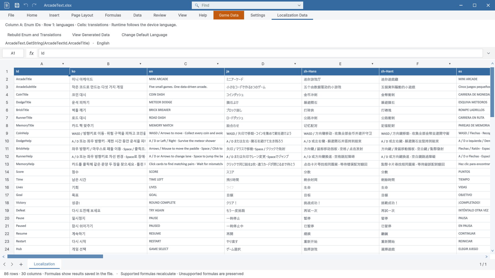

> 보관 기록입니다. 아래 결과는 원문 작성 시점의 내용이며, 이번 편집에서 제품 테스트를 다시 실행하지 않았습니다.

Windows · Unity 6000.0.83f1 · 1600×900 · 격리 Unity 실제 렌더링

## 원인과 수정

Play 중 셀을 그릴 때마다 편집 가능 여부를 확인하면서 등록 테이블 24개의 원본 경로를 반복 조회했습니다. OnGUI 이벤트 시작 시 읽기 전용 상태를 한 번 계산하고, 이벤트 종료 시 임시 상태를 해제하도록 수정했습니다. OnGUI 밖의 명령과 저장 API는 실제 상태를 다시 확인합니다.

## 같은 조건의 측정 결과

| 화면 | 수정 전 평균 | 수정 후 평균 | 추가 재검사 평균 |
| --- | --- | --- | --- |
| 편집 · 홈 · 상단 | 15.49 ms | 18.31 ms | 18.38 ms |
| 편집 · 로컬라이징 · 상단 | 13.65 ms | 14.18 ms | 17.69 ms |
| 편집 · 로컬라이징 · 스크롤 | 14.70 ms | 13.09 ms | 16.13 ms |
| Play · 홈 · 상단 | 722.14 ms | 18.38 ms | 24.72 ms |
| Play · 로컬라이징 · 상단 | 669.78 ms | 14.26 ms | 19.46 ms |
| Play · 로컬라이징 · 스크롤 | 684.28 ms | 16.58 ms | 18.69 ms |

각 화면은 준비용 3회 이후 12회 측정했습니다. 파일은 86행·30열·1,060셀이고 수식은 없습니다. 추가 재검사는 .NET 빌드와 동시에 실행했습니다. 값은 숨겨진 네이티브 HostView의 그리기 호출 시간이며 실제 데스크톱 FPS나 마우스 입력 지연을 직접 측정한 수치는 아닙니다.

## 회귀 검사

- 로컬라이징·게임 데이터의 12개 렌더 상태, 읽기 전용·편집 가능 여부·캐시 해제 48개 조건 통과.

- 실제 Play 모드의 등록·저장·직접 API 보호 6개 TC 통과.

- 일반 로컬라이징 편집은 유지하고 게임 데이터·글로벌 Enum의 Play 저장 차단도 유지.

- 원본 XLSX 해시와 격리 파일 해시 일치. 최종 소스와 실제 측정 Unity 소스 일치.

- 컴파일: 경고 0개, 오류 0개.

## 현재 화면

## 근거와 한계

정량 결과·검사 목록 · 수정 전 원시 측정 · 수정 후 원시 측정 · Play 보호 결과 · 빌드 로그

프로파일러의 Mono 할당량 카운터가 0을 반환하여 할당량 근거로 사용하지 않았습니다. 두 캡처의 일본어 한 셀에서 23×10픽셀 영역 차이가 관찰되었으며 원인은 미확인입니다. 화면 전체 픽셀 동일성을 주장하지 않습니다. 사용자 데스크톱 조작 및 다른 운영체제·Unity 버전은 검증하지 않았습니다.

XERJ: 실패 — 서버 미기동으로 rg 사용.

## 원문과 편집 이력

[보존된 원문 열기](../assets/imports/Docs/Testing/2026-10-29/arcade-text-performance/Report.ko.html)

- 원문 SHA-256: `a6a50196de9ddafa5bcb32d3d564a80d260d67b352142743db767d468358c697`
- 표시 날짜는 원본 파일의 수정 시각입니다. 작업 완료 시각은 원문에 있는 값을 기준으로 확인합니다.
