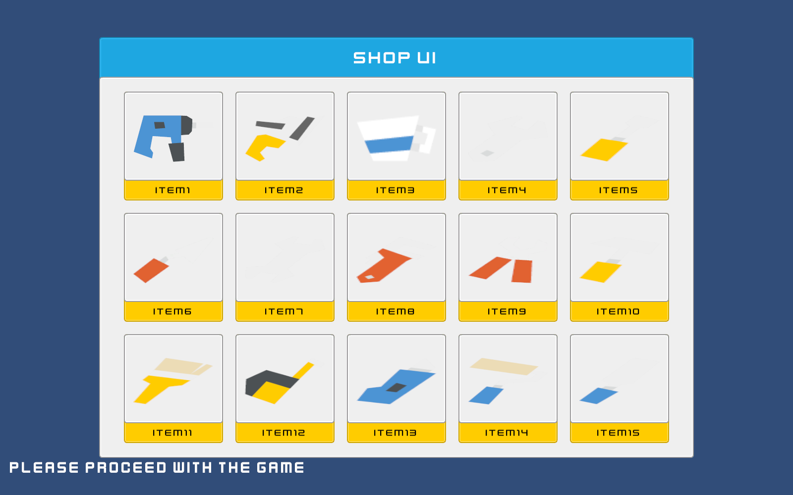
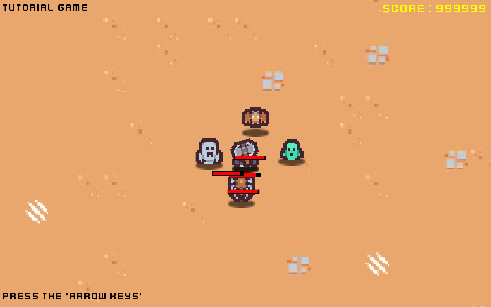
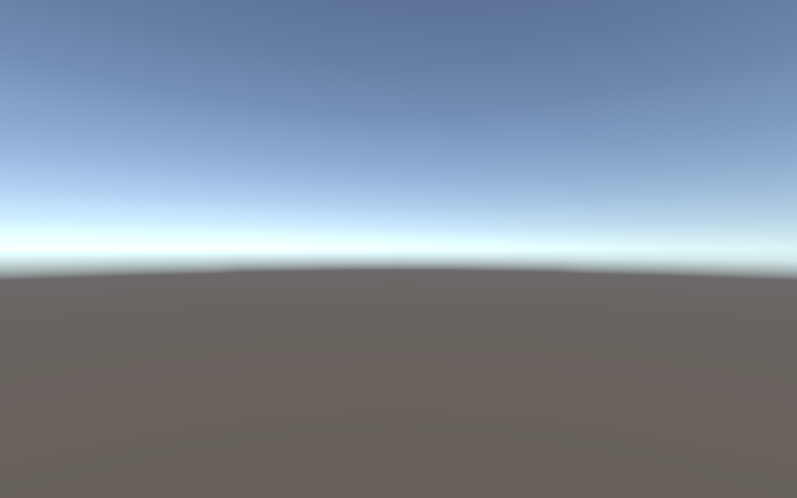

> 보관 기록입니다. 아래 결과는 원문 작성 시점의 내용이며, 이번 편집에서 제품 테스트를 다시 실행하지 않았습니다.

## 실행 환경과 보존 범위

| Unity | 6000.0.83f1 · Windows · 별도 검증 프로젝트 |
| --- | --- |
| 렌더링 | Play Mode 배치 실행은 OpenGL Core. 원본 작업 창은 Direct3D 11로 열려 있었으며, 검은 캡처의 원인은 미확인입니다. |
| 프로젝트 | 원본 Assets/DesignDataTable, Assets/Scenes와 ProjectSettings를 복사했습니다. UI·Sprite 패키지는 설치된 로컬 패키지를 참조했습니다. |
| 원본 데이터 | 원본 XLSX·CSV·바이너리를 테스트 입력으로 덮어쓰지 않았습니다. 샘플 C#·아이콘 임포트·메타 설정, 영어 기본 언어와 상점 씬 안내 문구 배치를 수정했습니다. 해시 대조 기록은 상점 씬 수정 전의 보존 검사입니다. 원본 이미지 픽셀은 변경하지 않았습니다. |
| 실행 근거 | 원본 데이터 87개 파일 해시 대조 · 최종 JSONL · Unity 검증 소스 · 성능 CSV |

## 실행으로 재현하고 수정한 문제

| 문제 | 수정 | 수정 전 근거 |
| --- | --- | --- |
| 재사용 투사체의 이전 소유자 유지 | ProjectileManager가 매번 소유자를 설정하도록 수정 **최종: pass** | 실패 JSONL `game.pool-updates-owner` |
| 재사용 투사체의 이전 회전 유지 | 위치와 회전을 함께 초기화하도록 수정 **최종: pass** | 실패 JSONL `game.pool-updates-rotation` |
| 최초 표시 때 손상 체력을 100%로 덮어씀 | OnEnable에서 현재 대상의 실제 체력 비율 사용 **최종: pass** | 실패 JSONL `game.hud-preserves-initial-damaged-health` |
| 이전 대상 이벤트 구독이 남음 | 대상 전환 전에 이전 이벤트 구독 해제 **최종: pass** | 실패 JSONL `game.hud-unsubscribes-previous-target` |
| 재활성화 시 체력과 구독 상태가 오래된 값으로 남음 | OnEnable에서 이벤트 재연결과 현재 값 동기화 **최종: pass** | 실패 JSONL `game.hud-resynchronizes-after-reactivation` |
| 중복 플레이어 등록 시 ArgumentException | 기존 풀을 유지하고 중복 항목을 추가하지 않도록 수정 **최종: pass** | 실패 JSONL `game.player-registration-is-idempotent` |
| 로고가 큐브맵으로 임포트되어 Texture2D 로드 실패 | 아이콘 메타를 2D로 교정하고 전처리기에서 Texture2D를 강제. 네이티브 캐시와 원본의 RGBA 픽셀 비교로 검증 **최종: pass** | 실패 JSONL `asset.logo-is-texture2d` |
| 상점 샘플 하단 안내가 화면 밖으로 잘림 | 안내 문구를 Canvas 하단 왼쪽에 연결하고 20픽셀 여백으로 배치 **최종: pass** | 실패 JSONL `shop.footer-inside-render` |

아이콘의 실제 임포트 타입 비교: Cubemap → Texture2D 실행 기록. 캐시 아이콘은 Unity가 이름 없는 텍스처로 복사하므로 이름 대신 RGBA 픽셀을 비교했습니다. 이는 Project 창을 눈으로 확인한 결과와는 구분합니다.

## 최종 Unity 검사 항목

런타임 객체·리소스·이벤트·생명주기를 실제 실행했습니다. 키보드를 눌러 조작하는 수동 플레이 테스트와는 구분합니다.

| 항목 | 결과 | 세부 내용 |
| --- | --- | --- |
| `asset.logo-is-texture2d` | pass | Texture2D |
| `workbook.SampleCharacter` | pass | 5 rows, 5 columns |
| `binary.matches-source.SampleCharacter` | pass |  |
| `asset.native-xlsx-importer.SampleCharacter` | pass |  |
| `asset.brand-icon.SampleCharacter` | pass | cached=; expected=DesignDataTableLogo; RGBA mean difference=0 |
| `unity.xlsx-freeze-and-data-roundtrip.SampleCharacter` | pass |  |
| `workbook.SampleDropItem` | pass | 4 rows, 4 columns |
| `binary.matches-source.SampleDropItem` | pass |  |
| `asset.native-xlsx-importer.SampleDropItem` | pass |  |
| `asset.brand-icon.SampleDropItem` | pass | cached=; expected=DesignDataTableLogo; RGBA mean difference=0 |
| `unity.xlsx-freeze-and-data-roundtrip.SampleDropItem` | pass |  |
| `workbook.SampleShopProduct` | pass | 15 rows, 3 columns |
| `binary.matches-source.SampleShopProduct` | pass |  |
| `asset.native-xlsx-importer.SampleShopProduct` | pass |  |
| `asset.brand-icon.SampleShopProduct` | pass | cached=; expected=DesignDataTableLogo; RGBA mean difference=0 |
| `unity.xlsx-freeze-and-data-roundtrip.SampleShopProduct` | pass |  |
| `workbook.SampleSkill` | pass | 3 rows, 8 columns |
| `binary.matches-source.SampleSkill` | pass |  |
| `asset.native-xlsx-importer.SampleSkill` | pass |  |
| `asset.brand-icon.SampleSkill` | pass | cached=; expected=DesignDataTableLogo; RGBA mean difference=0 |
| `unity.xlsx-freeze-and-data-roundtrip.SampleSkill` | pass |  |
| `shop.missing-script-count` | pass | 0 |
| `shop.product-count` | pass | 15 / 15 |
| `shop.name.1` | pass | item1 |
| `shop.thumbnail.1` | pass | genericItem_color_001 |
| `shop.name.2` | pass | item2 |
| `shop.thumbnail.2` | pass | genericItem_color_002 |
| `shop.name.3` | pass | item3 |
| `shop.thumbnail.3` | pass | genericItem_color_003 |
| `shop.name.4` | pass | item4 |
| `shop.thumbnail.4` | pass | genericItem_color_004 |
| `shop.name.5` | pass | item5 |
| `shop.thumbnail.5` | pass | genericItem_color_005 |
| `shop.name.6` | pass | item6 |
| `shop.thumbnail.6` | pass | genericItem_color_006 |
| `shop.name.7` | pass | item7 |
| `shop.thumbnail.7` | pass | genericItem_color_007 |
| `shop.name.8` | pass | item8 |
| `shop.thumbnail.8` | pass | genericItem_color_008 |
| `shop.name.9` | pass | item9 |
| `shop.thumbnail.9` | pass | genericItem_color_009 |
| `shop.name.10` | pass | item10 |
| `shop.thumbnail.10` | pass | genericItem_color_010 |
| `shop.name.11` | pass | item11 |
| `shop.thumbnail.11` | pass | genericItem_color_011 |
| `shop.name.12` | pass | item12 |
| `shop.thumbnail.12` | pass | genericItem_color_012 |
| `shop.name.13` | pass | item13 |
| `shop.thumbnail.13` | pass | genericItem_color_013 |
| `shop.name.14` | pass | item14 |
| `shop.thumbnail.14` | pass | genericItem_color_014 |
| `shop.name.15` | pass | item15 |
| `shop.thumbnail.15` | pass | genericItem_color_015 |
| `shop.footer-inside-render` | pass | (20.00, 20.00);(20.00, 75.00);(1020.00, 75.00);(1020.00, 20.00) |
| `game.missing-script-count` | pass | 0 |
| `game.player-exists` | pass |  |
| `game.enemy-count` | pass | 4 |
| `game.player-registration` | pass |  |
| `game.player-registration-is-idempotent` | pass |  |
| `game.player-registered-once` | pass |  |
| `game.enemy-ai-created` | pass |  |
| `game.enemies-move` | pass |  |
| `game.projectiles-fire` | pass |  |
| `game.hp-from-table` | pass |  |
| `game.damage-and-hud-event` | pass |  |
| `game.movement-from-table` | pass |  |
| `game.pool-reuses-projectile` | pass |  |
| `game.pool-updates-owner` | pass |  |
| `game.pool-updates-rotation` | pass |  |
| `game.hud-preserves-initial-damaged-health` | pass | initial=0.93; current=0.93; displayed=0.93 |
| `game.hud-unsubscribes-previous-target` | pass | expected=1; displayed=1 |
| `game.hud-resynchronizes-after-reactivation` | pass | expected=0.9; displayed=0.9 |
| `default-scene.missing-script-count` | pass | 0 |
| `default-scene.camera` | pass |  |
| `default-scene.light` | pass |  |

### 테스트 자체의 안정화

최종화 과정에서 초기 체력 검사 1회가 실패했으나, 당시 현재 체력·표시값의 상세 값은 없어서 원인을 확정하지 않았습니다. 추적 재실행에서는 0.93 / 0.93 / 0.93으로 통과했습니다. 이후 검사 대상을 전투에서 격리하고 실제 두 프레임을 기다리도록 변경했습니다. 기존 HpBar 코드로는 0.93을 1로 표시하는 등 세 오류가 재현됐고, 수정본으로 동일 검사를 통과했습니다.

간헐적 실패 관측 기록 · 독립 검사의 기존 코드 실패. 이후 실행 기록은 history 폴더에 보존합니다.

## C# 자동 회귀 검증

배포 패키지 빈 프로젝트 가져오기: 23개 통과 · 9개 언어 가이드·배포 파일 일치 검사 · 공식 Asset Store Tools 11.3.1: 28개 통과·경고 1개·실패 0개 · [제출 준비 점검](../assets/imports/Docs/AssetStoreSubmission.md)

### 실제 Unity 검증 재실행

```
pwsh -File Tools/Verification/Unity/RunValidation.ps1
```

PowerShell 7과 설치된 Unity 6000.0.83f1, 로컬 UI·Sprite 패키지 캐시가 필요합니다. 원본 창을 종료하지 않고 별도 프로젝트를 준비해 실행합니다. 전체 검사 완료 기록과 프로세스 종료값을 확인하며 실패가 있으면 스크립트도 실패합니다. Unity 전체 로그는 임시 검증 폴더에 두고, 공유용 결과에는 JSONL만 사용합니다.

상태: **pass** · 확인된 assertion 수: **8226**

```
dotnet run --project Tools/Verification/Verification.csproj --no-restore
```

전체 프로젝트 소스를 설치된 Unity 어셈블리에 대조해 컴파일합니다. XLSX 저장·복원, 수식, 상대·절대 참조, 복사·잘라내기, 떨어진 선택, 구조 변경, 필터·정렬, 행·열 크기·숨김, 틀 고정 좌표, 찾기·바꾸기·통계·연속 채우기·언어 테이블 등을 검사합니다. UI를 직접 클릭해 검증한 것으로 계산하지 않았습니다.

## 데이터 처리 성능

.NET 9 검증 프로그램의 단회 경과 시간입니다. 합성 데이터는 4개 열이며 행마다 수식 하나를 포함합니다. JIT·GC·캐시·동시 프로세스의 영향을 분리한 반복 통계가 아니며, Unity Mono·IL2CPP 성능이나 GUI FPS를 뜻하지 않습니다.

| 행 / 셀 | 작업 | 시간(ms) | 결과 |
| --- | --- | --- | --- |
| 1000 / 4000 | validate_and_build | 33.131 | 27894 bytes |
| 1000 / 4000 | find | 13.125 | 1 matches |
| 1000 / 4000 | selection_summary | 4.021 | 1000 numeric cells |
| 1000 / 4000 | diagnostics | 4.968 | 0 issues |
| 1000 / 4000 | sort_descending | 17.004 | 1000 rows |
| 1000 / 4000 | replace_all | 12.058 | 1000 replacements |
| 10000 / 40000 | validate_and_build | 59.396 | 288894 bytes |
| 10000 / 40000 | find | 57.237 | 1 matches |
| 10000 / 40000 | selection_summary | 29.993 | 10000 numeric cells |
| 10000 / 40000 | diagnostics | 63.887 | 0 issues |
| 10000 / 40000 | sort_descending | 167.603 | 10000 rows |
| 10000 / 40000 | replace_all | 155.302 | 10000 replacements |
| 50000 / 200000 | validate_and_build | 283.280 | 1488894 bytes |
| 50000 / 200000 | find | 238.272 | 1 matches |
| 50000 / 200000 | selection_summary | 168.297 | 50000 numeric cells |
| 50000 / 200000 | diagnostics | 203.110 | 0 issues |
| 50000 / 200000 | sort_descending | 715.606 | 50000 rows |
| 50000 / 200000 | replace_all | 645.611 | 50000 replacements |

## 실제 씬 렌더 캡처

Unity 카메라를 RenderTexture에 렌더한 이미지입니다. Overlay Canvas는 캡처 중에만 씬 카메라에 연결하고 복원했습니다. 창 전체의 운영체제 스크린샷으로 표현하지 않습니다.

[](../assets/imports/Docs/Testing/2026-10-19/screenshots/01-shop-scene.png)

상점 샘플

[](../assets/imports/Docs/Testing/2026-10-19/screenshots/02-game-scene.png)

게임 샘플

[](../assets/imports/Docs/Testing/2026-10-19/screenshots/03-default-scene.png)

기본 SampleScene

## 미완료·미검증 항목

편집기의 실제 클릭·키보드·드래그와 기능별 UI 스크린샷 촬영은 완료되지 않았습니다. 초기 창 캡처에서 본문이 검게 보였고, 복구 과정에서 포커스·캡처 작업이 과거 화면 비조작 요청을 근거로 자동 승인 검토에 의해 거부되었습니다. 이후 사용자가 클릭·입력·캡처를 명시적으로 허용했습니다. 재시도에서 기본 메뉴는 작동했지만 프레임 없는 자식 창의 입력 대상을 연결하지 못했습니다. 원인은 미확인입니다. 시도·오류·미검증 목록과 [새 창 캡처](../assets/imports/Docs/Testing/2026-10-19/ui/screenshots/issue-blank-window.png)를 보존했습니다.

[초기 캡처 문제 원본](../assets/imports/Docs/Testing/2026-10-19/screenshots/00-capture-problem.png)

- 틀 고정 상태에서의 실제 드래그·복사·필터·열 너비 조작

- IME 한글 입력, F4 커서 처리, 운영체제가 가로채는 단축키

- 설정창의 모든 언어·배율·다중 모니터 레이아웃

- 장시간 수동 플레이, 물리 입력과 다양한 플레이어 빌드

- 다른 Unity 버전과 외부 Microsoft Excel 프로그램에서의 최종 호환성

이 항목들은 자동 검증 통과 수에 포함해 완료 처리하지 않았습니다.

렌더링 옵션 참고: [Unity 6.0 공식 명령줄 문서](https://docs.unity3d.com/6000.0/Documentation/Manual/EditorCommandLineArguments.html). 이 문서는 OpenGL 옵션의 존재를 뒷받침하며 검은 화면의 원인을 입증하지는 않습니다.

## 원문과 편집 이력

[보존된 원문 열기](../assets/imports/Docs/Testing/2026-10-19/TestReport.html)

- 원문 SHA-256: `2ec8923f4079ba88f634380d32fb6634bb57c0ce8132c990d2fd480d65fc8392`
- 표시 날짜는 원본 파일의 수정 시각입니다. 작업 완료 시각은 원문에 있는 값을 기준으로 확인합니다.
