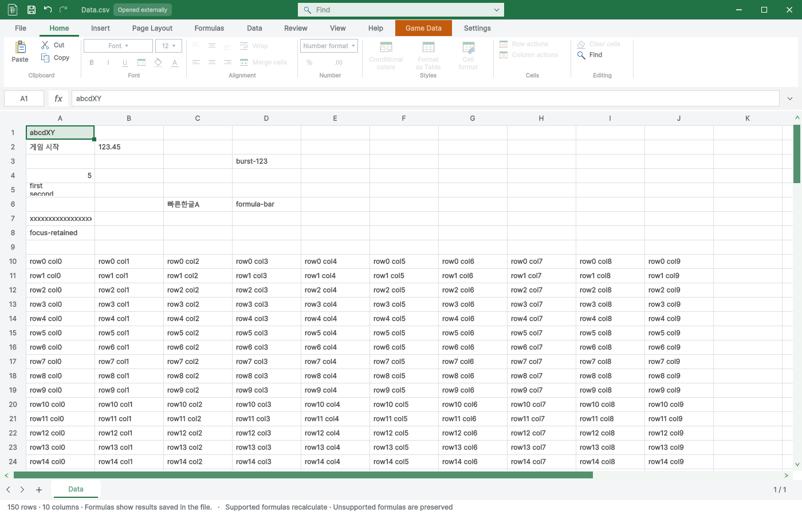

> 보관 기록입니다. 아래 결과는 원문 작성 시점의 내용이며, 이번 편집에서 제품 테스트를 다시 실행하지 않았습니다.

현재 소스 · Windows · Unity 6000.0.83f1

## 발견하고 수정한 문제

첫 화면 갱신 전에 키가 연달아 도착하면 `burst-123`이 `b`만 남았습니다. 텍스트 컨트롤이 포커스를 받기 전까지 후속 문자와 Backspace를 초안에 보존하도록 수정했습니다. 같은 조건과 한글·F2·즉시 Enter 조합을 다시 검사해 통과했습니다.

수정 전 재현 · 수정 후 입력 결과 · 한글 전체 표 TC · 실제 검사 소스 해시

## 이번 실행 결과

XLSX 입력 52개 · CSV 입력 52개 · 닫기 9개(26개 조건) · 표 기능 198개(3271개 조건) · Play 보호 6개 통과. 렌더 12개 상태에서 각각 100회, 총 1,200회 측정했습니다. 컴파일은 경고·오류 0개입니다.

## 입력·저장·반복 검사

| 검사 | XLSX | CSV |
| --- | --- | --- |
| 새 파일은 미저장 표시 없음 | 통과 | 통과 |
| 연속 영문 입력 4자 보존 | 통과 | 통과 |
| Enter 확정 및 다음 행 이동 | 통과 | 통과 |
| 완성 한글·공백 입력과 Tab 이동 | 통과 | 통과 |
| 숫자 입력 및 Shift Tab 역방향 이동 | 통과 | 통과 |
| Escape 초안 취소 시 기존 값 유지 | 통과 | 통과 |
| F2 기존 값 편집·삭제 후 확정 | 통과 | 통과 |
| 중간 Repaint 없는 8키 연속 입력 | 통과 | 통과 |
| 수식 문자열 전체 입력 및 확정 | 통과 | 통과 |
| Alt Enter 셀 내 줄바꿈 | 통과 | 통과 |
| 중간 Repaint 없는 한글 입력 즉시 Enter | 통과 | 통과 |
| F2 포커스 대기 중 문자 입력·Backspace·즉시 Enter | 통과 | 통과 |
| 수식 입력줄 마우스 클릭 후 연속 입력·확정 | 통과 | 통과 |
| 160자 빠른 연속 입력 손실 없음 | 통과 | 통과 |
| 포커스 상실 콜백 뒤 초안 보존 | 통과 | 통과 |
| 내부 클립보드 500셀 붙여넣기 | 통과 | 통과 |
| 500셀 붙여넣기 Undo | 통과 | 통과 |
| 500셀 붙여넣기 Redo | 통과 | 통과 |
| Ctrl S 원본 저장 및 미저장 표시 해제 | 통과 | 통과 |
| 원본 다시 열어 한글·대량 입력 유지 | 통과 | 통과 |
| 반복 입력 1 | 통과 | 통과 |
| 반복 입력 2 | 통과 | 통과 |
| 반복 입력 3 | 통과 | 통과 |
| 반복 입력 4 | 통과 | 통과 |
| 반복 입력 5 | 통과 | 통과 |
| 반복 입력 6 | 통과 | 통과 |
| 반복 입력 7 | 통과 | 통과 |
| 반복 입력 8 | 통과 | 통과 |
| 반복 입력 9 | 통과 | 통과 |
| 반복 입력 10 | 통과 | 통과 |
| 반복 입력 11 | 통과 | 통과 |
| 반복 입력 12 | 통과 | 통과 |
| 반복 입력 13 | 통과 | 통과 |
| 반복 입력 14 | 통과 | 통과 |
| 반복 입력 15 | 통과 | 통과 |
| 반복 입력 16 | 통과 | 통과 |
| 반복 입력 17 | 통과 | 통과 |
| 반복 입력 18 | 통과 | 통과 |
| 반복 입력 19 | 통과 | 통과 |
| 반복 입력 20 | 통과 | 통과 |
| 반복 열기 후 첫 입력 1 | 통과 | 통과 |
| 반복 열기 후 첫 입력 2 | 통과 | 통과 |
| 반복 열기 후 첫 입력 3 | 통과 | 통과 |
| 반복 열기 후 첫 입력 4 | 통과 | 통과 |
| 반복 열기 후 첫 입력 5 | 통과 | 통과 |
| 반복 열기 후 첫 입력 6 | 통과 | 통과 |
| 반복 열기 후 첫 입력 7 | 통과 | 통과 |
| 반복 열기 후 첫 입력 8 | 통과 | 통과 |
| 반복 열기 후 첫 입력 9 | 통과 | 통과 |
| 반복 열기 후 첫 입력 10 | 통과 | 통과 |
| 반복 열기 후 첫 입력 11 | 통과 | 통과 |
| 반복 열기 후 첫 입력 12 | 통과 | 통과 |

## 렌더 성능

각 상태 준비 10회 후 100회 측정. 입력 이벤트 시간에는 강제 Repaint가 포함되어 실제 키보드 지연으로 해석하지 않습니다. Mono 할당량 카운터는 근거로 사용하지 않았습니다.

| 파일 | 조건 | 평균 | P95 | 최대 |
| --- | --- | --- | --- | --- |
| ArcadeText | Edit-Home-top | 15.67 ms | 19.55 ms | 31.17 ms |
| ArcadeText | Edit-Localization-top | 11.09 ms | 14.02 ms | 16.07 ms |
| ArcadeText | Edit-Localization-scrolled | 12.39 ms | 16.49 ms | 21.03 ms |
| ArcadeText | Play-Home-top | 17.52 ms | 22.11 ms | 24.40 ms |
| ArcadeText | Play-Localization-top | 12.98 ms | 17.03 ms | 21.71 ms |
| ArcadeText | Play-Localization-scrolled | 12.73 ms | 15.85 ms | 18.69 ms |
| 게임 데이터 | Edit-Home-top | 12.79 ms | 18.06 ms | 22.22 ms |
| 게임 데이터 | Edit-Localization-top | 10.14 ms | 14.62 ms | 20.51 ms |
| 게임 데이터 | Edit-Localization-scrolled | 10.39 ms | 14.22 ms | 17.53 ms |
| 게임 데이터 | Play-Home-top | 11.62 ms | 15.95 ms | 19.72 ms |
| 게임 데이터 | Play-Localization-top | 9.30 ms | 12.52 ms | 19.24 ms |
| 게임 데이터 | Play-Localization-scrolled | 9.61 ms | 12.85 ms | 20.02 ms |

## 저장·닫기 보호

닫기 취소·저장·버리기, 50회 중복 닫기 요청, 인라인·수식 미확정 초안, 외부 변경으로 인한 저장 실패, 깨끗한 창 닫기, Ctrl W를 다시 검사했습니다.

실제 닫기 결과 · 한글 표 검사 상세 · 컴파일 로그

## Play 보호

등록 게임 데이터·글로벌 Enum의 저장 차단과 원본 불변, 일반 스프레드시트의 편집 허용을 확인했습니다. 자동화 API는 예외 대신 구조화된 오류 응답을 반환하는 현재 계약으로 검사했습니다.

한글 Play 검사 · 실행 근거

## 제출 파일 검사

Python 파생 캐시 포함과 격리 프로젝트 문서 메타데이터 차이를 발견해 정리했습니다. 깨끗한 프로젝트에서 패키지를 재생성한 뒤 원본 파일 1,068개와 메타데이터·GUID를 대조해 차이 0개를 확인했습니다. 이 패키지를 별도의 빈 Unity 프로젝트에 실제 임포트하여 69개 검사도 통과했습니다. 등록 테이블 24개와 바이너리 참조, 예제 씬 25개의 누락 스크립트 0개, 원본 검색 연결을 포함합니다. 씬 검사는 편집 모드에서 로드한 결과이며 모든 게임을 수동 플레이한 결과로 표시하지 않습니다.

최신 QA 패키지 · 패키지 바이트·GUID 검사 · 새 프로젝트 임포트 한글 검사

SHA-256: `464dac9e2451c059883c089fa82ad3b95ee4859c004b96308c28e6b8023419dc`

## 검증 범위

- Windows Unity 6000.0.83f1의 격리 실제 HostView 검사입니다. 사용자 화면·키보드·클립보드를 조작하지 않았습니다.

- 완성된 한글 키 이벤트를 검증했습니다. 실제 Windows IME 조합·키보드 하드웨어 입력은 미확인입니다.

- 렌더 시간은 숨겨진 HostView 호출 시간이며 데스크톱 FPS 또는 실제 체감 입력 지연과 동일하지 않습니다.

- 닫기 검사는 Unity 지연 콜백 펌프를 명시 실행했습니다. 비표시 환경의 자동 지연 콜백 진행을 검증한 것은 아닙니다.

- 기존 테스트 결과를 재사용하지 않고 현재 소스로 다시 실행했습니다. 다른 Unity 버전·운영체제는 검사하지 않았습니다.

실패 — 데이터 디렉터리 잠금으로 노드 시작 실패, rg 사용

제안 시간: 30~50분 · 실제 소요: 33분 43초 · 완료: 2026-10-29 13:20:51 KST

## 원문과 편집 이력

[보존된 원문 열기](../assets/imports/Docs/Testing/2026-10-29/release-final-qa/Report.ko.html)

- 원문 SHA-256: `29c4cf668a956bfb2da82f489b8a25f36a663d4f361ca5367e4c13831e614435`
- 표시 날짜는 원본 파일의 수정 시각입니다. 작업 완료 시각은 원문에 있는 값을 기준으로 확인합니다.
