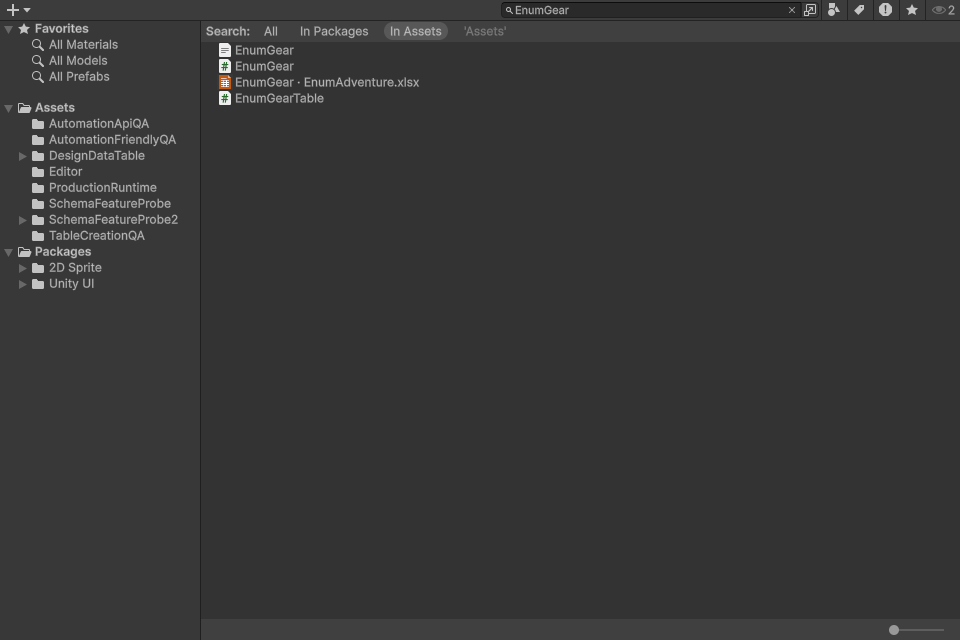

> 보관 기록입니다. 아래 결과는 원문 작성 시점의 내용이며, 이번 편집에서 제품 테스트를 다시 실행하지 않았습니다.

원본 검색·코드 문서 정리

## 원본 검색·코드 주석과 간격 정리

EnumGear 검색에 원본 XLSX 시트 링크가 함께 표시됩니다. 여러 데이터 테이블을 한 원본 파일에 두는 구조를 유지합니다.



## 생성 코드 예시

```
        /// <summary>
        /// Loads rows through the configured asynchronous binary provider.
        /// </summary>
        public async System.Threading.Tasks.Task LoadAsync()
        {
            _datas = await DataLoader.ReadBinaryDictionaryAsync<EnumGear>(Name, Key);
        }

        /// <summary>
        /// Replaces loaded rows by decoding the supplied binary bytes using this table's key.
        /// </summary>
        public void Load(byte[] bytes)
        {
            _datas = DataLoader.ReadBinaryDictionary<EnumGear>(bytes, Key);
        }

        /// <summary>
        /// Loads binary bytes from an asset and rejects a missing asset.
        /// </summary>
        public void Load(UnityEngine.TextAsset asset)
        {
            if (asset == null)
            {
                throw new System.ArgumentNullException(nameof(asset));
            }

            Load(asset.bytes);
        }

        /// <summary>
        /// Releases loaded rows so the next access reads the table again.
        /// </summary>
```

## 검증

| 항목 | 결과 |
| --- | --- |
| 소유CSharp파일 | 448 |
| 문서대상선언 | 5156 |
| XML요약누락 | 0 |
| 재생성테이블 | 24 |
| 바이너리변경 | 0 |
| 검색및연결검사 | 41 |
| 갱신생성코드파일 | 54 |

XML 문서 생성 컴파일 및 Windows 예제 플레이어 빌드: 오류·경고 0개.

## 검색·재생성 검사

- Generated API update preserves binary data: SampleCharacter

- Generated API update preserves binary data: SampleShopProduct

- Generated API update preserves binary data: SampleDropItem

- Generated API update preserves binary data: SampleSkill

- Generated API update preserves binary data: MiniGameBalance

- Generated API update preserves binary data: EnumGear

- Generated API update preserves binary data: EnumEnemies

- Generated API update preserves binary data: ThreeDSettings

- Generated API update preserves binary data: CanyonSettings

- Generated API update preserves binary data: SkyboundSettings

- Generated API update preserves binary data: DefenseSettings

- Generated API update preserves binary data: GolfSettings

- Generated API update preserves binary data: BowlingSettings

- Generated API update preserves binary data: WarehouseSettings

- Generated API update preserves binary data: DroneSettings

- Generated API update preserves binary data: MarbleSettings

- Generated API update preserves binary data: LanderSettings

- Generated API update preserves binary data: CourierSettings

- Generated API update preserves binary data: PotionSettings

- Generated API update preserves binary data: RhythmSettings

- Generated API update preserves binary data: BlocksSettings

- Generated API update preserves binary data: PinballSettings

- Generated API update preserves binary data: ExampleEquipment

- Generated API update preserves binary data: ExampleEnemies

- Two searchable sheet links share one original XLSX

- Original main object remains TextAsset

- Project name search returns original workbook: EnumGear

- Project name search returns original workbook: enumgear

- Project name search returns original workbook: EnumEnemies

- Project name search returns original workbook: EnumAdventure

- Search result accepts registered target: EnumEnemies

- Search result resolves exact source/sheet: EnumEnemies

- Search-only object excluded from player data

- Search result accepts registered target: EnumGear

- Search result resolves exact source/sheet: EnumGear

- Search-only object excluded from player data

- Search link identity survives reimport

- Detach one worksheet registration

- Only detached table search link disappears

- Detached table no longer matches original workbook

- Import/search/detach checks preserve original XLSX bytes

## 범위

- 비표시 실제 Unity ProjectBrowser·Inspector를 캡처했습니다. OS 화면 조작은 하지 않았습니다.

- 원본 검색은 XLSX 내부의 등록 테이블 이름에 적용합니다. 별도 원본 엑셀을 복제하지 않습니다.

- 클래스·메서드·생성자·속성·공개 필드 등의 XML 요약을 확인했습니다. 로컬 함수는 CS1587 경고를 피하기 위해 일반 주석을 사용합니다.

- 주석·공백 처리 단계에서는 에디터/입력 심볼을 켜고 끈 실행 토큰을 대조했습니다. 검색 기능과 생성 템플릿의 의도된 변경은 별도입니다.

- Windows 예제 플레이어 빌드가 성공했습니다. 이번에 모든 게임을 다시 수동 플레이했다는 의미는 아닙니다.

- 일부 기존 설명과 워크북에서 제공된 설명은 보존했습니다. 모든 주석을 사람이 독립적으로 검수했다고 주장하지 않습니다.

상세 근거: CodeAudit/Audit.json / Native/Results.json / Native-Final / PlayerBuild/Result.txt / Docs/LocalizedDocs.json

## 원문과 편집 이력

[보존된 원문 열기](../assets/imports/Docs/Testing/2026-10-29/table-search-code-docs/Report.ko.html)

- 원문 SHA-256: `e59c9c1256f0dc99b37348ea4ca7c63c1cd60f5cfbd486afc6a04fd559a6904b`
- 표시 날짜는 원본 파일의 수정 시각입니다. 작업 완료 시각은 원문에 있는 값을 기준으로 확인합니다.
