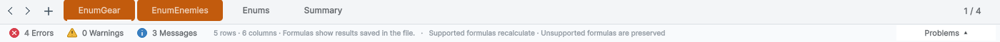
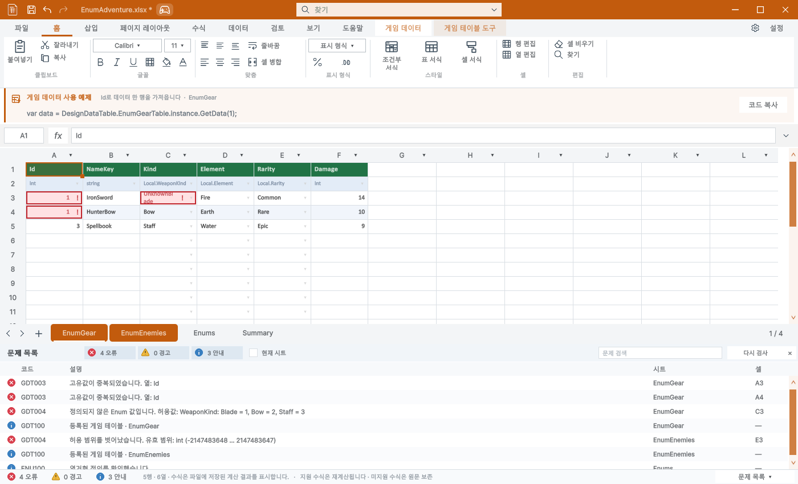
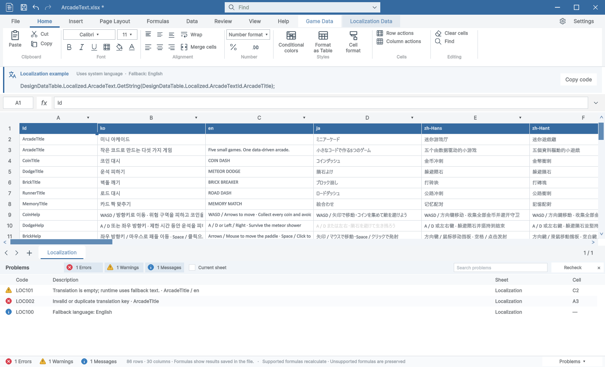

게임 데이터·로컬/전역 Enum·로컬라이징의 검증 결과를 파일별 문제 목록으로 모았습니다. 사용자 원본은 변경하지 않고 분리된 Unity 6000.0.83f1에서 실제 표시와 입력을 검증했습니다.

## 간편 보기

하단 한 줄에 오류·경고·안내 건수를 표시합니다. 건수 또는 문제 목록 버튼을 클릭하면 펼쳐지고, 닫으면 한 줄로 돌아갑니다.

## 펼친 문제 목록

- 코드·설명·시트·셀을 열로 표시합니다.
- 오류·경고·안내와 현재 시트 필터, 코드·설명 검색을 제공합니다.
- 행을 누르면 원본 시트와 셀로 이동합니다. Ctrl+C로 선택한 로그를 복사합니다.
- 위쪽 경계를 끌어 높이를 조절합니다. 수정 후 검증을 분할 갱신하며 다시 검사 버튼도 제공합니다.
- 중복 Id, 타입·범위, 잘못된 Enum 및 삭제된 정의, 로컬라이징 키와 빈 번역을 구분합니다.

## 아이콘과 예외 처리

빨간 오류·황색 경고·파란 안내 아이콘을 추가했습니다. Affinity 3.3.1에서 확인한 편집 원본 DiagnosticIcons.af와 SVG를 Assets/GameArtSources/EditorIcons/Diagnostics에 보관하고 PNG만 에디터에서 사용합니다. 기존 85개 슬롯 뒤에 3개를 추가해 기존 매핑을 유지했습니다.

일반 오류로 표시되던 GUI 흐름 종료 예외는 직접·중첩 ExitGUIException을 다시 전달하도록 수정했습니다. 소스 경로와 중첩 예외 실행으로 확인했으며 모든 팝업의 수동 클릭을 검증했다고 주장하지 않습니다.

## 검증 결과

- 신규 검증 42개 통과: 중복 Id 양쪽 셀, 범위 초과, Enum 삭제, 로컬라이징 오류·경고, 필터·연속 검색 입력·크기 조절·복사·셀 이동 포함.
- 11,000개 오류의 전체 건수와 표시 상한 10,000개, 검사 분할 실행을 확인했습니다. 실제 ArcadeText 프레임 시간 측정 결과는 아닙니다.
- 기존 회귀 검사: Play 잠금 33개, 컨텍스트 리본 208개, Summary·게임 리본 346개 통과.
- 최종 C# 빌드 오류 0·경고 0.
- 32개 UI 화면 재촬영. 9개 언어 가이드·이미지 해시 검사 오류 0. 브라우저 140개 검사 통과.
- 영어·한국어 PDF 총 38쪽의 텍스트·글꼴을 검사하고 변경된 페이지를 렌더링해 확인했습니다.
- 아이콘 88개 안전 여백, 명령 매핑 143개, 두 아틀라스 크기를 확인했습니다.

한글 TC와 실행 증거: 프로젝트 Docs/Testing/2026-10-29/problem-list. 최초 실패 기록은 보존했으며 최종 성공은 Results.json·Complete.txt로 구분합니다. 신규 패널은 9개 언어로 실제 캡처했으며 주요 영어·한국어 화면을 육안 확인했습니다. 나머지 언어 전체 문구의 교정 완료를 의미하지 않습니다.

보고서도 3개 이미지 로드, 데스크톱·모바일 폭, 브라우저 오류 없음과 107개 로컬 링크를 확인했습니다.

## 배포 상태

로컬 구현·빌드·실행 검증·문서 갱신 완료입니다. 커밋·푸시·스토어 제출은 수행하지 않았습니다. 사용자의 열려 있는 프로젝트 전체 동작을 수동으로 전수 검증한 결과는 아닙니다.

## 시간과 검색

- 제안 시간: 30–45분.
- 실제로 완료된 시간: 37분 57초 · 2026-10-29 19:16:36 KST (구현·실행·문서·보고서 검증 기준).
- XERJ: 사용 — 검증 관련 후보 검색 후 현재 소스로 대조했습니다. 관련 심볼 누락은 rg로 보완했습니다.
