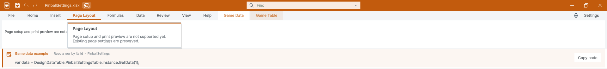

## 작업 결과

공통 모체 연결과 실행 검증은 완료했습니다. 기존 DataTable의 제목줄·게임 데이터 강조색·툴팁 카드 형태를 유지했습니다.

문서 전체 검증은 기존 소스·이미지 해시 불일치 206건 때문에 통과 상태가 아닙니다. 이번 교체한 공통 제목줄·복원 캡처에는 검사 오류가 없습니다.

## 변경 내용

### 적용 내용

WorkbookViewer는 ToolWindow → TemplateWindow를 상속하며, 제품의 저장·Undo·Redo·문서 표시·검색·창 제어 명령을 모체의 DrawTemplateHeader 슬롯으로 전달합니다. 기존 IMGUI 편집 엔진과 기본 배치 값은 유지했습니다.

SpreadsheetScreenTip의 카드 렌더러를 Templete.Runtime.TipCard로 추출했습니다. DataTable의 번역·호버 지연·설명·단축키 처리는 기존 코드가 담당하고, 같은 카드 렌더러를 Pixora와 개발 갤러리도 사용합니다.

9개 가이드의 공통 모체·설정 설명을 갱신하고 실제 제목줄과 창 복원 캡처를 교체했습니다. 과거 매니페스트와 이미지는 Before에 보존했습니다.

## 검증

- 기존 DataTable 스타일·기본 치수·공통 값 반영을 대조한 108개 Unity 실행 검사가 통과했습니다.
- DataTable ↔ Pixora 교차 클릭 8회, Pixora 실제 최소화 후 공통 목록 클릭 복원과 복원 상태 조회를 확인했습니다.
- DataTable 단독 구성과 양방향 패키지 설치, 최종 패키지 재설치·모체 상속을 확인했습니다.
- 원본 개발 프로젝트의 DataTable·공통·Pixora 어셈블리가 16:21 KST에 새로 컴파일됐고 기존 창을 유지했습니다.
- 문서 검사: 9개 언어·현재 이미지 39개, 기존 소스/이미지 해시 오류 206건. 새 공통 제목줄·복원 캡처 오류 0건. 전체 통과로 보고하지 않습니다.

[문서 검사 원문](https://github.com/MDJ0126/TurnRoom/blob/e791f141aef5a82d08175ebf0791475f46bafc50/Artifacts/TempleteQA/DataTableGuides.json) · [기본 스타일 대조](https://github.com/MDJ0126/TurnRoom/blob/e791f141aef5a82d08175ebf0791475f46bafc50/Artifacts/TempleteQA/Layout108.json)

새 캡처의 소스 해시는 CRLF를 LF로 정규화한 뒤 실제 작업 폴더와 Git blob 양쪽에서 대조해 오류 0건을 확인했습니다. 기존 206건의 원본 해시를 갱신해 통과시키지 않았습니다.

## 남은 사항

기존 문서의 206개 소스·이미지 해시 불일치에 대한 전체 재촬영·대조가 남아 있습니다. 원본 해시를 현재 값으로 덮어 통과시키지 않았습니다. 다른 OS·Unity 버전과 스토어 게시 업데이트는 미실행입니다.

## 작업 시간

- 제안 시간: 90–150분. 세 프로젝트를 함께 수행한 통합 작업의 시작 시 제안 시간입니다.
- 실제로 완료된 시간: 통합 구현·검증·프로젝트 푸시·보고서 작성: 2시간 24분 39초. 시작 2026-10-30 14:32:14 KST, 결과 기록 완료 2026-10-30 16:56:54 KST (UTC+09:00). 보고서 공개 게시 확인은 이 기록 생성 이후 별도로 수행합니다.
- XERJ: 사용 — SpreadsheetScreenTip 검색 후보를 활용했습니다. Templete 새 인덱스는 frozen mapping identity 오류로 갱신에 실패해 현재 모체 소스는 rg와 실제 실행으로 대조했습니다. 자동 갱신 활성 여부는 검증하지 않았습니다.
