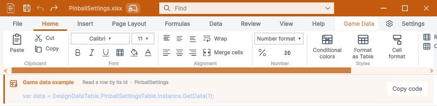

## 작업 결과

원본 아이콘을 그대로 유지하고 기존 호출부를 공통 렌더러에 위임했습니다. 실행 화면과 신규 공통 가이드 화면은 확인했으며 전체 과거 가이드 검사는 미통과입니다.

## 변경 내용

### 적용 내용

SpreadsheetRibbonIcons의 공개 호출을 유지하고 내부를 TemplateIcons로 위임했습니다. 창 제어만 공통 WindowControls로 연결했습니다. 하단 창 목록은 MouseDown 전의 앞 창 그룹을 보존합니다. 아틀라스 위치 변경은 기존 GUID를 보존하며, 과거 캡처의 원본 해시는 바꾸지 않고 이동 경로만 정정했습니다.

## 검증

원본 아틀라스 바이트/두 GUID 보존. 기존 스타일 기준 108개 검사 통과. Pixora와의 실제 교차 선택 통과. 9개 오프라인 가이드 재빌드. 새 공통 제목줄·복원 캡처의 현재 소스 해시 일치. 전체 VerifyLocalizedDocs는 238개 과거 캡처/소스 불일치로 실패했으며 그대로 보존했습니다.

## 남은 사항

Windows / Unity 6000.0.83f1에서 검증했습니다. 다른 OS·배율·물리 모니터 연결 변경은 미확인입니다. DataTable 전체 가이드 검사 238건의 과거 화면/소스 불일치는 남아 있으며 통과로 변경하지 않았습니다. 이번에 다시 캡처한 26개 기록은 현재 소스와 일치합니다. Pixora Undo/Redo 기능을 새로 추가한 것은 아닙니다.

## 작업 시간

- 제안 시간: 40~80분
- 실제로 완료된 시간: 시작 2026-10-30 17:16:52 KST · 구현·실행 검증 및 프로젝트 푸시 완료. 보고 작성 시점 2026-10-30 18:37:25 KST, 경과 80.6분. 보고서 공개 배포 확인은 별도 단계입니다.
- XERJ: 사용 — Tools/Search/Xerj.ps1 Status 및 Search PreserveVisiblePeer 호출. 후보를 현재 WindowFocus/WindowFrame/WorkbookNativeWindow 소스와 네이티브 실행 기록으로 확인했습니다.
