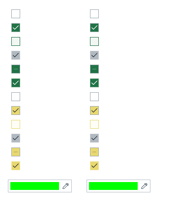

## 작업 결과

체크박스와 색상 필드의 기존 그리기 코드를 공통 모체에 위임했습니다. 제품의 기존 입력 처리와 업무 로직은 유지했습니다.

## 변경 내용

### 적용 내용

체크박스와 색상 필드의 기존 그리기 코드를 공통 모체에 위임했습니다. 제품의 기존 입력 처리와 업무 로직은 유지했습니다.

교훈 검토: 내부 컨트롤의 실제 입력·선택값과 로드된 빌드를 확인하는 프로젝트 QA를 AGENTS.md에 반영했습니다. 전역은 기존 실제 원본·실행 대조 및 증거 우선 규칙과 중복되므로 변경하지 않았습니다. 신규 비트맵 디자인 없이 DataTable 원본 아이콘·그리기 코드를 재사용했습니다.

## 검증

원본 IMGUI 대 공통 IMGUI 13개 픽셀 비교가 모두 일치했습니다. UITK와 IMGUI의 픽셀 동일성을 주장하는 검사는 아닙니다. 현재 공유 헤더·복원 화면을 갱신했습니다. 기존 전체 문서 검사는 259건 실패로 별도 보존했습니다.

## 남은 사항

기존 DataTable 문서 전체 검사 259건은 미해결입니다. 이번 갱신 화면 관련 오류는 0건입니다. 다른 Unity 버전은 미검증입니다.

## 작업 시간

- 제안 시간: 20~40분
- 실제로 완료된 시간: 121.2분 · 구현/실행 검증 시각 2026-10-30 20:46:21 KST. 공개 배포 확인은 후속 메뉴얼에 기록.
- XERJ: 사용 — XERJ Vector3Field 검색에서 해당 Pixora 소스 누락을 확인하여 rg와 현재 소스로 보완.
