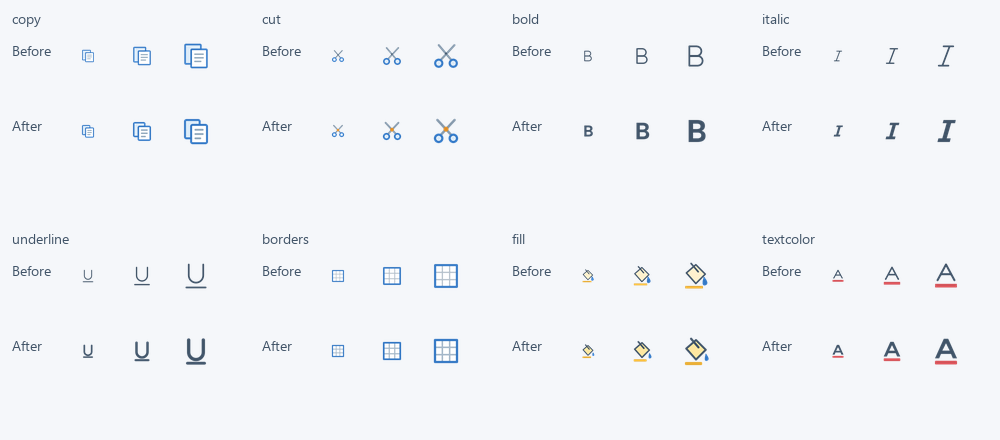

## 작업 결과

8종 재설계·적용과 실제 Unity 가져오기62개 검사를 마쳤습니다. 실제 홈 탭 화면 재촬영은 화면 조작 금지에 따라 미실행입니다.

## 변경 내용

### 적용 내용

잘라내기·복사·굵게·기울임·밑줄·테두리·채우기·글자색을 수정했습니다. B/I는 채운 실루엣, U는 굵기를 맞춘 선으로 만들었습니다. 복사·잘라내기는 파랑/회색, 색상 도구는 빨강/노랑/파랑 의미 색상을 유지합니다. 정상·화이트 atlas와 개별 PNG를 갱신했으며 기존 GUID·명령 별칭은 유지합니다. 다른88종은 픽셀이 동일합니다. 재설치 도구도 SVG 오버라이드를 유지하도록 수정했습니다. 편집 가능한8개 SVG와 출력물을 프로젝트 HomeRefinement 폴더에 보관했습니다.

아이콘 원본을16·24·32px로 출력해 검토한 비교입니다. 실제 프로그램 스크린샷으로 대체하지 않습니다.

## 검증

| 검증 | 결과 |
|---|---|
| 실제 Unity6000.0.83f1 batchmode/nographics | 62검사 통과·실패0 |
| 실제 atlas import | 크기512×768·밉맵OFF·alpha 처리 |
| 8종 컬러/화이트 | 모서리 투명·실루엣 확인 |
| 명령 연결 | 공통 아이콘과 워크북 별칭·UV 확인 |
| 영향 범위 | 다른88종 픽셀 동일 |
| 기본 재설치 회귀 | 오버라이드 포함 전체 atlas 픽셀 동일 |
| 작은 출력 | 16·24·32px 실제 래스터 출력 시각 검토 |

[Unity 결과](../assets/home-icon-refinement/unity-results.json) · [픽셀 비교](../assets/home-icon-refinement/pixel-checks.json)

Affinity CLI doctor/status는 ECONNREFUSED였습니다. 앱 실행·재시작·포커스 전환을 하지 않았으며 SVG를 headless Chromium으로 렌더링했습니다. Affinity에서 편집·내보낸 것으로 보고하지 않습니다.

## 남은 사항

실제 홈 탭 실행 화면과 밝은/어두운 배경의 최종 UI 검증·9개 언어 스크린샷 갱신은 미실행입니다. ScreenshotManifest에 미검증 범위를 기록하고 기존 캡처 해시는 유지했습니다. Native .af master에8개 SVG를 병합하고 Affinity 재열기·재출력 대조도 남아 있습니다. 사용자 첨부 화면의 외부 공개 준비는 자동 승인 검토에서 거부되어 게시 범위에서 제외했습니다. 교훈 검토: 기존의 실제 원본·적용 경로 대조와 도구 실패·화면 미검증 구분 지침 적용, 전역 변경 없음.

## 작업 시간

- 제안 시간: 10–15분
- 실제로 완료된 시간: 구현·비대화형 검증 5분 45초, 2026-10-31 20:10:22 KST. 공개 배포 확인은 별도 진행.
- XERJ: 사용 — XERJ Ribbon Cut Copy Bold icon 검색으로 SpreadsheetRibbon·WorkbookViewerEditing 후보를 찾고 현재 소스·TemplateIcons와 atlas를 대조했습니다.
