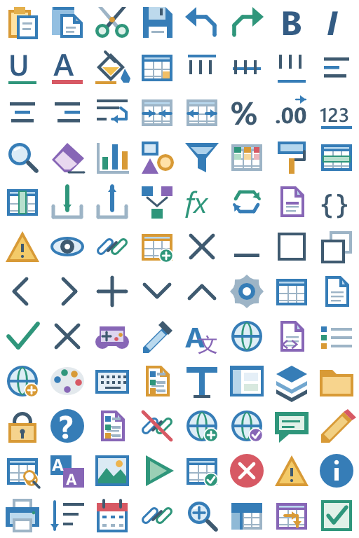
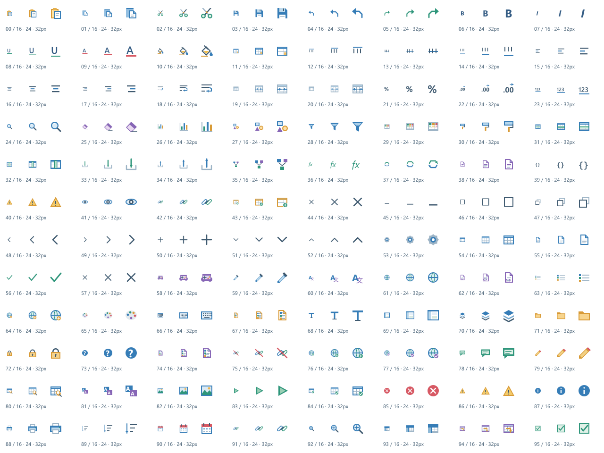

## 작업 결과

컬러·화이트96종을 실제 Affinity 네이티브 벡터로 제작·저장하고 적용했습니다. Unity414검사 및 원본 재열기 픽셀 대조를 통과했습니다. 실제 Unity 리본 화면 캡처는 미실행입니다.

## 변경 내용

### 적용 내용

선 굵기만 변경한 이전 대체안을 교체했습니다. 복사·잘라내기·글꼴·정렬·표·차트·도형·설정·게임 데이터·로컬라이징·진단 등 공통96슬롯을 재설계했습니다.692개의 새 네이티브 벡터/텍스트 노드를 사용합니다. 의미 색상은 파랑·초록·주황·보라·빨강입니다. 타이틀바의 화이트 버전도 별도 Affinity 원본입니다. 기존 명령 별칭·UV·텍스처 GUID는 유지했습니다.

원본 기준 폴더: Assets/TurnRoom/Templete/Development/Art/ColorIcons. 최신 컬러·화이트 .af, 전체 PNG, Exports/Commands의96개 개별 출력, IconCatalog.json, SourceScripts와 README에 모았습니다. 런타임 복사 경로는 README에 표시했습니다. 이전 SVG 덮어쓰기 도구는 비활성화했습니다.

위 이미지는 실제 Affinity의 아트 출력입니다. Unity 리본 화면 캡처가 아닙니다.

## 검증

| 검사 | 실제 결과 |
|---|---|
| Affinity 앱 |3.3.1.4940 실제 MCP 연결 |
| 네이티브 제작 |96종·새 벡터/텍스트692개 |
| 원본 저장 | 프로젝트 내 .af 일반 저장 성공 |
| 재열기 | 닫기→다시 열기→전체 RGBA 동일 |
| 실제 출력 | NodeRenderingEngine으로 래스터화, PixelBuffer로64px 자르기 및 Affinity에서16/24/32px 축소 |
| 호스트 파일 저장 | 받은 RGBA를 수정 없이 PNG로 직렬화 |
| 컬러 변화 | 이전 대비96슬롯 모두 픽셀 변경 |
| 화이트 | 불투명 픽셀 모두 흰색 |
| Unity6000.0.83f1 batchmode |414검사·실패0 |
| 투명도 |96개 여백·코너 alpha 검증 |

[실제 검사 결과](../assets/affinity-native-v5/checks.json)

MCP의 새 경로 saveAs/export는 PERMISSION_DENIED였습니다. 파일을 프로젝트에서 정상적으로 열고 in-place save하는 지원 방식으로 원본을 저장했습니다. Native raster engine의 메모리 출력을 사용했으며 바탕화면·권한 변경·다른 그림 도구를 쓰지 않았습니다.

## 남은 사항

실제 Unity 홈·컨텍스트 탭의 최종 실행 화면과9개 언어 문서 재촬영은 미실행입니다. Computer Use node_repl 도구가 이번 세션에 제공되지 않아 GUI 입력/캡처를 수행하지 않았습니다. 런타임 프로젝트 파일 아이콘의 사용자 색상 생성 경로는 기존 기능을 유지했습니다. 교훈 검토: 최신 전역 지침이 실제 Affinity 필수·실패 시 임의 대체 금지를 이미 명시하여 중복 추가 없음.

## 작업 시간

- 제안 시간: 최초8종10–15분 → 전체 확장25–40분 제안 → 사용자 지정20분(약21:00부터21:20 KST)
- 실제로 완료된 시간: 최초 시작2026-10-31 20:31:09 KST. 전체96종 구현·비대화형 검증 21:15:01 KST. 공개 배포 확인은 별도.
- XERJ: 사용 — XERJ TemplateIcons StatusIconTexture 검색 후 현재 원본·명령 atlas와 경로 대조
