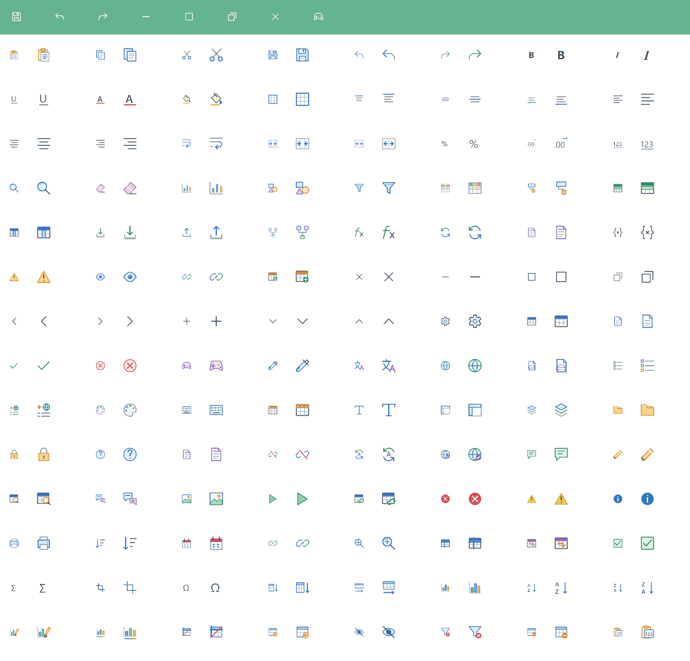
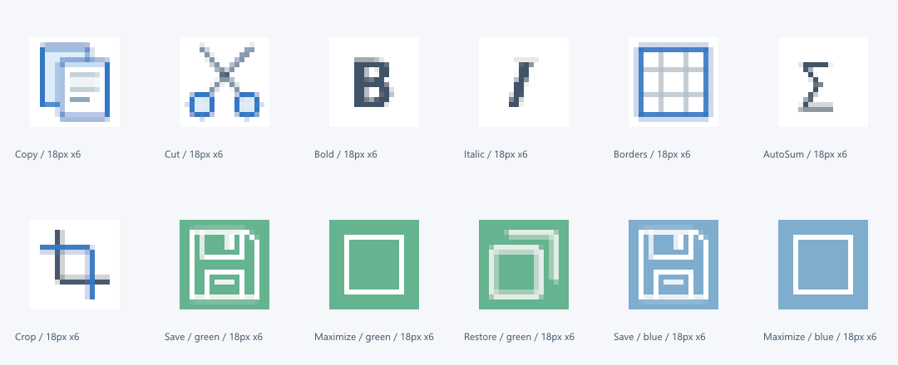

## 작업 결과

실제 Affinity에서 보정·제작한112종을 검증 후 적용했습니다. Direct3D11 렌더 검사1473개가 통과했습니다. 실제 Unity 창의 마우스·메뉴 상호작용 검증은 미실행입니다.

## 변경 내용

### 적용 내용

이전v4의 곡선·둥근 모서리·색상을 유지하며 광학 크기와 획을 정리했습니다. B/I/U·글자색·수치 표기·세로 정렬10종을 실제 글꼴과 기준선으로 다듬었습니다. 기울임 I는 확대 검토에서 사선처럼 보이는 문제를 찾아 세리프 글꼴로 재수정했습니다. 자동합계·자르기·기호·방향 채우기·통계·오름/내림차순·차트 스타일/색상·고정 해제·범위 변환·숨기기·필터 지우기·등록 해제·값 붙여넣기에16종 전용 아이콘을 만들고 잘못된 별칭을 제거했습니다.

원본·출력·개별 PNG·목록은 Templete/Development/Art/ColorIcons 한 기준 폴더에 보관했습니다. 최신 원본은 Color/White/Extras/ExtrasWhite-v6.af 네 개입니다. 타이틀바 White는 밝은 내부 면을 Erase로 뚫어 사각형으로 메워지지 않게 했습니다.

실제 Unity 그래픽 장치와 UI 셰이더로 출력한 검사 화면입니다. 전체 편집기 창의 클릭 QA 화면으로 대신하지 않습니다.

확대는 실제 Affinity에서 수행했으며 Unity18px 출력의 픽셀을 변경하지 않았습니다.

## 검증

| 검증 | 실제 결과 |
|---|---|
| 실제 크기 | UITemplate small/quick18px, ribbon26px 확인 |
| UnityGPU |Direct3D11,1473검사 통과·실패0 |
|16개 기능 연결 | 실제 Workbook 경유 별칭·전용 텍스처·UV 대조 |
|112종 출력 |18px·26px에서 빈 그림/전체 사각형 여부 검사 후 시각 대조 |
| 화이트 | 녹색·파란색 바탕의 실제18px 저장/최대화/복원 내부가 배경과 일치 |
| 패스 |926곡선·9470제어점, 빈/길이0/채워진 열린 패스/비정상 좌표/중복 검사 오류0 |
| 원본 정리 | 숨겨진 루트 작업1413개 제거 전후 전체393216픽셀씩 동일 |
| 재열기 | Affinity 연결 종료 뒤4개 저장 원본 재열기 확인; 이후 I 수정·정리 저장 및 픽셀 대조 |
| 적용 안전성 | 검사 중 기존v4 유지, 통과한 QA 리소스와 바이트 동일한 파일만 적용 |

[세부 QA](../assets/refined-icons-v6/qa.json) · [112종 의미·기능 연결 목록](../assets/refined-icons-v6/semantics.json)

제작·곡선 보정·자르기·픽셀 확대는 실제 Affinity3.3.1에서 실행했습니다. 호스트는 Affinity 메모리 출력의 RGBA를 변경 없이 PNG로 직렬화했습니다. 바탕화면 및 외부 그림 도구를 사용하지 않았습니다.

## 남은 사항

전체 Unity 창의 클릭·호버·최소화 등 상호작용 검증과9개 언어 문서 재촬영은 미실행입니다. 기존 캡처 해시를 최신 화면처럼 갱신하지 않았습니다. 패스 검사는 Native Curve의 닫힘·빈 경로·좌표·중복 범위이며, 모든 곡선의 수학적 자기 교차를 완전 증명한 것은 아닙니다. Affinity 연결이 한 차례 종료됐으며 저장된 원본을 재열어 복구했습니다. 원인은 미확인으로 남깁니다. 교훈 검토: 실제 표시 크기와 내부 투명 공간 검증을 적용했으며, 전역의 실제 Affinity·품질 검증 지침과 중복되어 새 전역 규칙은 추가하지 않았습니다.

## 작업 시간

- 제안 시간: 25–40분. 작업 중 사용자가 픽셀·패스 검토를 추가로 강조했습니다.
- 실제로 완료된 시간: 2026-10-31 21:33:41 KST 시작. 구현·검증·적용 22:14:34 KST, 공개 배포 확인 별도.
- XERJ: 사용 — TemplateIcons ArtworkIndex WindowControls 검색 결과를 현재 코드·UITemplate 값·실제16개 명령 처리와 대조했습니다. 오래된 검색 결과는 현재 소스로 교정했습니다.
