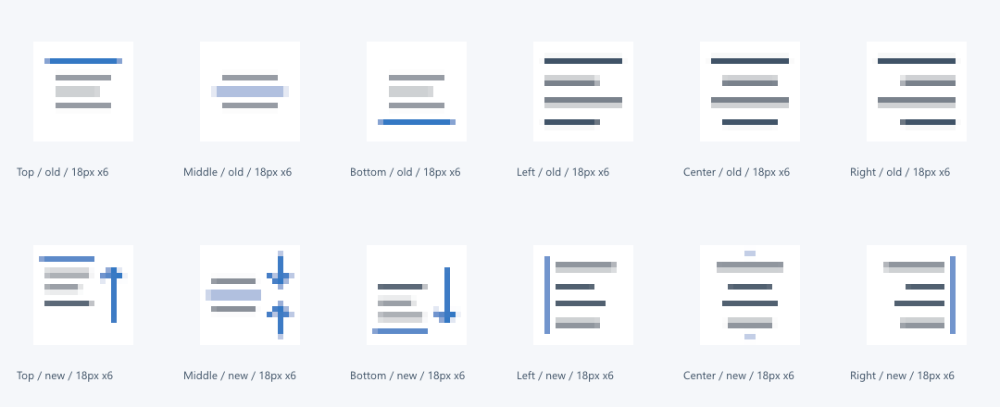
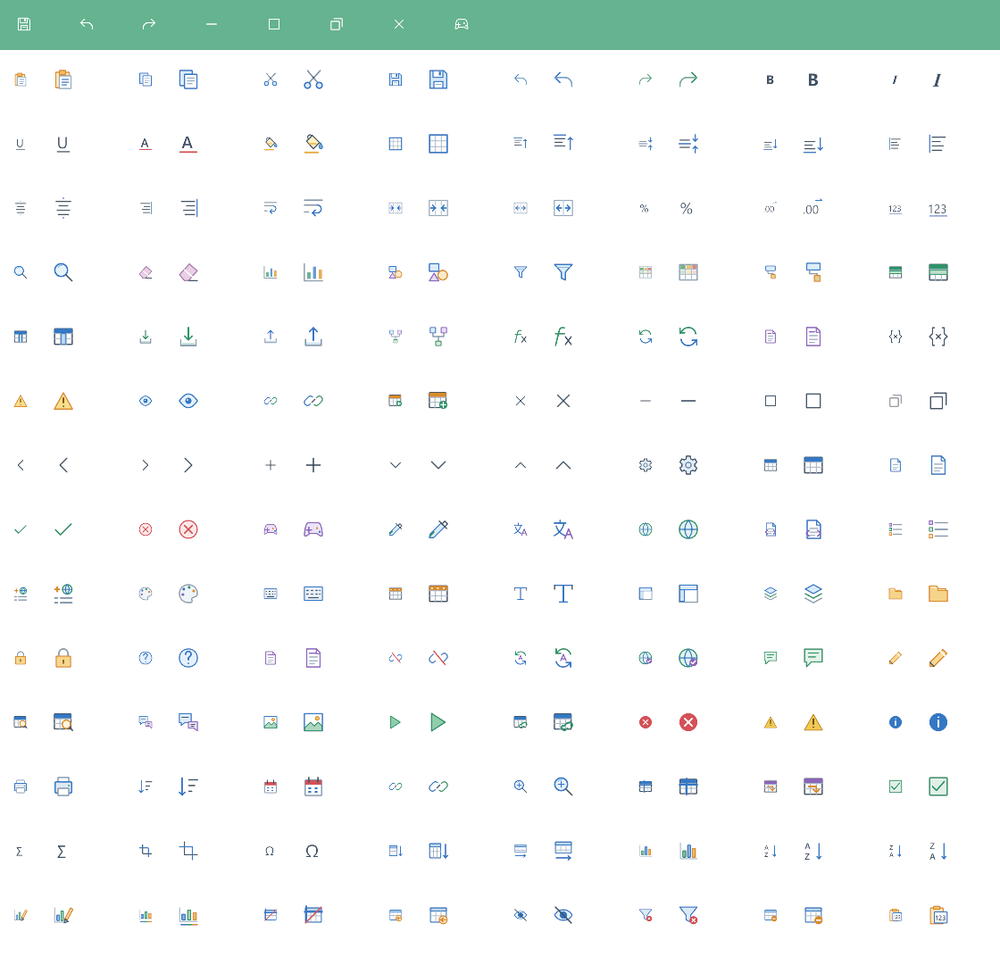

## 작업 결과

실제 Affinity에서 정렬6종과 채우기·글자색8종을 수정하고18px 실루엣 비교와1489검사 통과 후 적용했습니다. 실제 Unity 패널 클릭 재촬영은 미실행입니다.

## 변경 내용

### 적용 내용

위 정렬은 위쪽 화살표와 상단 기준선, 세로 가운데는 안쪽으로 모이는 두 화살표와 중앙선, 아래 정렬은 아래 화살표와 하단선으로 바꿨습니다. 왼쪽·오른쪽은 서로 반대쪽 축을 표시하고, 가로 가운데는 길이가 다른 네 줄을 대칭 배치했습니다. 채우기는 페인트통·흘러내리는 방울·노란 표시선, 글자색은 선명한 A와 색상선으로 보정했습니다. 다른88개 컬러·88개 화이트 타일은 픽셀 버퍼가 동일합니다. 창 제어의 사용자 색상 처리와 투명 마스크 구조도 유지했습니다.

실제 UnityGPU18px 출력을 Affinity에서 nearest-neighbour6배 확대했습니다. 전체 Unity 패널 클릭 QA 화면을 대신하는 이미지는 아닙니다.

## 검증

| 검증 | 결과 |
|---|---|
|18px 실루엣15쌍 | 모두 구분, 최소 다른 픽셀12→28 |
| 위/가운데 |26→92픽셀 차이 |
| 위/아래 |28→84픽셀 차이 |
| 가운데/아래 |26→92픽셀 차이 |
| 왼쪽/중앙 |12→28픽셀 차이 |
| 왼쪽/오른쪽 |24→48픽셀 차이 |
| 중앙/오른쪽 |12→28픽셀 차이 |
| 실제UnityGPU |Direct3D11,1489검사·실패0 |
| 다른 아이콘 |176개 타일 버퍼 동일 |
| 패스 |빈/길이0/채워진 열린 경로/비정상 좌표/중복 검출0 |
| 흰색 저장·최대화·복원 |기존18px 내부 투명도 회귀 통과 |

[세부 QA](../assets/alignment-icons-v7/qa.json) · [15쌍 실루엣 비교 CSV](../assets/alignment-icons-v7/separation.csv)

실루엣 비교는 색상 구분을 제외한 foreground mask의 서로 다른 픽셀 수입니다. 이 수치만으로 사람의 이해를 보장한다고 해석하지 않고 실제18px 확대본도 함께 검토했습니다.

## 남은 사항

실제 Unity 패널의 클릭·호버 재촬영은 미실행입니다. 기존 문서 캡처 해시를 갱신해 새 화면처럼 표시하지 않았습니다. 패스 검사는 NativeCurve의 닫힘·빈 경로·좌표·중복 범위이며 모든 자기 교차를 완전 증명한 것은 아닙니다. 교훈 검토: 기존 실제 크기·목적·투명 공간 지침을 적용했으며 전역 추가 없음.

## 작업 시간

- 제안 시간: 8–12분
- 실제로 완료된 시간: 2026-10-31 22:31:40 KST 시작, 구현·검증·적용 22:43:01 KST. 공개배포 확인은 별도.
- XERJ: 사용 — alignment.top alignment.vertical sheet.left 검색 후 실제SpreadsheetRibbon 배치와 현재소스를 대조했습니다.
