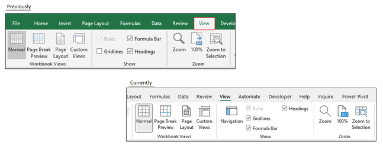
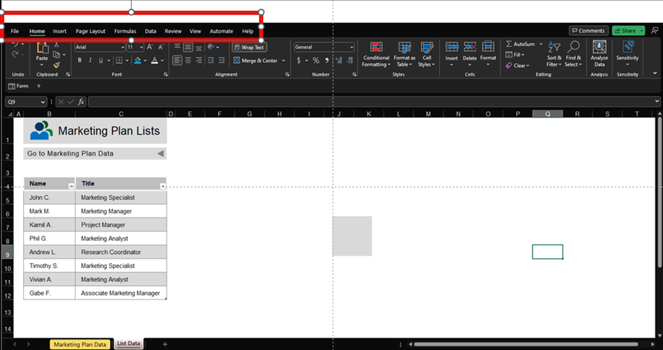
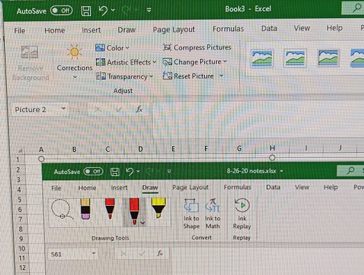
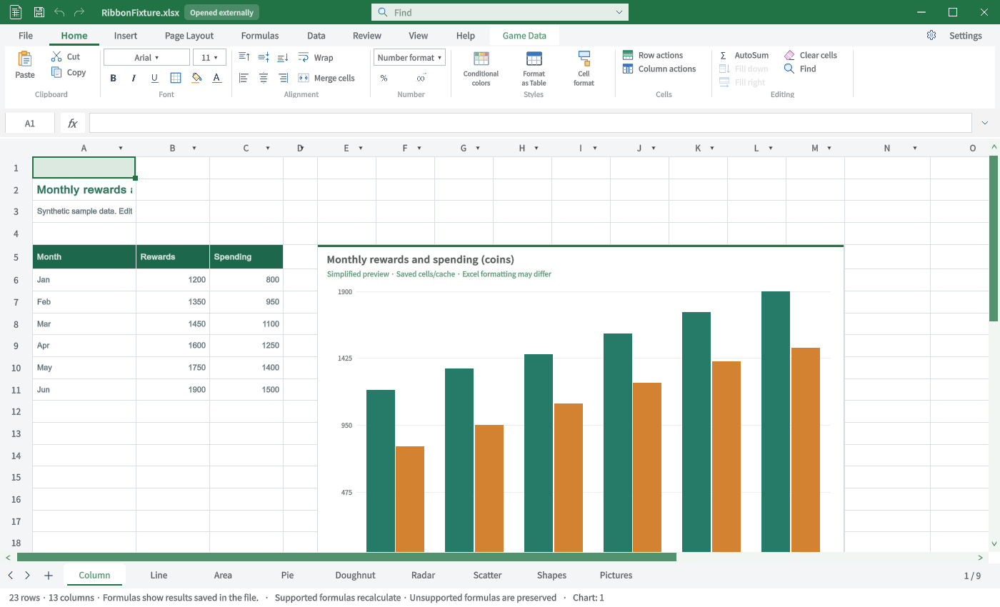
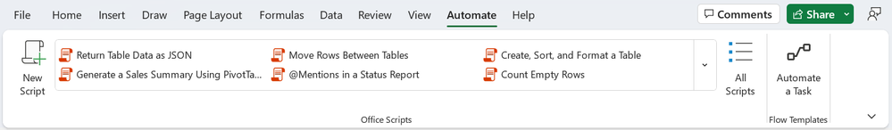
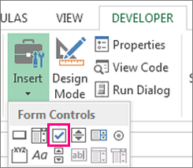
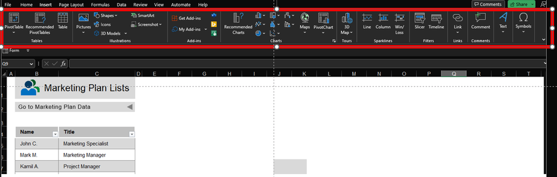
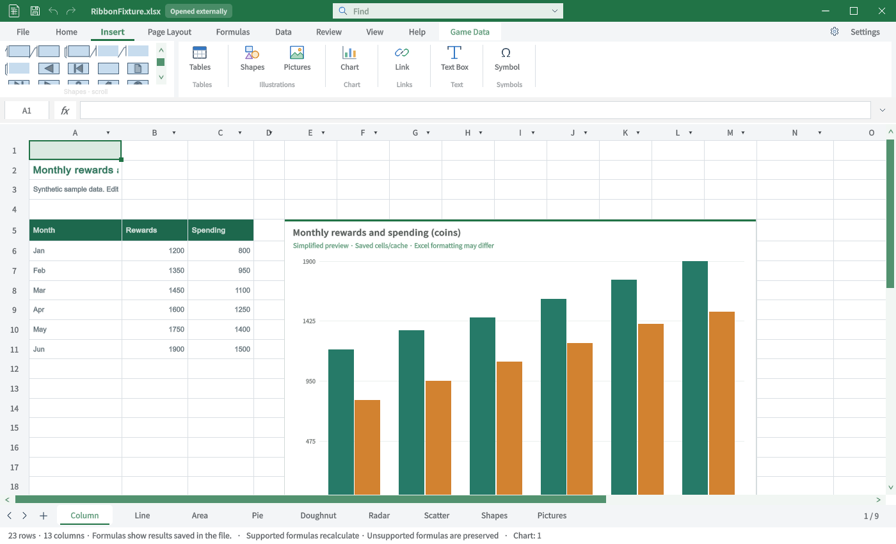

## 작업 결과

6개 탭의 비교 TC입니다. 전체 Excel 동등성 통과 보고가 아닙니다.

## 변경 내용

### 적용 내용

### TC-RIB-08 · 보기 — 불일치

| 항목 | 내용 |
|---|---|
| 실행 절차 | 보기 탭을 선택합니다. |
| 기대 동작 | 통합 문서 보기·표시·확대/축소·창 그룹을 대조합니다. |
| 실제 결과 | 고정·해제·개체·시트·보기 메뉴는 보이지만 원본의 보기/확대 그룹 구성과 다릅니다. |
| 재QA·수정 필요 | 고정·해제·확대·창별 개별 실행 회귀. |

### TC-RIB-09 · 도움말 — 비교자료 부족

| 항목 | 내용 |
|---|---|
| 실행 절차 | 도움말을 선택합니다. |
| 기대 동작 | 도움말 탭의 실제 명령을 대조합니다. |
| 실제 결과 | 현재 디버그·버그 보고·수식 버튼 표시. 원본에는 Help 탭 이름만 보여 명령 대조는 미실행입니다. |
| 재QA·수정 필요 | 원본 Help 선택 화면 확보 및 명령 실행. |

### TC-RIB-10 · 그리기 — 기능 미구현

| 항목 | 내용 |
|---|---|
| 실행 절차 | 그리기 탭 진입점을 찾습니다. |
| 기대 동작 | 펜·잉크·다시 재생 등의 탭을 제공합니다. |
| 실제 결과 | 현재 탭 목록과 소스에 그리기 탭이 없습니다. 원본은 실제 Excel Draw 화면입니다. |
| 재QA·수정 필요 | 그리기 기능·탭 미구현. |

### TC-RIB-11 · 자동화 — 기능 미구현

| 항목 | 내용 |
|---|---|
| 실행 절차 | 자동화 탭 진입점을 찾습니다. |
| 기대 동작 | Office Scripts 목록과 스크립트 진입점을 대조합니다. |
| 실제 결과 | 현재 Automate 탭은 없습니다. 제품의 MCP·CLI를 Office Scripts와 동일한 기능으로 계산하지 않습니다. |
| 재QA·수정 필요 | Office Scripts 호환 기능 미구현. |

### TC-RIB-12 · 개발 도구 — 기능 미구현

| 항목 | 내용 |
|---|---|
| 실행 절차 | 개발 도구 탭 진입점을 찾습니다. |
| 기대 동작 | 컨트롤·코드·디자인 모드 그룹을 대조합니다. |
| 실제 결과 | Developer 탭과 VBA/폼 컨트롤 진입점이 없습니다. |
| 재QA·수정 필요 | 개발 도구 미구현. |

### TC-RIB-13 · 추가 기능 — 기능 미구현

| 항목 | 내용 |
|---|---|
| 실행 절차 | 삽입의 추가 기능 그룹을 확인합니다. |
| 기대 동작 | 추가 기능 진입점을 대조합니다. |
| 실제 결과 | 현재 Get/My Add-ins 진입점이 없습니다. 원본은 삽입 탭의 추가 기능 그룹이며 별도 Add-ins 탭 전체는 아닙니다. |
| 재QA·수정 필요 | 별도 Add-ins 원본 확보·추가 기능 연동. |

## 검증

Unity6000.0.83f1 / Windows / 영어 / 실제 Editor GUIView Direct3D11 캡처입니다. 별도 QA 프로젝트에서 실행했으며 모형·AI 이미지는 사용하지 않았습니다. Excel은 출처의 게시 원본이며 이 PC에서 직접 촬영한 화면이 아닙니다.

### TC-RIB-08 · 사진 대조

| Excel 원본 | TurnRoom 현재 |
|---|---|
|  |  |

원본 범위: 부분 원본·정확한 빌드 미확인. [원본 출처](https://techcommunity.microsoft.com/discussions/excelgeneral/view-ribbon-tab-checkboxes-no-longer-aligned/3989915)

### TC-RIB-09 · 사진 대조

| Excel 원본 | TurnRoom 현재 |
|---|---|
|  |  |

원본 범위: 전체 Help 리본 아님. [원본 출처](https://techcommunity.microsoft.com/blog/nonprofittechies/getting-familiar-with-microsoft-excel/3756412/)

### TC-RIB-10 · 사진 대조

| Excel 원본 | TurnRoom 현재 |
|---|---|
|  |  |

원본 범위: Excel Draw 화면·사진 촬영 자료. [원본 출처](https://learn.microsoft.com/en-us/answers/questions/5070058/cant-exit-the-drawing-tool-in-excel)

### TC-RIB-11 · 사진 대조

| Excel 원본 | TurnRoom 현재 |
|---|---|
|  |  |

원본 범위: Excel Automate 원본. [원본 출처](https://techcommunity.microsoft.com/blog/microsoft365insiderblog/automate-tasks-with-office-scripts-in-excel-for-windows-and-mac/4216151)

### TC-RIB-12 · 사진 대조

| Excel 원본 | TurnRoom 현재 |
|---|---|
|  |  |

원본 범위: Developer 컨트롤 부분 원본. [원본 출처](https://support.microsoft.com/en-us/excel/form-controls)

### TC-RIB-13 · 사진 대조

| Excel 원본 | TurnRoom 현재 |
|---|---|
|  |  |

원본 범위: 삽입 Add-ins 그룹 부분 원본. [원본 출처](https://techcommunity.microsoft.com/blog/nonprofittechies/getting-familiar-with-microsoft-excel/3756412/)

## 남은 사항

명령 전체를 클릭·저장·재열기한 전수 동작 QA는 아닙니다. 화면 표시와 기능 실행 판정을 분리했습니다. 없는 기능은 미구현으로 기록했고 차단으로 바꾸지 않았습니다.

[39개 TC 원본 데이터](../assets/ribbon-tab-tc-20261031/cases.json) · [캡처·출처·SHA256](../assets/ribbon-tab-tc-20261031/manifest.json)

로컬 Excel 실행경로를 확보하지 못해 동일 빌드의 원본 직접 촬영은 미실행입니다. 일부 참조는 구형 Windows 또는 Excel 웹의 부분 화면입니다. 제품 저장소 커밋·푸시는 미실행입니다.

교훈: 원본의 실제 제품·탭을 확인하고 부분 자료를 전체 대조로 계산하지 않습니다. 기존 전역 지침 범위이므로 전역 변경 없음.

## 작업 시간

- 제안 시간: 최초15–25분. 전체 탭 비교 요청 추가 후35–50분 예상.
- 실제로 완료된 시간: 2026-10-31 22:49:21 KST 시작. 최신 캡처23:14:04 KST 완료, 이 문서 작성23:23 KST. 기능 전체 완료 시각이 아닙니다.
- XERJ: 사용 — XERJ ContextualTabs 검색 후 현재 소스·원본 ZIP·Unity 실행과 대조
