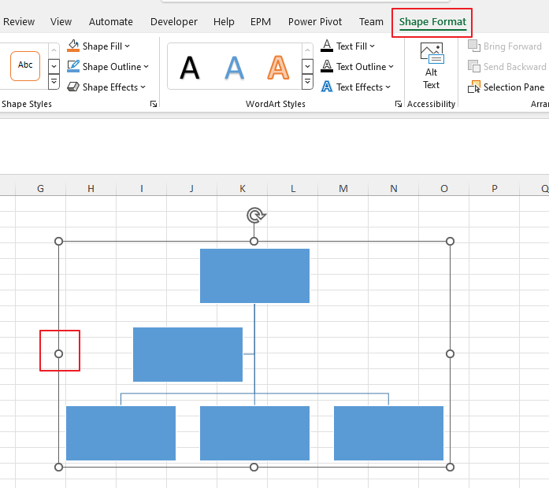
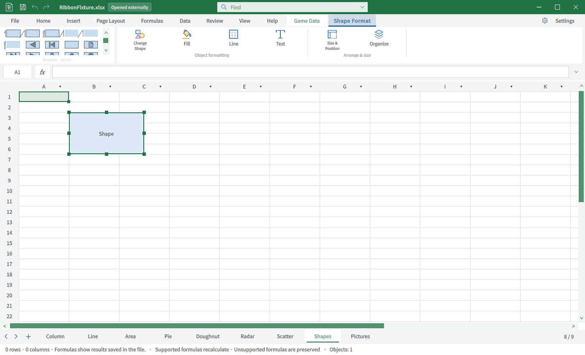
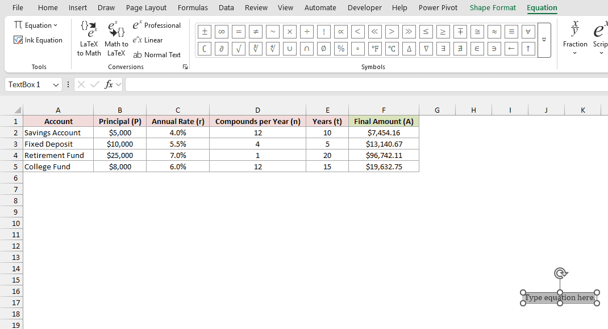
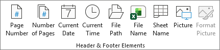
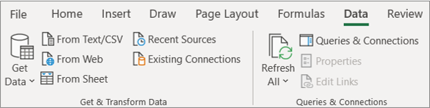
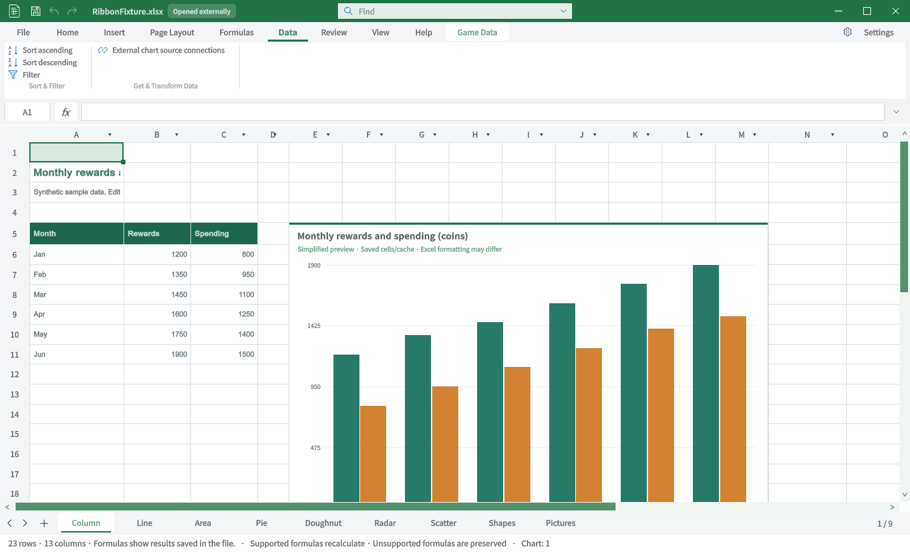

## 작업 결과

6개 탭의 비교 TC입니다. 전체 Excel 동등성 통과 보고가 아닙니다.

## 변경 내용

### 적용 내용

### TC-RIB-28 · SmartArt 서식 — 비교자료 부족

| 항목 | 내용 |
|---|---|
| 실행 절차 | SmartArt 관련 서식 경로를 확인합니다. |
| 기대 동작 | 관련 개체의 서식·스타일을 제공합니다. |
| 실제 결과 | 현재 일반 도형 서식만 있습니다. 원본도 Shape Format으로 표시되므로 별도 SmartArt Format 탭 존재 근거로 쓰지 않습니다. |
| 재QA·수정 필요 | Excel 버전별 서식 탭 관계 확인·SmartArt 기능 미구현. |

### TC-RIB-29 · 그래픽 서식 — 기능 미구현

| 항목 | 내용 |
|---|---|
| 실행 절차 | 관련 개체 삽입·선택 경로를 확인합니다. |
| 기대 동작 | SVG 선택 시 그래픽 서식 |
| 실제 결과 | 기존 자료525942316d775e.png는 Word 화면이므로 Excel 대조 원본에서 제외. 현재 해당 개체 편집·탭 진입점이 없습니다. |
| 재QA·수정 필요 | 해당 Excel 원본 확보·기능 미구현. |

### TC-RIB-30 · 3D 모델 서식 — 기능 미구현

| 항목 | 내용 |
|---|---|
| 실행 절차 | 관련 개체 삽입·선택 경로를 확인합니다. |
| 기대 동작 | 3D 모델 선택 시 보기·정렬 |
| 실제 결과 | 기존 자료185bd57246926c.png는 PowerPoint 화면이므로 Excel 대조 원본에서 제외. 현재 해당 개체 편집·탭 진입점이 없습니다. |
| 재QA·수정 필요 | 해당 Excel 원본 확보·기능 미구현. |

### TC-RIB-31 · 수식 디자인 — 기능 미구현

| 항목 | 내용 |
|---|---|
| 실행 절차 | 관련 개체 삽입·선택 경로를 확인합니다. |
| 기대 동작 | 수식 개체 선택 시 디자인 |
| 실제 결과 | 원본 Equation 탭과 실제 Excel 개체 화면 확보. 현재는 Equation 삽입·전용 탭이 없습니다. |
| 재QA·수정 필요 | 수식 개체 편집·전용 탭 미구현. |

### TC-RIB-32 · 머리글·바닥글 — 기능 미구현

| 항목 | 내용 |
|---|---|
| 실행 절차 | 머리글·바닥글 전용 편집 경로를 확인합니다. |
| 기대 동작 | 페이지 번호·날짜·파일명 등의 요소를 비교합니다. |
| 실제 결과 | 현재 리본에는 전용 탭이 없습니다. 페이지 설정 내부 저장 기능과 전용 탭 제공을 구분합니다. |
| 재QA·수정 필요 | 전용 편집 탭·직접 선택 실행 미구현. |

### TC-RIB-33 · 쿼리 편집 — 기능 미구현

| 항목 | 내용 |
|---|---|
| 실행 절차 | 쿼리 개체의 전용 편집 진입을 확인합니다. |
| 기대 동작 | 쿼리 선택·편집 탭을 제공합니다. |
| 실제 결과 | 현재 외부 차트 소스 연결만 표시합니다. 원본은 데이터 가져오기 그룹이며 Query 전용 탭 원본이 아닙니다. |
| 재QA·수정 필요 | Query 전용 원본 확보·기능 미구현. |

## 검증

Unity6000.0.83f1 / Windows / 영어 / 실제 Editor GUIView Direct3D11 캡처입니다. 별도 QA 프로젝트에서 실행했으며 모형·AI 이미지는 사용하지 않았습니다. Excel은 출처의 게시 원본이며 이 PC에서 직접 촬영한 화면이 아닙니다.

### TC-RIB-28 · 사진 대조

| Excel 원본 | TurnRoom 현재 |
|---|---|
|  |  |

원본 범위: SmartArt 파생 개체의 Shape Format. [원본 출처](https://learn.microsoft.com/en-us/answers/questions/5368523/smartart-in-excel-can-t-find-text-pane-no-arrow-on)

### TC-RIB-29 · 사진 대조

| Excel 원본 | TurnRoom 현재 |
|---|---|
| 해당 Excel 원본 미확보 · 사진 대조 미실행 |  |

원본 범위: Excel 원본 미확보.

### TC-RIB-30 · 사진 대조

| Excel 원본 | TurnRoom 현재 |
|---|---|
| 해당 Excel 원본 미확보 · 사진 대조 미실행 |  |

원본 범위: Excel 원본 미확보.

### TC-RIB-31 · 사진 대조

| Excel 원본 | TurnRoom 현재 |
|---|---|
|  |  |

원본 범위: SpreadsheetPlanet 직접 작성 Excel Microsoft365 Windows 원본. [원본 출처](https://spreadsheetplanet.com/insert-equation-excel/)

### TC-RIB-32 · 사진 대조

| Excel 원본 | TurnRoom 현재 |
|---|---|
|  |  |

원본 범위: Header/Footer Elements 부분 원본. [원본 출처](https://support.microsoft.com/en-us/excel/headers-and-footers-in-a-worksheet)

### TC-RIB-33 · 사진 대조

| Excel 원본 | TurnRoom 현재 |
|---|---|
|  |  |

원본 범위: Data Get & Transform 부분 자료. [원본 출처](https://support.microsoft.com/en-us/excel/about-power-query-in-excel)

## 남은 사항

명령 전체를 클릭·저장·재열기한 전수 동작 QA는 아닙니다. 화면 표시와 기능 실행 판정을 분리했습니다. 없는 기능은 미구현으로 기록했고 차단으로 바꾸지 않았습니다.

[39개 TC 원본 데이터](../assets/ribbon-tab-tc-20261031/cases.json) · [캡처·출처·SHA256](../assets/ribbon-tab-tc-20261031/manifest.json)

로컬 Excel 실행경로를 확보하지 못해 동일 빌드의 원본 직접 촬영은 미실행입니다. 일부 참조는 구형 Windows 또는 Excel 웹의 부분 화면입니다. 제품 저장소 커밋·푸시는 미실행입니다.

교훈: 원본의 실제 제품·탭을 확인하고 부분 자료를 전체 대조로 계산하지 않습니다. 기존 전역 지침 범위이므로 전역 변경 없음.

## 작업 시간

- 제안 시간: 최초15–25분. 전체 탭 비교 요청 추가 후35–50분 예상.
- 실제로 완료된 시간: 2026-10-31 22:49:21 KST 시작. 최신 캡처23:14:04 KST 완료, 이 문서 작성23:23 KST. 기능 전체 완료 시각이 아닙니다.
- XERJ: 사용 — XERJ ContextualTabs 검색 후 현재 소스·원본 ZIP·Unity 실행과 대조
