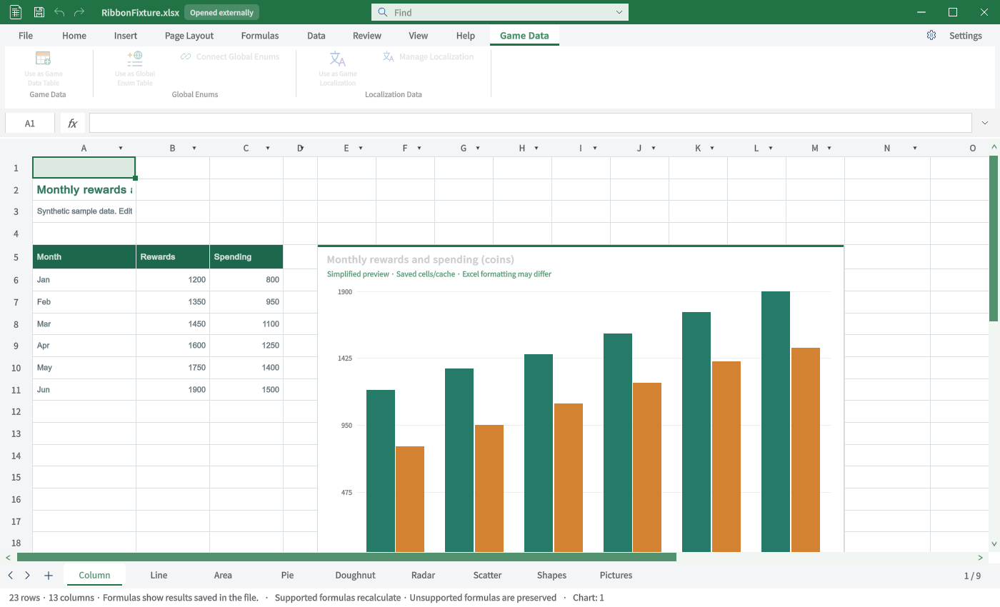
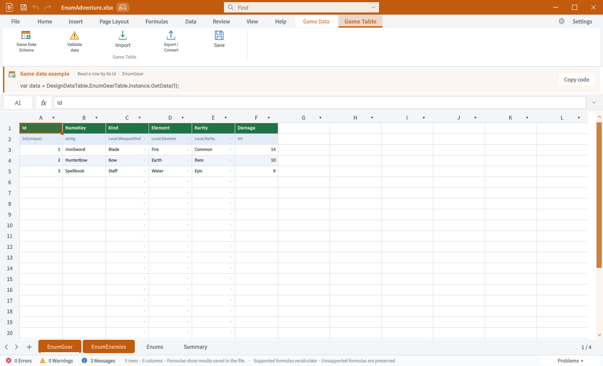
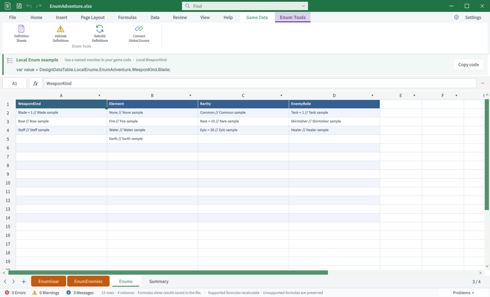
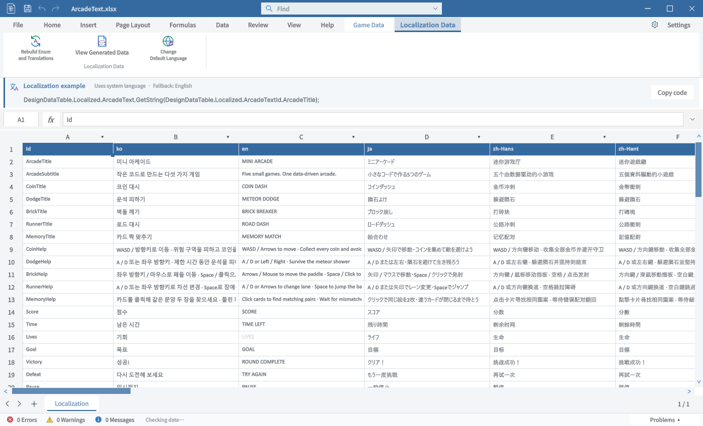
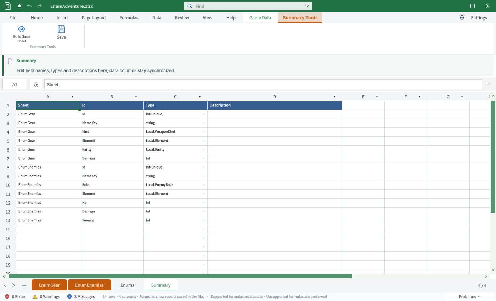
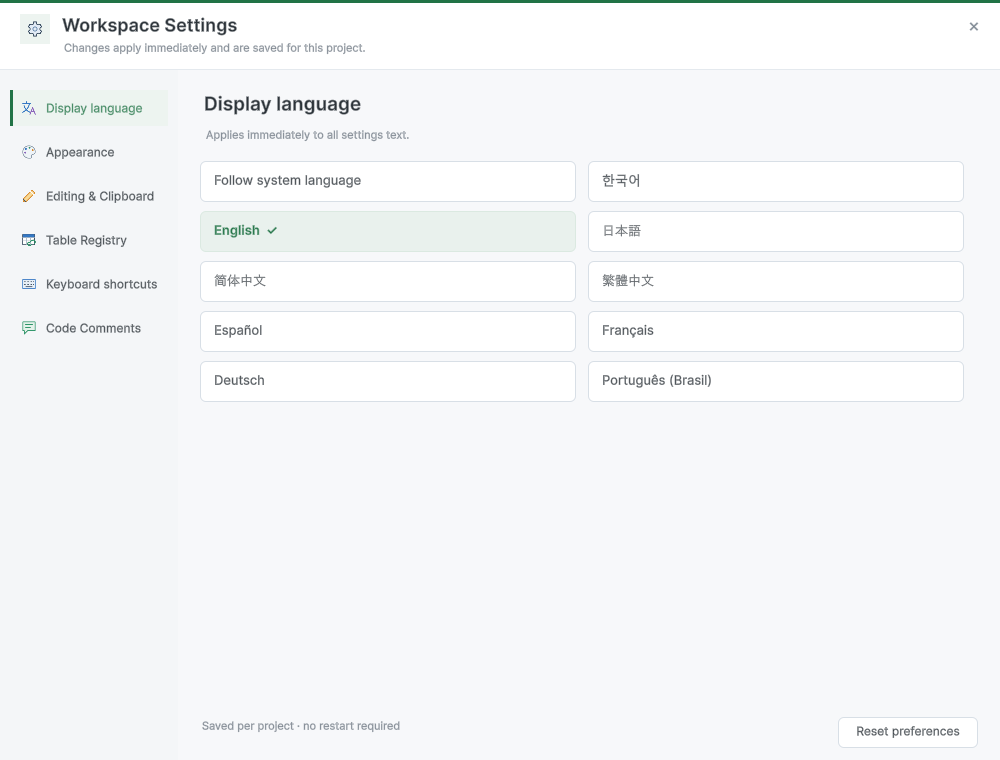

## 작업 결과

6개 탭의 비교 TC입니다. 전체 Excel 동등성 통과 보고가 아닙니다.

## 변경 내용

### 적용 내용

### TC-RIB-34 · 게임 데이터 — 표시 확인·동작 일부 미실행

| 항목 | 내용 |
|---|---|
| 실행 절차 | 게임 데이터 탭 선택 |
| 기대 동작 | 등록 종류별 그룹과 창 색상 일관성 |
| 실제 결과 | 일반·글로벌Enum·로컬라이징 그룹 표시. 프로젝트 외부 파일에서는 등록 버튼 비활성. |
| 재QA·수정 필요 | 화면 표시 외 명령의 전체 클릭·저장·잠금 검사는 미실행. |

### TC-RIB-35 · 게임 테이블 도구 — 표시 확인·동작 일부 미실행

| 항목 | 내용 |
|---|---|
| 실행 절차 | EnumGear 선택 |
| 기대 동작 | 게임 테이블 전용 도구·사용 예제 |
| 실제 결과 | 스키마·검증·가져오기·내보내기·저장 및 사용 예제 표시. |
| 재QA·수정 필요 | 화면 표시 외 명령의 전체 클릭·저장·잠금 검사는 미실행. |

### TC-RIB-36 · 열거형 도구 — 표시 확인·동작 일부 미실행

| 항목 | 내용 |
|---|---|
| 실행 절차 | Enums 시트 선택 |
| 기대 동작 | Enum 전용 도구·사용 예제 |
| 실제 결과 | 정의 시트·검증·재생성·글로벌 연결 및 사용 예제 표시. |
| 재QA·수정 필요 | 화면 표시 외 명령의 전체 클릭·저장·잠금 검사는 미실행. |

### TC-RIB-37 · 로컬라이징 — 표시 확인·동작 일부 미실행

| 항목 | 내용 |
|---|---|
| 실행 절차 | ArcadeText 선택 |
| 기대 동작 | 번역 전용 도구·대체 언어·예제 |
| 실제 결과 | 재생성·데이터 보기·기본 언어·예제 표시. |
| 재QA·수정 필요 | 화면 표시 외 명령의 전체 클릭·저장·잠금 검사는 미실행. |

### TC-RIB-38 · 서머리 도구 — 표시 확인·동작 일부 미실행

| 항목 | 내용 |
|---|---|
| 실행 절차 | Summary 시트 선택 |
| 기대 동작 | 서머리 전용 도구와 안내 |
| 실제 결과 | 게임 시트 이동·저장·설명 표시. |
| 재QA·수정 필요 | 화면 표시 외 명령의 전체 클릭·저장·잠금 검사는 미실행. |

### TC-RIB-39 · 설정 — 표시 확인·동작 일부 미실행

| 항목 | 내용 |
|---|---|
| 실행 절차 | 환경 설정 열기 |
| 기대 동작 | 우측 설정 위치와 읽기 쉬운 패널 |
| 실제 결과 | 우측 설정 진입과 실제 설정 패널 캡처. |
| 재QA·수정 필요 | 화면 표시 외 명령의 전체 클릭·저장·잠금 검사는 미실행. |

## 검증

Unity6000.0.83f1 / Windows / 영어 / 실제 Editor GUIView Direct3D11 캡처입니다. 별도 QA 프로젝트에서 실행했으며 모형·AI 이미지는 사용하지 않았습니다. Excel은 출처의 게시 원본이며 이 PC에서 직접 촬영한 화면이 아닙니다.

### TC-RIB-34 · 사진 대조

| Excel 원본 | TurnRoom 현재 |
|---|---|
| Excel 대응 원본 없음·제품 고유 기능 |  |

원본 범위: Excel 대응 원본 없음·제품 고유 기능.

### TC-RIB-35 · 사진 대조

| Excel 원본 | TurnRoom 현재 |
|---|---|
| Excel 대응 원본 없음·제품 고유 기능 |  |

원본 범위: Excel 대응 원본 없음·제품 고유 기능.

### TC-RIB-36 · 사진 대조

| Excel 원본 | TurnRoom 현재 |
|---|---|
| Excel 대응 원본 없음·제품 고유 기능 |  |

원본 범위: Excel 대응 원본 없음·제품 고유 기능.

### TC-RIB-37 · 사진 대조

| Excel 원본 | TurnRoom 현재 |
|---|---|
| Excel 대응 원본 없음·제품 고유 기능 |  |

원본 범위: Excel 대응 원본 없음·제품 고유 기능.

### TC-RIB-38 · 사진 대조

| Excel 원본 | TurnRoom 현재 |
|---|---|
| Excel 대응 원본 없음·제품 고유 기능 |  |

원본 범위: Excel 대응 원본 없음·제품 고유 기능.

### TC-RIB-39 · 사진 대조

| Excel 원본 | TurnRoom 현재 |
|---|---|
| Excel 대응 원본 없음·제품 고유 기능 |  |

원본 범위: Excel 대응 원본 없음·제품 고유 기능.

## 남은 사항

명령 전체를 클릭·저장·재열기한 전수 동작 QA는 아닙니다. 화면 표시와 기능 실행 판정을 분리했습니다. 없는 기능은 미구현으로 기록했고 차단으로 바꾸지 않았습니다.

[39개 TC 원본 데이터](../assets/ribbon-tab-tc-20261031/cases.json) · [캡처·출처·SHA256](../assets/ribbon-tab-tc-20261031/manifest.json)

로컬 Excel 실행경로를 확보하지 못해 동일 빌드의 원본 직접 촬영은 미실행입니다. 일부 참조는 구형 Windows 또는 Excel 웹의 부분 화면입니다. 제품 저장소 커밋·푸시는 미실행입니다.

교훈: 원본의 실제 제품·탭을 확인하고 부분 자료를 전체 대조로 계산하지 않습니다. 기존 전역 지침 범위이므로 전역 변경 없음.

## 작업 시간

- 제안 시간: 최초15–25분. 전체 탭 비교 요청 추가 후35–50분 예상.
- 실제로 완료된 시간: 2026-10-31 22:49:21 KST 시작. 최신 캡처23:14:04 KST 완료, 이 문서 작성23:23 KST. 기능 전체 완료 시각이 아닙니다.
- XERJ: 사용 — XERJ ContextualTabs 검색 후 현재 소스·원본 ZIP·Unity 실행과 대조
