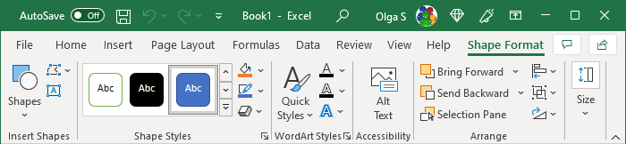
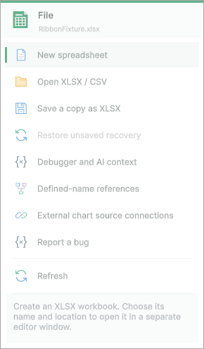
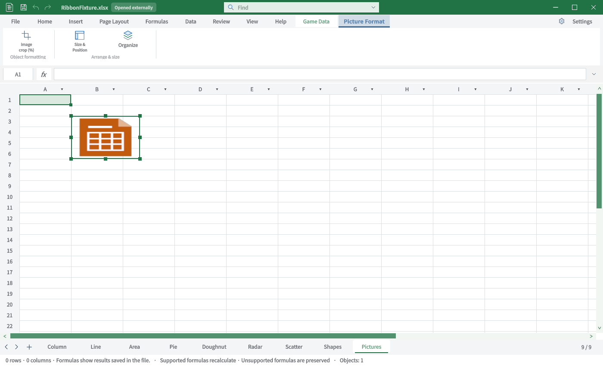
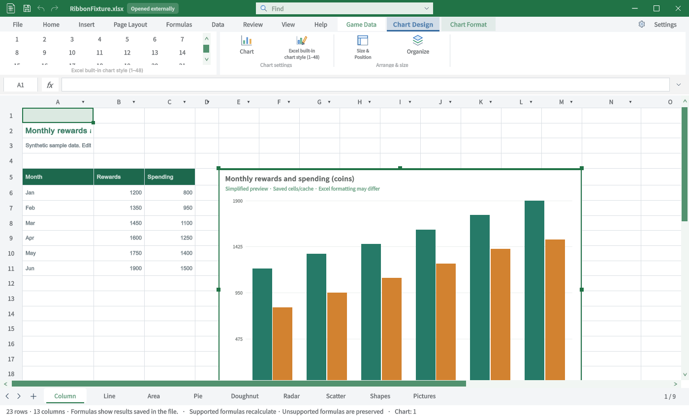
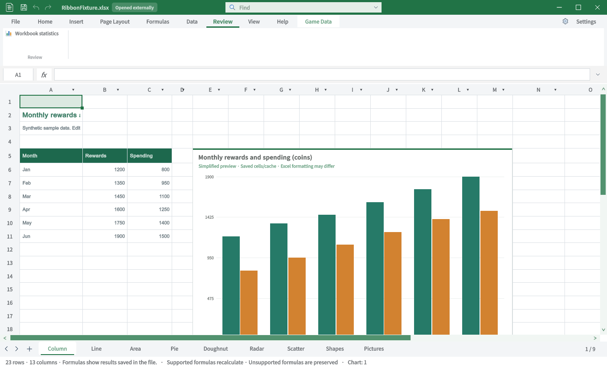

## 작업 결과

기준58묶음의 누락 없이 TC 연결을 남겼습니다. 기능 및 사진 대조 통과가 아닙니다.

## 변경 내용

### 적용 내용

### TC-RIB-40 · 빠른 실행 도구 — 비교자료 부족

절차: 해당 전용 탭 또는 진입점을 현재 리본에서 확인합니다.

기대: 저장·Undo·Redo·제목 표시

실제: 현재 저장·Undo·Redo 진입점 표시. 클릭·저장 실패의 이번 회차 GUI 검사는 미실행.

재QA: 원본 전체 화면·정확한 버전 및 해당 명령 실행 검증 필요.

### TC-RIB-41 · 인쇄 미리보기 — 비교자료 부족

절차: 해당 전용 탭 또는 진입점을 현재 리본에서 확인합니다.

기대: Print Preview 전용 탭·인쇄 설정

실제: 현재 파일 메뉴와 기본 탭에는 Print Preview 진입점이 없음.

재QA: 원본 전체 화면·정확한 버전 및 해당 명령 실행 검증 필요.

### TC-RIB-42 · 배경 제거 — 비교자료 부족

절차: 해당 전용 탭 또는 진입점을 현재 리본에서 확인합니다.

기대: 그림 선택 후 배경 제거 전용 탭

실제: 현재 그림 서식에는 자르기·크기·개체 관리만 있고 배경 제거 진입점이 없음.

재QA: 원본 전체 화면·정확한 버전 및 해당 명령 실행 검증 필요.

### TC-RIB-43 · 구형 차트 레이아웃 — 비교자료 부족

절차: 해당 전용 탭 또는 진입점을 현재 리본에서 확인합니다.

기대: 기준 목록 TabChartToolsLayout 명령군

실제: 현재 Chart Design/Format만 생성. 구형 독립 Layout 탭은 없음. 현대 버전과 같은 탭 구성이라고 간주하지 않음.

재QA: 원본 전체 화면·정확한 버전 및 해당 명령 실행 검증 필요.

### TC-RIB-44 · 구형 피벗 차트 레이아웃 — 비교자료 부족

절차: 해당 전용 탭 또는 진입점을 현재 리본에서 확인합니다.

기대: 기준 목록 TabPivotChartToolsLayout 명령군

실제: 현재 피벗 차트 편집 진입점 및 독립 Layout 탭 없음.

재QA: 원본 전체 화면·정확한 버전 및 해당 명령 실행 검증 필요.

### TC-RIB-45 · BI 시각화 도구 — 비교자료 부족

절차: 해당 전용 탭 또는 진입점을 현재 리본에서 확인합니다.

기대: 기준 목록 TabBIVisualTools의 활성 조건과 명령

실제: 목록의6개 레코드만 확인. 현재 전용 탭 없음. 정확한 원본 버전·활성 조건은 미확인.

재QA: 원본 전체 화면·정확한 버전 및 해당 명령 실행 검증 필요.

### TC-RIB-46 · 접근성 작성 도구 — 비교자료 부족

절차: 해당 전용 탭 또는 진입점을 현재 리본에서 확인합니다.

기대: 기준 목록 TabAccessibleAuthoring의 활성 조건과 명령

실제: 현재 검토에는 통계만 표시. 원본 전체 전용 탭과 활성 조건 미확인.

재QA: 원본 전체 화면·정확한 버전 및 해당 명령 실행 검증 필요.

## 검증

### TC-RIB-40 · 사진

| Excel | TurnRoom |
|---|---|
|  |  |

### TC-RIB-41 · 사진

| Excel | TurnRoom |
|---|---|
| 원본 미확보 · 대조 미실행 |  |

### TC-RIB-42 · 사진

| Excel | TurnRoom |
|---|---|
| 원본 미확보 · 대조 미실행 |  |

### TC-RIB-43 · 사진

| Excel | TurnRoom |
|---|---|
| 원본 미확보 · 대조 미실행 |  |

### TC-RIB-44 · 사진

| Excel | TurnRoom |
|---|---|
| 원본 미확보 · 대조 미실행 |  |

### TC-RIB-45 · 사진

| Excel | TurnRoom |
|---|---|
| 원본 미확보 · 대조 미실행 |  |

### TC-RIB-46 · 사진

| Excel | TurnRoom |
|---|---|
| 원본 미확보 · 대조 미실행 |  |

## 남은 사항

원본 미확보 항목은 실제 사진 대조 미실행입니다. [58묶음 연결](../assets/ribbon-tab-tc-20261031/source-bucket-coverage.json) · [전체46TC](../assets/ribbon-tab-tc-20261031/all-cases.json)

## 작업 시간

- 제안 시간: 전체 탭 비교 추가 후35–50분
- 실제로 완료된 시간: 2026-10-31 22:49:21 KST 시작, 보충 TC 작성23:27 KST. 전체 기능 완료 아님.
- XERJ: 사용 — XERJ 후보와 ContextualTabs·SpreadsheetRibbon 현재 소스를 대조
