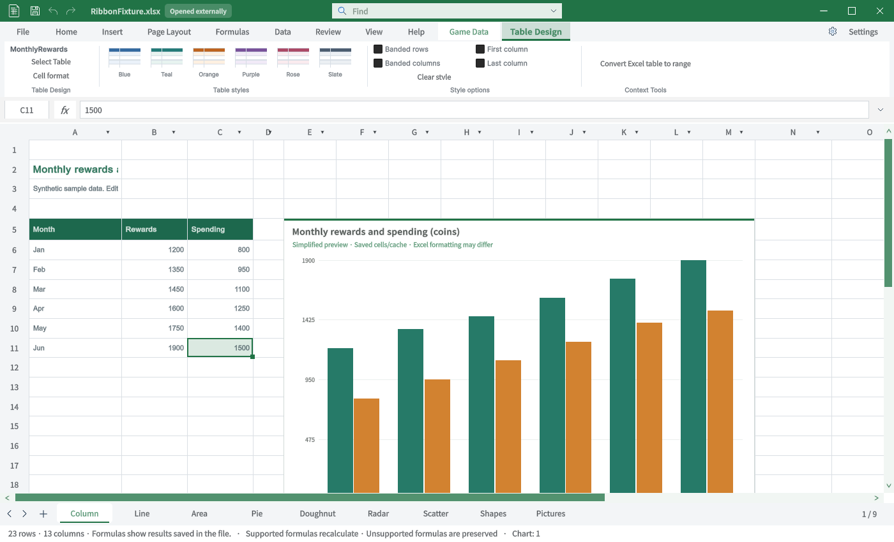

## 작업 결과

탭별 TC와 사진 대조 결과를 아래7개 문서로 나누었습니다. Excel 동등성이나 전체 기능 QA 통과 상태가 아닙니다.

## 변경 내용

### 적용 내용

| TC 범위 | 탭별 사진·실행 결과 |
|---|---|
| TC-RIB-01–TC-RIB-07 | [일반 탭 1](2026-10-31-result-20261031142330298-v1.0.0.html) |
| TC-RIB-08–TC-RIB-13 | [일반 탭 2](2026-10-31-result-20261031142330620-v1.0.0.html) |
| TC-RIB-14–TC-RIB-20 | [특수탭 1](2026-10-31-result-20261031142330937-v1.0.0.html) |
| TC-RIB-21–TC-RIB-27 | [특수탭 2](2026-10-31-result-20261031142331218-v1.0.0.html) |
| TC-RIB-28–TC-RIB-33 | [특수탭 3](2026-10-31-result-20261031142331493-v1.0.0.html) |
| TC-RIB-34–TC-RIB-39 | [게임 데이터·설정](2026-10-31-result-20261031142331773-v1.0.0.html) |
| TC-RIB-40–TC-RIB-46 | [구형·기준 목록 보충](2026-10-31-result-20261031142546909-v1.0.0.html) |

원본58묶음에는 구형 별칭과 Backstage·컨텍스트 메뉴가 포함되어 있습니다. [58묶음 → TC 연결](../assets/ribbon-tab-tc-20261031/source-bucket-coverage.json)에서 빠진 항목 없이 확인할 수 있습니다. 리본 탭이 아닌 두 묶음은 명시해 구분했습니다.

이번 구현: ChartGallery A5:C11 실제 표 등록, 차트1–48번호 선택 목록, 삽입 탭 도형187종 스크롤 목록.9개 언어 가이드도 갱신했습니다.

v1.0.1 집계 정정: 보충 TC의 빠른 실행 원본1건을 포함하면 사진 원본이 연결된 케이스는30개입니다.

## 검증

Unity6000.0.83f1의 실제 Editor GUIView를 Direct3D11로 캡처했습니다. 소프트웨어 목업·AI 이미지가 아닙니다. 별도 QA 프로젝트에서 실행했고 데스크톱 마우스·키보드는 사용하지 않았습니다. 실제 IMGUI 타일3개 클릭과 파일 팝업 생성도 검사했습니다.

| 검증 | 실제 결과 |
|---|---|
| 편집 API 회귀 | 730건 통과 |
| IMGUI 경로 | 삽입 도형·차트 스타일·표 프리셋 클릭 및 파일 팝업4건 |
| 최신 Unity 캡처 | 25장 |
| Excel 원본 연결 | 46TC 중30케이스. 일부 원본은 부분 화면·구형 또는 웹 |
| 대응 원본 없음 | 제품 고유 기능6케이스 |
| Excel 원본 미확보 | 10케이스 |

[전체46TC JSON](../assets/ribbon-tab-tc-20261031/all-cases.json) · [캡처·원본 출처·SHA256](../assets/ribbon-tab-tc-20261031/manifest.json) · [730검사](../assets/ribbon-tab-tc-20261031/engine-result.json) · [IMGUI 검사](../assets/ribbon-tab-tc-20261031/ui-checks.txt)

## 남은 사항

원본과 같은 차트 효과 썸네일 갤러리는 미구현입니다. 그림 스타일·도형 스타일·피벗·스파크라인 등도 누락이 있어 각 TC에 기록했습니다. 번호 목록·API 테스트를 갤러리 동등성 통과로 바꾸지 않았습니다.

Excel 원본은 출처가 있는 게시 이미지입니다. 이 PC의 동일 빌드 Excel을 직접 촬영한 화면은 아니며, 확보하지 못한 원본은 미실행으로 남겼습니다. Word 그래픽 화면·PowerPoint3D 화면·잘못 연결된 PivotTable 그룹은 Excel 비교 원본에서 제외했습니다.

Windows 실제 입력과 각 명령의 저장·취소·Undo 전수 반복은 미실행입니다. 제품 소스는 적용했지만 제품 저장소의 커밋·푸시는 이번 회차에서 수행하지 않았습니다.

이미지는 원본 바이트와 글자 판독을 보존했습니다. 최대234338바이트인 로컬라이징 캡처는200KB 목표보다 크지만 재가공하지 않았습니다. 교훈 검토: 사진·제품·탭의 일치와 실제 실행을 분리하는 기존 전역 규칙을 적용했습니다. 전역 지침 변경 없음.

## 작업 시간

- 제안 시간: 최초15–25분. 전체 탭 비교·TC 게시 요청 추가 후35–50분 예상.
- 실제로 완료된 시간: 시작2026-10-31 22:49:21 KST. 이 보고서 작성 시38분7초 경과, 2026-10-31 23:27:28 KST. 공개 배포 확인 전이며 전체 기능 완료 시각은 아닙니다.
- XERJ: 사용 — XERJ ContextualTabs·SelectedTable 검색 후보를 현재 소스와 대조하고 XLSX ZIP 및 Unity 실행으로 확인했습니다.
