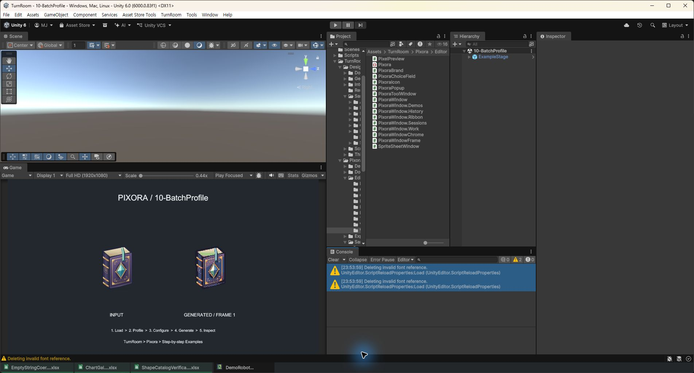

## 작업 결과

소스 수정과 실제 Unity 재컴파일·도메인 재로딩을 수행했습니다. 콘솔 오류 0개, 경고 2개를 관찰했습니다.

## 변경 내용

### 적용 내용

Config에 이미 있던 GUID 기반 설치 경로 조회를 보존하고 정적 필드를 사용 시 조회하는 프로퍼티로 변경했습니다. WorkbookAssets의 읽히지 않는 logo 필드와 대입만 제거했습니다.

## 검증

dotnet build Tools/Verification/Verification.csproj --no-restore 성공. 이 프로젝트는 일부 경고를 억제하므로 별도로 실제 Unity Ctrl+R 재컴파일을 확인했습니다. Unity Tundra build success 6.04초, Pixora.Editor.dll 및 DesignDataTable.Editor.dll 갱신과 Mono 재로딩 성공. 재로딩 로그에서 경로 오류와 CS0618/CS0414가 재발하지 않았습니다. 실제 콘솔 화면에서 오류 0개, 글꼴 경고 2개 확인.

## 남은 사항

Deleting invalid font reference 2개는 미해결입니다. 전체 스택은 Unity 내부 TextSettings.InitializeFontReferenceLookup → EditorTextSettings.CreateDefaultEditorFontAsset → ScriptReloadProperties.Load이며 프로젝트 호출 프레임이나 대상 글꼴 이름은 없습니다. 프로젝트 에셋의 m_FontReferences 검색 결과가 없어 프로젝트 원인으로 단정하지 않았습니다. 경고 숨김이나 사용자 설정 삭제는 수행하지 않았습니다. 실제 키보드 Undo/Redo 회귀 확인은 미실행입니다. 캡처는 가공 없이 원본 PNG를 보존했습니다. 교훈 검토: 변경 없음 — 기존 증거 우선 지침으로 포괄되며 Unity 버전별 상세는 이 보고서에 남깁니다.

## 작업 시간

- 제안 시간: 3~10분
- 실제로 완료된 시간: 시작 2026-10-31 23:49:47 KST. 소스 수정과 Unity 확인 23:54 KST. 보고서 작성 시각 2026-10-31 23:55:33 +09:00; 공개 검증은 별도 진행.
- XERJ: 실패 — Status: node not running. Search 시 서버 기동 실패: data/node.lock 사용 중. 다른 프로세스 잠금을 삭제하지 않고 rg 및 현재 소스로 대조했습니다.
