## 작업 결과

전체 작업은 아직 끝나지 않았습니다. 앞선 답변에서 보고서 링크 없이 작업을 끝낸 것은 전달 누락입니다. 이 보고서는 현재 확인된 수정·QA와 남은 범위를 한 곳에 모은 진행 보고이며 최종 통과 보고가 아닙니다.

표·도형·그림·차트의 실제 리본·갤러리·Affinity 아이콘을 수정했습니다. 최신 격리 Unity의20화면과 본 프로젝트 실제 창을 확보했습니다. 본 프로젝트 CLI에서 로드된 빌드 ID가 변경된 것도 확인했습니다. 전체46TC의 명령·원본 대조가 모두 통과한 상태는 아닙니다.

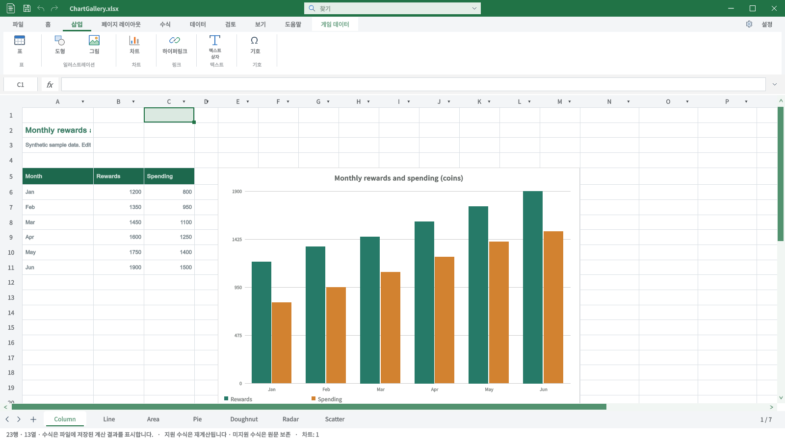

## 변경 내용

### 적용 내용

- 삽입 도형187종의9개 분류 드롭다운, 도형32종 스타일 목록과 실제 적용·Undo를 연결했습니다.
- 실제 Office 표60종+기존6종과 Office 셀 스타일63종을 지원하며 셀 스타일 팝업에는47종을 표시합니다.
- 차트48종은 legacy OOXML 스타일 ID입니다. 최신 Excel의 전체 효과·갤러리와 동일하다고 주장하지 않습니다.
- 표 스타일의 표시·저장과 범위 변환 시 글꼴·채움·테두리 보존을 수정했습니다. 그림 테두리 편집은 이미지 원본과 자르기를 보존합니다.
- Affinity3.3.1에서 실제 아이콘을 제작하고 프로젝트 ColorIcons에 편집 원본과 V10 출력물을 모았습니다.
- 도형 리본의 잘리는 문구는 실제 화면 확인 후 글자 크기/가용 폭을 수정했습니다.
- 보고서 공통 JSON에 TC 배열을 추가해46TC를 단일 문서에 보존합니다.

## 검증

검증 환경: Unity6000.0.83f1, Windows. 격리 QA 프로젝트와 본 프로젝트 결과를 구분합니다. 원본 사진은 공개된 Excel 자료이며 이번 PC의 로컬 Excel을 새로 실행해 촬영한 사진이 아닙니다. 원본의 전체 탭/부분 화면/구형 또는 Web 여부는 각 TC의 출처·범위에 기록합니다.

| 실제 실행 묶음 | 통과 검사 수 | 범위 |
| --- | ---: | --- |
| 도형 분류/선택 | 203 | 분류·드롭다운 선택 |
| 도형 스타일 | 199 |32종·Undo·보존 |
| 최신 도형 리본 | 3 | 실제 스타일 클릭·변경·Undo |
| 최신 차트 스타일 | 196 |48스타일·색상·실제 타일 클릭 |
| Office표 스타일 | 367 |60종·저장·색/글꼴/테두리 |
| 그림 서식 | 52 | 원본/자르기·테두리·Undo |
| 통합 편집 | 326 |63셀 스타일·표 변환·차트 표현 |
| 최신 실제 팝업 | 4 | Good선택·Light2적용·Undo |

각 숫자는 서로 다른 시점의 세부 검사 묶음이며 전체46TC 통과 수로 합산하지 않습니다. 최신20화면은 촬영 성공이며20개 기능 통과를 의미하지 않습니다. 실제 Windows 마우스 클릭은 창 포커스 검사에서 중단된 시도가 있어 성공으로 기록하지 않았습니다. GUI 이벤트 검사는 실제 Unity 네이티브 팝업 호스트에서 실행했습니다.

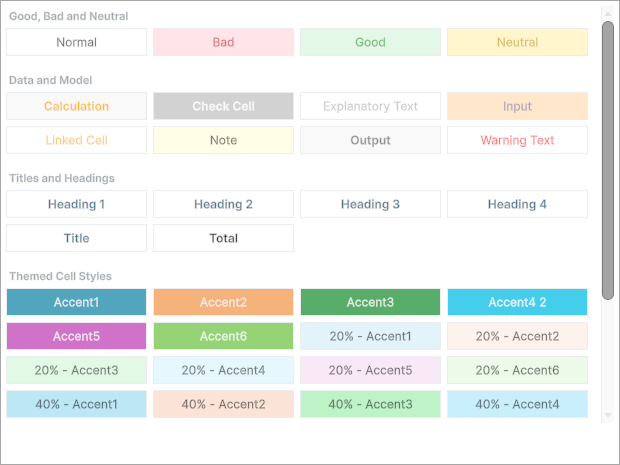

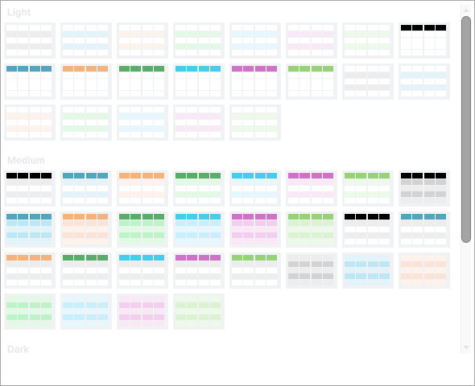

화면은 직접 캡처한 PNG 원본을 보존했습니다. 대다수200KB 이하이며, 작은 글자 판독을 위해 로컬라이징234KB 화면은 강제 축소하지 않았습니다. 이미지 편집이나 가짜 비교 합성은 하지 않았습니다.

### TC-RIB-01 · 파일

분류: 일반 · 결과: **부분 확인**

| 항목 | 내용 |
| --- | --- |
| 실행 절차 | 파일 메뉴를 엽니다. |
| 기대값 | 열기·저장·닫기와 Excel Backstage 그룹을 비교합니다. |
| 실제 결과 | 원본은 보호 메뉴 일부뿐입니다. 현재는 새 문서·열기·다른 이름 저장·복구·새로 고침 팝업입니다. |
| 수정 내용 | 이번 회차 수정 없음. 이전 기록의 근거와 제한을 보존합니다. |
| 재검증 | 전체 명령의 최신 실행 재검증은 미실행입니다. |
| 원본 출처·버전 | Excel 보호 메뉴 부분 자료 · https://support.microsoft.com/en-us/excel/restrict-changes-to-files-in-excel |

**Excel 원본**

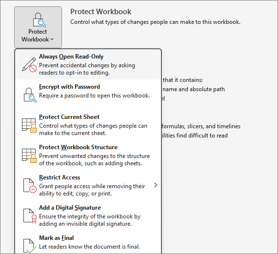

**수정 전**

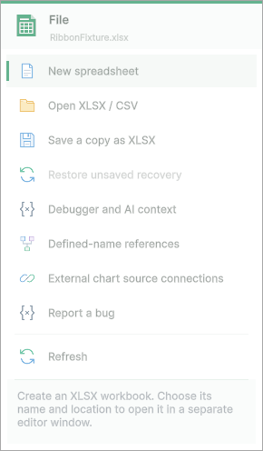

화면 근거: 해당 기능의 최신 실제 실행 화면 미확보 또는 미구현

### TC-RIB-02 · 홈

분류: 일반 · 결과: **부분 확인**

| 항목 | 내용 |
| --- | --- |
| 실행 절차 | 일반 시트에서 홈 탭을 선택합니다. |
| 기대값 | 클립보드·글꼴·맞춤·표시 형식·스타일·셀·편집 그룹을 대조합니다. |
| 실제 결과 | 셀 스타일47종 갤러리와 정렬·필터 메뉴를 연결했습니다. 셀 스타일63종 API 및 팝업 Good 선택 확인. 전체 홈 명령 전수 입력 검사는 남아 있습니다. |
| 수정 내용 | 셀 스타일47종 갤러리와 정렬·필터 메뉴를 연결했습니다. |
| 재검증 | 셀 스타일63종 API 및 팝업 Good 선택 확인. 전체 홈 명령 전수 입력 검사는 남아 있습니다. |
| 원본 출처·버전 | 부분 원본·정확한 빌드 미확인 · https://techcommunity.microsoft.com/blog/nonprofittechies/getting-familiar-with-microsoft-excel/3756412/ |

**Excel 원본**

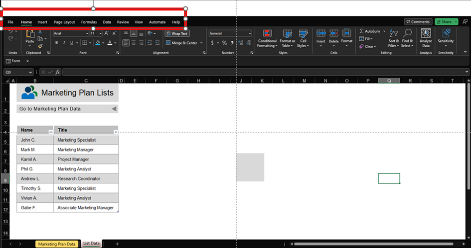

**수정 전**

**수정 후 실제 실행**

### TC-RIB-03 · 삽입

분류: 일반 · 결과: **부분 확인**

| 항목 | 내용 |
| --- | --- |
| 실행 절차 | 삽입 탭에서 도형 타일을 클릭합니다. |
| 기대값 | 표·도형·그림·차트·링크·텍스트·기호와 추가 삽입 그룹을 대조합니다. |
| 실제 결과 | 도형187종을9개 분류의 스크롤 드롭다운으로 변경했습니다. 203건 분류·템플릿·실제 항목 클릭 검사 통과. 모든187종의 마우스 배치 전수는 미실행입니다. |
| 수정 내용 | 도형187종을9개 분류의 스크롤 드롭다운으로 변경했습니다. |
| 재검증 | 203건 분류·템플릿·실제 항목 클릭 검사 통과. 모든187종의 마우스 배치 전수는 미실행입니다. |
| 원본 출처·버전 | 부분 원본·정확한 빌드 미확인 · https://techcommunity.microsoft.com/blog/nonprofittechies/getting-familiar-with-microsoft-excel/3756412/ |

**Excel 원본**

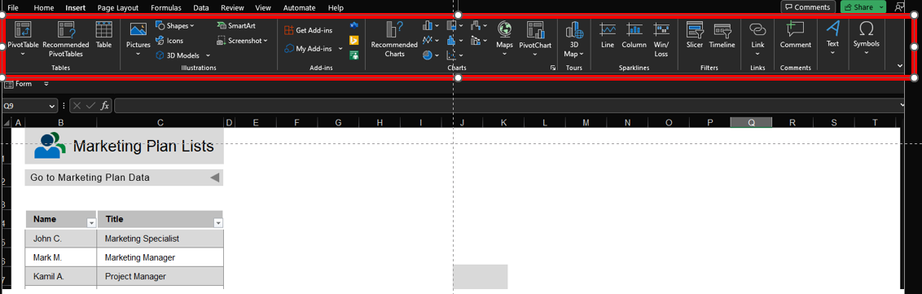

**수정 전**

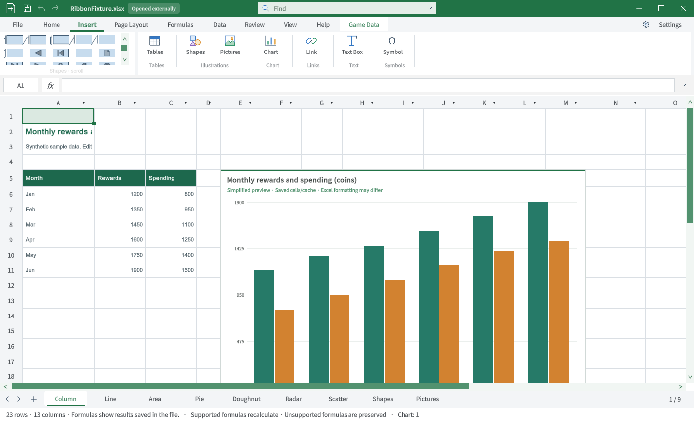

**수정 후 실제 실행**

### TC-RIB-04 · 페이지 레이아웃

분류: 일반 · 결과: **부분 확인**

| 항목 | 내용 |
| --- | --- |
| 실행 절차 | 페이지 레이아웃을 선택합니다. |
| 기대값 | 테마·페이지 설정·배율 그룹을 비교합니다. |
| 실제 결과 | 현재는 페이지 설정 버튼 하나입니다. 원본의 독립 그룹·리본 컨트롤이 없습니다. |
| 수정 내용 | 이번 회차 수정 없음. 이전 기록의 근거와 제한을 보존합니다. |
| 재검증 | 전체 명령의 최신 실행 재검증은 미실행입니다. |
| 원본 출처·버전 | 구형 Windows 원본 일부 · https://support.microsoft.com/en-us/excel/fit-to-one-page-in-excel |

**Excel 원본**

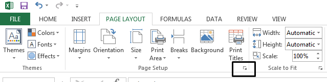

**수정 전**

**수정 후 실제 실행**

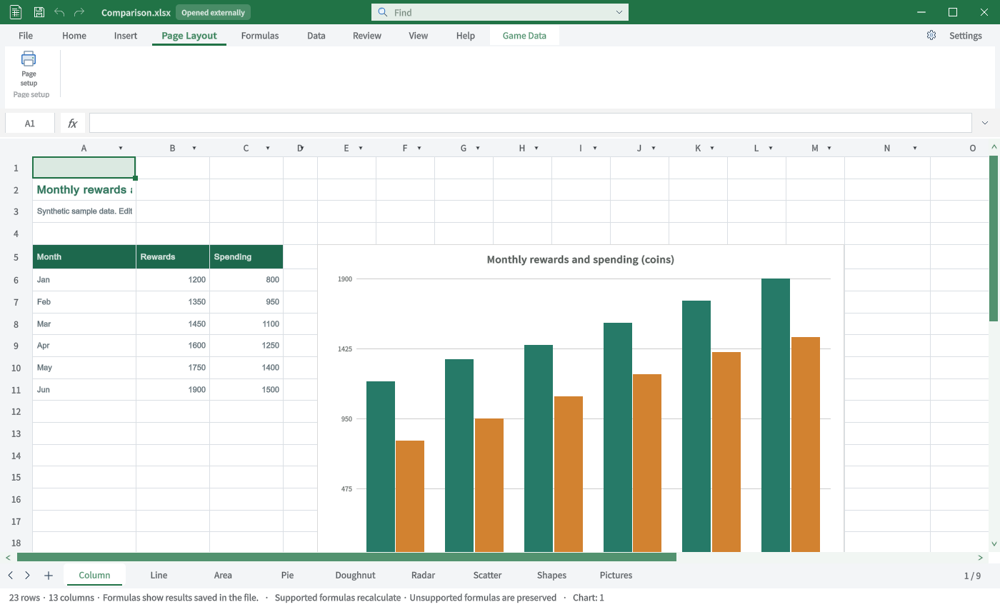

### TC-RIB-05 · 수식

분류: 일반 · 결과: **부분 확인**

| 항목 | 내용 |
| --- | --- |
| 실행 절차 | 수식 탭을 선택합니다. |
| 기대값 | 함수 라이브러리·이름·수식 분석·계산을 비교합니다. |
| 실제 결과 | 도움말·이름 관리자·이름 참조·재계산은 보이지만 함수 분류 갤러리와 분석 도구가 없습니다. |
| 수정 내용 | 이번 회차 수정 없음. 이전 기록의 근거와 제한을 보존합니다. |
| 재검증 | 전체 명령의 최신 실행 재검증은 미실행입니다. |
| 원본 출처·버전 | 함수 라이브러리 부분 원본 · https://support.microsoft.com/en-us/excel/using-functions-and-nested-functions-in-excel-formulas |

**Excel 원본**

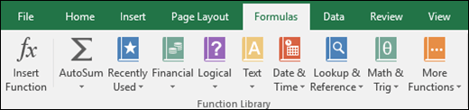

**수정 전**

**수정 후 실제 실행**

### TC-RIB-06 · 데이터

분류: 일반 · 결과: **부분 확인**

| 항목 | 내용 |
| --- | --- |
| 실행 절차 | 데이터 탭을 선택합니다. |
| 기대값 | 정렬·필터와 데이터 가져오기·쿼리 그룹을 비교합니다. |
| 실제 결과 | 정렬·필터·외부 차트 연결만 보입니다. 원본의 Get Data·쿼리 새로 고침 구성이 없습니다. |
| 수정 내용 | 이번 회차 수정 없음. 이전 기록의 근거와 제한을 보존합니다. |
| 재검증 | 전체 명령의 최신 실행 재검증은 미실행입니다. |
| 원본 출처·버전 | Excel2016 Get & Transform 부분 원본 · https://support.microsoft.com/en-us/excel/about-power-query-in-excel |

**Excel 원본**

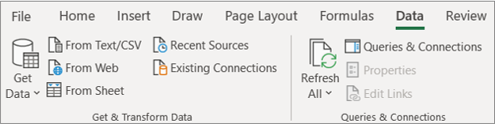

**수정 전**

**수정 후 실제 실행**

### TC-RIB-07 · 검토

분류: 일반 · 결과: **부분 확인**

| 항목 | 내용 |
| --- | --- |
| 실행 절차 | 검토 탭을 선택합니다. |
| 기대값 | 맞춤법·접근성·변경·댓글·보호와 통계를 대조합니다. |
| 실제 결과 | 현재는 통계 버튼만 보입니다. 비교 원본은 Excel 웹이므로 Windows 동일 버전 비교는 아닙니다. |
| 수정 내용 | 이번 회차 수정 없음. 이전 기록의 근거와 제한을 보존합니다. |
| 재검증 | 전체 명령의 최신 실행 재검증은 미실행입니다. |
| 원본 출처·버전 | Excel 웹 원본·Windows와 구별 · https://learn.microsoft.com/en-us/answers/questions/5190624/review-tab-options-greyed-out-in-excel-365-files-w |

**Excel 원본**

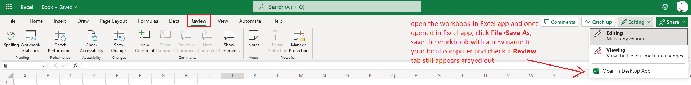

**수정 전**

**수정 후 실제 실행**

### TC-RIB-08 · 보기

분류: 일반 · 결과: **부분 확인**

| 항목 | 내용 |
| --- | --- |
| 실행 절차 | 보기 탭을 선택합니다. |
| 기대값 | 통합 문서 보기·표시·확대/축소·창 그룹을 대조합니다. |
| 실제 결과 | 고정·해제·개체·시트·보기 메뉴는 보이지만 원본의 보기/확대 그룹 구성과 다릅니다. |
| 수정 내용 | 이번 회차 수정 없음. 이전 기록의 근거와 제한을 보존합니다. |
| 재검증 | 전체 명령의 최신 실행 재검증은 미실행입니다. |
| 원본 출처·버전 | 부분 원본·정확한 빌드 미확인 · https://techcommunity.microsoft.com/discussions/excelgeneral/view-ribbon-tab-checkboxes-no-longer-aligned/3989915 |

**Excel 원본**

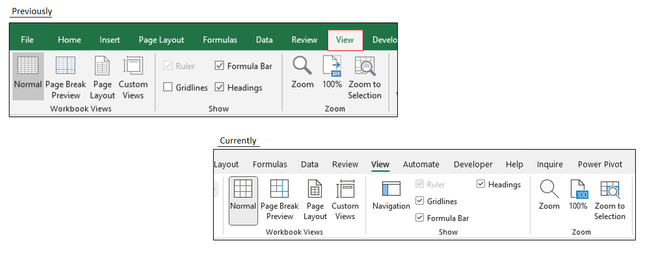

**수정 전**

**수정 후 실제 실행**

### TC-RIB-09 · 도움말

분류: 일반 · 결과: **부분 확인**

| 항목 | 내용 |
| --- | --- |
| 실행 절차 | 도움말을 선택합니다. |
| 기대값 | 도움말 탭의 실제 명령을 대조합니다. |
| 실제 결과 | 현재 디버그·버그 보고·수식 버튼 표시. 원본에는 Help 탭 이름만 보여 명령 대조는 미실행입니다. |
| 수정 내용 | 이번 회차 수정 없음. 이전 기록의 근거와 제한을 보존합니다. |
| 재검증 | 전체 명령의 최신 실행 재검증은 미실행입니다. |
| 원본 출처·버전 | 전체 Help 리본 아님 · https://techcommunity.microsoft.com/blog/nonprofittechies/getting-familiar-with-microsoft-excel/3756412/ |

**Excel 원본**

**수정 전**

**수정 후 실제 실행**

### TC-RIB-10 · 그리기

분류: 일반 · 결과: **실패**

| 항목 | 내용 |
| --- | --- |
| 실행 절차 | 그리기 탭 진입점을 찾습니다. |
| 기대값 | 펜·잉크·다시 재생 등의 탭을 제공합니다. |
| 실제 결과 | 현재 해당 기능/전용 탭은 구현되지 않았습니다. 이전 삽입/홈 화면을 해당 기능의 실행 증거로 취급하지 않습니다. |
| 수정 내용 | 이번 회차 수정 없음. 이전 기록의 근거와 제한을 보존합니다. |
| 재검증 | 전체 명령의 최신 실행 재검증은 미실행입니다. |
| 원본 출처·버전 | Excel Draw 화면·사진 촬영 자료 · https://learn.microsoft.com/en-us/answers/questions/5070058/cant-exit-the-drawing-tool-in-excel |

**Excel 원본**

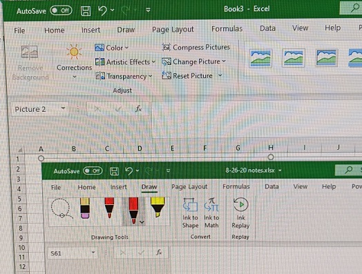

**수정 전**

화면 근거: 해당 기능의 최신 실제 실행 화면 미확보 또는 미구현

### TC-RIB-11 · 자동화

분류: 일반 · 결과: **실패**

| 항목 | 내용 |
| --- | --- |
| 실행 절차 | 자동화 탭 진입점을 찾습니다. |
| 기대값 | Office Scripts 목록과 스크립트 진입점을 대조합니다. |
| 실제 결과 | 현재 해당 기능/전용 탭은 구현되지 않았습니다. 이전 삽입/홈 화면을 해당 기능의 실행 증거로 취급하지 않습니다. |
| 수정 내용 | 이번 회차 수정 없음. 이전 기록의 근거와 제한을 보존합니다. |
| 재검증 | 전체 명령의 최신 실행 재검증은 미실행입니다. |
| 원본 출처·버전 | Excel Automate 원본 · https://techcommunity.microsoft.com/blog/microsoft365insiderblog/automate-tasks-with-office-scripts-in-excel-for-windows-and-mac/4216151 |

**Excel 원본**

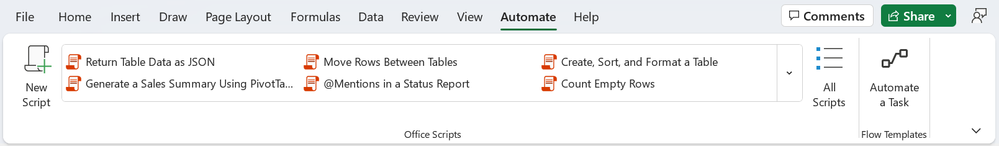

**수정 전**

화면 근거: 해당 기능의 최신 실제 실행 화면 미확보 또는 미구현

### TC-RIB-12 · 개발 도구

분류: 일반 · 결과: **실패**

| 항목 | 내용 |
| --- | --- |
| 실행 절차 | 개발 도구 탭 진입점을 찾습니다. |
| 기대값 | 컨트롤·코드·디자인 모드 그룹을 대조합니다. |
| 실제 결과 | 현재 해당 기능/전용 탭은 구현되지 않았습니다. 이전 삽입/홈 화면을 해당 기능의 실행 증거로 취급하지 않습니다. |
| 수정 내용 | 이번 회차 수정 없음. 이전 기록의 근거와 제한을 보존합니다. |
| 재검증 | 전체 명령의 최신 실행 재검증은 미실행입니다. |
| 원본 출처·버전 | Developer 컨트롤 부분 원본 · https://support.microsoft.com/en-us/excel/form-controls |

**Excel 원본**

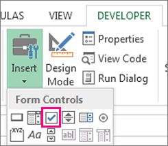

**수정 전**

화면 근거: 해당 기능의 최신 실제 실행 화면 미확보 또는 미구현

### TC-RIB-13 · 추가 기능

분류: 일반 · 결과: **실패**

| 항목 | 내용 |
| --- | --- |
| 실행 절차 | 삽입의 추가 기능 그룹을 확인합니다. |
| 기대값 | 추가 기능 진입점을 대조합니다. |
| 실제 결과 | 현재 해당 기능/전용 탭은 구현되지 않았습니다. 이전 삽입/홈 화면을 해당 기능의 실행 증거로 취급하지 않습니다. |
| 수정 내용 | 이번 회차 수정 없음. 이전 기록의 근거와 제한을 보존합니다. |
| 재검증 | 전체 명령의 최신 실행 재검증은 미실행입니다. |
| 원본 출처·버전 | 삽입 Add-ins 그룹 부분 원본 · https://techcommunity.microsoft.com/blog/nonprofittechies/getting-familiar-with-microsoft-excel/3756412/ |

**Excel 원본**

**수정 전**

화면 근거: 해당 기능의 최신 실제 실행 화면 미확보 또는 미구현

### TC-RIB-14 · 표 디자인

분류: 특수 · 결과: **부분 확인**

| 항목 | 내용 |
| --- | --- |
| 실행 절차 | ChartGallery A5:C11 안 C11을 선택합니다. |
| 기대값 | 표 내부에서 전용 탭·스타일 갤러리·옵션을 제공합니다. |
| 실제 결과 | ChartGallery A5:C11을 실제 표로 등록하고 Office60종+기존6종 갤러리를 연결했습니다. Office표367검사 및 실제 Light2 선택·Undo 통과. 이름 편집·크기 변경·총합 행 등 원본 메뉴는 미완성입니다. |
| 수정 내용 | ChartGallery A5:C11을 실제 표로 등록하고 Office60종+기존6종 갤러리를 연결했습니다. |
| 재검증 | Office표367검사 및 실제 Light2 선택·Undo 통과. 이름 편집·크기 변경·총합 행 등 원본 메뉴는 미완성입니다. |
| 원본 출처·버전 | Windows 표 디자인 및 피벗 분석 원본 · https://support.microsoft.com/en-us/excel/where-are-the-table-tools |

**Excel 원본**

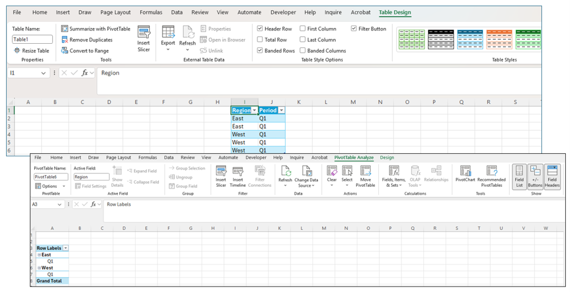

**수정 전**

**수정 후 실제 실행**

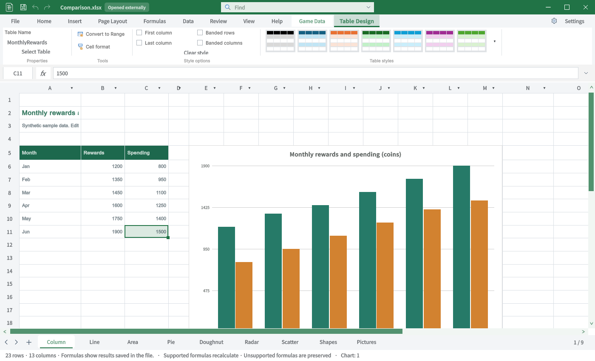

### TC-RIB-15 · 도형 서식

분류: 특수 · 결과: **부분 확인**

| 항목 | 내용 |
| --- | --- |
| 실행 절차 | 도형 개체를 선택합니다. |
| 기대값 | 도형 삽입·도형 스타일·WordArt·접근성·정렬·크기를 대조합니다. |
| 실제 결과 | 원본 순서의 그룹,3개 미리보기+32종 목록,색상·회전·정렬 순서 메뉴와 Affinity 아이콘을 적용했습니다. 문구 잘림도 수정했습니다. 스타일199검사 및 최신 실제 타일 선택·Undo3건 통과. 도형 효과·다중 객체 맞춤/그룹은 미구현입니다. |
| 수정 내용 | 원본 순서의 그룹,3개 미리보기+32종 목록,색상·회전·정렬 순서 메뉴와 Affinity 아이콘을 적용했습니다. 문구 잘림도 수정했습니다. |
| 재검증 | 스타일199검사 및 최신 실제 타일 선택·Undo3건 통과. 도형 효과·다중 객체 맞춤/그룹은 미구현입니다. |
| 원본 출처·버전 | OfficeToolTips 직접 촬영 Excel365 원본·빌드 미확인 · https://www.officetooltips.com/excel/tips/how_to_change_format_for_diagram_shapes_in_excel |

**Excel 원본**

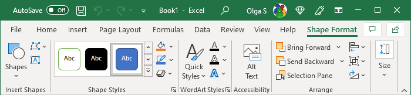

**수정 전**

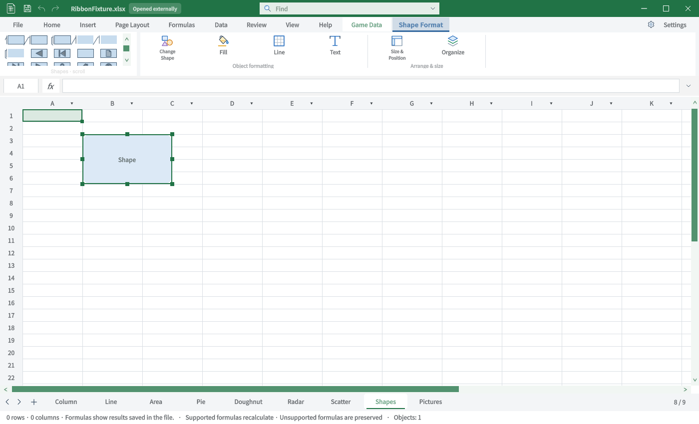

**수정 후 실제 실행**

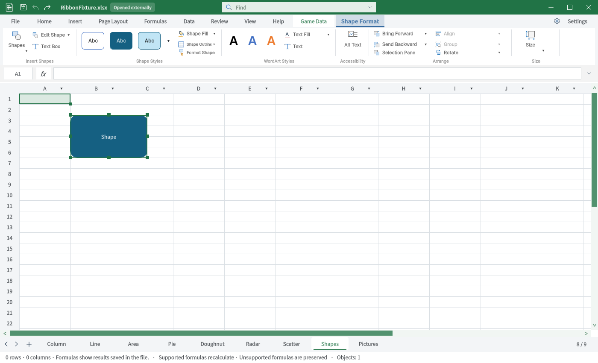

### TC-RIB-16 · 그림 서식

분류: 특수 · 결과: **부분 확인**

| 항목 | 내용 |
| --- | --- |
| 실행 절차 | 삽입된 그림을 선택합니다. |
| 기대값 | 보정·그림 스타일·접근성·정렬·크기를 비교합니다. |
| 실제 결과 | 조정·그림 스타일·접근성·배치·크기 그룹과6개 테두리 미리보기를 구성했습니다. 52검사에서 이미지 바이트·자르기·Undo·저장 재열기 보존 확인. Office 전체 그림 효과와 색 보정은 미구현입니다. |
| 수정 내용 | 조정·그림 스타일·접근성·배치·크기 그룹과6개 테두리 미리보기를 구성했습니다. |
| 재검증 | 52검사에서 이미지 바이트·자르기·Undo·저장 재열기 보존 확인. Office 전체 그림 효과와 색 보정은 미구현입니다. |
| 원본 출처·버전 | 부분 원본·정확한 빌드 미확인 · https://learn.microsoft.com/en-us/answers/questions/5267157/where-are-microsoft-365-excel-picture-format-tools |

**Excel 원본**

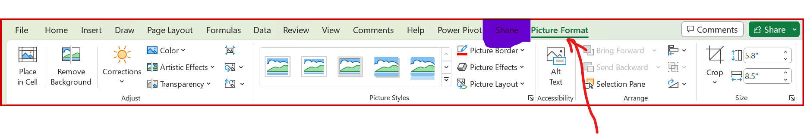

**수정 전**

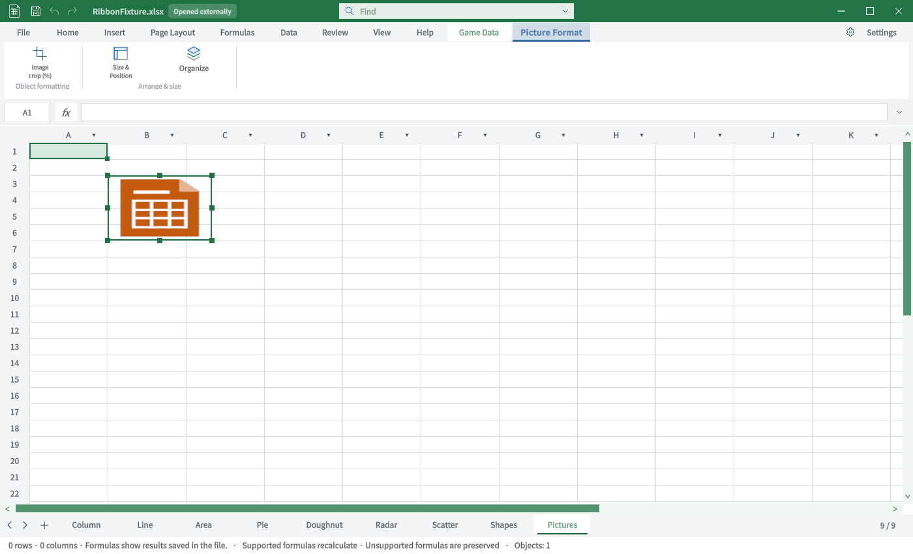

**수정 후 실제 실행**

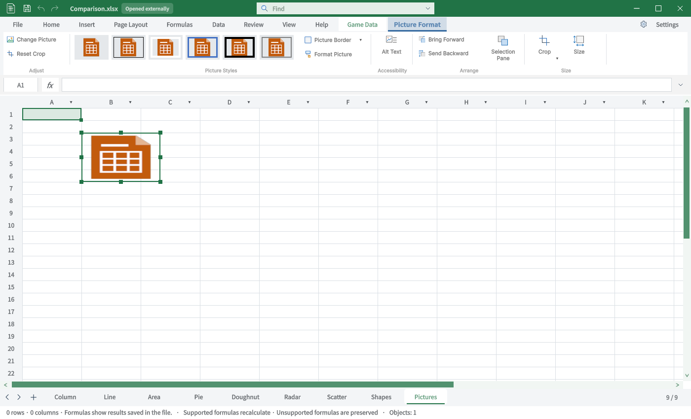

### TC-RIB-17 · 차트 디자인

분류: 특수 · 결과: **부분 확인**

| 항목 | 내용 |
| --- | --- |
| 실행 절차 | 차트를 선택한 뒤 디자인 탭에서 스타일2를 클릭합니다. |
| 기대값 | 썸네일 스타일 목록·데이터·차트 요소를 대조합니다. |
| 실제 결과 | 차트 레이아웃·스타일·데이터·유형·위치 순서와6개 실제 차트 미리보기·48종 목록을 구성했습니다. 최신 배치196검사 및 실제 스타일2 클릭 통과. 빠른 레이아웃·행/열 전환·종류/위치 변경 버튼은 비활성이며 구현이 남았습니다. |
| 수정 내용 | 차트 레이아웃·스타일·데이터·유형·위치 순서와6개 실제 차트 미리보기·48종 목록을 구성했습니다. |
| 재검증 | 최신 배치196검사 및 실제 스타일2 클릭 통과. 빠른 레이아웃·행/열 전환·종류/위치 변경 버튼은 비활성이며 구현이 남았습니다. |
| 원본 출처·버전 | 부분 원본·정확한 빌드 미확인 · https://learn.microsoft.com/en-us/answers/questions/5423242/chart-design-not-available-i-have-tried-everything |

**Excel 원본**

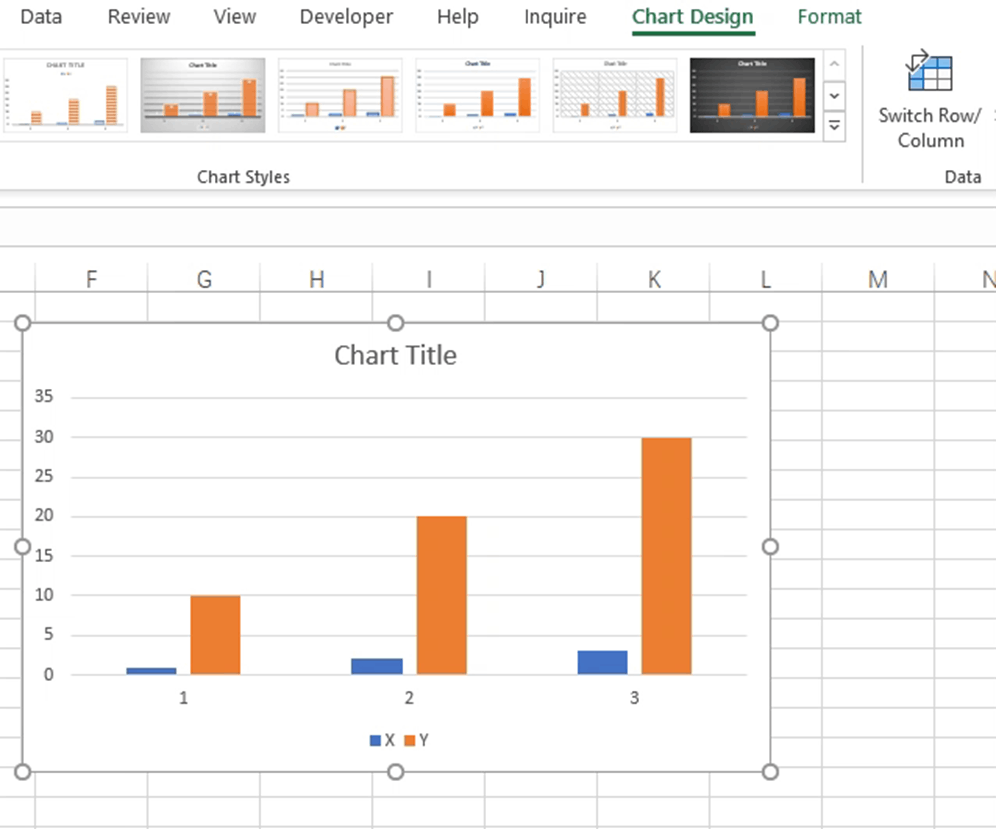

**수정 전**

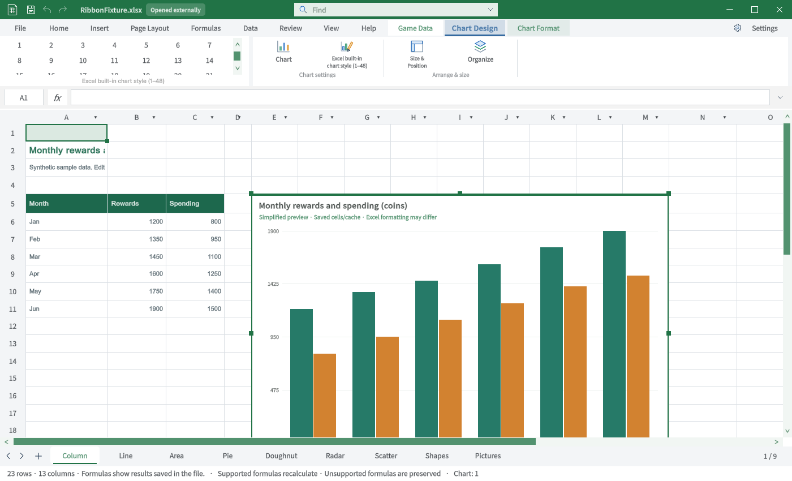

**수정 후 실제 실행**

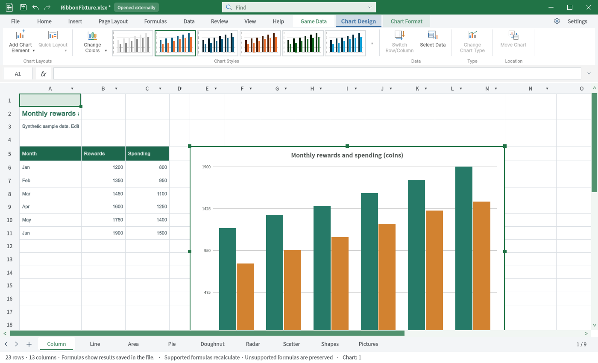

### TC-RIB-18 · 차트 서식

분류: 특수 · 결과: **부분 확인**

| 항목 | 내용 |
| --- | --- |
| 실행 절차 | 차트를 선택한 뒤 서식 탭을 선택합니다. |
| 기대값 | 현재 선택·서식·스타일·정렬을 비교합니다. |
| 실제 결과 | 현재 선택·도형 스타일·텍스트·접근성·배치·크기 그룹과 차트 영역 서식 팝업을 연결했습니다. 326개 통합 검사에 차트 제목·범례·격자·색상·저장 검증 포함. 전체 차트 요소 선택/효과 메뉴는 미완성입니다. |
| 수정 내용 | 현재 선택·도형 스타일·텍스트·접근성·배치·크기 그룹과 차트 영역 서식 팝업을 연결했습니다. |
| 재검증 | 326개 통합 검사에 차트 제목·범례·격자·색상·저장 검증 포함. 전체 차트 요소 선택/효과 메뉴는 미완성입니다. |
| 원본 출처·버전 | 구형 Current Selection 부분 원본 · https://support.microsoft.com/en-us/office/graphics-visuals/change-the-shape-fill-outline-or-effects-of-chart-elements |

**Excel 원본**

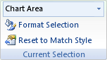

**수정 전**

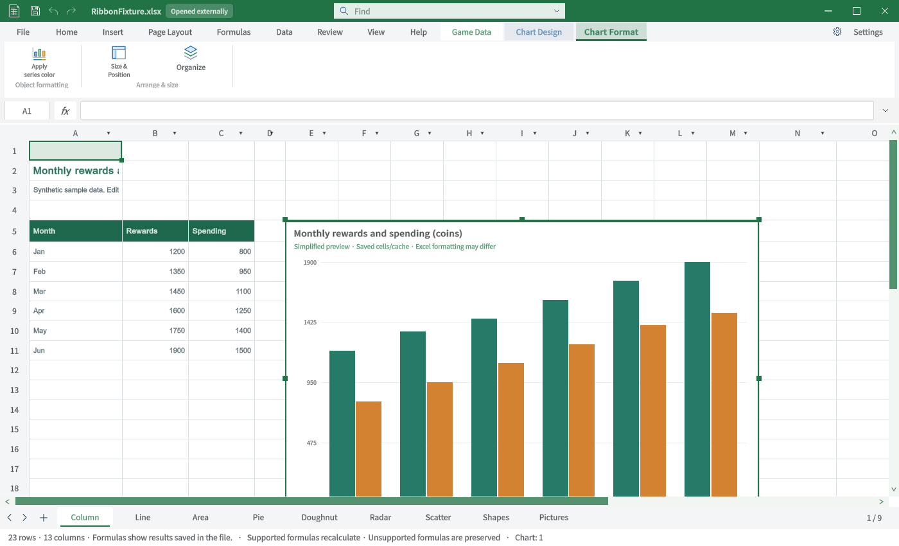

**수정 후 실제 실행**

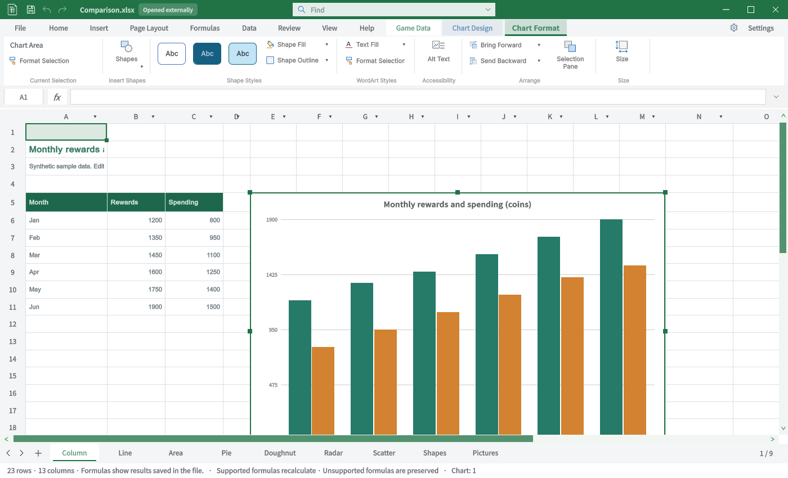

### TC-RIB-19 · 피벗 테이블 분석

분류: 특수 · 결과: **실패**

| 항목 | 내용 |
| --- | --- |
| 실행 절차 | 피벗 삽입·선택 경로를 확인합니다. |
| 기대값 | 피벗 개체 선택 시 분석 탭 |
| 실제 결과 | 현재 해당 기능/전용 탭은 구현되지 않았습니다. 이전 삽입/홈 화면을 해당 기능의 실행 증거로 취급하지 않습니다. |
| 수정 내용 | 이번 회차 수정 없음. 이전 기록의 근거와 제한을 보존합니다. |
| 재검증 | 전체 명령의 최신 실행 재검증은 미실행입니다. |
| 원본 출처·버전 | 원본 일부 · https://support.microsoft.com/en-us/excel/where-are-the-table-tools |

**Excel 원본**

**수정 전**

화면 근거: 해당 기능의 최신 실제 실행 화면 미확보 또는 미구현

### TC-RIB-20 · 피벗 테이블 디자인

분류: 특수 · 결과: **실패**

| 항목 | 내용 |
| --- | --- |
| 실행 절차 | 피벗 삽입·선택 경로를 확인합니다. |
| 기대값 | 피벗 스타일·레이아웃 |
| 실제 결과 | 현재 해당 기능/전용 탭은 구현되지 않았습니다. 이전 삽입/홈 화면을 해당 기능의 실행 증거로 취급하지 않습니다. |
| 수정 내용 | 이번 회차 수정 없음. 이전 기록의 근거와 제한을 보존합니다. |
| 재검증 | 전체 명령의 최신 실행 재검증은 미실행입니다. |
| 원본 출처·버전 | 원본 일부 · https://support.microsoft.com/en-us/excel/design-the-layout-and-format-of-a-pivottable |

**Excel 원본**

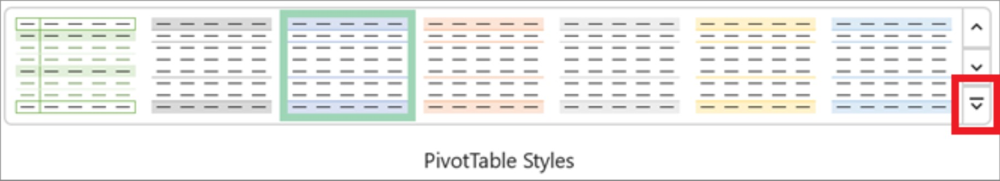

**수정 전**

화면 근거: 해당 기능의 최신 실제 실행 화면 미확보 또는 미구현

### TC-RIB-21 · 피벗 차트 분석

분류: 특수 · 결과: **실패**

| 항목 | 내용 |
| --- | --- |
| 실행 절차 | 피벗 삽입·선택 경로를 확인합니다. |
| 기대값 | 피벗 차트 선택 시 분석 탭 |
| 실제 결과 | 현재 해당 기능/전용 탭은 구현되지 않았습니다. 이전 삽입/홈 화면을 해당 기능의 실행 증거로 취급하지 않습니다. |
| 수정 내용 | 이번 회차 수정 없음. 이전 기록의 근거와 제한을 보존합니다. |
| 재검증 | 전체 명령의 최신 실행 재검증은 미실행입니다. |
| 원본 출처·버전 | W3Schools 직접 작성 Field Buttons 부분 원본 · https://www.w3schools.com/excel/excel_pivot_charts.php |

**Excel 원본**

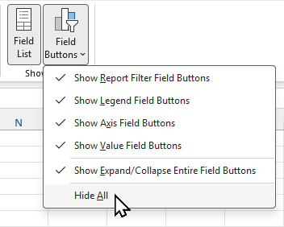

**수정 전**

화면 근거: 해당 기능의 최신 실제 실행 화면 미확보 또는 미구현

### TC-RIB-22 · 피벗 차트 디자인

분류: 특수 · 결과: **실패**

| 항목 | 내용 |
| --- | --- |
| 실행 절차 | 피벗 삽입·선택 경로를 확인합니다. |
| 기대값 | 피벗 차트 스타일·데이터 |
| 실제 결과 | 현재 해당 기능/전용 탭은 구현되지 않았습니다. 이전 삽입/홈 화면을 해당 기능의 실행 증거로 취급하지 않습니다. |
| 수정 내용 | 이번 회차 수정 없음. 이전 기록의 근거와 제한을 보존합니다. |
| 재검증 | 전체 명령의 최신 실행 재검증은 미실행입니다. |
| 원본 출처·버전 | 해당 원본 미확보 · 제품 전용 기능: Excel 대응 원본 없음 |

**수정 전**

화면 근거: 대응 원본 사진 없음 또는 정확한 버전의 원본 미확보; 해당 기능의 최신 실제 실행 화면 미확보 또는 미구현

### TC-RIB-23 · 피벗 차트 서식

분류: 특수 · 결과: **실패**

| 항목 | 내용 |
| --- | --- |
| 실행 절차 | 피벗 삽입·선택 경로를 확인합니다. |
| 기대값 | 피벗 차트 서식 |
| 실제 결과 | 현재 해당 기능/전용 탭은 구현되지 않았습니다. 이전 삽입/홈 화면을 해당 기능의 실행 증거로 취급하지 않습니다. |
| 수정 내용 | 이번 회차 수정 없음. 이전 기록의 근거와 제한을 보존합니다. |
| 재검증 | 전체 명령의 최신 실행 재검증은 미실행입니다. |
| 원본 출처·버전 | 해당 원본 미확보 · 제품 전용 기능: Excel 대응 원본 없음 |

**수정 전**

화면 근거: 대응 원본 사진 없음 또는 정확한 버전의 원본 미확보; 해당 기능의 최신 실제 실행 화면 미확보 또는 미구현

### TC-RIB-24 · 슬라이서

분류: 특수 · 결과: **실패**

| 항목 | 내용 |
| --- | --- |
| 실행 절차 | 슬라이서 삽입·선택 경로를 확인합니다. |
| 기대값 | 슬라이서 선택 시 전용 도구와 스타일을 제공합니다. |
| 실제 결과 | 현재 해당 기능/전용 탭은 구현되지 않았습니다. 이전 삽입/홈 화면을 해당 기능의 실행 증거로 취급하지 않습니다. |
| 수정 내용 | 이번 회차 수정 없음. 이전 기록의 근거와 제한을 보존합니다. |
| 재검증 | 전체 명령의 최신 실행 재검증은 미실행입니다. |
| 원본 출처·버전 | 삽입·개체 부분 원본 · https://learn.microsoft.com/en-us/answers/questions/545181/slicer-in-excel-on-o365-has-disappeared |

**Excel 원본**

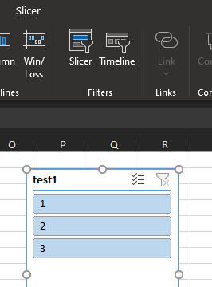

**수정 전**

화면 근거: 해당 기능의 최신 실제 실행 화면 미확보 또는 미구현

### TC-RIB-25 · 시간 표시 막대

분류: 특수 · 결과: **실패**

| 항목 | 내용 |
| --- | --- |
| 실행 절차 | Timeline 삽입·선택 경로를 확인합니다. |
| 기대값 | Timeline 스타일 갤러리를 제공합니다. |
| 실제 결과 | 현재 해당 기능/전용 탭은 구현되지 않았습니다. 이전 삽입/홈 화면을 해당 기능의 실행 증거로 취급하지 않습니다. |
| 수정 내용 | 이번 회차 수정 없음. 이전 기록의 근거와 제한을 보존합니다. |
| 재검증 | 전체 명령의 최신 실행 재검증은 미실행입니다. |
| 원본 출처·버전 | Timeline Styles 부분 원본 · https://support.microsoft.com/en-us/excel/create-a-pivottable-timeline-to-filter-dates |

**Excel 원본**

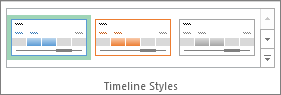

**수정 전**

화면 근거: 해당 기능의 최신 실제 실행 화면 미확보 또는 미구현

### TC-RIB-26 · 스파크라인

분류: 특수 · 결과: **실패**

| 항목 | 내용 |
| --- | --- |
| 실행 절차 | 스파크라인 삽입·선택 경로를 확인합니다. |
| 기대값 | 스파크라인 스타일 갤러리를 제공합니다. |
| 실제 결과 | 현재 해당 기능/전용 탭은 구현되지 않았습니다. 이전 삽입/홈 화면을 해당 기능의 실행 증거로 취급하지 않습니다. |
| 수정 내용 | 이번 회차 수정 없음. 이전 기록의 근거와 제한을 보존합니다. |
| 재검증 | 전체 명령의 최신 실행 재검증은 미실행입니다. |
| 원본 출처·버전 | Sparkline Style 부분 원본 · https://support.microsoft.com/en-us/excel/analyze-trends-in-data-using-sparklines |

**Excel 원본**

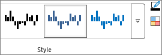

**수정 전**

화면 근거: 해당 기능의 최신 실제 실행 화면 미확보 또는 미구현

### TC-RIB-27 · SmartArt 디자인

분류: 특수 · 결과: **실패**

| 항목 | 내용 |
| --- | --- |
| 실행 절차 | SmartArt 삽입·선택 경로를 확인합니다. |
| 기대값 | 레이아웃·색상·스타일을 제공합니다. |
| 실제 결과 | 현재 해당 기능/전용 탭은 구현되지 않았습니다. 이전 삽입/홈 화면을 해당 기능의 실행 증거로 취급하지 않습니다. |
| 수정 내용 | 이번 회차 수정 없음. 이전 기록의 근거와 제한을 보존합니다. |
| 재검증 | 전체 명령의 최신 실행 재검증은 미실행입니다. |
| 원본 출처·버전 | Excel SmartArt 디자인 부분 원본 · https://learn.microsoft.com/en-us/answers/questions/5368523/smartart-in-excel-can-t-find-text-pane-no-arrow-on |

**Excel 원본**

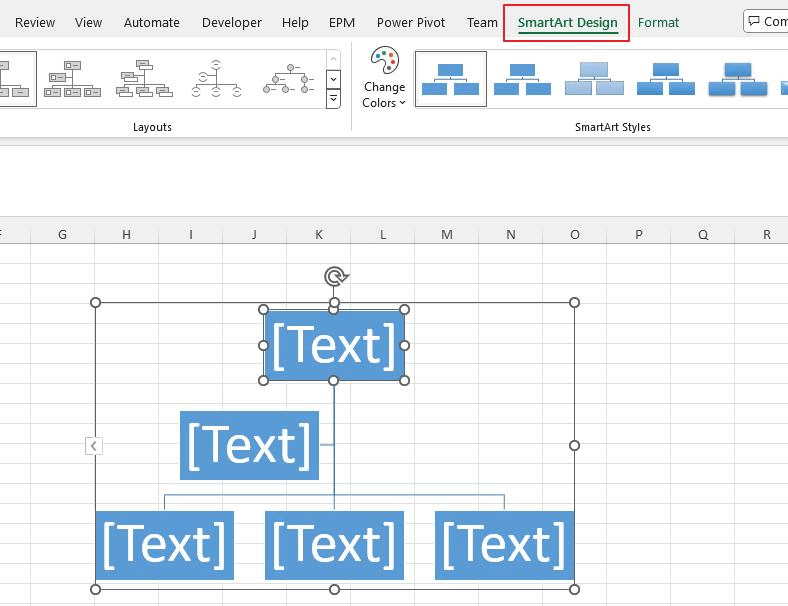

**수정 전**

화면 근거: 해당 기능의 최신 실제 실행 화면 미확보 또는 미구현

### TC-RIB-28 · SmartArt 서식

분류: 특수 · 결과: **실패**

| 항목 | 내용 |
| --- | --- |
| 실행 절차 | SmartArt 관련 서식 경로를 확인합니다. |
| 기대값 | 관련 개체의 서식·스타일을 제공합니다. |
| 실제 결과 | 현재 해당 기능/전용 탭은 구현되지 않았습니다. 이전 삽입/홈 화면을 해당 기능의 실행 증거로 취급하지 않습니다. |
| 수정 내용 | 이번 회차 수정 없음. 이전 기록의 근거와 제한을 보존합니다. |
| 재검증 | 전체 명령의 최신 실행 재검증은 미실행입니다. |
| 원본 출처·버전 | SmartArt 파생 개체의 Shape Format · https://learn.microsoft.com/en-us/answers/questions/5368523/smartart-in-excel-can-t-find-text-pane-no-arrow-on |

**Excel 원본**

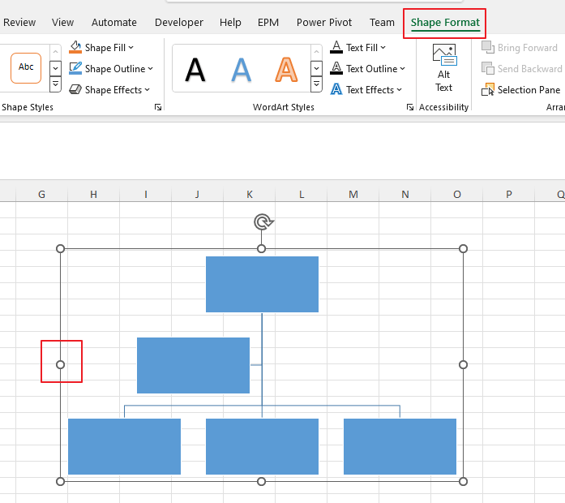

**수정 전**

화면 근거: 해당 기능의 최신 실제 실행 화면 미확보 또는 미구현

### TC-RIB-29 · 그래픽 서식

분류: 특수 · 결과: **실패**

| 항목 | 내용 |
| --- | --- |
| 실행 절차 | 관련 개체 삽입·선택 경로를 확인합니다. |
| 기대값 | SVG 선택 시 그래픽 서식 |
| 실제 결과 | 현재 해당 기능/전용 탭은 구현되지 않았습니다. 이전 삽입/홈 화면을 해당 기능의 실행 증거로 취급하지 않습니다. |
| 수정 내용 | 이번 회차 수정 없음. 이전 기록의 근거와 제한을 보존합니다. |
| 재검증 | 전체 명령의 최신 실행 재검증은 미실행입니다. |
| 원본 출처·버전 | Excel 원본 미확보 · 제품 전용 기능: Excel 대응 원본 없음 |

**수정 전**

화면 근거: 대응 원본 사진 없음 또는 정확한 버전의 원본 미확보; 해당 기능의 최신 실제 실행 화면 미확보 또는 미구현

### TC-RIB-30 · 3D 모델 서식

분류: 특수 · 결과: **실패**

| 항목 | 내용 |
| --- | --- |
| 실행 절차 | 관련 개체 삽입·선택 경로를 확인합니다. |
| 기대값 | 3D 모델 선택 시 보기·정렬 |
| 실제 결과 | 현재 해당 기능/전용 탭은 구현되지 않았습니다. 이전 삽입/홈 화면을 해당 기능의 실행 증거로 취급하지 않습니다. |
| 수정 내용 | 이번 회차 수정 없음. 이전 기록의 근거와 제한을 보존합니다. |
| 재검증 | 전체 명령의 최신 실행 재검증은 미실행입니다. |
| 원본 출처·버전 | Excel 원본 미확보 · 제품 전용 기능: Excel 대응 원본 없음 |

**수정 전**

화면 근거: 대응 원본 사진 없음 또는 정확한 버전의 원본 미확보; 해당 기능의 최신 실제 실행 화면 미확보 또는 미구현

### TC-RIB-31 · 수식 디자인

분류: 특수 · 결과: **실패**

| 항목 | 내용 |
| --- | --- |
| 실행 절차 | 관련 개체 삽입·선택 경로를 확인합니다. |
| 기대값 | 수식 개체 선택 시 디자인 |
| 실제 결과 | 현재 해당 기능/전용 탭은 구현되지 않았습니다. 이전 삽입/홈 화면을 해당 기능의 실행 증거로 취급하지 않습니다. |
| 수정 내용 | 이번 회차 수정 없음. 이전 기록의 근거와 제한을 보존합니다. |
| 재검증 | 전체 명령의 최신 실행 재검증은 미실행입니다. |
| 원본 출처·버전 | SpreadsheetPlanet 직접 작성 Excel Microsoft365 Windows 원본 · https://spreadsheetplanet.com/insert-equation-excel/ |

**Excel 원본**

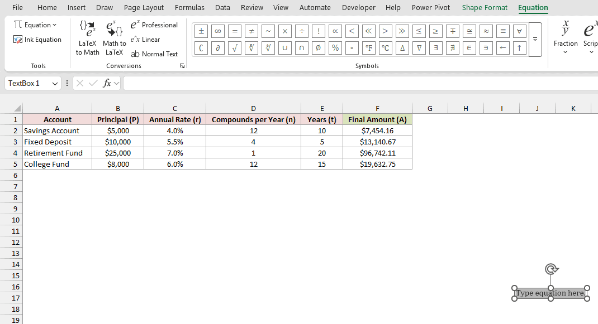

**수정 전**

화면 근거: 해당 기능의 최신 실제 실행 화면 미확보 또는 미구현

### TC-RIB-32 · 머리글·바닥글

분류: 특수 · 결과: **실패**

| 항목 | 내용 |
| --- | --- |
| 실행 절차 | 머리글·바닥글 전용 편집 경로를 확인합니다. |
| 기대값 | 페이지 번호·날짜·파일명 등의 요소를 비교합니다. |
| 실제 결과 | 현재 해당 기능/전용 탭은 구현되지 않았습니다. 이전 삽입/홈 화면을 해당 기능의 실행 증거로 취급하지 않습니다. |
| 수정 내용 | 이번 회차 수정 없음. 이전 기록의 근거와 제한을 보존합니다. |
| 재검증 | 전체 명령의 최신 실행 재검증은 미실행입니다. |
| 원본 출처·버전 | Header/Footer Elements 부분 원본 · https://support.microsoft.com/en-us/excel/headers-and-footers-in-a-worksheet |

**Excel 원본**

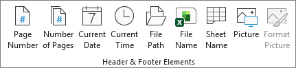

**수정 전**

화면 근거: 해당 기능의 최신 실제 실행 화면 미확보 또는 미구현

### TC-RIB-33 · 쿼리 편집

분류: 특수 · 결과: **실패**

| 항목 | 내용 |
| --- | --- |
| 실행 절차 | 쿼리 개체의 전용 편집 진입을 확인합니다. |
| 기대값 | 쿼리 선택·편집 탭을 제공합니다. |
| 실제 결과 | 현재 해당 기능/전용 탭은 구현되지 않았습니다. 이전 삽입/홈 화면을 해당 기능의 실행 증거로 취급하지 않습니다. |
| 수정 내용 | 이번 회차 수정 없음. 이전 기록의 근거와 제한을 보존합니다. |
| 재검증 | 전체 명령의 최신 실행 재검증은 미실행입니다. |
| 원본 출처·버전 | Data Get & Transform 부분 자료 · https://support.microsoft.com/en-us/excel/about-power-query-in-excel |

**Excel 원본**

**수정 전**

화면 근거: 해당 기능의 최신 실제 실행 화면 미확보 또는 미구현

### TC-RIB-34 · 게임 데이터

분류: 제품 전용 · 결과: **부분 확인**

| 항목 | 내용 |
| --- | --- |
| 실행 절차 | 게임 데이터 탭 선택 |
| 기대값 | 등록 종류별 그룹과 창 색상 일관성 |
| 실제 결과 | 최신 Unity에서 해당 제품 전용 화면을 재촬영했습니다. 전체 명령·플레이 잠금·저장 실패의 재검증은 남아 있습니다. |
| 수정 내용 | 이번 회차 수정 없음. 이전 기록의 근거와 제한을 보존합니다. |
| 재검증 | 전체 명령의 최신 실행 재검증은 미실행입니다. |
| 원본 출처·버전 | Excel 대응 원본 없음·제품 고유 기능 · 제품 전용 기능: Excel 대응 원본 없음 |

**수정 전**

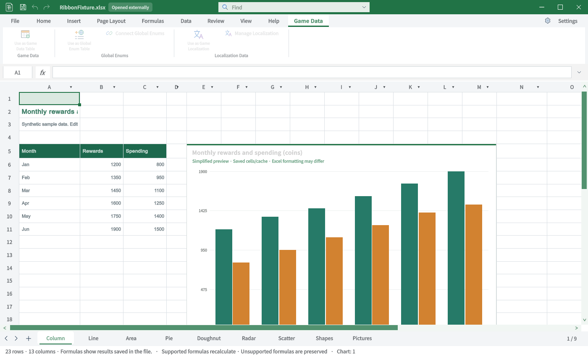

**수정 후 실제 실행**

화면 근거: 대응 원본 사진 없음 또는 정확한 버전의 원본 미확보; 제품 전용 기능이므로 Excel 원본과 직접 대응하지 않음

### TC-RIB-35 · 게임 테이블 도구

분류: 제품 전용 · 결과: **부분 확인**

| 항목 | 내용 |
| --- | --- |
| 실행 절차 | EnumGear 선택 |
| 기대값 | 게임 테이블 전용 도구·사용 예제 |
| 실제 결과 | 최신 Unity에서 해당 제품 전용 화면을 재촬영했습니다. 전체 명령·플레이 잠금·저장 실패의 재검증은 남아 있습니다. |
| 수정 내용 | 이번 회차 수정 없음. 이전 기록의 근거와 제한을 보존합니다. |
| 재검증 | 전체 명령의 최신 실행 재검증은 미실행입니다. |
| 원본 출처·버전 | Excel 대응 원본 없음·제품 고유 기능 · 제품 전용 기능: Excel 대응 원본 없음 |

**수정 전**

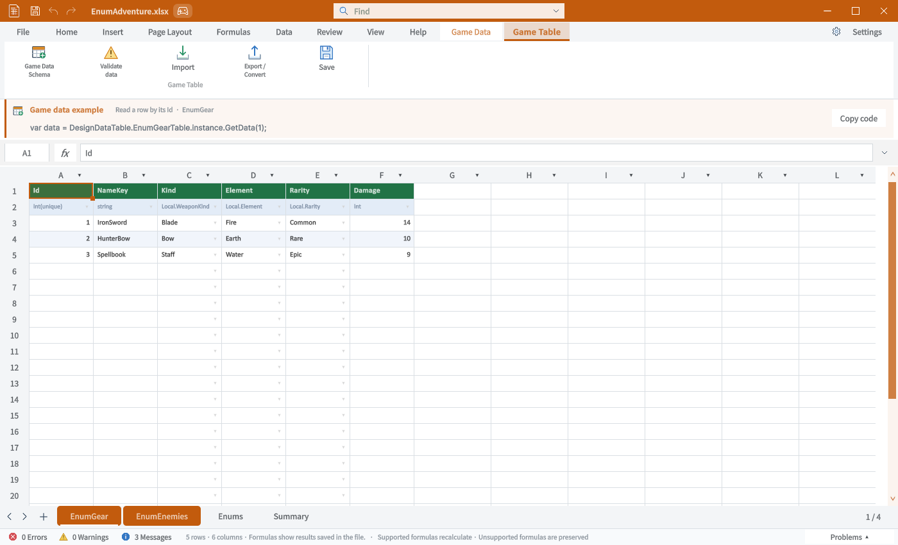

**수정 후 실제 실행**

화면 근거: 대응 원본 사진 없음 또는 정확한 버전의 원본 미확보; 제품 전용 기능이므로 Excel 원본과 직접 대응하지 않음

### TC-RIB-36 · 열거형 도구

분류: 제품 전용 · 결과: **부분 확인**

| 항목 | 내용 |
| --- | --- |
| 실행 절차 | Enums 시트 선택 |
| 기대값 | Enum 전용 도구·사용 예제 |
| 실제 결과 | 최신 Unity에서 해당 제품 전용 화면을 재촬영했습니다. 전체 명령·플레이 잠금·저장 실패의 재검증은 남아 있습니다. |
| 수정 내용 | 이번 회차 수정 없음. 이전 기록의 근거와 제한을 보존합니다. |
| 재검증 | 전체 명령의 최신 실행 재검증은 미실행입니다. |
| 원본 출처·버전 | Excel 대응 원본 없음·제품 고유 기능 · 제품 전용 기능: Excel 대응 원본 없음 |

**수정 전**

**수정 후 실제 실행**

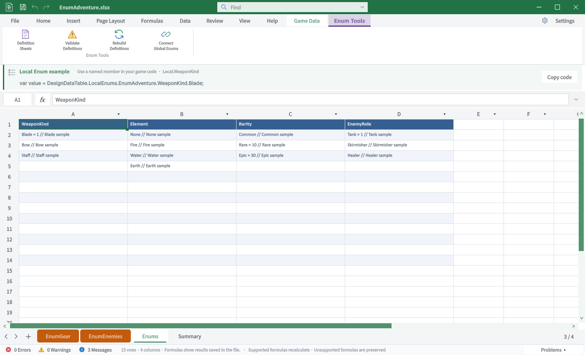

화면 근거: 대응 원본 사진 없음 또는 정확한 버전의 원본 미확보; 제품 전용 기능이므로 Excel 원본과 직접 대응하지 않음

### TC-RIB-37 · 로컬라이징

분류: 제품 전용 · 결과: **부분 확인**

| 항목 | 내용 |
| --- | --- |
| 실행 절차 | ArcadeText 선택 |
| 기대값 | 번역 전용 도구·대체 언어·예제 |
| 실제 결과 | 최신 Unity에서 해당 제품 전용 화면을 재촬영했습니다. 전체 명령·플레이 잠금·저장 실패의 재검증은 남아 있습니다. |
| 수정 내용 | 이번 회차 수정 없음. 이전 기록의 근거와 제한을 보존합니다. |
| 재검증 | 전체 명령의 최신 실행 재검증은 미실행입니다. |
| 원본 출처·버전 | Excel 대응 원본 없음·제품 고유 기능 · 제품 전용 기능: Excel 대응 원본 없음 |

**수정 전**

**수정 후 실제 실행**

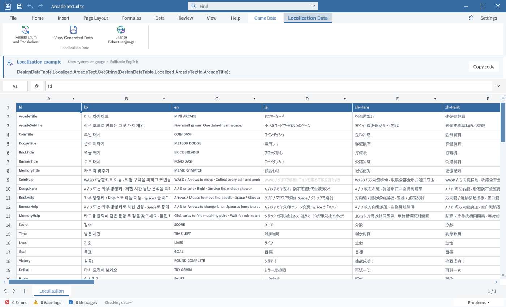

화면 근거: 대응 원본 사진 없음 또는 정확한 버전의 원본 미확보; 제품 전용 기능이므로 Excel 원본과 직접 대응하지 않음

### TC-RIB-38 · 서머리 도구

분류: 제품 전용 · 결과: **부분 확인**

| 항목 | 내용 |
| --- | --- |
| 실행 절차 | Summary 시트 선택 |
| 기대값 | 서머리 전용 도구와 안내 |
| 실제 결과 | 최신 Unity에서 해당 제품 전용 화면을 재촬영했습니다. 전체 명령·플레이 잠금·저장 실패의 재검증은 남아 있습니다. |
| 수정 내용 | 이번 회차 수정 없음. 이전 기록의 근거와 제한을 보존합니다. |
| 재검증 | 전체 명령의 최신 실행 재검증은 미실행입니다. |
| 원본 출처·버전 | Excel 대응 원본 없음·제품 고유 기능 · 제품 전용 기능: Excel 대응 원본 없음 |

**수정 전**

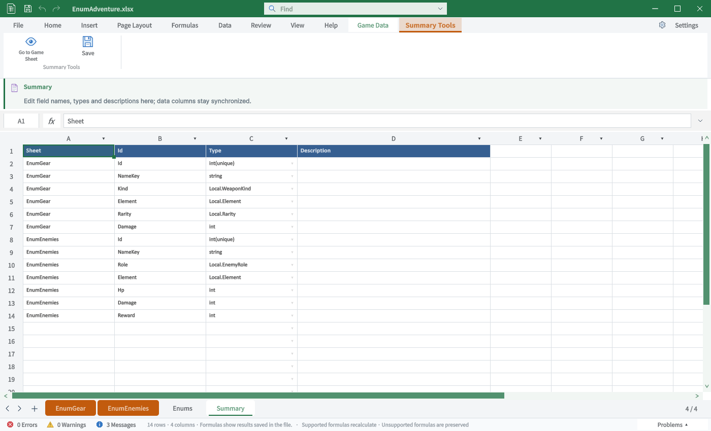

**수정 후 실제 실행**

화면 근거: 대응 원본 사진 없음 또는 정확한 버전의 원본 미확보; 제품 전용 기능이므로 Excel 원본과 직접 대응하지 않음

### TC-RIB-39 · 설정

분류: 제품 전용 · 결과: **부분 확인**

| 항목 | 내용 |
| --- | --- |
| 실행 절차 | 환경 설정 열기 |
| 기대값 | 우측 설정 위치와 읽기 쉬운 패널 |
| 실제 결과 | 최신 Unity에서 해당 제품 전용 화면을 재촬영했습니다. 전체 명령·플레이 잠금·저장 실패의 재검증은 남아 있습니다. |
| 수정 내용 | 이번 회차 수정 없음. 이전 기록의 근거와 제한을 보존합니다. |
| 재검증 | 전체 명령의 최신 실행 재검증은 미실행입니다. |
| 원본 출처·버전 | Excel 대응 원본 없음·제품 고유 기능 · 제품 전용 기능: Excel 대응 원본 없음 |

**수정 전**

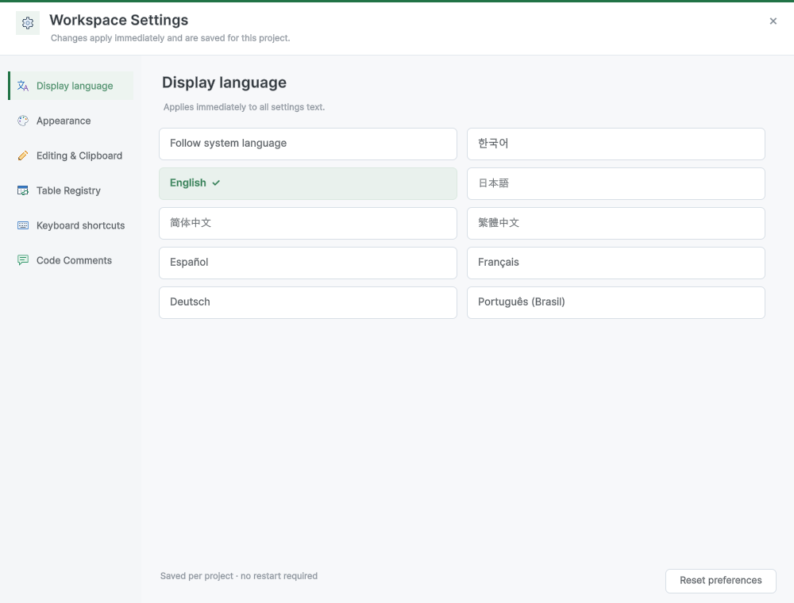

**수정 후 실제 실행**

화면 근거: 대응 원본 사진 없음 또는 정확한 버전의 원본 미확보; 제품 전용 기능이므로 Excel 원본과 직접 대응하지 않음

### TC-RIB-40 · 빠른 실행 도구

분류: 기준 목록 보충 · 결과: **부분 확인**

| 항목 | 내용 |
| --- | --- |
| 실행 절차 | 해당 전용 탭 또는 진입점을 현재 리본에서 확인합니다. |
| 기대값 | 저장·Undo·Redo·제목 표시 |
| 실제 결과 | 자료가 구형 별칭·부분 화면이거나 해당 기능의 실제 실행 증거가 부족합니다. 독립 최신 탭으로 확정하거나 통과 처리하지 않았습니다. |
| 수정 내용 | 이번 회차 수정 없음. 이전 기록의 근거와 제한을 보존합니다. |
| 재검증 | 전체 명령의 최신 실행 재검증은 미실행입니다. |
| 원본 출처·버전 | Excel365 원본의 빠른 실행 도구 일부 · https://www.officetooltips.com/excel/tips/how_to_change_format_for_diagram_shapes_in_excel |

**Excel 원본**

**수정 전**

**수정 후 실제 실행**

### TC-RIB-41 · 인쇄 미리보기

분류: 기준 목록 보충 · 결과: **부분 확인**

| 항목 | 내용 |
| --- | --- |
| 실행 절차 | 해당 전용 탭 또는 진입점을 현재 리본에서 확인합니다. |
| 기대값 | Print Preview 전용 탭·인쇄 설정 |
| 실제 결과 | 자료가 구형 별칭·부분 화면이거나 해당 기능의 실제 실행 증거가 부족합니다. 독립 최신 탭으로 확정하거나 통과 처리하지 않았습니다. |
| 수정 내용 | 이번 회차 수정 없음. 이전 기록의 근거와 제한을 보존합니다. |
| 재검증 | 전체 명령의 최신 실행 재검증은 미실행입니다. |
| 원본 출처·버전 | 해당 Excel 원본 미확보 · 제품 전용 기능: Excel 대응 원본 없음 |

**수정 전**

화면 근거: 대응 원본 사진 없음 또는 정확한 버전의 원본 미확보; 해당 기능의 최신 실제 실행 화면 미확보 또는 미구현

### TC-RIB-42 · 배경 제거

분류: 기준 목록 보충 · 결과: **부분 확인**

| 항목 | 내용 |
| --- | --- |
| 실행 절차 | 해당 전용 탭 또는 진입점을 현재 리본에서 확인합니다. |
| 기대값 | 그림 선택 후 배경 제거 전용 탭 |
| 실제 결과 | 자료가 구형 별칭·부분 화면이거나 해당 기능의 실제 실행 증거가 부족합니다. 독립 최신 탭으로 확정하거나 통과 처리하지 않았습니다. |
| 수정 내용 | 이번 회차 수정 없음. 이전 기록의 근거와 제한을 보존합니다. |
| 재검증 | 전체 명령의 최신 실행 재검증은 미실행입니다. |
| 원본 출처·버전 | 해당 Excel 원본 미확보 · 제품 전용 기능: Excel 대응 원본 없음 |

**수정 전**

화면 근거: 대응 원본 사진 없음 또는 정확한 버전의 원본 미확보; 해당 기능의 최신 실제 실행 화면 미확보 또는 미구현

### TC-RIB-43 · 구형 차트 레이아웃

분류: 기준 목록 보충 · 결과: **부분 확인**

| 항목 | 내용 |
| --- | --- |
| 실행 절차 | 해당 전용 탭 또는 진입점을 현재 리본에서 확인합니다. |
| 기대값 | 기준 목록 TabChartToolsLayout 명령군 |
| 실제 결과 | 자료가 구형 별칭·부분 화면이거나 해당 기능의 실제 실행 증거가 부족합니다. 독립 최신 탭으로 확정하거나 통과 처리하지 않았습니다. |
| 수정 내용 | 이번 회차 수정 없음. 이전 기록의 근거와 제한을 보존합니다. |
| 재검증 | 전체 명령의 최신 실행 재검증은 미실행입니다. |
| 원본 출처·버전 | 해당 Excel 원본 미확보 · 제품 전용 기능: Excel 대응 원본 없음 |

**수정 전**

화면 근거: 대응 원본 사진 없음 또는 정확한 버전의 원본 미확보; 해당 기능의 최신 실제 실행 화면 미확보 또는 미구현

### TC-RIB-44 · 구형 피벗 차트 레이아웃

분류: 기준 목록 보충 · 결과: **부분 확인**

| 항목 | 내용 |
| --- | --- |
| 실행 절차 | 해당 전용 탭 또는 진입점을 현재 리본에서 확인합니다. |
| 기대값 | 기준 목록 TabPivotChartToolsLayout 명령군 |
| 실제 결과 | 자료가 구형 별칭·부분 화면이거나 해당 기능의 실제 실행 증거가 부족합니다. 독립 최신 탭으로 확정하거나 통과 처리하지 않았습니다. |
| 수정 내용 | 이번 회차 수정 없음. 이전 기록의 근거와 제한을 보존합니다. |
| 재검증 | 전체 명령의 최신 실행 재검증은 미실행입니다. |
| 원본 출처·버전 | 해당 Excel 원본 미확보 · 제품 전용 기능: Excel 대응 원본 없음 |

**수정 전**

화면 근거: 대응 원본 사진 없음 또는 정확한 버전의 원본 미확보; 해당 기능의 최신 실제 실행 화면 미확보 또는 미구현

### TC-RIB-45 · BI 시각화 도구

분류: 기준 목록 보충 · 결과: **부분 확인**

| 항목 | 내용 |
| --- | --- |
| 실행 절차 | 해당 전용 탭 또는 진입점을 현재 리본에서 확인합니다. |
| 기대값 | 기준 목록 TabBIVisualTools의 활성 조건과 명령 |
| 실제 결과 | 자료가 구형 별칭·부분 화면이거나 해당 기능의 실제 실행 증거가 부족합니다. 독립 최신 탭으로 확정하거나 통과 처리하지 않았습니다. |
| 수정 내용 | 이번 회차 수정 없음. 이전 기록의 근거와 제한을 보존합니다. |
| 재검증 | 전체 명령의 최신 실행 재검증은 미실행입니다. |
| 원본 출처·버전 | 해당 Excel 원본 미확보 · 제품 전용 기능: Excel 대응 원본 없음 |

**수정 전**

화면 근거: 대응 원본 사진 없음 또는 정확한 버전의 원본 미확보; 해당 기능의 최신 실제 실행 화면 미확보 또는 미구현

### TC-RIB-46 · 접근성 작성 도구

분류: 기준 목록 보충 · 결과: **부분 확인**

| 항목 | 내용 |
| --- | --- |
| 실행 절차 | 해당 전용 탭 또는 진입점을 현재 리본에서 확인합니다. |
| 기대값 | 기준 목록 TabAccessibleAuthoring의 활성 조건과 명령 |
| 실제 결과 | 자료가 구형 별칭·부분 화면이거나 해당 기능의 실제 실행 증거가 부족합니다. 독립 최신 탭으로 확정하거나 통과 처리하지 않았습니다. |
| 수정 내용 | 이번 회차 수정 없음. 이전 기록의 근거와 제한을 보존합니다. |
| 재검증 | 전체 명령의 최신 실행 재검증은 미실행입니다. |
| 원본 출처·버전 | 해당 Excel 원본 미확보 · 제품 전용 기능: Excel 대응 원본 없음 |

**수정 전**

화면 근거: 대응 원본 사진 없음 또는 정확한 버전의 원본 미확보; 해당 기능의 최신 실제 실행 화면 미확보 또는 미구현

## 남은 사항

1. 전체46TC의 원본과 같은 메뉴·아이콘·배치·기능 일치: 미완료. 아래 각TC의 미구현·미실행을 확인해 주십시오.
2. 피벗·슬라이서·시간 막대·SmartArt·3D·쿼리 등의 엔진과 전용 탭은 구현되지 않았습니다. 실제 외부 제한이 아니므로 차단으로 표시하지 않습니다.
3. 기존 탭도 모든 메뉴를 복제한 상태가 아닙니다. 차트 비활성 버튼, 도형 효과/다중 맞춤, 표 이름/범위/총합 행 등의 구현과 검증이 남았습니다.
4. 최신 본 프로젝트의 실제 클릭·입력·IME·반복 저장·닫기 안전성 전체 회귀가 남았습니다. 현재 보고서는 입력 성능 및 더티 파일 유실 문제의 해결을 보증하지 않습니다.
5. 문서9개 언어 갱신과 최종 제품 변경의 커밋·푸시·제출 패키지 검증이 남았습니다. 이 보고서 게시와 제품 배포를 구분합니다.

교훈 검토: 전역 지침 변경 없음. 미실행을 통과로 보고하지 않기, 실행 증거와 화면 촬영을 구분하기, 최종 개별 웹 링크 확인 의무가 기존 지침에 이미 있습니다. 이번에는 해당 의무를 완료 보고에 적용하지 못했으므로 기존 규칙을 그대로 준수하고 상세 근거를 이 프로젝트에 남깁니다.

## 작업 시간

- 제안 시간: 전체 작업4–6시간(2026-10-31 23:42:56 KST 시작). 이번 보고서 정리·공개10–15분(2026-11-01 02:52:15 KST 시작).
- 실제로 완료된 시간: 제품 전체 미완료. 이 원본 작성 시각 2026-11-01 02:54:05 KST. 보고서 공개 완료 시각과 소요 시간은 실제 배포 확인 후 채팅에 기록합니다.
- XERJ: 사용 — 작업 시작 XERJ 심볼 검색 후 현재 소스·XLSX XML 및 실제 Unity 결과와 대조. 이번 보고서 단계는 보존된 실행 근거를 확인했습니다.
