## 작업 결과

전체46개 대조 항목을 하나의 보고서에 유지합니다. 구현과 실제 QA를 마친 세부 항목만 근거와 함께 갱신했습니다. 전체 탭의 레이아웃·아이콘·영역·단축키는 계속 구현 중이며 지속 목표는 active입니다.

## 변경 내용

### 적용 내용

ChartGallery의7개 차트 시트에 실제 XLSX 표를 등록했습니다.6개를 추가했으며 각 시트의 서로 다른 범위를 유지합니다. 원본 데이터·서식과 실제 차트7개 파트의 바이트 보존을 별도 확인했습니다. 재패키징 원본도 갱신하고 누락 방지 검사를 추가했습니다.

표 이름을 편집 가능한 필드로 바꾸고 로컬 구조화 참조·정의 이름을 함께 갱신합니다. 외부 참조·불투명 확장 XML은 보존합니다. 차트 파트 경로를 디렉터리 추측 대신 콘텐츠 형식으로 조회해 시트 이름/값 갱신을 복구했습니다.

Affinity3.3.1의 편집 가능한 V9 벡터 원본에서 위/가운데/아래·왼쪽/가운데/오른쪽 맞춤6개를 다시 제작했습니다. 기본 아틀라스96개 중 해당6개만 변경했고 색상/흰색 원본과 개별 출력12개를 보관했습니다. 추가48개는 V11을 유지합니다.

Ctrl+F1 접기·펼치기, 접힌 리본의 임시 탭 열기·클릭·Escape, 표 이름 입력 중 접기를 구현했습니다. 홈의 Tab/Shift+Tab·방향키·Enter/Space 명령 이동을 추가했습니다. 두 기존 네이티브 포커스 검사를 모두 유지합니다.

이전 보고서의 Home 접근 키40개는 집계 오류였습니다. 현재 소스의 실제 목록은42개이며 이번 보고서에서 정정합니다.

## 검증

실제 실행: Unity6000.0.83f1, Windows 격리 QA. 검사 수는 반복 상태/셀 검사를 포함하며 고유 사용자 TC 수가 아닙니다. 합계를46TC 통과 수로 사용하지 않습니다. 각 JSON의 실행 시각과 어셈블리 ID를 보존합니다.

|검증|결과|근거|
|---|---|---|
|홈 API/GUI/저장·Undo|111 통과(R5)|[home-api-r5.json](../assets/ribbon-goal-round5-20261101/home-api-r5.json)|
|실제 Home 접근키 회귀|13 통과(R13)|[home-physical-r13.json](../assets/ribbon-goal-round5-20261101/home-physical-r13.json)|
|실제 Tab/방향키/Enter|11 통과(R3)|[home-navigation-enter-r3.json](../assets/ribbon-goal-round5-20261101/home-navigation-enter-r3.json)|
|실제 Tab/방향키/Space|11 통과(R5)|[home-navigation-space-r5.json](../assets/ribbon-goal-round5-20261101/home-navigation-space-r5.json)|
|실제 임시 리본 포인터/이름 편집|13 통과(R4)|[ribbon-pointer-r4.json](../assets/ribbon-goal-round5-20261101/ribbon-pointer-r4.json)|
|접기·펼치기 실제 키|8 통과(R3)|[ribbon-collapse-r3.json](../assets/ribbon-goal-round5-20261101/ribbon-collapse-r3.json)|
|Unity 실제 Ctrl+D·Ctrl+F1 범위|8 통과(R3)|[unity-scope-r3.json](../assets/ribbon-goal-round5-20261101/unity-scope-r3.json)|
|7개 표·셀·경계·저장·재열기|6764 검사 통과(R1)|[native-tables-r1.json](../assets/ribbon-goal-round5-20261101/native-tables-r1.json)|
|표 이름 API|38 통과(R3)|[table-name-api.json](../assets/ribbon-goal-round5-20261101/table-name-api.json)|
|차트 파트 이름·값 갱신|8 통과(R2)|[chart-part-rename.json](../assets/ribbon-goal-round5-20261101/chart-part-rename.json)|
|현재20개 탭 촬영|촬영 성공, 기능 통과 아님(R8)|[capture-r8.json](../assets/ribbon-goal-round5-20261101/capture-r8.json)|

Tab 보조 이벤트 때문에 두 번째 이동이 끊긴 실제 실패(R2)와 Space 실행 후 Undo 실패(R4)를 보존했습니다. 보조 문자/Shift 처리를 수정한 뒤 새 문서에서 각각 재검증했습니다. 임시 리본 Escape 수정 후 문서 clean·원래 표 이름·Source 값 복구를 확인했습니다.

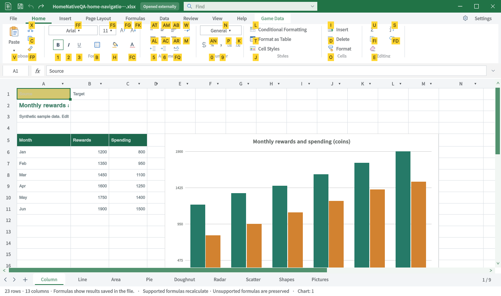

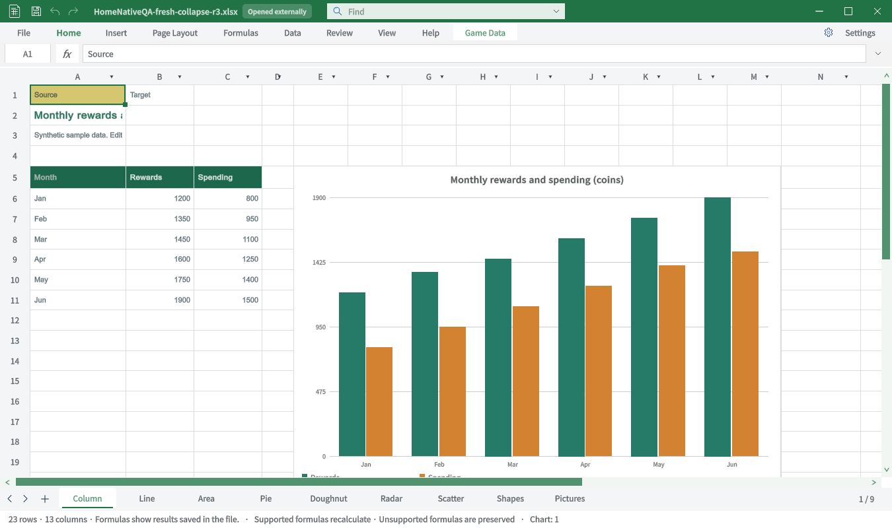

Excel 원본은 Microsoft 공개 자료이며 로컬 Excel 새 촬영이 아닙니다. 정확한 빌드/DPI는 미확인입니다. 실제 QA 화면은 직접 캡처 원본이고 이미지 편집/합성을 하지 않았습니다. 일부 이미지는 작은 글자 판독을 위해200KB를 초과합니다.

[전체 첨부 크기·SHA256](../assets/ribbon-goal-round5-20261101/evidence-manifest.json) · [실제 차트7개 파트 보존](../assets/ribbon-goal-round5-20261101/native-table-chart-parts.json) · [재패키징 누락 방지](../assets/ribbon-goal-round5-20261101/sample-package-guard.json) · [Affinity6개 변경 범위](../assets/ribbon-goal-round5-20261101/alignment-v9-pixel-check.json)

### TC-RIB-01 · 파일

분류: 일반 · 결과: **부분 확인**

| 항목 | 내용 |
| --- | --- |
| 실행 절차 | 파일 메뉴를 엽니다. |
| 기대값 | 열기·저장·닫기와 Excel Backstage 그룹을 비교합니다. |
| 실제 결과 | 원본은 보호 메뉴 일부뿐입니다. 현재는 새 문서·열기·다른 이름 저장·복구·새로 고침 팝업입니다. |
| 수정 내용 | 이번 회차 수정 없음. 이전 기록의 근거와 제한을 보존합니다. |
| 재검증 | 전체 명령의 최신 실행 재검증은 미실행입니다. |
| 원본 출처·버전 | Excel 보호 메뉴 부분 자료 · https://support.microsoft.com/en-us/excel/restrict-changes-to-files-in-excel |

**Excel 원본**

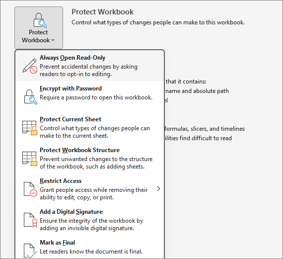

**수정 전**

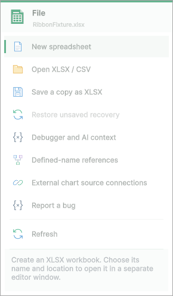

화면 근거: 해당 기능의 최신 실제 실행 화면 미확보 또는 미구현

### TC-RIB-02 · 홈

분류: 일반 · 결과: **부분 확인**

| 항목 | 내용 |
| --- | --- |
| 실행 절차 | 일반 시트에서 홈 탭을 선택합니다. |
| 기대값 | 클립보드·글꼴·맞춤·표시 형식·스타일·셀·편집 그룹을 대조합니다. |
| 실제 결과 | Home7개 그룹 배치·42개 접근 키·Ctrl+F1·임시 리본·Tab/Shift+Tab/방향키/Enter/Space 이동 구현. 전체 홈 레이아웃·명령 최종 일치는 미완료. |
| 수정 내용 | Affinity V9 맞춤6종 재제작, 기본96개 중6개만 변경. 추가16종은 ExtrasV11 유지. 보조 문자 누수·임시 리본 클릭/접기·이름 편집 유지 수정. 포커스 검사2곳 유지. |
| 재검증 | 홈111검사(R5),물리 접근키13건(R13),Enter 이동11건(R3),Space 이동11건(R5),임시 리본13건(R4). 실패 R2/R4 기록 보존. 각 증거의 MVID/시각으로 검증 버전을 구분. |
| 원본 출처·버전 | Microsoft Windows Excel Home 키 팁 실제 원본1350×200. 정확한 Excel 빌드와 DPI는 미확인. https://support.microsoft.com/en-us/accessibility/excel/keyboard-shortcuts-in-excel |

**Excel 원본**

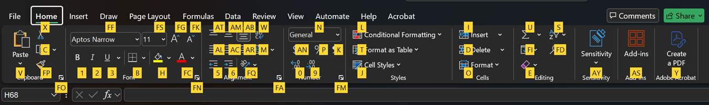

**수정 전**

**수정 후 실제 실행**

화면 근거: 전체 Home 명령 전수 검증 및 나머지 아이콘의 원본 대조·수정이 남음.

### TC-RIB-03 · 삽입

분류: 일반 · 결과: **부분 확인**

| 항목 | 내용 |
| --- | --- |
| 실행 절차 | 삽입 탭에서 도형 타일을 클릭합니다. |
| 기대값 | 표·도형·그림·차트·링크·텍스트·기호와 추가 삽입 그룹을 대조합니다. |
| 실제 결과 | 도형187종을9개 분류의 스크롤 드롭다운으로 변경했습니다. 203건 분류·템플릿·실제 항목 클릭 검사 통과. 모든187종의 마우스 배치 전수는 미실행입니다. |
| 수정 내용 | 도형187종을9개 분류의 스크롤 드롭다운으로 변경했습니다. |
| 재검증 | 203건 분류·템플릿·실제 항목 클릭 검사 통과. 모든187종의 마우스 배치 전수는 미실행입니다. 최신R7 실제 화면 촬영 성공. 촬영만으로 해당 TC의 기능 통과를 의미하지 않습니다. |
| 원본 출처·버전 | 부분 원본·정확한 빌드 미확인 · https://techcommunity.microsoft.com/blog/nonprofittechies/getting-familiar-with-microsoft-excel/3756412/ |

**Excel 원본**

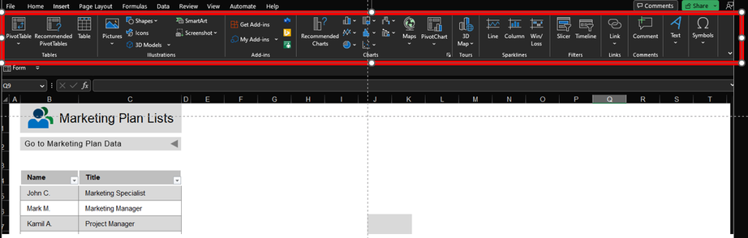

**수정 전**

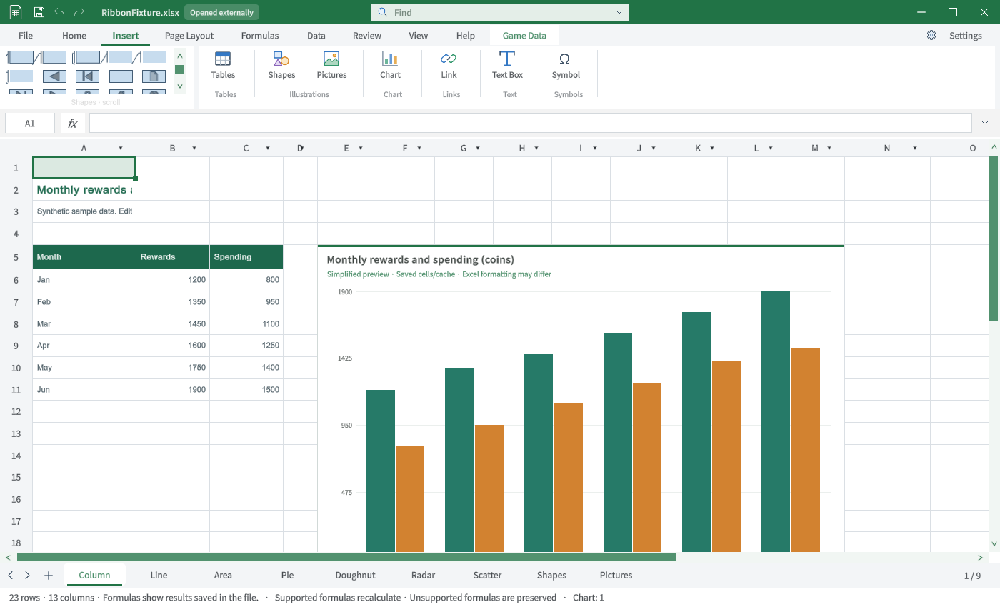

**수정 후 실제 실행**

### TC-RIB-04 · 페이지 레이아웃

분류: 일반 · 결과: **부분 확인**

| 항목 | 내용 |
| --- | --- |
| 실행 절차 | 페이지 레이아웃을 선택합니다. |
| 기대값 | 테마·페이지 설정·배율 그룹을 비교합니다. |
| 실제 결과 | 현재는 페이지 설정 버튼 하나입니다. 원본의 독립 그룹·리본 컨트롤이 없습니다. |
| 수정 내용 | 이번 회차 수정 없음. 이전 기록의 근거와 제한을 보존합니다. |
| 재검증 | 전체 명령의 최신 실행 재검증은 미실행입니다. 최신R7 실제 화면 촬영 성공. 촬영만으로 해당 TC의 기능 통과를 의미하지 않습니다. |
| 원본 출처·버전 | 구형 Windows 원본 일부 · https://support.microsoft.com/en-us/excel/fit-to-one-page-in-excel |

**Excel 원본**

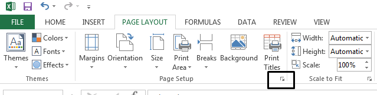

**수정 전**

**수정 후 실제 실행**

### TC-RIB-05 · 수식

분류: 일반 · 결과: **부분 확인**

| 항목 | 내용 |
| --- | --- |
| 실행 절차 | 수식 탭을 선택합니다. |
| 기대값 | 함수 라이브러리·이름·수식 분석·계산을 비교합니다. |
| 실제 결과 | 도움말·이름 관리자·이름 참조·재계산은 보이지만 함수 분류 갤러리와 분석 도구가 없습니다. |
| 수정 내용 | 이번 회차 수정 없음. 이전 기록의 근거와 제한을 보존합니다. |
| 재검증 | 전체 명령의 최신 실행 재검증은 미실행입니다. 최신R7 실제 화면 촬영 성공. 촬영만으로 해당 TC의 기능 통과를 의미하지 않습니다. |
| 원본 출처·버전 | 함수 라이브러리 부분 원본 · https://support.microsoft.com/en-us/excel/using-functions-and-nested-functions-in-excel-formulas |

**Excel 원본**

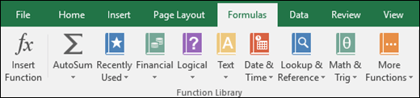

**수정 전**

**수정 후 실제 실행**

### TC-RIB-06 · 데이터

분류: 일반 · 결과: **부분 확인**

| 항목 | 내용 |
| --- | --- |
| 실행 절차 | 데이터 탭을 선택합니다. |
| 기대값 | 정렬·필터와 데이터 가져오기·쿼리 그룹을 비교합니다. |
| 실제 결과 | 정렬·필터·외부 차트 연결만 보입니다. 원본의 Get Data·쿼리 새로 고침 구성이 없습니다. |
| 수정 내용 | 이번 회차 수정 없음. 이전 기록의 근거와 제한을 보존합니다. |
| 재검증 | 전체 명령의 최신 실행 재검증은 미실행입니다. 최신R7 실제 화면 촬영 성공. 촬영만으로 해당 TC의 기능 통과를 의미하지 않습니다. |
| 원본 출처·버전 | Excel2016 Get & Transform 부분 원본 · https://support.microsoft.com/en-us/excel/about-power-query-in-excel |

**Excel 원본**

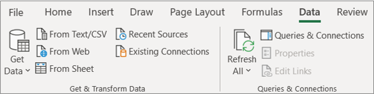

**수정 전**

**수정 후 실제 실행**

### TC-RIB-07 · 검토

분류: 일반 · 결과: **부분 확인**

| 항목 | 내용 |
| --- | --- |
| 실행 절차 | 검토 탭을 선택합니다. |
| 기대값 | 맞춤법·접근성·변경·댓글·보호와 통계를 대조합니다. |
| 실제 결과 | 현재는 통계 버튼만 보입니다. 비교 원본은 Excel 웹이므로 Windows 동일 버전 비교는 아닙니다. |
| 수정 내용 | 이번 회차 수정 없음. 이전 기록의 근거와 제한을 보존합니다. |
| 재검증 | 전체 명령의 최신 실행 재검증은 미실행입니다. 최신R7 실제 화면 촬영 성공. 촬영만으로 해당 TC의 기능 통과를 의미하지 않습니다. |
| 원본 출처·버전 | Excel 웹 원본·Windows와 구별 · https://learn.microsoft.com/en-us/answers/questions/5190624/review-tab-options-greyed-out-in-excel-365-files-w |

**Excel 원본**

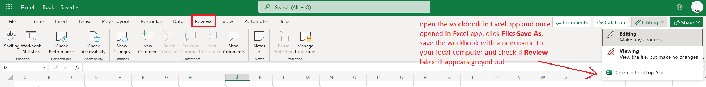

**수정 전**

**수정 후 실제 실행**

### TC-RIB-08 · 보기

분류: 일반 · 결과: **부분 확인**

| 항목 | 내용 |
| --- | --- |
| 실행 절차 | 보기 탭을 선택합니다. |
| 기대값 | 통합 문서 보기·표시·확대/축소·창 그룹을 대조합니다. |
| 실제 결과 | 고정·해제·개체·시트·보기 메뉴는 보이지만 원본의 보기/확대 그룹 구성과 다릅니다. |
| 수정 내용 | 이번 회차 수정 없음. 이전 기록의 근거와 제한을 보존합니다. |
| 재검증 | 전체 명령의 최신 실행 재검증은 미실행입니다. 최신R7 실제 화면 촬영 성공. 촬영만으로 해당 TC의 기능 통과를 의미하지 않습니다. |
| 원본 출처·버전 | 부분 원본·정확한 빌드 미확인 · https://techcommunity.microsoft.com/discussions/excelgeneral/view-ribbon-tab-checkboxes-no-longer-aligned/3989915 |

**Excel 원본**

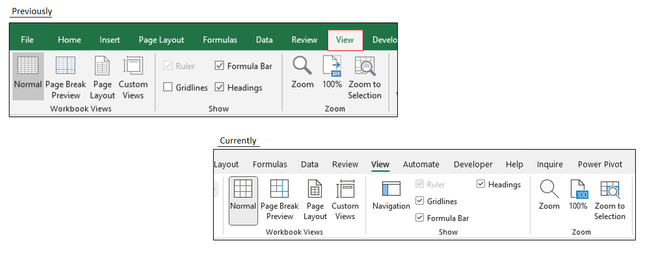

**수정 전**

**수정 후 실제 실행**

### TC-RIB-09 · 도움말

분류: 일반 · 결과: **부분 확인**

| 항목 | 내용 |
| --- | --- |
| 실행 절차 | 도움말을 선택합니다. |
| 기대값 | 도움말 탭의 실제 명령을 대조합니다. |
| 실제 결과 | 현재 디버그·버그 보고·수식 버튼 표시. 원본에는 Help 탭 이름만 보여 명령 대조는 미실행입니다. |
| 수정 내용 | 이번 회차 수정 없음. 이전 기록의 근거와 제한을 보존합니다. |
| 재검증 | 전체 명령의 최신 실행 재검증은 미실행입니다. 최신R7 실제 화면 촬영 성공. 촬영만으로 해당 TC의 기능 통과를 의미하지 않습니다. |
| 원본 출처·버전 | 전체 Help 리본 아님 · https://techcommunity.microsoft.com/blog/nonprofittechies/getting-familiar-with-microsoft-excel/3756412/ |

**Excel 원본**

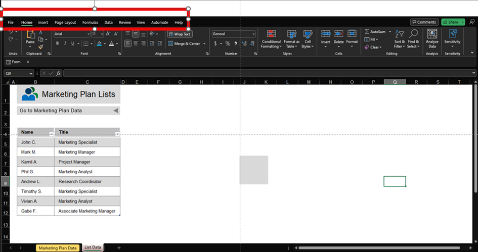

**수정 전**

**수정 후 실제 실행**

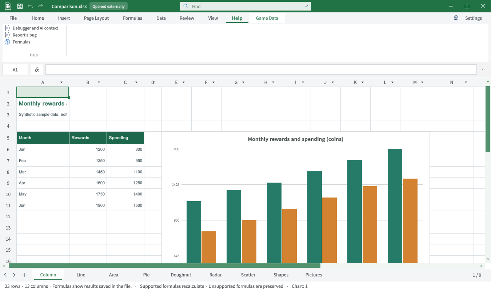

### TC-RIB-10 · 그리기

분류: 일반 · 결과: **실패**

| 항목 | 내용 |
| --- | --- |
| 실행 절차 | 그리기 탭 진입점을 찾습니다. |
| 기대값 | 펜·잉크·다시 재생 등의 탭을 제공합니다. |
| 실제 결과 | 현재 해당 기능/전용 탭은 구현되지 않았습니다. 이전 삽입/홈 화면을 해당 기능의 실행 증거로 취급하지 않습니다. |
| 수정 내용 | 이번 회차 수정 없음. 이전 기록의 근거와 제한을 보존합니다. |
| 재검증 | 전체 명령의 최신 실행 재검증은 미실행입니다. |
| 원본 출처·버전 | Excel Draw 화면·사진 촬영 자료 · https://learn.microsoft.com/en-us/answers/questions/5070058/cant-exit-the-drawing-tool-in-excel |

**Excel 원본**

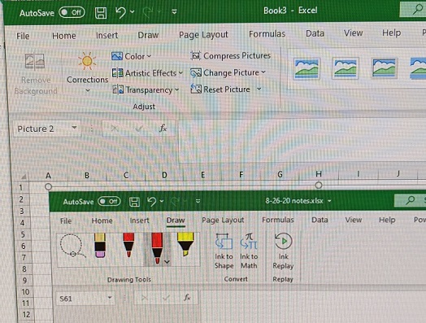

**수정 전**

화면 근거: 해당 기능의 최신 실제 실행 화면 미확보 또는 미구현

### TC-RIB-11 · 자동화

분류: 일반 · 결과: **실패**

| 항목 | 내용 |
| --- | --- |
| 실행 절차 | 자동화 탭 진입점을 찾습니다. |
| 기대값 | Office Scripts 목록과 스크립트 진입점을 대조합니다. |
| 실제 결과 | 현재 해당 기능/전용 탭은 구현되지 않았습니다. 이전 삽입/홈 화면을 해당 기능의 실행 증거로 취급하지 않습니다. |
| 수정 내용 | 이번 회차 수정 없음. 이전 기록의 근거와 제한을 보존합니다. |
| 재검증 | 전체 명령의 최신 실행 재검증은 미실행입니다. |
| 원본 출처·버전 | Excel Automate 원본 · https://techcommunity.microsoft.com/blog/microsoft365insiderblog/automate-tasks-with-office-scripts-in-excel-for-windows-and-mac/4216151 |

**Excel 원본**

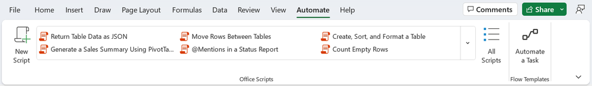

**수정 전**

화면 근거: 해당 기능의 최신 실제 실행 화면 미확보 또는 미구현

### TC-RIB-12 · 개발 도구

분류: 일반 · 결과: **실패**

| 항목 | 내용 |
| --- | --- |
| 실행 절차 | 개발 도구 탭 진입점을 찾습니다. |
| 기대값 | 컨트롤·코드·디자인 모드 그룹을 대조합니다. |
| 실제 결과 | 현재 해당 기능/전용 탭은 구현되지 않았습니다. 이전 삽입/홈 화면을 해당 기능의 실행 증거로 취급하지 않습니다. |
| 수정 내용 | 이번 회차 수정 없음. 이전 기록의 근거와 제한을 보존합니다. |
| 재검증 | 전체 명령의 최신 실행 재검증은 미실행입니다. |
| 원본 출처·버전 | Developer 컨트롤 부분 원본 · https://support.microsoft.com/en-us/excel/form-controls |

**Excel 원본**

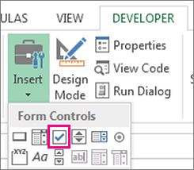

**수정 전**

화면 근거: 해당 기능의 최신 실제 실행 화면 미확보 또는 미구현

### TC-RIB-13 · 추가 기능

분류: 일반 · 결과: **실패**

| 항목 | 내용 |
| --- | --- |
| 실행 절차 | 삽입의 추가 기능 그룹을 확인합니다. |
| 기대값 | 추가 기능 진입점을 대조합니다. |
| 실제 결과 | 현재 해당 기능/전용 탭은 구현되지 않았습니다. 이전 삽입/홈 화면을 해당 기능의 실행 증거로 취급하지 않습니다. |
| 수정 내용 | 이번 회차 수정 없음. 이전 기록의 근거와 제한을 보존합니다. |
| 재검증 | 전체 명령의 최신 실행 재검증은 미실행입니다. |
| 원본 출처·버전 | 삽입 Add-ins 그룹 부분 원본 · https://techcommunity.microsoft.com/blog/nonprofittechies/getting-familiar-with-microsoft-excel/3756412/ |

**Excel 원본**

**수정 전**

화면 근거: 해당 기능의 최신 실제 실행 화면 미확보 또는 미구현

### TC-RIB-14 · 표 디자인

분류: 특수 · 결과: **부분 확인**

| 항목 | 내용 |
| --- | --- |
| 실행 절차 | ChartGallery A5:C11 안 C11을 선택합니다. |
| 기대값 | 표 내부에서 전용 탭·스타일 갤러리·옵션을 제공합니다. |
| 실제 결과 | ChartGallery7개 시트에 모두 실제 표 등록. 셀 선택 시 표 디자인 등장과 편집 가능한 이름·스타일 갤러리 확인. 표 범위/머리글/합계행/필터 UI는 아직 남음. |
| 수정 내용 | 6개 누락 표 추가, 원본 값·서식·차트7개 보존. 재패키징 원본/검사 갱신. 네이티브 이름 편집·로컬 참조 갱신/Undo 구현. |
| 재검증 | 6764 상태/셀 검사,표 내부115좌표와 유효 경계·저장 재열기·7개 실제 탭 촬영. 이름 API38검사 및 실제 입력7검사,임시 리본 이름 입력 유지13검사 포함. 전체TC 통과 아님. |
| 원본 출처·버전 | Windows 표 디자인 및 피벗 분석 원본 · https://support.microsoft.com/en-us/excel/where-are-the-table-tools |

**Excel 원본**

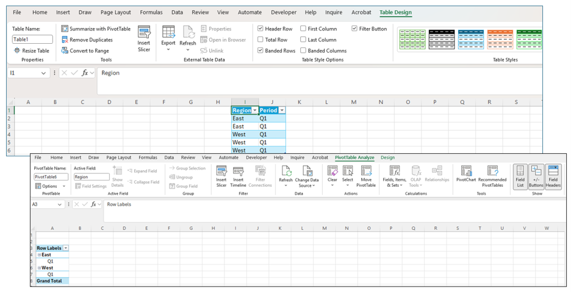

**수정 전**

**수정 후 실제 실행**

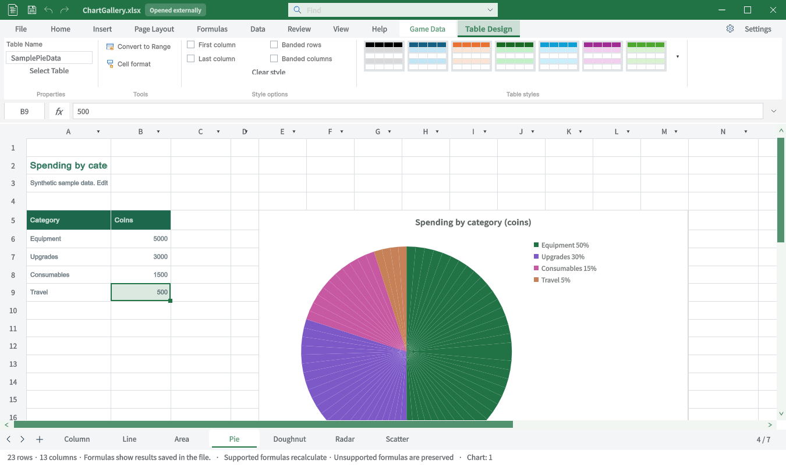

화면 근거: 표 디자인 나머지 기능과 원본 배치 전수 검증 남음

### TC-RIB-15 · 도형 서식

분류: 특수 · 결과: **부분 확인**

| 항목 | 내용 |
| --- | --- |
| 실행 절차 | 도형 개체를 선택합니다. |
| 기대값 | 도형 삽입·도형 스타일·WordArt·접근성·정렬·크기를 대조합니다. |
| 실제 결과 | 원본 순서의 그룹,3개 미리보기+32종 목록,색상·회전·정렬 순서 메뉴와 Affinity 아이콘을 적용했습니다. 문구 잘림도 수정했습니다. 스타일199검사 및 최신 실제 타일 선택·Undo3건 통과. 도형 효과·다중 객체 맞춤/그룹은 미구현입니다. |
| 수정 내용 | 원본 순서의 그룹,3개 미리보기+32종 목록,색상·회전·정렬 순서 메뉴와 Affinity 아이콘을 적용했습니다. 문구 잘림도 수정했습니다. |
| 재검증 | 스타일199검사 및 최신 실제 타일 선택·Undo3건 통과. 도형 효과·다중 객체 맞춤/그룹은 미구현입니다. 최신R7 실제 화면 촬영 성공. 촬영만으로 해당 TC의 기능 통과를 의미하지 않습니다. |
| 원본 출처·버전 | OfficeToolTips 직접 촬영 Excel365 원본·빌드 미확인 · https://www.officetooltips.com/excel/tips/how_to_change_format_for_diagram_shapes_in_excel |

**Excel 원본**

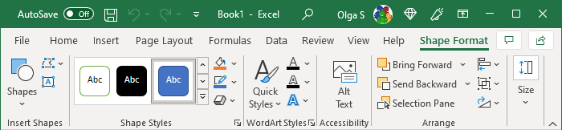

**수정 전**

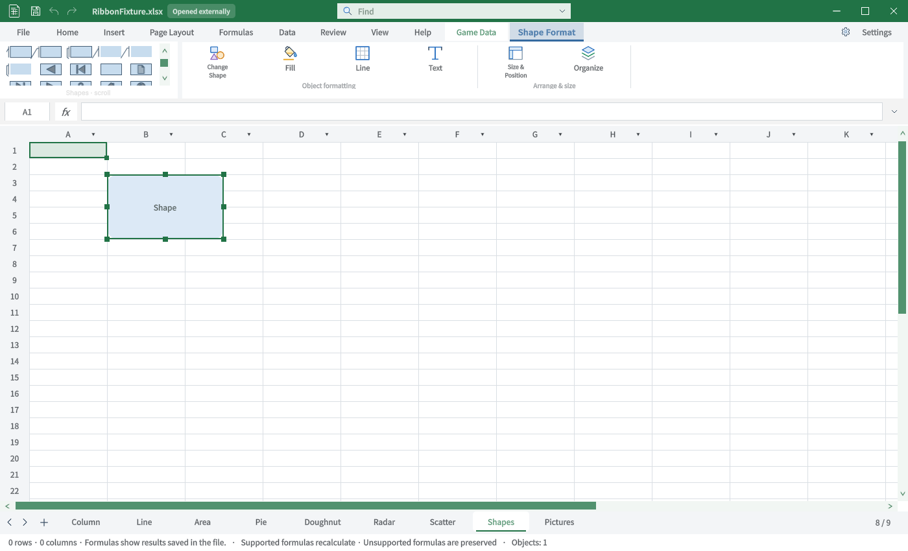

**수정 후 실제 실행**

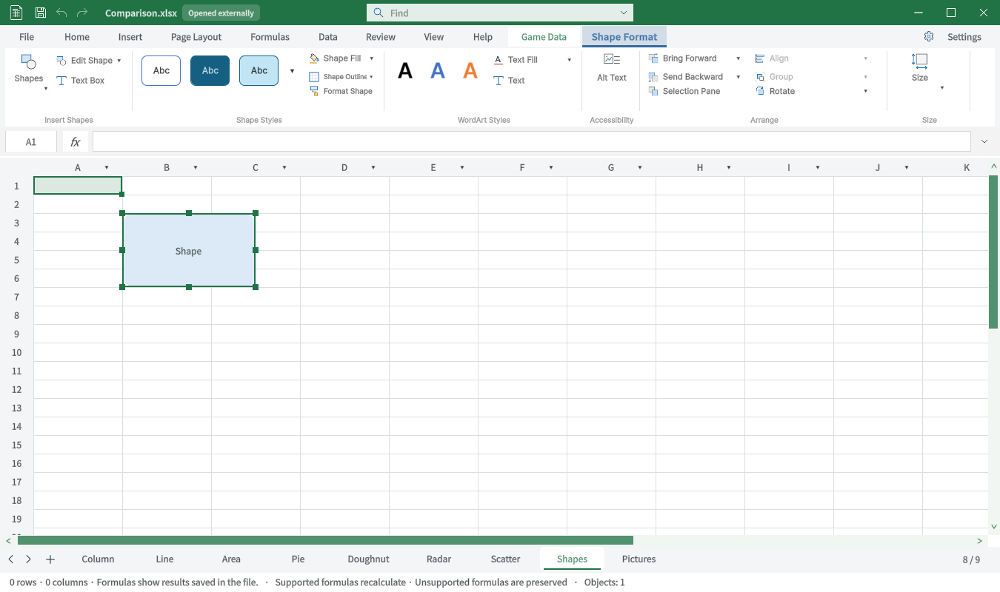

### TC-RIB-16 · 그림 서식

분류: 특수 · 결과: **부분 확인**

| 항목 | 내용 |
| --- | --- |
| 실행 절차 | 삽입된 그림을 선택합니다. |
| 기대값 | 보정·그림 스타일·접근성·정렬·크기를 비교합니다. |
| 실제 결과 | 조정·그림 스타일·접근성·배치·크기 그룹과6개 테두리 미리보기를 구성했습니다. 52검사에서 이미지 바이트·자르기·Undo·저장 재열기 보존 확인. Office 전체 그림 효과와 색 보정은 미구현입니다. |
| 수정 내용 | 조정·그림 스타일·접근성·배치·크기 그룹과6개 테두리 미리보기를 구성했습니다. |
| 재검증 | 52검사에서 이미지 바이트·자르기·Undo·저장 재열기 보존 확인. Office 전체 그림 효과와 색 보정은 미구현입니다. 최신R7 실제 화면 촬영 성공. 촬영만으로 해당 TC의 기능 통과를 의미하지 않습니다. |
| 원본 출처·버전 | 부분 원본·정확한 빌드 미확인 · https://learn.microsoft.com/en-us/answers/questions/5267157/where-are-microsoft-365-excel-picture-format-tools |

**Excel 원본**

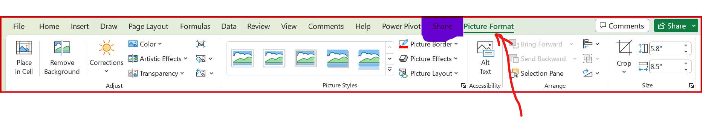

**수정 전**

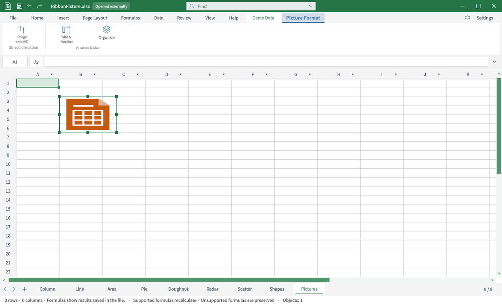

**수정 후 실제 실행**

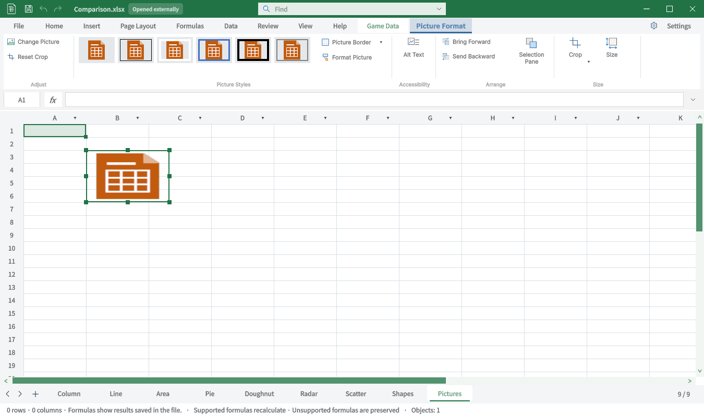

### TC-RIB-17 · 차트 디자인

분류: 특수 · 결과: **부분 확인**

| 항목 | 내용 |
| --- | --- |
| 실행 절차 | 차트를 선택한 뒤 디자인 탭에서 스타일2를 클릭합니다. |
| 기대값 | 썸네일 스타일 목록·데이터·차트 요소를 대조합니다. |
| 실제 결과 | 차트 레이아웃·스타일·데이터·유형·위치 순서와6개 실제 차트 미리보기·48종 목록을 구성했습니다. 최신 배치196검사 및 실제 스타일2 클릭 통과. 빠른 레이아웃·행/열 전환·종류/위치 변경 버튼은 비활성이며 구현이 남았습니다. |
| 수정 내용 | 차트 레이아웃·스타일·데이터·유형·위치 순서와6개 실제 차트 미리보기·48종 목록을 구성했습니다. 차트 파트를 실제 콘텐츠 형식으로 조회하도록 수정. 시트 이름/차트 값 저장 갱신8검사 통과. 렌더러/전체 디자인 구현 완료는 아님. |
| 재검증 | 최신 배치196검사 및 실제 스타일2 클릭 통과. 빠른 레이아웃·행/열 전환·종류/위치 변경 버튼은 비활성이며 구현이 남았습니다. 최신R7 실제 화면 촬영 성공. 촬영만으로 해당 TC의 기능 통과를 의미하지 않습니다. |
| 원본 출처·버전 | 부분 원본·정확한 빌드 미확인 · https://learn.microsoft.com/en-us/answers/questions/5423242/chart-design-not-available-i-have-tried-everything |

**Excel 원본**

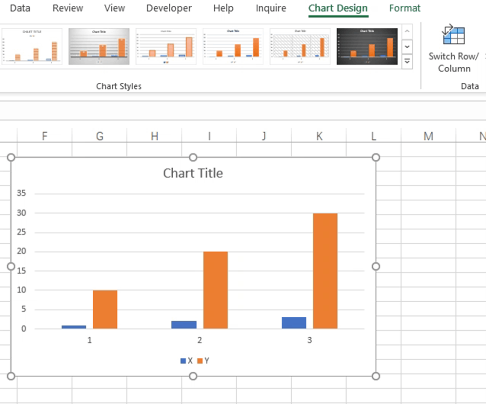

**수정 전**

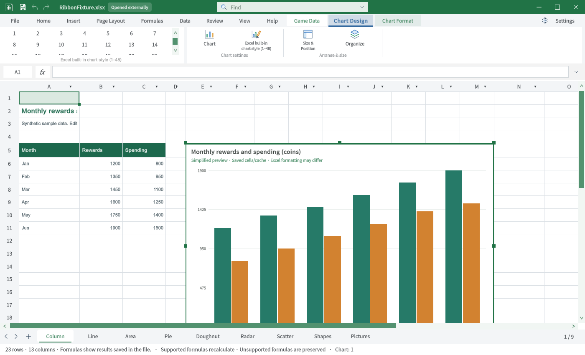

**수정 후 실제 실행**

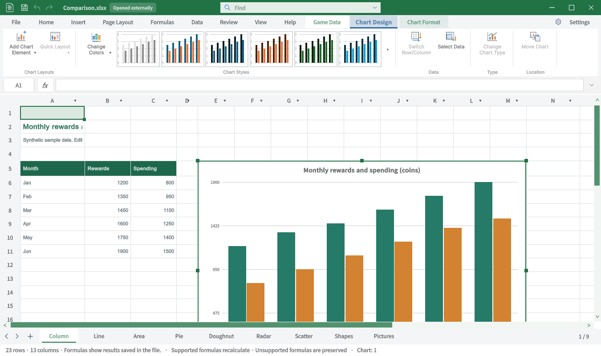

### TC-RIB-18 · 차트 서식

분류: 특수 · 결과: **부분 확인**

| 항목 | 내용 |
| --- | --- |
| 실행 절차 | 차트를 선택한 뒤 서식 탭을 선택합니다. |
| 기대값 | 현재 선택·서식·스타일·정렬을 비교합니다. |
| 실제 결과 | 현재 선택·도형 스타일·텍스트·접근성·배치·크기 그룹과 차트 영역 서식 팝업을 연결했습니다. 326개 통합 검사에 차트 제목·범례·격자·색상·저장 검증 포함. 전체 차트 요소 선택/효과 메뉴는 미완성입니다. |
| 수정 내용 | 현재 선택·도형 스타일·텍스트·접근성·배치·크기 그룹과 차트 영역 서식 팝업을 연결했습니다. |
| 재검증 | 326개 통합 검사에 차트 제목·범례·격자·색상·저장 검증 포함. 전체 차트 요소 선택/효과 메뉴는 미완성입니다. 최신R7 실제 화면 촬영 성공. 촬영만으로 해당 TC의 기능 통과를 의미하지 않습니다. |
| 원본 출처·버전 | 구형 Current Selection 부분 원본 · https://support.microsoft.com/en-us/office/graphics-visuals/change-the-shape-fill-outline-or-effects-of-chart-elements |

**Excel 원본**

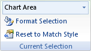

**수정 전**

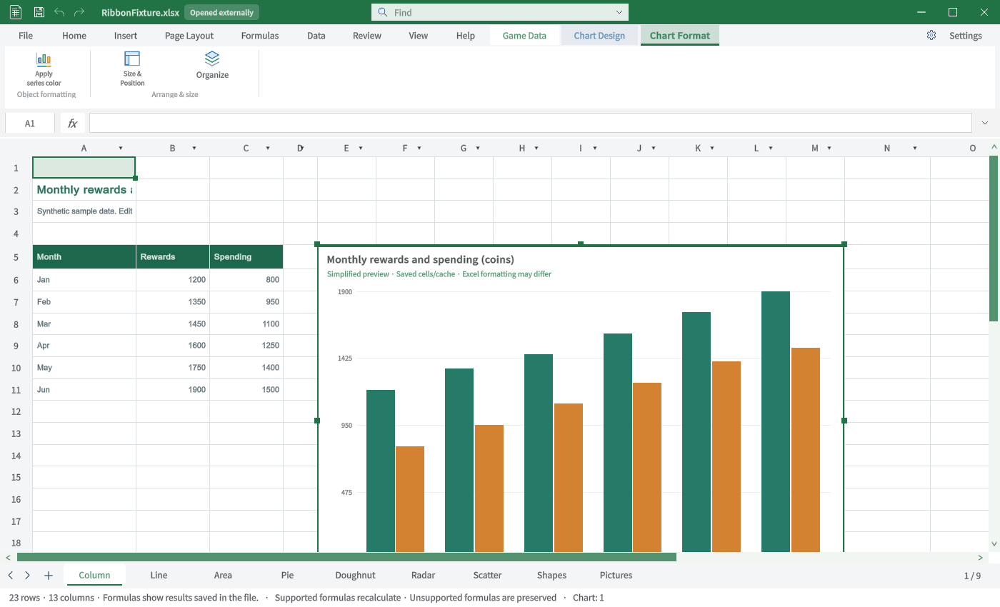

**수정 후 실제 실행**

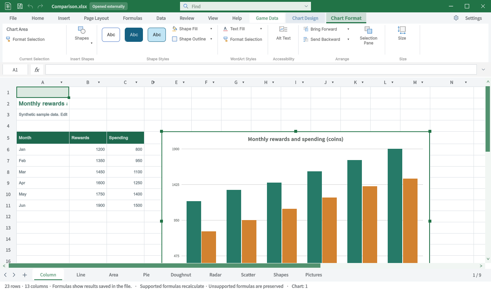

### TC-RIB-19 · 피벗 테이블 분석

분류: 특수 · 결과: **실패**

| 항목 | 내용 |
| --- | --- |
| 실행 절차 | 피벗 삽입·선택 경로를 확인합니다. |
| 기대값 | 피벗 개체 선택 시 분석 탭 |
| 실제 결과 | 현재 해당 기능/전용 탭은 구현되지 않았습니다. 이전 삽입/홈 화면을 해당 기능의 실행 증거로 취급하지 않습니다. |
| 수정 내용 | 이번 회차 수정 없음. 이전 기록의 근거와 제한을 보존합니다. |
| 재검증 | 전체 명령의 최신 실행 재검증은 미실행입니다. |
| 원본 출처·버전 | 원본 일부 · https://support.microsoft.com/en-us/excel/where-are-the-table-tools |

**Excel 원본**

**수정 전**

화면 근거: 해당 기능의 최신 실제 실행 화면 미확보 또는 미구현

### TC-RIB-20 · 피벗 테이블 디자인

분류: 특수 · 결과: **실패**

| 항목 | 내용 |
| --- | --- |
| 실행 절차 | 피벗 삽입·선택 경로를 확인합니다. |
| 기대값 | 피벗 스타일·레이아웃 |
| 실제 결과 | 현재 해당 기능/전용 탭은 구현되지 않았습니다. 이전 삽입/홈 화면을 해당 기능의 실행 증거로 취급하지 않습니다. |
| 수정 내용 | 이번 회차 수정 없음. 이전 기록의 근거와 제한을 보존합니다. |
| 재검증 | 전체 명령의 최신 실행 재검증은 미실행입니다. |
| 원본 출처·버전 | 원본 일부 · https://support.microsoft.com/en-us/excel/design-the-layout-and-format-of-a-pivottable |

**Excel 원본**

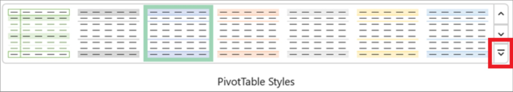

**수정 전**

화면 근거: 해당 기능의 최신 실제 실행 화면 미확보 또는 미구현

### TC-RIB-21 · 피벗 차트 분석

분류: 특수 · 결과: **실패**

| 항목 | 내용 |
| --- | --- |
| 실행 절차 | 피벗 삽입·선택 경로를 확인합니다. |
| 기대값 | 피벗 차트 선택 시 분석 탭 |
| 실제 결과 | 현재 해당 기능/전용 탭은 구현되지 않았습니다. 이전 삽입/홈 화면을 해당 기능의 실행 증거로 취급하지 않습니다. |
| 수정 내용 | 이번 회차 수정 없음. 이전 기록의 근거와 제한을 보존합니다. |
| 재검증 | 전체 명령의 최신 실행 재검증은 미실행입니다. |
| 원본 출처·버전 | W3Schools 직접 작성 Field Buttons 부분 원본 · https://www.w3schools.com/excel/excel_pivot_charts.php |

**Excel 원본**

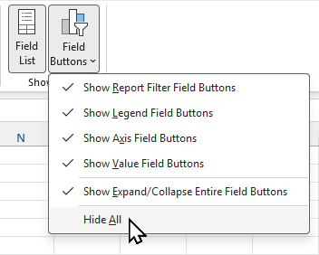

**수정 전**

화면 근거: 해당 기능의 최신 실제 실행 화면 미확보 또는 미구현

### TC-RIB-22 · 피벗 차트 디자인

분류: 특수 · 결과: **실패**

| 항목 | 내용 |
| --- | --- |
| 실행 절차 | 피벗 삽입·선택 경로를 확인합니다. |
| 기대값 | 피벗 차트 스타일·데이터 |
| 실제 결과 | 현재 해당 기능/전용 탭은 구현되지 않았습니다. 이전 삽입/홈 화면을 해당 기능의 실행 증거로 취급하지 않습니다. |
| 수정 내용 | 이번 회차 수정 없음. 이전 기록의 근거와 제한을 보존합니다. |
| 재검증 | 전체 명령의 최신 실행 재검증은 미실행입니다. |
| 원본 출처·버전 | 해당 원본 미확보 · 제품 전용 기능: Excel 대응 원본 없음 |

**수정 전**

화면 근거: 대응 원본 사진 없음 또는 정확한 버전의 원본 미확보; 해당 기능의 최신 실제 실행 화면 미확보 또는 미구현

### TC-RIB-23 · 피벗 차트 서식

분류: 특수 · 결과: **실패**

| 항목 | 내용 |
| --- | --- |
| 실행 절차 | 피벗 삽입·선택 경로를 확인합니다. |
| 기대값 | 피벗 차트 서식 |
| 실제 결과 | 현재 해당 기능/전용 탭은 구현되지 않았습니다. 이전 삽입/홈 화면을 해당 기능의 실행 증거로 취급하지 않습니다. |
| 수정 내용 | 이번 회차 수정 없음. 이전 기록의 근거와 제한을 보존합니다. |
| 재검증 | 전체 명령의 최신 실행 재검증은 미실행입니다. |
| 원본 출처·버전 | 해당 원본 미확보 · 제품 전용 기능: Excel 대응 원본 없음 |

**수정 전**

화면 근거: 대응 원본 사진 없음 또는 정확한 버전의 원본 미확보; 해당 기능의 최신 실제 실행 화면 미확보 또는 미구현

### TC-RIB-24 · 슬라이서

분류: 특수 · 결과: **실패**

| 항목 | 내용 |
| --- | --- |
| 실행 절차 | 슬라이서 삽입·선택 경로를 확인합니다. |
| 기대값 | 슬라이서 선택 시 전용 도구와 스타일을 제공합니다. |
| 실제 결과 | 현재 해당 기능/전용 탭은 구현되지 않았습니다. 이전 삽입/홈 화면을 해당 기능의 실행 증거로 취급하지 않습니다. |
| 수정 내용 | 이번 회차 수정 없음. 이전 기록의 근거와 제한을 보존합니다. |
| 재검증 | 전체 명령의 최신 실행 재검증은 미실행입니다. |
| 원본 출처·버전 | 삽입·개체 부분 원본 · https://learn.microsoft.com/en-us/answers/questions/545181/slicer-in-excel-on-o365-has-disappeared |

**Excel 원본**

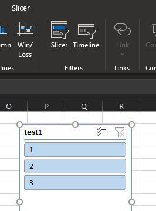

**수정 전**

화면 근거: 해당 기능의 최신 실제 실행 화면 미확보 또는 미구현

### TC-RIB-25 · 시간 표시 막대

분류: 특수 · 결과: **실패**

| 항목 | 내용 |
| --- | --- |
| 실행 절차 | Timeline 삽입·선택 경로를 확인합니다. |
| 기대값 | Timeline 스타일 갤러리를 제공합니다. |
| 실제 결과 | 현재 해당 기능/전용 탭은 구현되지 않았습니다. 이전 삽입/홈 화면을 해당 기능의 실행 증거로 취급하지 않습니다. |
| 수정 내용 | 이번 회차 수정 없음. 이전 기록의 근거와 제한을 보존합니다. |
| 재검증 | 전체 명령의 최신 실행 재검증은 미실행입니다. |
| 원본 출처·버전 | Timeline Styles 부분 원본 · https://support.microsoft.com/en-us/excel/create-a-pivottable-timeline-to-filter-dates |

**Excel 원본**

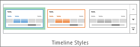

**수정 전**

화면 근거: 해당 기능의 최신 실제 실행 화면 미확보 또는 미구현

### TC-RIB-26 · 스파크라인

분류: 특수 · 결과: **실패**

| 항목 | 내용 |
| --- | --- |
| 실행 절차 | 스파크라인 삽입·선택 경로를 확인합니다. |
| 기대값 | 스파크라인 스타일 갤러리를 제공합니다. |
| 실제 결과 | 현재 해당 기능/전용 탭은 구현되지 않았습니다. 이전 삽입/홈 화면을 해당 기능의 실행 증거로 취급하지 않습니다. |
| 수정 내용 | 이번 회차 수정 없음. 이전 기록의 근거와 제한을 보존합니다. |
| 재검증 | 전체 명령의 최신 실행 재검증은 미실행입니다. |
| 원본 출처·버전 | Sparkline Style 부분 원본 · https://support.microsoft.com/en-us/excel/analyze-trends-in-data-using-sparklines |

**Excel 원본**

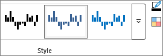

**수정 전**

화면 근거: 해당 기능의 최신 실제 실행 화면 미확보 또는 미구현

### TC-RIB-27 · SmartArt 디자인

분류: 특수 · 결과: **실패**

| 항목 | 내용 |
| --- | --- |
| 실행 절차 | SmartArt 삽입·선택 경로를 확인합니다. |
| 기대값 | 레이아웃·색상·스타일을 제공합니다. |
| 실제 결과 | 현재 해당 기능/전용 탭은 구현되지 않았습니다. 이전 삽입/홈 화면을 해당 기능의 실행 증거로 취급하지 않습니다. |
| 수정 내용 | 이번 회차 수정 없음. 이전 기록의 근거와 제한을 보존합니다. |
| 재검증 | 전체 명령의 최신 실행 재검증은 미실행입니다. |
| 원본 출처·버전 | Excel SmartArt 디자인 부분 원본 · https://learn.microsoft.com/en-us/answers/questions/5368523/smartart-in-excel-can-t-find-text-pane-no-arrow-on |

**Excel 원본**

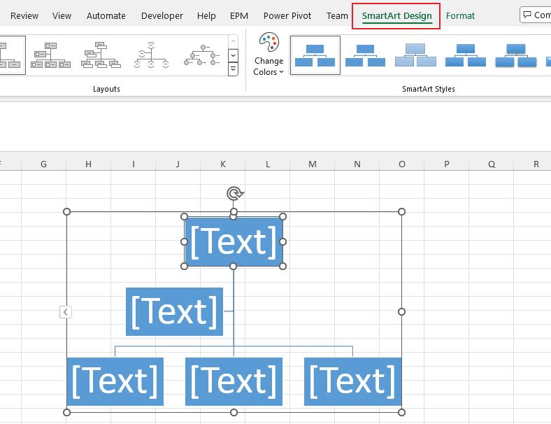

**수정 전**

화면 근거: 해당 기능의 최신 실제 실행 화면 미확보 또는 미구현

### TC-RIB-28 · SmartArt 서식

분류: 특수 · 결과: **실패**

| 항목 | 내용 |
| --- | --- |
| 실행 절차 | SmartArt 관련 서식 경로를 확인합니다. |
| 기대값 | 관련 개체의 서식·스타일을 제공합니다. |
| 실제 결과 | 현재 해당 기능/전용 탭은 구현되지 않았습니다. 이전 삽입/홈 화면을 해당 기능의 실행 증거로 취급하지 않습니다. |
| 수정 내용 | 이번 회차 수정 없음. 이전 기록의 근거와 제한을 보존합니다. |
| 재검증 | 전체 명령의 최신 실행 재검증은 미실행입니다. |
| 원본 출처·버전 | SmartArt 파생 개체의 Shape Format · https://learn.microsoft.com/en-us/answers/questions/5368523/smartart-in-excel-can-t-find-text-pane-no-arrow-on |

**Excel 원본**

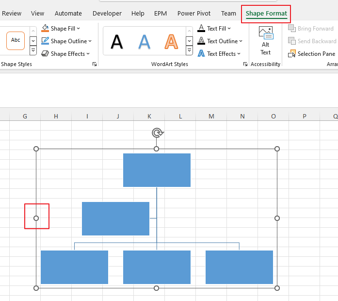

**수정 전**

화면 근거: 해당 기능의 최신 실제 실행 화면 미확보 또는 미구현

### TC-RIB-29 · 그래픽 서식

분류: 특수 · 결과: **실패**

| 항목 | 내용 |
| --- | --- |
| 실행 절차 | 관련 개체 삽입·선택 경로를 확인합니다. |
| 기대값 | SVG 선택 시 그래픽 서식 |
| 실제 결과 | 현재 해당 기능/전용 탭은 구현되지 않았습니다. 이전 삽입/홈 화면을 해당 기능의 실행 증거로 취급하지 않습니다. |
| 수정 내용 | 이번 회차 수정 없음. 이전 기록의 근거와 제한을 보존합니다. |
| 재검증 | 전체 명령의 최신 실행 재검증은 미실행입니다. |
| 원본 출처·버전 | Excel 원본 미확보 · 제품 전용 기능: Excel 대응 원본 없음 |

**수정 전**

화면 근거: 대응 원본 사진 없음 또는 정확한 버전의 원본 미확보; 해당 기능의 최신 실제 실행 화면 미확보 또는 미구현

### TC-RIB-30 · 3D 모델 서식

분류: 특수 · 결과: **실패**

| 항목 | 내용 |
| --- | --- |
| 실행 절차 | 관련 개체 삽입·선택 경로를 확인합니다. |
| 기대값 | 3D 모델 선택 시 보기·정렬 |
| 실제 결과 | 현재 해당 기능/전용 탭은 구현되지 않았습니다. 이전 삽입/홈 화면을 해당 기능의 실행 증거로 취급하지 않습니다. |
| 수정 내용 | 이번 회차 수정 없음. 이전 기록의 근거와 제한을 보존합니다. |
| 재검증 | 전체 명령의 최신 실행 재검증은 미실행입니다. |
| 원본 출처·버전 | Excel 원본 미확보 · 제품 전용 기능: Excel 대응 원본 없음 |

**수정 전**

화면 근거: 대응 원본 사진 없음 또는 정확한 버전의 원본 미확보; 해당 기능의 최신 실제 실행 화면 미확보 또는 미구현

### TC-RIB-31 · 수식 디자인

분류: 특수 · 결과: **실패**

| 항목 | 내용 |
| --- | --- |
| 실행 절차 | 관련 개체 삽입·선택 경로를 확인합니다. |
| 기대값 | 수식 개체 선택 시 디자인 |
| 실제 결과 | 현재 해당 기능/전용 탭은 구현되지 않았습니다. 이전 삽입/홈 화면을 해당 기능의 실행 증거로 취급하지 않습니다. |
| 수정 내용 | 이번 회차 수정 없음. 이전 기록의 근거와 제한을 보존합니다. |
| 재검증 | 전체 명령의 최신 실행 재검증은 미실행입니다. |
| 원본 출처·버전 | SpreadsheetPlanet 직접 작성 Excel Microsoft365 Windows 원본 · https://spreadsheetplanet.com/insert-equation-excel/ |

**Excel 원본**

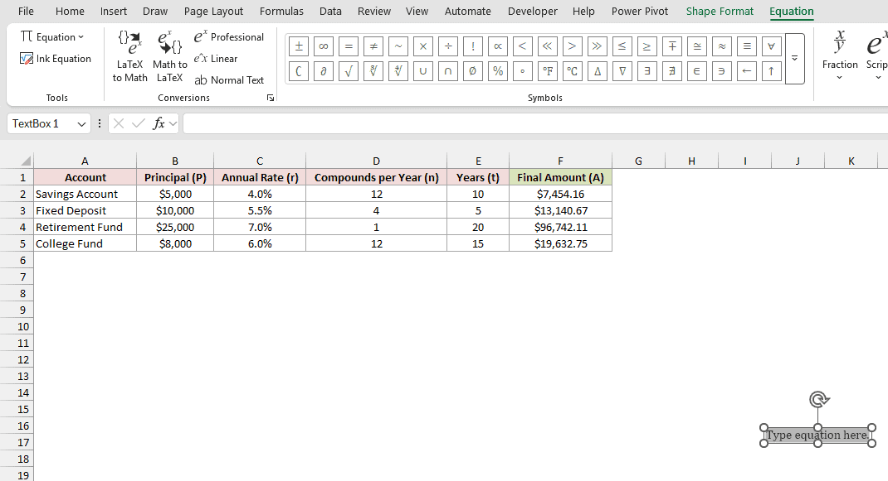

**수정 전**

화면 근거: 해당 기능의 최신 실제 실행 화면 미확보 또는 미구현

### TC-RIB-32 · 머리글·바닥글

분류: 특수 · 결과: **실패**

| 항목 | 내용 |
| --- | --- |
| 실행 절차 | 머리글·바닥글 전용 편집 경로를 확인합니다. |
| 기대값 | 페이지 번호·날짜·파일명 등의 요소를 비교합니다. |
| 실제 결과 | 현재 해당 기능/전용 탭은 구현되지 않았습니다. 이전 삽입/홈 화면을 해당 기능의 실행 증거로 취급하지 않습니다. |
| 수정 내용 | 이번 회차 수정 없음. 이전 기록의 근거와 제한을 보존합니다. |
| 재검증 | 전체 명령의 최신 실행 재검증은 미실행입니다. |
| 원본 출처·버전 | Header/Footer Elements 부분 원본 · https://support.microsoft.com/en-us/excel/headers-and-footers-in-a-worksheet |

**Excel 원본**

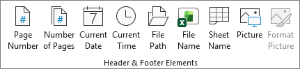

**수정 전**

화면 근거: 해당 기능의 최신 실제 실행 화면 미확보 또는 미구현

### TC-RIB-33 · 쿼리 편집

분류: 특수 · 결과: **실패**

| 항목 | 내용 |
| --- | --- |
| 실행 절차 | 쿼리 개체의 전용 편집 진입을 확인합니다. |
| 기대값 | 쿼리 선택·편집 탭을 제공합니다. |
| 실제 결과 | 현재 해당 기능/전용 탭은 구현되지 않았습니다. 이전 삽입/홈 화면을 해당 기능의 실행 증거로 취급하지 않습니다. |
| 수정 내용 | 이번 회차 수정 없음. 이전 기록의 근거와 제한을 보존합니다. |
| 재검증 | 전체 명령의 최신 실행 재검증은 미실행입니다. |
| 원본 출처·버전 | Data Get & Transform 부분 자료 · https://support.microsoft.com/en-us/excel/about-power-query-in-excel |

**Excel 원본**

**수정 전**

화면 근거: 해당 기능의 최신 실제 실행 화면 미확보 또는 미구현

### TC-RIB-34 · 게임 데이터

분류: 제품 전용 · 결과: **부분 확인**

| 항목 | 내용 |
| --- | --- |
| 실행 절차 | 게임 데이터 탭 선택 |
| 기대값 | 등록 종류별 그룹과 창 색상 일관성 |
| 실제 결과 | 최신 Unity에서 해당 제품 전용 화면을 재촬영했습니다. 전체 명령·플레이 잠금·저장 실패의 재검증은 남아 있습니다. |
| 수정 내용 | 이번 회차 수정 없음. 이전 기록의 근거와 제한을 보존합니다. |
| 재검증 | 전체 명령의 최신 실행 재검증은 미실행입니다. |
| 원본 출처·버전 | Excel 대응 원본 없음·제품 고유 기능 · 제품 전용 기능: Excel 대응 원본 없음 |

**수정 전**

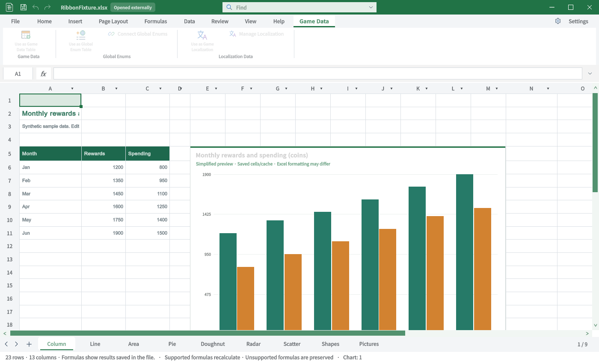

**수정 후 실제 실행**

화면 근거: 대응 원본 사진 없음 또는 정확한 버전의 원본 미확보; 제품 전용 기능이므로 Excel 원본과 직접 대응하지 않음

### TC-RIB-35 · 게임 테이블 도구

분류: 제품 전용 · 결과: **부분 확인**

| 항목 | 내용 |
| --- | --- |
| 실행 절차 | EnumGear 선택 |
| 기대값 | 게임 테이블 전용 도구·사용 예제 |
| 실제 결과 | 최신 Unity에서 해당 제품 전용 화면을 재촬영했습니다. 전체 명령·플레이 잠금·저장 실패의 재검증은 남아 있습니다. |
| 수정 내용 | 이번 회차 수정 없음. 이전 기록의 근거와 제한을 보존합니다. |
| 재검증 | 전체 명령의 최신 실행 재검증은 미실행입니다. |
| 원본 출처·버전 | Excel 대응 원본 없음·제품 고유 기능 · 제품 전용 기능: Excel 대응 원본 없음 |

**수정 전**

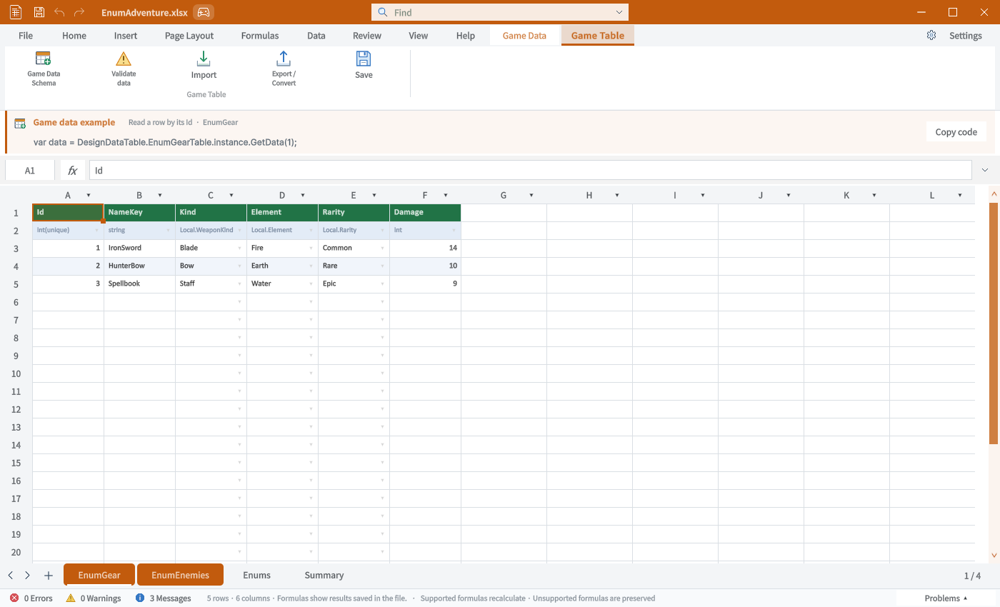

**수정 후 실제 실행**

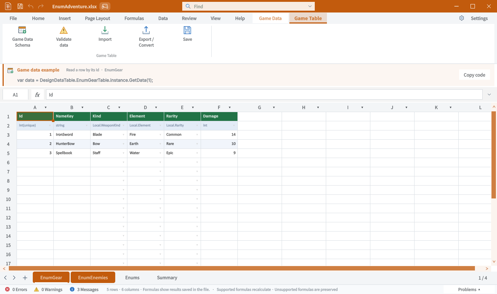

화면 근거: 대응 원본 사진 없음 또는 정확한 버전의 원본 미확보; 제품 전용 기능이므로 Excel 원본과 직접 대응하지 않음

### TC-RIB-36 · 열거형 도구

분류: 제품 전용 · 결과: **부분 확인**

| 항목 | 내용 |
| --- | --- |
| 실행 절차 | Enums 시트 선택 |
| 기대값 | Enum 전용 도구·사용 예제 |
| 실제 결과 | 최신 Unity에서 해당 제품 전용 화면을 재촬영했습니다. 전체 명령·플레이 잠금·저장 실패의 재검증은 남아 있습니다. |
| 수정 내용 | 이번 회차 수정 없음. 이전 기록의 근거와 제한을 보존합니다. |
| 재검증 | 전체 명령의 최신 실행 재검증은 미실행입니다. |
| 원본 출처·버전 | Excel 대응 원본 없음·제품 고유 기능 · 제품 전용 기능: Excel 대응 원본 없음 |

**수정 전**

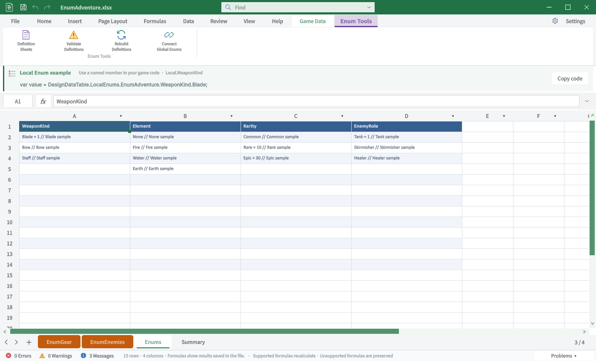

**수정 후 실제 실행**

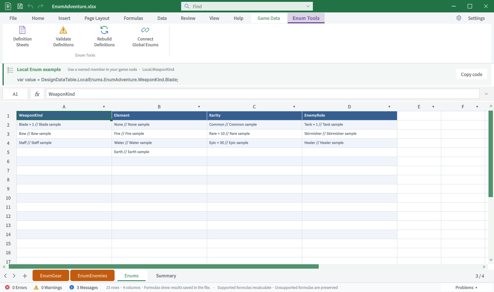

화면 근거: 대응 원본 사진 없음 또는 정확한 버전의 원본 미확보; 제품 전용 기능이므로 Excel 원본과 직접 대응하지 않음

### TC-RIB-37 · 로컬라이징

분류: 제품 전용 · 결과: **부분 확인**

| 항목 | 내용 |
| --- | --- |
| 실행 절차 | ArcadeText 선택 |
| 기대값 | 번역 전용 도구·대체 언어·예제 |
| 실제 결과 | 최신 Unity에서 해당 제품 전용 화면을 재촬영했습니다. 전체 명령·플레이 잠금·저장 실패의 재검증은 남아 있습니다. |
| 수정 내용 | 이번 회차 수정 없음. 이전 기록의 근거와 제한을 보존합니다. |
| 재검증 | 전체 명령의 최신 실행 재검증은 미실행입니다. |
| 원본 출처·버전 | Excel 대응 원본 없음·제품 고유 기능 · 제품 전용 기능: Excel 대응 원본 없음 |

**수정 전**

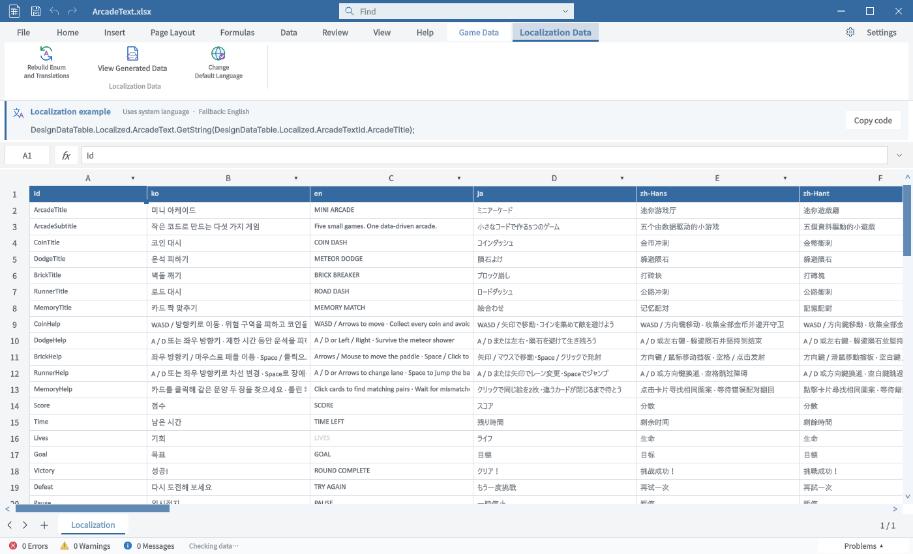

**수정 후 실제 실행**

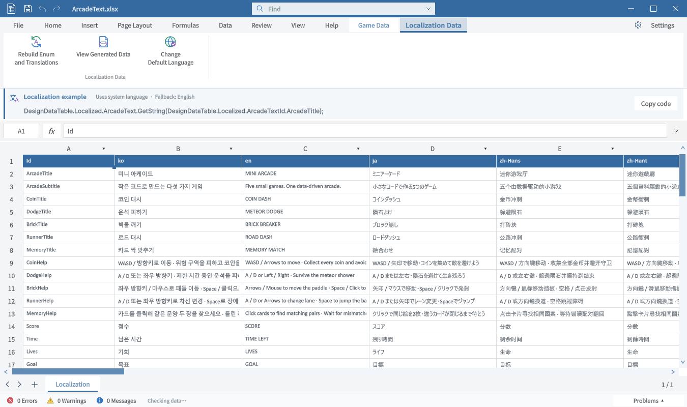

화면 근거: 대응 원본 사진 없음 또는 정확한 버전의 원본 미확보; 제품 전용 기능이므로 Excel 원본과 직접 대응하지 않음

### TC-RIB-38 · 서머리 도구

분류: 제품 전용 · 결과: **부분 확인**

| 항목 | 내용 |
| --- | --- |
| 실행 절차 | Summary 시트 선택 |
| 기대값 | 서머리 전용 도구와 안내 |
| 실제 결과 | 최신 Unity에서 해당 제품 전용 화면을 재촬영했습니다. 전체 명령·플레이 잠금·저장 실패의 재검증은 남아 있습니다. |
| 수정 내용 | 이번 회차 수정 없음. 이전 기록의 근거와 제한을 보존합니다. |
| 재검증 | 전체 명령의 최신 실행 재검증은 미실행입니다. |
| 원본 출처·버전 | Excel 대응 원본 없음·제품 고유 기능 · 제품 전용 기능: Excel 대응 원본 없음 |

**수정 전**

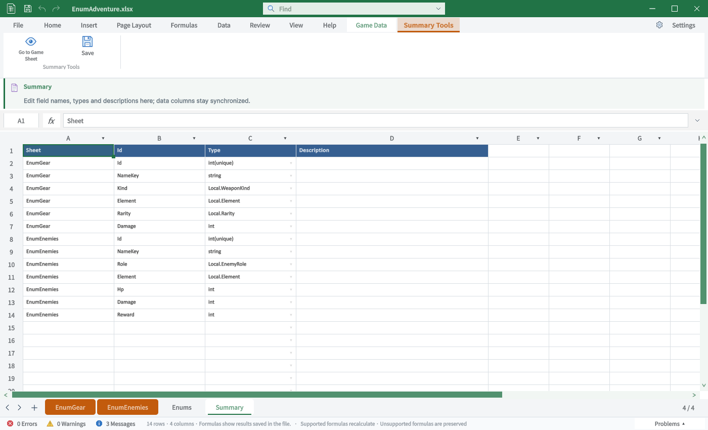

**수정 후 실제 실행**

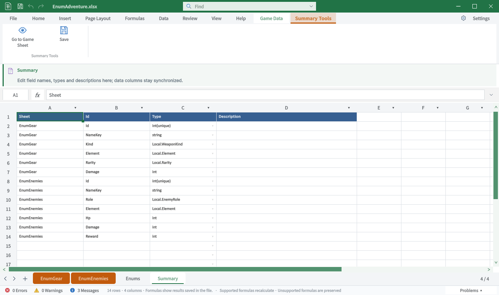

화면 근거: 대응 원본 사진 없음 또는 정확한 버전의 원본 미확보; 제품 전용 기능이므로 Excel 원본과 직접 대응하지 않음

### TC-RIB-39 · 설정

분류: 제품 전용 · 결과: **부분 확인**

| 항목 | 내용 |
| --- | --- |
| 실행 절차 | 환경 설정 열기 |
| 기대값 | 우측 설정 위치와 읽기 쉬운 패널 |
| 실제 결과 | 최신 Unity에서 해당 제품 전용 화면을 재촬영했습니다. 전체 명령·플레이 잠금·저장 실패의 재검증은 남아 있습니다. |
| 수정 내용 | 이번 회차 수정 없음. 이전 기록의 근거와 제한을 보존합니다. |
| 재검증 | 전체 명령의 최신 실행 재검증은 미실행입니다. |
| 원본 출처·버전 | Excel 대응 원본 없음·제품 고유 기능 · 제품 전용 기능: Excel 대응 원본 없음 |

**수정 전**

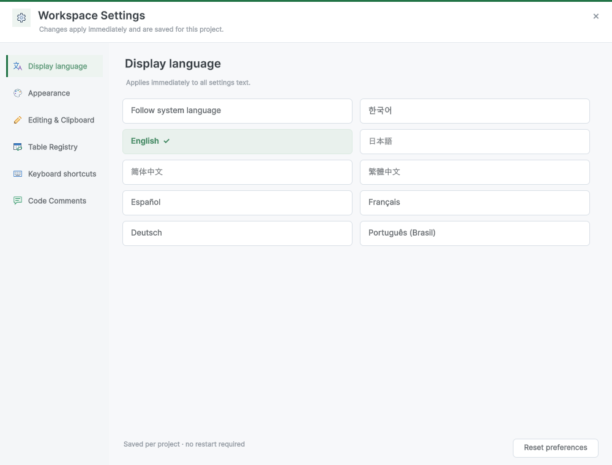

**수정 후 실제 실행**

화면 근거: 대응 원본 사진 없음 또는 정확한 버전의 원본 미확보; 제품 전용 기능이므로 Excel 원본과 직접 대응하지 않음

### TC-RIB-40 · 빠른 실행 도구

분류: 기준 목록 보충 · 결과: **부분 확인**

| 항목 | 내용 |
| --- | --- |
| 실행 절차 | 해당 전용 탭 또는 진입점을 현재 리본에서 확인합니다. |
| 기대값 | 저장·Undo·Redo·제목 표시 |
| 실제 결과 | 자료가 구형 별칭·부분 화면이거나 해당 기능의 실제 실행 증거가 부족합니다. 독립 최신 탭으로 확정하거나 통과 처리하지 않았습니다. |
| 수정 내용 | 이번 회차 수정 없음. 이전 기록의 근거와 제한을 보존합니다. |
| 재검증 | 전체 명령의 최신 실행 재검증은 미실행입니다. |
| 원본 출처·버전 | Excel365 원본의 빠른 실행 도구 일부 · https://www.officetooltips.com/excel/tips/how_to_change_format_for_diagram_shapes_in_excel |

**Excel 원본**

**수정 전**

**수정 후 실제 실행**

### TC-RIB-41 · 인쇄 미리보기

분류: 기준 목록 보충 · 결과: **부분 확인**

| 항목 | 내용 |
| --- | --- |
| 실행 절차 | 해당 전용 탭 또는 진입점을 현재 리본에서 확인합니다. |
| 기대값 | Print Preview 전용 탭·인쇄 설정 |
| 실제 결과 | 자료가 구형 별칭·부분 화면이거나 해당 기능의 실제 실행 증거가 부족합니다. 독립 최신 탭으로 확정하거나 통과 처리하지 않았습니다. |
| 수정 내용 | 이번 회차 수정 없음. 이전 기록의 근거와 제한을 보존합니다. |
| 재검증 | 전체 명령의 최신 실행 재검증은 미실행입니다. |
| 원본 출처·버전 | 해당 Excel 원본 미확보 · 제품 전용 기능: Excel 대응 원본 없음 |

**수정 전**

화면 근거: 대응 원본 사진 없음 또는 정확한 버전의 원본 미확보; 해당 기능의 최신 실제 실행 화면 미확보 또는 미구현

### TC-RIB-42 · 배경 제거

분류: 기준 목록 보충 · 결과: **부분 확인**

| 항목 | 내용 |
| --- | --- |
| 실행 절차 | 해당 전용 탭 또는 진입점을 현재 리본에서 확인합니다. |
| 기대값 | 그림 선택 후 배경 제거 전용 탭 |
| 실제 결과 | 자료가 구형 별칭·부분 화면이거나 해당 기능의 실제 실행 증거가 부족합니다. 독립 최신 탭으로 확정하거나 통과 처리하지 않았습니다. |
| 수정 내용 | 이번 회차 수정 없음. 이전 기록의 근거와 제한을 보존합니다. |
| 재검증 | 전체 명령의 최신 실행 재검증은 미실행입니다. |
| 원본 출처·버전 | 해당 Excel 원본 미확보 · 제품 전용 기능: Excel 대응 원본 없음 |

**수정 전**

화면 근거: 대응 원본 사진 없음 또는 정확한 버전의 원본 미확보; 해당 기능의 최신 실제 실행 화면 미확보 또는 미구현

### TC-RIB-43 · 구형 차트 레이아웃

분류: 기준 목록 보충 · 결과: **부분 확인**

| 항목 | 내용 |
| --- | --- |
| 실행 절차 | 해당 전용 탭 또는 진입점을 현재 리본에서 확인합니다. |
| 기대값 | 기준 목록 TabChartToolsLayout 명령군 |
| 실제 결과 | 자료가 구형 별칭·부분 화면이거나 해당 기능의 실제 실행 증거가 부족합니다. 독립 최신 탭으로 확정하거나 통과 처리하지 않았습니다. |
| 수정 내용 | 이번 회차 수정 없음. 이전 기록의 근거와 제한을 보존합니다. |
| 재검증 | 전체 명령의 최신 실행 재검증은 미실행입니다. |
| 원본 출처·버전 | 해당 Excel 원본 미확보 · 제품 전용 기능: Excel 대응 원본 없음 |

**수정 전**

화면 근거: 대응 원본 사진 없음 또는 정확한 버전의 원본 미확보; 해당 기능의 최신 실제 실행 화면 미확보 또는 미구현

### TC-RIB-44 · 구형 피벗 차트 레이아웃

분류: 기준 목록 보충 · 결과: **부분 확인**

| 항목 | 내용 |
| --- | --- |
| 실행 절차 | 해당 전용 탭 또는 진입점을 현재 리본에서 확인합니다. |
| 기대값 | 기준 목록 TabPivotChartToolsLayout 명령군 |
| 실제 결과 | 자료가 구형 별칭·부분 화면이거나 해당 기능의 실제 실행 증거가 부족합니다. 독립 최신 탭으로 확정하거나 통과 처리하지 않았습니다. |
| 수정 내용 | 이번 회차 수정 없음. 이전 기록의 근거와 제한을 보존합니다. |
| 재검증 | 전체 명령의 최신 실행 재검증은 미실행입니다. |
| 원본 출처·버전 | 해당 Excel 원본 미확보 · 제품 전용 기능: Excel 대응 원본 없음 |

**수정 전**

화면 근거: 대응 원본 사진 없음 또는 정확한 버전의 원본 미확보; 해당 기능의 최신 실제 실행 화면 미확보 또는 미구현

### TC-RIB-45 · BI 시각화 도구

분류: 기준 목록 보충 · 결과: **부분 확인**

| 항목 | 내용 |
| --- | --- |
| 실행 절차 | 해당 전용 탭 또는 진입점을 현재 리본에서 확인합니다. |
| 기대값 | 기준 목록 TabBIVisualTools의 활성 조건과 명령 |
| 실제 결과 | 자료가 구형 별칭·부분 화면이거나 해당 기능의 실제 실행 증거가 부족합니다. 독립 최신 탭으로 확정하거나 통과 처리하지 않았습니다. |
| 수정 내용 | 이번 회차 수정 없음. 이전 기록의 근거와 제한을 보존합니다. |
| 재검증 | 전체 명령의 최신 실행 재검증은 미실행입니다. |
| 원본 출처·버전 | 해당 Excel 원본 미확보 · 제품 전용 기능: Excel 대응 원본 없음 |

**수정 전**

화면 근거: 대응 원본 사진 없음 또는 정확한 버전의 원본 미확보; 해당 기능의 최신 실제 실행 화면 미확보 또는 미구현

### TC-RIB-46 · 접근성 작성 도구

분류: 기준 목록 보충 · 결과: **부분 확인**

| 항목 | 내용 |
| --- | --- |
| 실행 절차 | 해당 전용 탭 또는 진입점을 현재 리본에서 확인합니다. |
| 기대값 | 기준 목록 TabAccessibleAuthoring의 활성 조건과 명령 |
| 실제 결과 | 자료가 구형 별칭·부분 화면이거나 해당 기능의 실제 실행 증거가 부족합니다. 독립 최신 탭으로 확정하거나 통과 처리하지 않았습니다. |
| 수정 내용 | 이번 회차 수정 없음. 이전 기록의 근거와 제한을 보존합니다. |
| 재검증 | 전체 명령의 최신 실행 재검증은 미실행입니다. |
| 원본 출처·버전 | 해당 Excel 원본 미확보 · 제품 전용 기능: Excel 대응 원본 없음 |

**수정 전**

화면 근거: 대응 원본 사진 없음 또는 정확한 버전의 원본 미확보; 해당 기능의 최신 실제 실행 화면 미확보 또는 미구현

## 남은 사항

전체46TC 레이아웃·아이콘·영역·단축키 최종 구현과 전수 실제 입력 검증이 남았습니다. 홈 전체 명령·대화상자 실행기·좁은 화면 키보드 스크롤·다른 탭의 키보드 탐색, 차트 빠른 레이아웃/행열전환/종류/이동, 도형 맞춤/그룹, 표 범위/머리글/합계행/필터, 미구현 전용 탭을 작업 목록에 유지합니다.

7개 시트의 표 인식과 이름 편집은 수정했지만 표 디자인 전체 TC를 통과 처리하지 않습니다. Pie 미리보기의 방사형 경계 표현 차이는 관찰했으며 원인은 미확인입니다. IME 전체 스트레스·반복 저장/닫기·9개 언어 문서 재촬영·제품 커밋/배포/최종 패키지 검증도 남았습니다.

자동 승인 검토가 중복 포커스 검사 정리를 보호 약화 우려로 거부했습니다. 해당 제거는 실행하지 않고 두 검사를 보존한 Escape 수정만 적용했습니다.

교훈 검토: 전역 변경 없음. 기존 실행 근거·포커스 보호 지침을 유지합니다. OPC 차트 파트 조회와 QA 도메인 리로드/문자 이벤트 검증은 프로젝트 근거로 기록했습니다.

## 작업 시간

- 제안 시간: 전체4–6시간(2026-10-31 23:42:56 KST 시작). 홈 첫 묶음30–45분(2026-11-01 03:15:07 KST 시작), 이후 추가15–25분 예상도 초과.
- 실제로 완료된 시간: 진행 중이며 전체 완료 시각은 없습니다. 2026-11-01 07:09 KST 기준 전체 시작(10-31 23:42:56) 후 약7시간26분으로 최초4–6시간 예상을 초과했습니다. 이 시각은 중간 집계이며 공개 완료 시각이 아닙니다.
- XERJ: 사용 — XERJ로 SpreadsheetRibbon 후보를 검색하고 현재 소스로 대조했습니다. 샘플 생성·차트 파트 경로는 rg로 보완했습니다.
