## 작업 결과

원래46TC와5개 전체 작업을 보존합니다. 비활성 차트4명령을 실제 네이티브 편집과 연결했고 API235검사·실제 입력/저장/Unity 범위21검사가 통과했습니다. 이 수치는46TC 통과 수가 아니며 전체 목표는 active입니다.

## 변경 내용

### 적용 내용

차트 빠른 레이아웃8개 미리보기, 연결 데이터 행/열 전환,8종류 변환 및 기존 워크시트로 차트 이동을 구현했습니다. 차트 디자인의 기존 그룹 순서와 실제6개 스타일/48개 갤러리를 유지했습니다. 기존 실제 Affinity 제작 아이콘을 사용했으며 이번 회차 새 아트 제작은 없습니다.

이동은 원본 차트 파트·수식·데이터를 유지하고 중복 파트를 만들지 않습니다. 대상 시트에 같은 로컬 이름이 있어도 원본 시트명으로 한정합니다. 일반 복사에서는 독립 차트 파트를 생성하는 기존 동작을 유지했습니다. 행/열 전환은 원본 셀을 전치하지 않고 차트 참조를 바꾸며 포인트 색상도 대응 좌표로 옮깁니다.

저장된 범례 위치가 렌더에 반영되도록 변경했습니다. 제목 숨김 후 다시 표시할 때 실제 제목을 복구합니다. 실제 캡처에서 작은 미리보기의 축 라벨 겹침을 발견해 미리보기에서만 생략했습니다. 원본 차트 축 설정은 변경하지 않습니다. 레이더 전환 후2포인트 계열이 표시 불가였던 조건을 수정했습니다.

F10·Tab·방향키·Ctrl+방향키의 차트 명령 탐색과 스타일6개/전체 갤러리 활성화를 연결했습니다. 기존 통합문서 실제 포커스 보호2개는 유지했습니다. 새16개 문자열은9개 언어로 추가했으며 실제 시각 검증은 영어입니다.

## 검증

실제 Unity6000.0.83f1 격리 프로젝트에서 실행했습니다. API와 UI의 각 실행 MVID를 JSON에 보존합니다. 정적 컴파일과 실제 실행을 구분합니다.

|검증|실제 결과|근거|
|---|---|---|
|네이티브 차트 API·XLSX 왕복|235통과/0실패(R3)|[실행 기록](../assets/ribbon-chart-design-20261101/chart-api-r3.json)|
|실제 버튼·키·Ctrl+S·Unity 범위|21통과/0실패|[19개 관찰 스냅샷 포함](../assets/ribbon-chart-design-20261101/chart-native-ui-r1.json)|
|초기 레이더 전환 실패|215통과/1실패(R1),기록 보존|[초기 실패](../assets/ribbon-chart-design-20261101/chart-api-failed-r1.json)|
|레이더 수정 후 재검사|229통과/0실패(R2)|[수정 후 실행](../assets/ribbon-chart-design-20261101/chart-api-r2.json)|

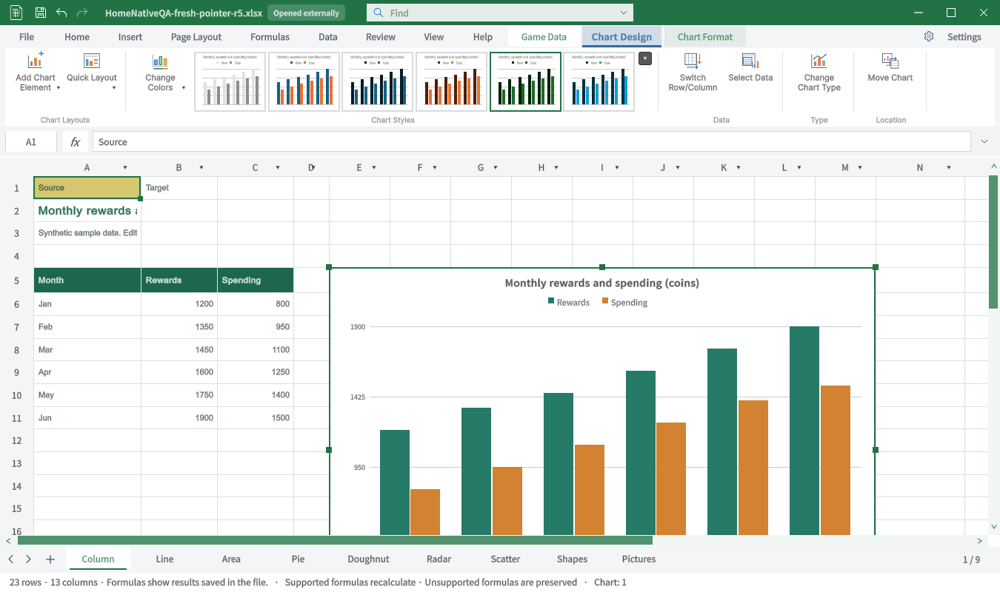

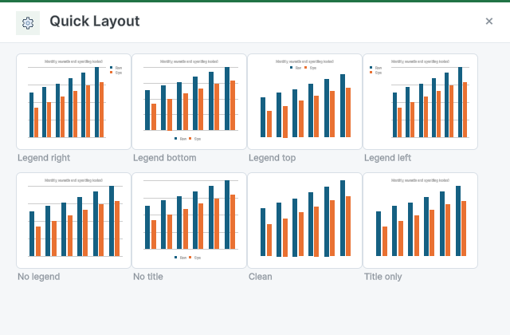

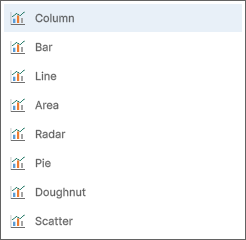

API 검사는50회 이동 반복 후 차트 파트7개 유지, 일반 복사 시8개로 독립 생성, 같은 로컬 이름 충돌, 행열2회 왕복, 포인트 색상 전치,24개 출발/도착 종류 조합, 제목/범례 위치/값 보존과 저장·재열기를 포함합니다. 실제 UI 검사는 행열 전환·갤러리·종류·이동과 Undo, F10/Tab/그룹 탐색, 저장 후 Undo/Redo, Scene에서 Ctrl+F1 문서 비간섭과 Ctrl+D 실제 개체5→6 복제를 확인했습니다.

[수정 전 미리보기 라벨 겹침](../assets/ribbon-chart-design-20261101/chart-layout-before-r1.png) · [원본 바이트·크기·SHA256](../assets/ribbon-chart-design-20261101/evidence-manifest.json). 캡처는 실제 창에서 직접 얻었고 합성/이미지 편집을 하지 않았습니다. 각 이미지200KB 미만입니다.

대조 근거: [Microsoft Excel 행열 전환](https://support.microsoft.com/en-gb/excel/change-how-rows-and-columns-of-data-are-plotted-in-a-chart), [차트 이동](https://support.microsoft.com/en-us/excel/move-or-resize-a-chart). 공식 문서의 Chart Design/Data/Location 명령 위치와 대조했습니다. 이번 환경에서 Excel COM이 등록되지 않아 새 Excel 실행 캡처는 못 했습니다. 공식 문서의 상대 이미지 링크는 가져오기 실패였으며 이전 TC 원본 사진을 삭제하거나 새 Excel 촬영으로 표시하지 않았습니다.

이동 Undo는 문서 상태를 복구하지만 대상 시트에서 선택 차트가 없어져 홈 탭으로 전환됩니다. 원본 시트 선택 자동 복구까지 통과했다고 보고하지 않습니다. 빠른 키 전송에서는 관찰/키 처리 시차를 확인해 포커스 확인 후 Enter 활성화를 다시 확인했습니다.

### 앞선 회차 검증 보존

Windows Unity6000.0.83f1의 격리 QA 프로젝트에서 실제 실행했습니다. 각 JSON에 해당 실행의 MVID/시각/문서 경로를 보존합니다. 개별 검사 수를46TC 통과 수로 합산하지 않습니다.

|검증|결과|근거|
|---|---|---|
|페이지 API/실제 XLSX 왕복·보존|43 통과,0실패(R2)|[page-api-r2.json](../assets/ribbon-page-layout-20261101/page-api-r2.json)|
|실제 메뉴/입력/Save/Undo/Redo|18 통과,0실패(R3)|[page-ui-r3.json](../assets/ribbon-page-layout-20261101/page-ui-r3.json)|
|확정 전 입력/Ctrl+F1/Enter/Undo|4 통과,0실패(R3)|[page-draft-r3.json](../assets/ribbon-page-layout-20261101/page-draft-r3.json)|
|실제 저장 XML 직접 검사|2 통과,0실패|[page-saved-xml-r2.json](../assets/ribbon-page-layout-20261101/page-saved-xml-r2.json)|
|표 이름/임시 리본 영향 회귀|13 통과,0실패(R5)|[ribbon-pointer-r5.json](../assets/ribbon-page-layout-20261101/ribbon-pointer-r5.json)|
|Home/Insert/GameData 키보드 탐색|27 통과,0실패(R9)|[ribbon-navigation-r9.json](../assets/ribbon-page-layout-20261101/ribbon-navigation-r9.json)|
|Affinity 저장/닫기/재열기 출력|색상·흰색 각64타일 픽셀 동일|[affinity-page-reopened-r1.json](../assets/ribbon-page-layout-20261101/affinity-page-reopened-r1.json)|

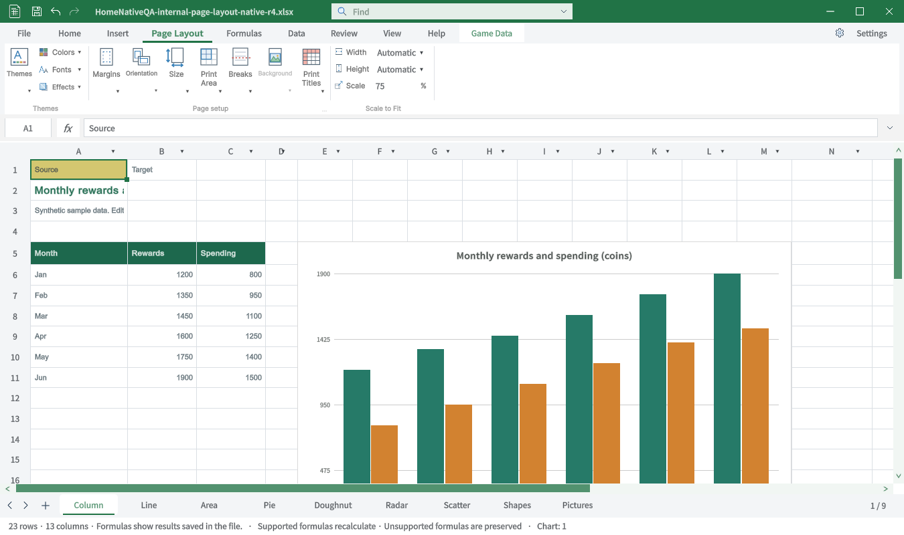

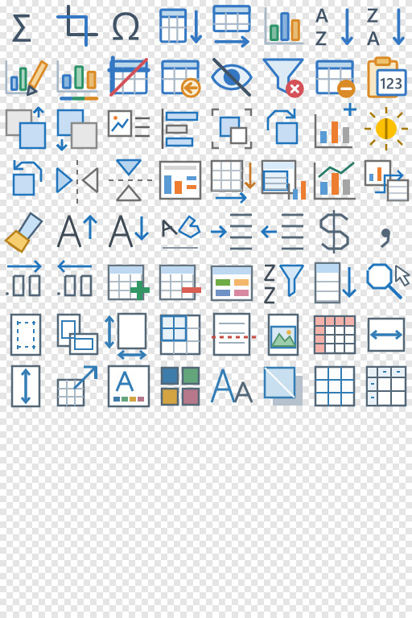

첫 실제 UI 검사에서는 저장 후 Redo가 적용되지 않아15검사 뒤 실패했습니다. 확정된 입력의 텍스트 포커스를 끝낸 후18검사를 재통과했습니다. 확정 전 Ctrl+F1은 편집기 숨김을 확인한 뒤 초안 유지로 수정했고4검사를 통과했습니다.

페이지 API 첫 검사에서는 이름 작업 뒤 다른 차트의 비어 있던 캐시가 채워져 바이트 비교가 실패했습니다. 기존 DefineName의 RefreshDefinedNameChartCaches 호출과 실제 차이를 확인했습니다. R2에서는 파생 캐시와 원본 수식·스타일·구조를 구분해 검증했고 과거 실패를 보존합니다. 이 결과를 차트 전체 바이트 동일로 보고하지 않습니다.

[첫 API 실패](../assets/ribbon-page-layout-20261101/page-api-failed-r1.json) · [첫 실제 UI 실패](../assets/ribbon-page-layout-20261101/page-ui-failed-r1.json) · [Ctrl+F1 수정 전 관찰](../assets/ribbon-page-layout-20261101/page-draft-before-r2.json) · [Affinity 기존48타일 보존/16종 추가](../assets/ribbon-page-layout-20261101/affinity-page-pixels-r1.json) · [로컬 원본 크기·SHA256](../assets/ribbon-page-layout-20261101/evidence-manifest.json)

Microsoft 대조 원본은 기존 공개 Windows 자료이며 정확한 설치 빌드/DPI는 미확인입니다. 현재 프로그램 화면은 직접 캡처이고 이미지 합성/편집을 하지 않았습니다. Affinity 자료는 실제 앱의 네이티브 렌더입니다. JSON은 Git 게시 시 줄바꿈이 정규화될 수 있으므로 공개 원본과의 데이터 일치도 구분합니다.

### TC-RIB-01 · 파일

분류: 일반 · 결과: **부분 확인**

| 항목 | 내용 |
| --- | --- |
| 실행 절차 | 파일 메뉴를 엽니다. |
| 기대값 | 열기·저장·닫기와 Excel Backstage 그룹을 비교합니다. |
| 실제 결과 | 원본은 보호 메뉴 일부뿐입니다. 현재는 새 문서·열기·다른 이름 저장·복구·새로 고침 팝업입니다. |
| 수정 내용 | 이번 회차 수정 없음. 이전 기록의 근거와 제한을 보존합니다. |
| 재검증 | 전체 명령의 최신 실행 재검증은 미실행입니다. |
| 원본 출처·버전 | Excel 보호 메뉴 부분 자료 · https://support.microsoft.com/en-us/excel/restrict-changes-to-files-in-excel |

**Excel 원본**

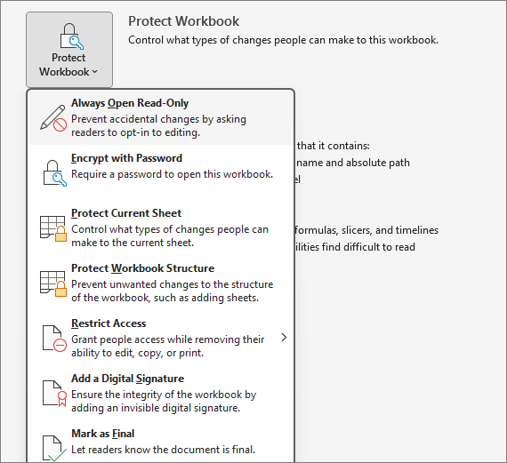

**수정 전**

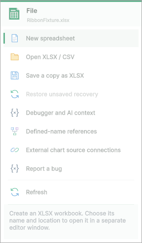

화면 근거: 해당 기능의 최신 실제 실행 화면 미확보 또는 미구현

### TC-RIB-02 · 홈

분류: 일반 · 결과: **부분 확인**

| 항목 | 내용 |
| --- | --- |
| 실행 절차 | 일반 시트에서 홈 탭을 선택합니다. |
| 기대값 | 클립보드·글꼴·맞춤·표시 형식·스타일·셀·편집 그룹을 대조합니다. |
| 실제 결과 | Home7개 그룹 배치·42개 접근 키·Ctrl+F1·임시 리본·Tab/Shift+Tab/방향키/Enter/Space 이동 구현. 전체 홈 레이아웃·명령 최종 일치는 미완료. |
| 수정 내용 | Affinity V9 맞춤6종 재제작, 기본96개 중6개만 변경. 추가16종은 ExtrasV11 유지. 보조 문자 누수·임시 리본 클릭/접기·이름 편집 유지 수정. 포커스 검사2곳 유지. |
| 재검증 | 홈111검사(R5),물리 접근키13건(R13),Enter 이동11건(R3),Space 이동11건(R5),임시 리본13건(R4). 실패 R2/R4 기록 보존. 각 증거의 MVID/시각으로 검증 버전을 구분. |
| 원본 출처·버전 | Microsoft Windows Excel Home 키 팁 실제 원본1350×200. 정확한 Excel 빌드와 DPI는 미확인. https://support.microsoft.com/en-us/accessibility/excel/keyboard-shortcuts-in-excel |

**Excel 원본**

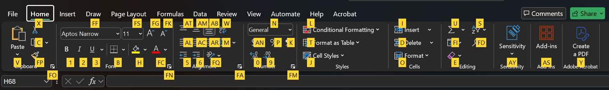

**수정 전**

**수정 후 실제 실행**

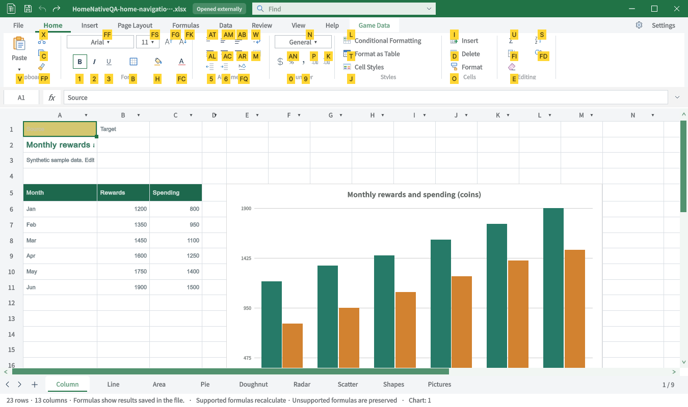

화면 근거: 전체 Home 명령 전수 검증 및 나머지 아이콘의 원본 대조·수정이 남음.

### TC-RIB-03 · 삽입

분류: 일반 · 결과: **부분 확인**

| 항목 | 내용 |
| --- | --- |
| 실행 절차 | 삽입 탭에서 도형 타일을 클릭합니다. |
| 기대값 | 표·도형·그림·차트·링크·텍스트·기호와 추가 삽입 그룹을 대조합니다. |
| 실제 결과 | 도형187종을9개 분류의 스크롤 드롭다운으로 변경했습니다. 203건 분류·템플릿·실제 항목 클릭 검사 통과. 모든187종의 마우스 배치 전수는 미실행입니다. |
| 수정 내용 | 도형187종을9개 분류의 스크롤 드롭다운으로 변경했습니다. |
| 재검증 | 203건 분류·템플릿·실제 항목 클릭 검사 통과. 모든187종의 마우스 배치 전수는 미실행입니다. 최신R7 실제 화면 촬영 성공. 촬영만으로 해당 TC의 기능 통과를 의미하지 않습니다. |
| 원본 출처·버전 | 부분 원본·정확한 빌드 미확인 · https://techcommunity.microsoft.com/blog/nonprofittechies/getting-familiar-with-microsoft-excel/3756412/ |

**Excel 원본**

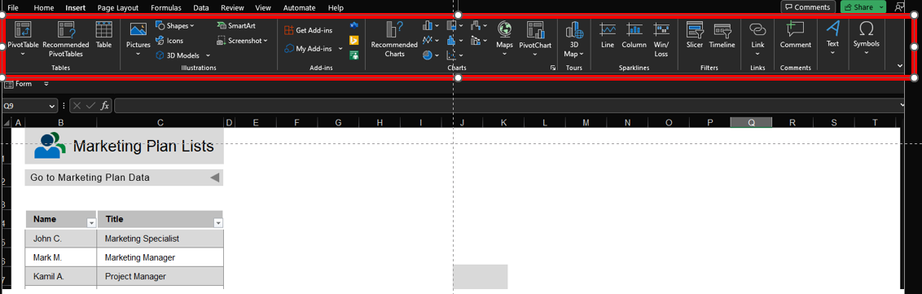

**수정 전**

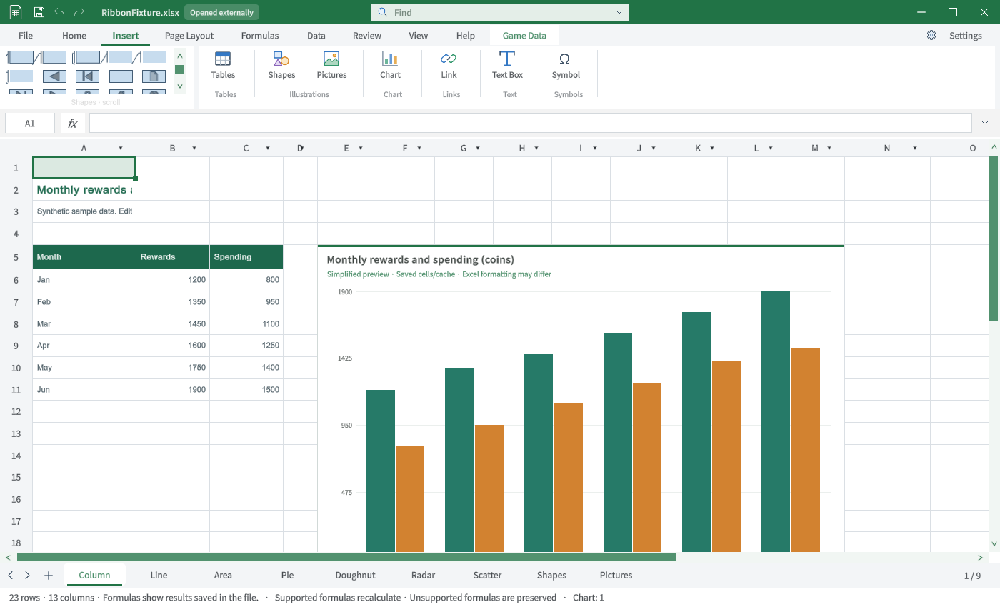

**수정 후 실제 실행**

### TC-RIB-04 · 페이지 레이아웃

분류: 일반 · 결과: **부분 확인**

| 항목 | 내용 |
| --- | --- |
| 실행 절차 | 페이지 레이아웃을 선택합니다. |
| 기대값 | 테마·페이지 설정·배율 그룹을 비교합니다. |
| 실제 결과 | 단일 버튼을 테마·페이지 설정·배율3영역으로 구현. 실제 여백/방향/용지/인쇄 영역/나누기/반복 제목/맞춤·배율 API 연결. 테마는 번들 Office(ECMA) 적용이며 배경은 아직 비활성. |
| 수정 내용 | Affinity16종 V12 추가,32px 큰 아이콘·9개 언어39문구·캡션 조정. 페이지 맞춤 네이티브 저장·반복 행열 동시 보존·자동 경계 보존·부분 테마 적용. 확정 후 Redo/확정 전 Ctrl+F1 초안 처리 수정. |
| 재검증 | API43(R2),실제 메뉴·입력·저장/Undo/Redo18(R3),초안4(R3),저장 XML2,영향 회귀13(R5) 통과. 초기 실패와 QA 개정 이유 보존. 전체 페이지 기능·픽셀/언어 최종 대조는 남음. |
| 원본 출처·버전 | 구형 Windows 원본 일부 · https://support.microsoft.com/en-us/excel/fit-to-one-page-in-excel |

**Excel 원본**

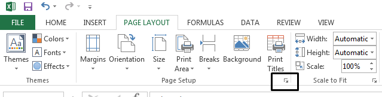

**수정 전**

**수정 후 실제 실행**

화면 근거: 배경·전체 테마 갤러리/가져오기·고급 인쇄/용지·9개 언어 실제 레이아웃 및 최종 픽셀 대조 미완료

### TC-RIB-05 · 수식

분류: 일반 · 결과: **부분 확인**

| 항목 | 내용 |
| --- | --- |
| 실행 절차 | 수식 탭을 선택합니다. |
| 기대값 | 함수 라이브러리·이름·수식 분석·계산을 비교합니다. |
| 실제 결과 | 도움말·이름 관리자·이름 참조·재계산은 보이지만 함수 분류 갤러리와 분석 도구가 없습니다. |
| 수정 내용 | 이번 회차 수정 없음. 이전 기록의 근거와 제한을 보존합니다. |
| 재검증 | 전체 명령의 최신 실행 재검증은 미실행입니다. 최신R7 실제 화면 촬영 성공. 촬영만으로 해당 TC의 기능 통과를 의미하지 않습니다. |
| 원본 출처·버전 | 함수 라이브러리 부분 원본 · https://support.microsoft.com/en-us/excel/using-functions-and-nested-functions-in-excel-formulas |

**Excel 원본**

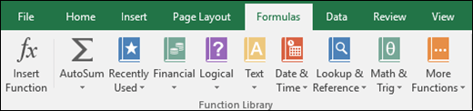

**수정 전**

**수정 후 실제 실행**

### TC-RIB-06 · 데이터

분류: 일반 · 결과: **부분 확인**

| 항목 | 내용 |
| --- | --- |
| 실행 절차 | 데이터 탭을 선택합니다. |
| 기대값 | 정렬·필터와 데이터 가져오기·쿼리 그룹을 비교합니다. |
| 실제 결과 | 정렬·필터·외부 차트 연결만 보입니다. 원본의 Get Data·쿼리 새로 고침 구성이 없습니다. |
| 수정 내용 | 이번 회차 수정 없음. 이전 기록의 근거와 제한을 보존합니다. |
| 재검증 | 전체 명령의 최신 실행 재검증은 미실행입니다. 최신R7 실제 화면 촬영 성공. 촬영만으로 해당 TC의 기능 통과를 의미하지 않습니다. |
| 원본 출처·버전 | Excel2016 Get & Transform 부분 원본 · https://support.microsoft.com/en-us/excel/about-power-query-in-excel |

**Excel 원본**

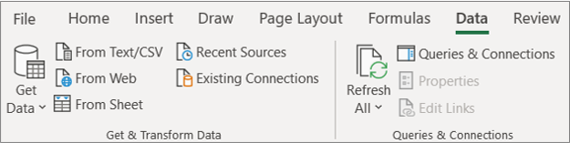

**수정 전**

**수정 후 실제 실행**

### TC-RIB-07 · 검토

분류: 일반 · 결과: **부분 확인**

| 항목 | 내용 |
| --- | --- |
| 실행 절차 | 검토 탭을 선택합니다. |
| 기대값 | 맞춤법·접근성·변경·댓글·보호와 통계를 대조합니다. |
| 실제 결과 | 현재는 통계 버튼만 보입니다. 비교 원본은 Excel 웹이므로 Windows 동일 버전 비교는 아닙니다. |
| 수정 내용 | 이번 회차 수정 없음. 이전 기록의 근거와 제한을 보존합니다. |
| 재검증 | 전체 명령의 최신 실행 재검증은 미실행입니다. 최신R7 실제 화면 촬영 성공. 촬영만으로 해당 TC의 기능 통과를 의미하지 않습니다. |
| 원본 출처·버전 | Excel 웹 원본·Windows와 구별 · https://learn.microsoft.com/en-us/answers/questions/5190624/review-tab-options-greyed-out-in-excel-365-files-w |

**Excel 원본**

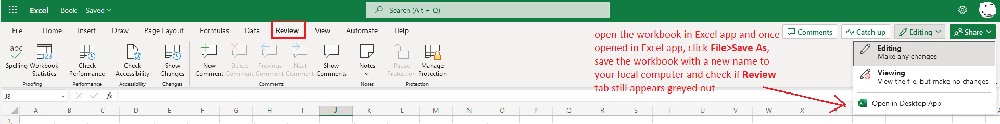

**수정 전**

**수정 후 실제 실행**

### TC-RIB-08 · 보기

분류: 일반 · 결과: **부분 확인**

| 항목 | 내용 |
| --- | --- |
| 실행 절차 | 보기 탭을 선택합니다. |
| 기대값 | 통합 문서 보기·표시·확대/축소·창 그룹을 대조합니다. |
| 실제 결과 | 고정·해제·개체·시트·보기 메뉴는 보이지만 원본의 보기/확대 그룹 구성과 다릅니다. |
| 수정 내용 | 이번 회차 수정 없음. 이전 기록의 근거와 제한을 보존합니다. |
| 재검증 | 전체 명령의 최신 실행 재검증은 미실행입니다. 최신R7 실제 화면 촬영 성공. 촬영만으로 해당 TC의 기능 통과를 의미하지 않습니다. |
| 원본 출처·버전 | 부분 원본·정확한 빌드 미확인 · https://techcommunity.microsoft.com/discussions/excelgeneral/view-ribbon-tab-checkboxes-no-longer-aligned/3989915 |

**Excel 원본**

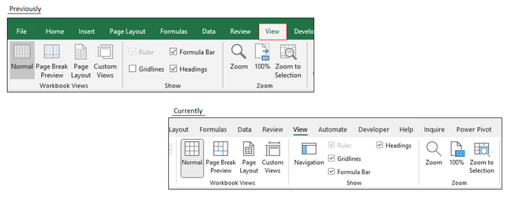

**수정 전**

**수정 후 실제 실행**

### TC-RIB-09 · 도움말

분류: 일반 · 결과: **부분 확인**

| 항목 | 내용 |
| --- | --- |
| 실행 절차 | 도움말을 선택합니다. |
| 기대값 | 도움말 탭의 실제 명령을 대조합니다. |
| 실제 결과 | 현재 디버그·버그 보고·수식 버튼 표시. 원본에는 Help 탭 이름만 보여 명령 대조는 미실행입니다. |
| 수정 내용 | 이번 회차 수정 없음. 이전 기록의 근거와 제한을 보존합니다. |
| 재검증 | 전체 명령의 최신 실행 재검증은 미실행입니다. 최신R7 실제 화면 촬영 성공. 촬영만으로 해당 TC의 기능 통과를 의미하지 않습니다. |
| 원본 출처·버전 | 전체 Help 리본 아님 · https://techcommunity.microsoft.com/blog/nonprofittechies/getting-familiar-with-microsoft-excel/3756412/ |

**Excel 원본**

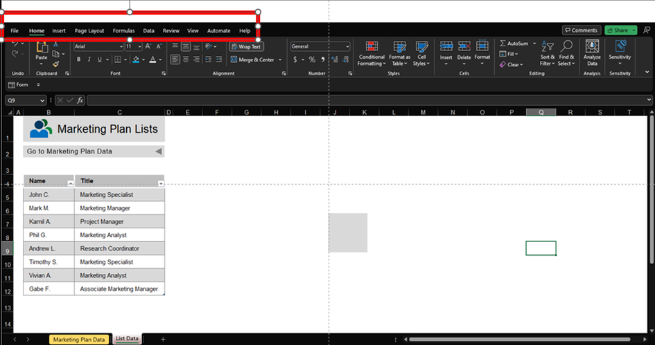

**수정 전**

**수정 후 실제 실행**

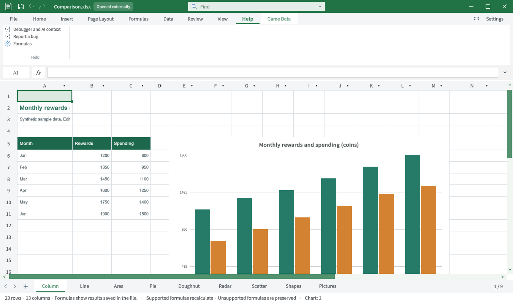

### TC-RIB-10 · 그리기

분류: 일반 · 결과: **실패**

| 항목 | 내용 |
| --- | --- |
| 실행 절차 | 그리기 탭 진입점을 찾습니다. |
| 기대값 | 펜·잉크·다시 재생 등의 탭을 제공합니다. |
| 실제 결과 | 현재 해당 기능/전용 탭은 구현되지 않았습니다. 이전 삽입/홈 화면을 해당 기능의 실행 증거로 취급하지 않습니다. |
| 수정 내용 | 이번 회차 수정 없음. 이전 기록의 근거와 제한을 보존합니다. |
| 재검증 | 전체 명령의 최신 실행 재검증은 미실행입니다. |
| 원본 출처·버전 | Excel Draw 화면·사진 촬영 자료 · https://learn.microsoft.com/en-us/answers/questions/5070058/cant-exit-the-drawing-tool-in-excel |

**Excel 원본**

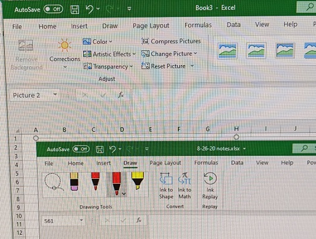

**수정 전**

화면 근거: 해당 기능의 최신 실제 실행 화면 미확보 또는 미구현

### TC-RIB-11 · 자동화

분류: 일반 · 결과: **실패**

| 항목 | 내용 |
| --- | --- |
| 실행 절차 | 자동화 탭 진입점을 찾습니다. |
| 기대값 | Office Scripts 목록과 스크립트 진입점을 대조합니다. |
| 실제 결과 | 현재 해당 기능/전용 탭은 구현되지 않았습니다. 이전 삽입/홈 화면을 해당 기능의 실행 증거로 취급하지 않습니다. |
| 수정 내용 | 이번 회차 수정 없음. 이전 기록의 근거와 제한을 보존합니다. |
| 재검증 | 전체 명령의 최신 실행 재검증은 미실행입니다. |
| 원본 출처·버전 | Excel Automate 원본 · https://techcommunity.microsoft.com/blog/microsoft365insiderblog/automate-tasks-with-office-scripts-in-excel-for-windows-and-mac/4216151 |

**Excel 원본**

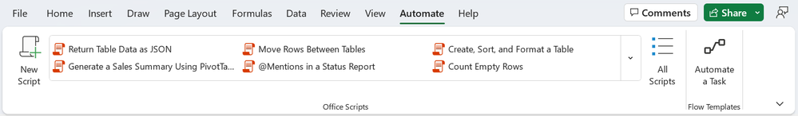

**수정 전**

화면 근거: 해당 기능의 최신 실제 실행 화면 미확보 또는 미구현

### TC-RIB-12 · 개발 도구

분류: 일반 · 결과: **실패**

| 항목 | 내용 |
| --- | --- |
| 실행 절차 | 개발 도구 탭 진입점을 찾습니다. |
| 기대값 | 컨트롤·코드·디자인 모드 그룹을 대조합니다. |
| 실제 결과 | 현재 해당 기능/전용 탭은 구현되지 않았습니다. 이전 삽입/홈 화면을 해당 기능의 실행 증거로 취급하지 않습니다. |
| 수정 내용 | 이번 회차 수정 없음. 이전 기록의 근거와 제한을 보존합니다. |
| 재검증 | 전체 명령의 최신 실행 재검증은 미실행입니다. |
| 원본 출처·버전 | Developer 컨트롤 부분 원본 · https://support.microsoft.com/en-us/excel/form-controls |

**Excel 원본**

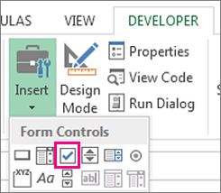

**수정 전**

화면 근거: 해당 기능의 최신 실제 실행 화면 미확보 또는 미구현

### TC-RIB-13 · 추가 기능

분류: 일반 · 결과: **실패**

| 항목 | 내용 |
| --- | --- |
| 실행 절차 | 삽입의 추가 기능 그룹을 확인합니다. |
| 기대값 | 추가 기능 진입점을 대조합니다. |
| 실제 결과 | 현재 해당 기능/전용 탭은 구현되지 않았습니다. 이전 삽입/홈 화면을 해당 기능의 실행 증거로 취급하지 않습니다. |
| 수정 내용 | 이번 회차 수정 없음. 이전 기록의 근거와 제한을 보존합니다. |
| 재검증 | 전체 명령의 최신 실행 재검증은 미실행입니다. |
| 원본 출처·버전 | 삽입 Add-ins 그룹 부분 원본 · https://techcommunity.microsoft.com/blog/nonprofittechies/getting-familiar-with-microsoft-excel/3756412/ |

**Excel 원본**

**수정 전**

화면 근거: 해당 기능의 최신 실제 실행 화면 미확보 또는 미구현

### TC-RIB-14 · 표 디자인

분류: 특수 · 결과: **부분 확인**

| 항목 | 내용 |
| --- | --- |
| 실행 절차 | ChartGallery A5:C11 안 C11을 선택합니다. |
| 기대값 | 표 내부에서 전용 탭·스타일 갤러리·옵션을 제공합니다. |
| 실제 결과 | ChartGallery7개 시트에 모두 실제 표 등록. 셀 선택 시 표 디자인 등장과 편집 가능한 이름·스타일 갤러리 확인. 표 범위/머리글/합계행/필터 UI는 아직 남음. |
| 수정 내용 | 6개 누락 표 추가, 원본 값·서식·차트7개 보존. 재패키징 원본/검사 갱신. 네이티브 이름 편집·로컬 참조 갱신/Undo 구현. |
| 재검증 | 6764 상태/셀 검사,표 내부115좌표와 유효 경계·저장 재열기·7개 실제 탭 촬영. 이름 API38검사 및 실제 입력7검사,임시 리본 이름 입력 유지13검사 포함. 전체TC 통과 아님. |
| 원본 출처·버전 | Windows 표 디자인 및 피벗 분석 원본 · https://support.microsoft.com/en-us/excel/where-are-the-table-tools |

**Excel 원본**

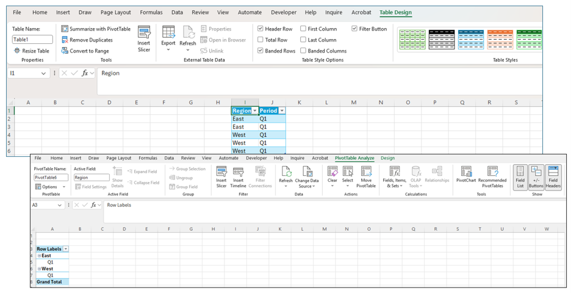

**수정 전**

**수정 후 실제 실행**

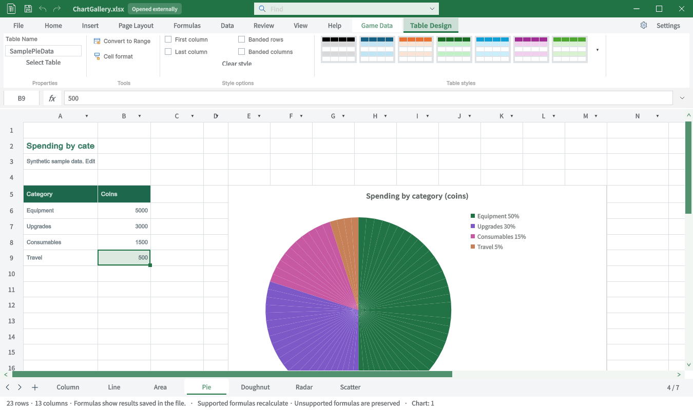

화면 근거: 표 디자인 나머지 기능과 원본 배치 전수 검증 남음

### TC-RIB-15 · 도형 서식

분류: 특수 · 결과: **부분 확인**

| 항목 | 내용 |
| --- | --- |
| 실행 절차 | 도형 개체를 선택합니다. |
| 기대값 | 도형 삽입·도형 스타일·WordArt·접근성·정렬·크기를 대조합니다. |
| 실제 결과 | 원본 순서의 그룹,3개 미리보기+32종 목록,색상·회전·정렬 순서 메뉴와 Affinity 아이콘을 적용했습니다. 문구 잘림도 수정했습니다. 스타일199검사 및 최신 실제 타일 선택·Undo3건 통과. 도형 효과·다중 객체 맞춤/그룹은 미구현입니다. |
| 수정 내용 | 원본 순서의 그룹,3개 미리보기+32종 목록,색상·회전·정렬 순서 메뉴와 Affinity 아이콘을 적용했습니다. 문구 잘림도 수정했습니다. |
| 재검증 | 스타일199검사 및 최신 실제 타일 선택·Undo3건 통과. 도형 효과·다중 객체 맞춤/그룹은 미구현입니다. 최신R7 실제 화면 촬영 성공. 촬영만으로 해당 TC의 기능 통과를 의미하지 않습니다. |
| 원본 출처·버전 | OfficeToolTips 직접 촬영 Excel365 원본·빌드 미확인 · https://www.officetooltips.com/excel/tips/how_to_change_format_for_diagram_shapes_in_excel |

**Excel 원본**

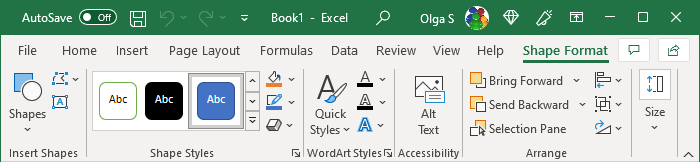

**수정 전**

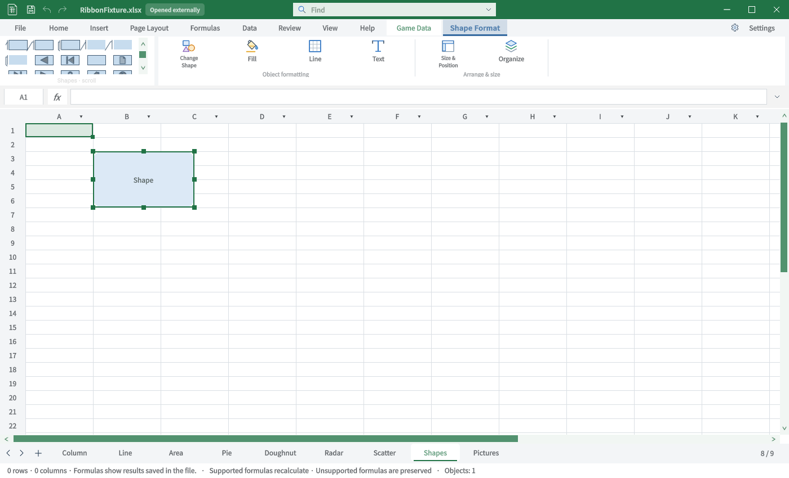

**수정 후 실제 실행**

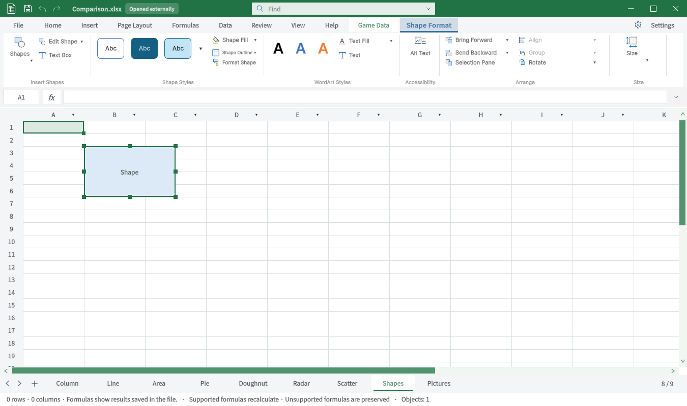

### TC-RIB-16 · 그림 서식

분류: 특수 · 결과: **부분 확인**

| 항목 | 내용 |
| --- | --- |
| 실행 절차 | 삽입된 그림을 선택합니다. |
| 기대값 | 보정·그림 스타일·접근성·정렬·크기를 비교합니다. |
| 실제 결과 | 조정·그림 스타일·접근성·배치·크기 그룹과6개 테두리 미리보기를 구성했습니다. 52검사에서 이미지 바이트·자르기·Undo·저장 재열기 보존 확인. Office 전체 그림 효과와 색 보정은 미구현입니다. |
| 수정 내용 | 조정·그림 스타일·접근성·배치·크기 그룹과6개 테두리 미리보기를 구성했습니다. |
| 재검증 | 52검사에서 이미지 바이트·자르기·Undo·저장 재열기 보존 확인. Office 전체 그림 효과와 색 보정은 미구현입니다. 최신R7 실제 화면 촬영 성공. 촬영만으로 해당 TC의 기능 통과를 의미하지 않습니다. |
| 원본 출처·버전 | 부분 원본·정확한 빌드 미확인 · https://learn.microsoft.com/en-us/answers/questions/5267157/where-are-microsoft-365-excel-picture-format-tools |

**Excel 원본**

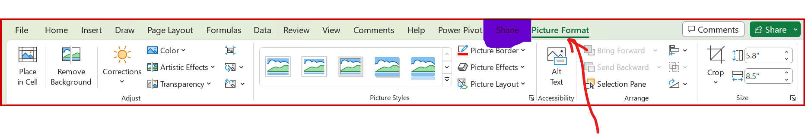

**수정 전**

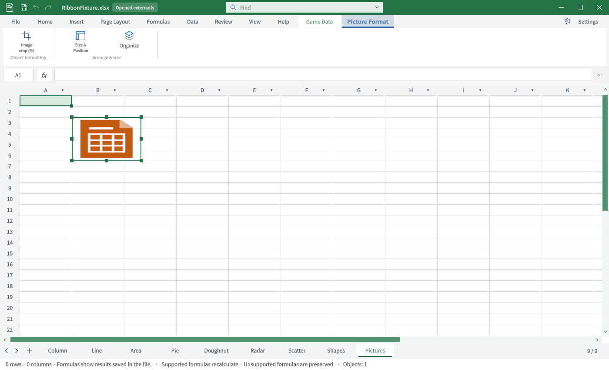

**수정 후 실제 실행**

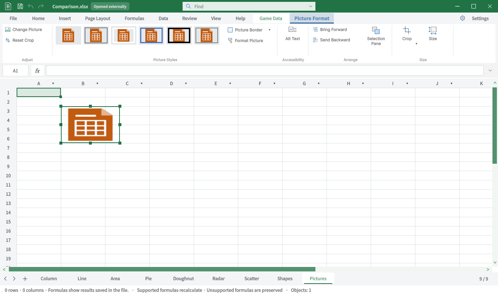

### TC-RIB-17 · 차트 디자인

분류: 특수 · 결과: **부분 확인**

| 항목 | 내용 |
| --- | --- |
| 실행 절차 | 차트를 선택한 뒤 디자인 탭에서 스타일2를 클릭합니다. |
| 기대값 | 썸네일 스타일 목록·데이터·차트 요소를 대조합니다. |
| 실제 결과 | 빠른 레이아웃8개 실제 갤러리·행열 전환·8종류·기존 시트 이동4명령을 활성화했습니다. 실제6개 스타일/48목록과5그룹을 유지합니다. |
| 수정 내용 | 차트 이동의 파트 중복·로컬 이름 충돌 방지,일반 복사 독립 파트 유지,전치 포인트 색상,제목 복구·범례 위치 렌더,레이더2포인트 표시,미리보기 축 라벨 겹침 및 확장 화살표 수정. 차트 명령/스타일 키보드 탐색 연결. |
| 재검증 | 네이티브API235통과(R3),실제UI/저장/Unity범위21통과. R1레이더실패 보존. 전체 Excel 프리셋·대화상자·모든 종류·최종 레이아웃/아이콘/단축키 일치는 남음. |
| 원본 출처·버전 | 부분 원본·정확한 빌드 미확인 · https://learn.microsoft.com/en-us/answers/questions/5423242/chart-design-not-available-i-have-tried-everything |

**Excel 원본**

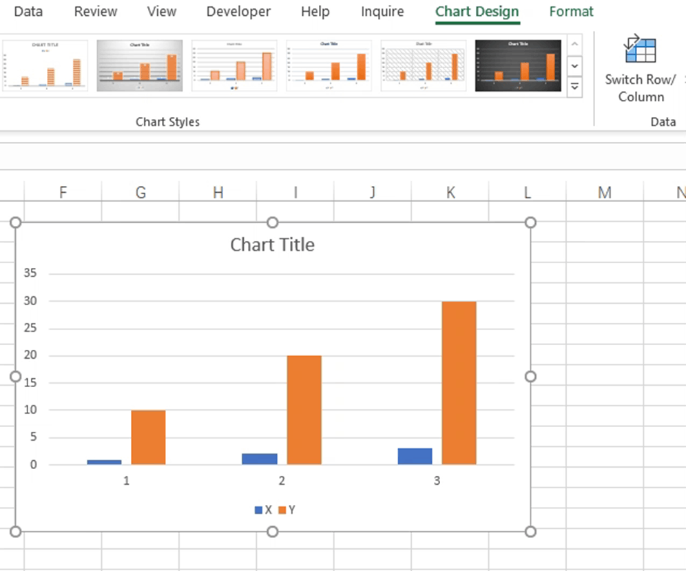

**수정 전**

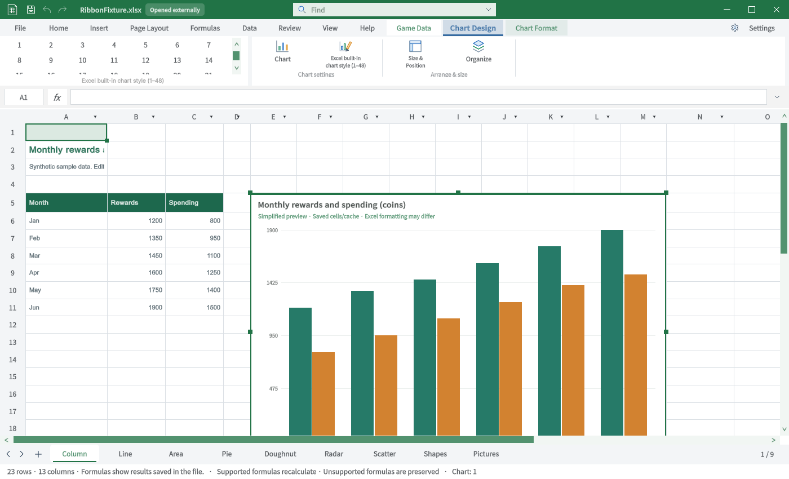

**수정 후 실제 실행**

화면 근거: Excel 번호별 레이아웃·전체 종류/이동 대화상자·새 차트 시트·전체 원본/DPI/픽셀 최종 대조 미완료

### TC-RIB-18 · 차트 서식

분류: 특수 · 결과: **부분 확인**

| 항목 | 내용 |
| --- | --- |
| 실행 절차 | 차트를 선택한 뒤 서식 탭을 선택합니다. |
| 기대값 | 현재 선택·서식·스타일·정렬을 비교합니다. |
| 실제 결과 | 현재 선택·도형 스타일·텍스트·접근성·배치·크기 그룹과 차트 영역 서식 팝업을 연결했습니다. 326개 통합 검사에 차트 제목·범례·격자·색상·저장 검증 포함. 전체 차트 요소 선택/효과 메뉴는 미완성입니다. |
| 수정 내용 | 현재 선택·도형 스타일·텍스트·접근성·배치·크기 그룹과 차트 영역 서식 팝업을 연결했습니다. |
| 재검증 | 326개 통합 검사에 차트 제목·범례·격자·색상·저장 검증 포함. 전체 차트 요소 선택/효과 메뉴는 미완성입니다. 최신R7 실제 화면 촬영 성공. 촬영만으로 해당 TC의 기능 통과를 의미하지 않습니다. |
| 원본 출처·버전 | 구형 Current Selection 부분 원본 · https://support.microsoft.com/en-us/office/graphics-visuals/change-the-shape-fill-outline-or-effects-of-chart-elements |

**Excel 원본**

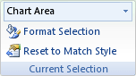

**수정 전**

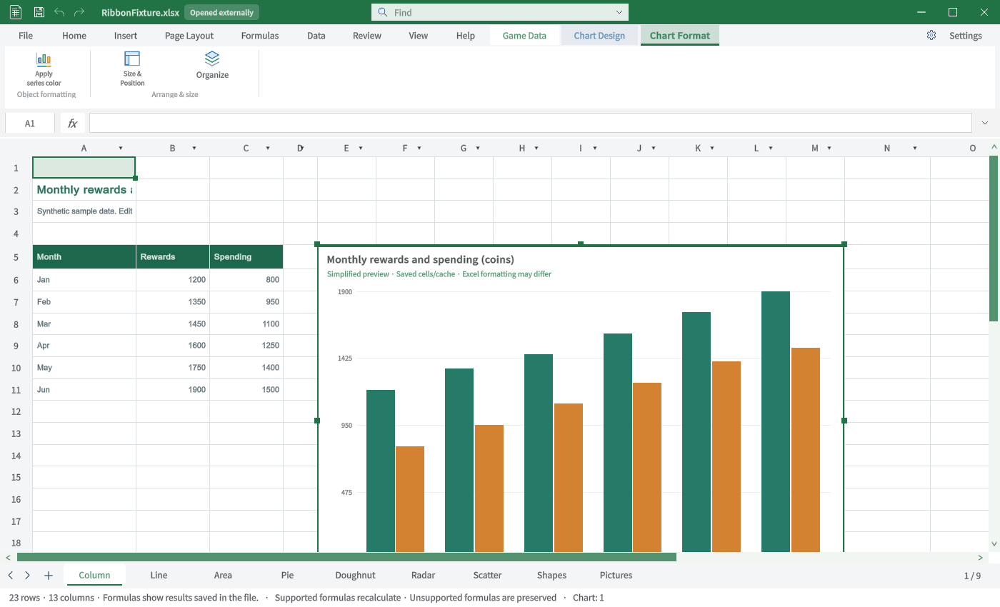

**수정 후 실제 실행**

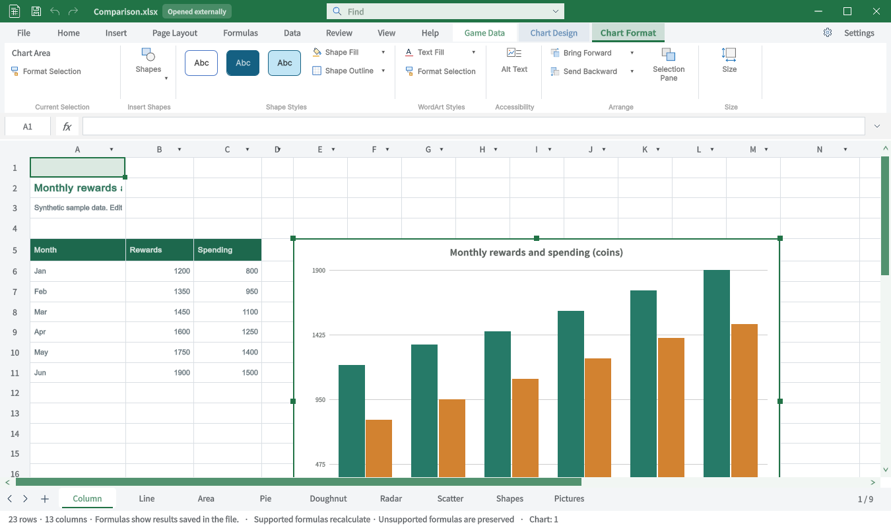

### TC-RIB-19 · 피벗 테이블 분석

분류: 특수 · 결과: **실패**

| 항목 | 내용 |
| --- | --- |
| 실행 절차 | 피벗 삽입·선택 경로를 확인합니다. |
| 기대값 | 피벗 개체 선택 시 분석 탭 |
| 실제 결과 | 현재 해당 기능/전용 탭은 구현되지 않았습니다. 이전 삽입/홈 화면을 해당 기능의 실행 증거로 취급하지 않습니다. |
| 수정 내용 | 이번 회차 수정 없음. 이전 기록의 근거와 제한을 보존합니다. |
| 재검증 | 전체 명령의 최신 실행 재검증은 미실행입니다. |
| 원본 출처·버전 | 원본 일부 · https://support.microsoft.com/en-us/excel/where-are-the-table-tools |

**Excel 원본**

**수정 전**

화면 근거: 해당 기능의 최신 실제 실행 화면 미확보 또는 미구현

### TC-RIB-20 · 피벗 테이블 디자인

분류: 특수 · 결과: **실패**

| 항목 | 내용 |
| --- | --- |
| 실행 절차 | 피벗 삽입·선택 경로를 확인합니다. |
| 기대값 | 피벗 스타일·레이아웃 |
| 실제 결과 | 현재 해당 기능/전용 탭은 구현되지 않았습니다. 이전 삽입/홈 화면을 해당 기능의 실행 증거로 취급하지 않습니다. |
| 수정 내용 | 이번 회차 수정 없음. 이전 기록의 근거와 제한을 보존합니다. |
| 재검증 | 전체 명령의 최신 실행 재검증은 미실행입니다. |
| 원본 출처·버전 | 원본 일부 · https://support.microsoft.com/en-us/excel/design-the-layout-and-format-of-a-pivottable |

**Excel 원본**

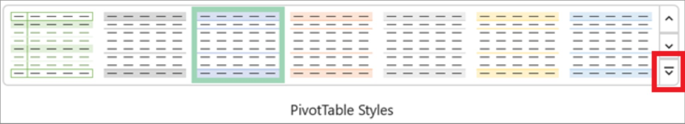

**수정 전**

화면 근거: 해당 기능의 최신 실제 실행 화면 미확보 또는 미구현

### TC-RIB-21 · 피벗 차트 분석

분류: 특수 · 결과: **실패**

| 항목 | 내용 |
| --- | --- |
| 실행 절차 | 피벗 삽입·선택 경로를 확인합니다. |
| 기대값 | 피벗 차트 선택 시 분석 탭 |
| 실제 결과 | 현재 해당 기능/전용 탭은 구현되지 않았습니다. 이전 삽입/홈 화면을 해당 기능의 실행 증거로 취급하지 않습니다. |
| 수정 내용 | 이번 회차 수정 없음. 이전 기록의 근거와 제한을 보존합니다. |
| 재검증 | 전체 명령의 최신 실행 재검증은 미실행입니다. |
| 원본 출처·버전 | W3Schools 직접 작성 Field Buttons 부분 원본 · https://www.w3schools.com/excel/excel_pivot_charts.php |

**Excel 원본**

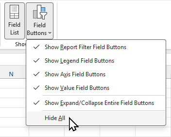

**수정 전**

화면 근거: 해당 기능의 최신 실제 실행 화면 미확보 또는 미구현

### TC-RIB-22 · 피벗 차트 디자인

분류: 특수 · 결과: **실패**

| 항목 | 내용 |
| --- | --- |
| 실행 절차 | 피벗 삽입·선택 경로를 확인합니다. |
| 기대값 | 피벗 차트 스타일·데이터 |
| 실제 결과 | 현재 해당 기능/전용 탭은 구현되지 않았습니다. 이전 삽입/홈 화면을 해당 기능의 실행 증거로 취급하지 않습니다. |
| 수정 내용 | 이번 회차 수정 없음. 이전 기록의 근거와 제한을 보존합니다. |
| 재검증 | 전체 명령의 최신 실행 재검증은 미실행입니다. |
| 원본 출처·버전 | 해당 원본 미확보 · 제품 전용 기능: Excel 대응 원본 없음 |

**수정 전**

화면 근거: 대응 원본 사진 없음 또는 정확한 버전의 원본 미확보; 해당 기능의 최신 실제 실행 화면 미확보 또는 미구현

### TC-RIB-23 · 피벗 차트 서식

분류: 특수 · 결과: **실패**

| 항목 | 내용 |
| --- | --- |
| 실행 절차 | 피벗 삽입·선택 경로를 확인합니다. |
| 기대값 | 피벗 차트 서식 |
| 실제 결과 | 현재 해당 기능/전용 탭은 구현되지 않았습니다. 이전 삽입/홈 화면을 해당 기능의 실행 증거로 취급하지 않습니다. |
| 수정 내용 | 이번 회차 수정 없음. 이전 기록의 근거와 제한을 보존합니다. |
| 재검증 | 전체 명령의 최신 실행 재검증은 미실행입니다. |
| 원본 출처·버전 | 해당 원본 미확보 · 제품 전용 기능: Excel 대응 원본 없음 |

**수정 전**

화면 근거: 대응 원본 사진 없음 또는 정확한 버전의 원본 미확보; 해당 기능의 최신 실제 실행 화면 미확보 또는 미구현

### TC-RIB-24 · 슬라이서

분류: 특수 · 결과: **실패**

| 항목 | 내용 |
| --- | --- |
| 실행 절차 | 슬라이서 삽입·선택 경로를 확인합니다. |
| 기대값 | 슬라이서 선택 시 전용 도구와 스타일을 제공합니다. |
| 실제 결과 | 현재 해당 기능/전용 탭은 구현되지 않았습니다. 이전 삽입/홈 화면을 해당 기능의 실행 증거로 취급하지 않습니다. |
| 수정 내용 | 이번 회차 수정 없음. 이전 기록의 근거와 제한을 보존합니다. |
| 재검증 | 전체 명령의 최신 실행 재검증은 미실행입니다. |
| 원본 출처·버전 | 삽입·개체 부분 원본 · https://learn.microsoft.com/en-us/answers/questions/545181/slicer-in-excel-on-o365-has-disappeared |

**Excel 원본**

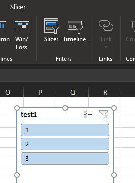

**수정 전**

화면 근거: 해당 기능의 최신 실제 실행 화면 미확보 또는 미구현

### TC-RIB-25 · 시간 표시 막대

분류: 특수 · 결과: **실패**

| 항목 | 내용 |
| --- | --- |
| 실행 절차 | Timeline 삽입·선택 경로를 확인합니다. |
| 기대값 | Timeline 스타일 갤러리를 제공합니다. |
| 실제 결과 | 현재 해당 기능/전용 탭은 구현되지 않았습니다. 이전 삽입/홈 화면을 해당 기능의 실행 증거로 취급하지 않습니다. |
| 수정 내용 | 이번 회차 수정 없음. 이전 기록의 근거와 제한을 보존합니다. |
| 재검증 | 전체 명령의 최신 실행 재검증은 미실행입니다. |
| 원본 출처·버전 | Timeline Styles 부분 원본 · https://support.microsoft.com/en-us/excel/create-a-pivottable-timeline-to-filter-dates |

**Excel 원본**

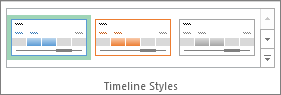

**수정 전**

화면 근거: 해당 기능의 최신 실제 실행 화면 미확보 또는 미구현

### TC-RIB-26 · 스파크라인

분류: 특수 · 결과: **실패**

| 항목 | 내용 |
| --- | --- |
| 실행 절차 | 스파크라인 삽입·선택 경로를 확인합니다. |
| 기대값 | 스파크라인 스타일 갤러리를 제공합니다. |
| 실제 결과 | 현재 해당 기능/전용 탭은 구현되지 않았습니다. 이전 삽입/홈 화면을 해당 기능의 실행 증거로 취급하지 않습니다. |
| 수정 내용 | 이번 회차 수정 없음. 이전 기록의 근거와 제한을 보존합니다. |
| 재검증 | 전체 명령의 최신 실행 재검증은 미실행입니다. |
| 원본 출처·버전 | Sparkline Style 부분 원본 · https://support.microsoft.com/en-us/excel/analyze-trends-in-data-using-sparklines |

**Excel 원본**

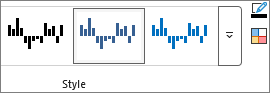

**수정 전**

화면 근거: 해당 기능의 최신 실제 실행 화면 미확보 또는 미구현

### TC-RIB-27 · SmartArt 디자인

분류: 특수 · 결과: **실패**

| 항목 | 내용 |
| --- | --- |
| 실행 절차 | SmartArt 삽입·선택 경로를 확인합니다. |
| 기대값 | 레이아웃·색상·스타일을 제공합니다. |
| 실제 결과 | 현재 해당 기능/전용 탭은 구현되지 않았습니다. 이전 삽입/홈 화면을 해당 기능의 실행 증거로 취급하지 않습니다. |
| 수정 내용 | 이번 회차 수정 없음. 이전 기록의 근거와 제한을 보존합니다. |
| 재검증 | 전체 명령의 최신 실행 재검증은 미실행입니다. |
| 원본 출처·버전 | Excel SmartArt 디자인 부분 원본 · https://learn.microsoft.com/en-us/answers/questions/5368523/smartart-in-excel-can-t-find-text-pane-no-arrow-on |

**Excel 원본**

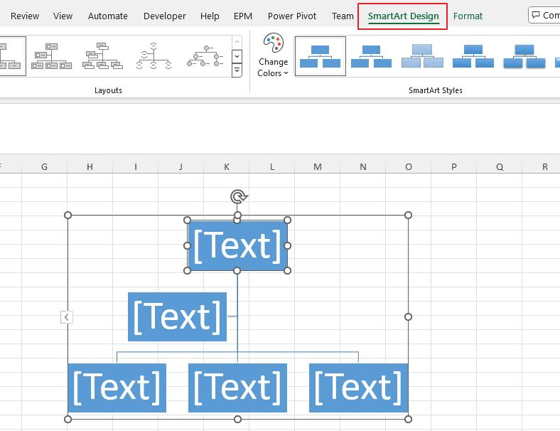

**수정 전**

화면 근거: 해당 기능의 최신 실제 실행 화면 미확보 또는 미구현

### TC-RIB-28 · SmartArt 서식

분류: 특수 · 결과: **실패**

| 항목 | 내용 |
| --- | --- |
| 실행 절차 | SmartArt 관련 서식 경로를 확인합니다. |
| 기대값 | 관련 개체의 서식·스타일을 제공합니다. |
| 실제 결과 | 현재 해당 기능/전용 탭은 구현되지 않았습니다. 이전 삽입/홈 화면을 해당 기능의 실행 증거로 취급하지 않습니다. |
| 수정 내용 | 이번 회차 수정 없음. 이전 기록의 근거와 제한을 보존합니다. |
| 재검증 | 전체 명령의 최신 실행 재검증은 미실행입니다. |
| 원본 출처·버전 | SmartArt 파생 개체의 Shape Format · https://learn.microsoft.com/en-us/answers/questions/5368523/smartart-in-excel-can-t-find-text-pane-no-arrow-on |

**Excel 원본**

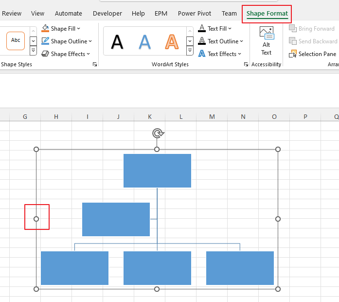

**수정 전**

화면 근거: 해당 기능의 최신 실제 실행 화면 미확보 또는 미구현

### TC-RIB-29 · 그래픽 서식

분류: 특수 · 결과: **실패**

| 항목 | 내용 |
| --- | --- |
| 실행 절차 | 관련 개체 삽입·선택 경로를 확인합니다. |
| 기대값 | SVG 선택 시 그래픽 서식 |
| 실제 결과 | 현재 해당 기능/전용 탭은 구현되지 않았습니다. 이전 삽입/홈 화면을 해당 기능의 실행 증거로 취급하지 않습니다. |
| 수정 내용 | 이번 회차 수정 없음. 이전 기록의 근거와 제한을 보존합니다. |
| 재검증 | 전체 명령의 최신 실행 재검증은 미실행입니다. |
| 원본 출처·버전 | Excel 원본 미확보 · 제품 전용 기능: Excel 대응 원본 없음 |

**수정 전**

화면 근거: 대응 원본 사진 없음 또는 정확한 버전의 원본 미확보; 해당 기능의 최신 실제 실행 화면 미확보 또는 미구현

### TC-RIB-30 · 3D 모델 서식

분류: 특수 · 결과: **실패**

| 항목 | 내용 |
| --- | --- |
| 실행 절차 | 관련 개체 삽입·선택 경로를 확인합니다. |
| 기대값 | 3D 모델 선택 시 보기·정렬 |
| 실제 결과 | 현재 해당 기능/전용 탭은 구현되지 않았습니다. 이전 삽입/홈 화면을 해당 기능의 실행 증거로 취급하지 않습니다. |
| 수정 내용 | 이번 회차 수정 없음. 이전 기록의 근거와 제한을 보존합니다. |
| 재검증 | 전체 명령의 최신 실행 재검증은 미실행입니다. |
| 원본 출처·버전 | Excel 원본 미확보 · 제품 전용 기능: Excel 대응 원본 없음 |

**수정 전**

화면 근거: 대응 원본 사진 없음 또는 정확한 버전의 원본 미확보; 해당 기능의 최신 실제 실행 화면 미확보 또는 미구현

### TC-RIB-31 · 수식 디자인

분류: 특수 · 결과: **실패**

| 항목 | 내용 |
| --- | --- |
| 실행 절차 | 관련 개체 삽입·선택 경로를 확인합니다. |
| 기대값 | 수식 개체 선택 시 디자인 |
| 실제 결과 | 현재 해당 기능/전용 탭은 구현되지 않았습니다. 이전 삽입/홈 화면을 해당 기능의 실행 증거로 취급하지 않습니다. |
| 수정 내용 | 이번 회차 수정 없음. 이전 기록의 근거와 제한을 보존합니다. |
| 재검증 | 전체 명령의 최신 실행 재검증은 미실행입니다. |
| 원본 출처·버전 | SpreadsheetPlanet 직접 작성 Excel Microsoft365 Windows 원본 · https://spreadsheetplanet.com/insert-equation-excel/ |

**Excel 원본**

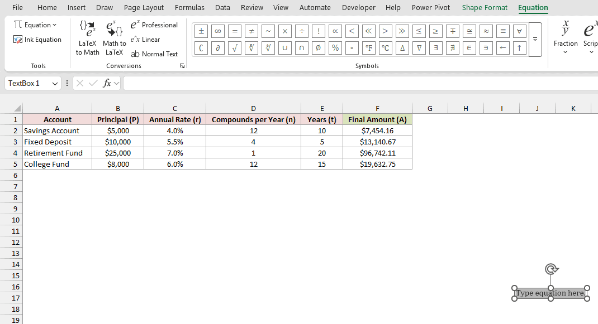

**수정 전**

화면 근거: 해당 기능의 최신 실제 실행 화면 미확보 또는 미구현

### TC-RIB-32 · 머리글·바닥글

분류: 특수 · 결과: **실패**

| 항목 | 내용 |
| --- | --- |
| 실행 절차 | 머리글·바닥글 전용 편집 경로를 확인합니다. |
| 기대값 | 페이지 번호·날짜·파일명 등의 요소를 비교합니다. |
| 실제 결과 | 현재 해당 기능/전용 탭은 구현되지 않았습니다. 이전 삽입/홈 화면을 해당 기능의 실행 증거로 취급하지 않습니다. |
| 수정 내용 | 이번 회차 수정 없음. 이전 기록의 근거와 제한을 보존합니다. |
| 재검증 | 전체 명령의 최신 실행 재검증은 미실행입니다. |
| 원본 출처·버전 | Header/Footer Elements 부분 원본 · https://support.microsoft.com/en-us/excel/headers-and-footers-in-a-worksheet |

**Excel 원본**

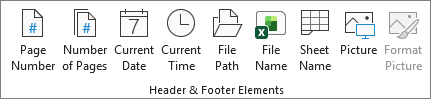

**수정 전**

화면 근거: 해당 기능의 최신 실제 실행 화면 미확보 또는 미구현

### TC-RIB-33 · 쿼리 편집

분류: 특수 · 결과: **실패**

| 항목 | 내용 |
| --- | --- |
| 실행 절차 | 쿼리 개체의 전용 편집 진입을 확인합니다. |
| 기대값 | 쿼리 선택·편집 탭을 제공합니다. |
| 실제 결과 | 현재 해당 기능/전용 탭은 구현되지 않았습니다. 이전 삽입/홈 화면을 해당 기능의 실행 증거로 취급하지 않습니다. |
| 수정 내용 | 이번 회차 수정 없음. 이전 기록의 근거와 제한을 보존합니다. |
| 재검증 | 전체 명령의 최신 실행 재검증은 미실행입니다. |
| 원본 출처·버전 | Data Get & Transform 부분 자료 · https://support.microsoft.com/en-us/excel/about-power-query-in-excel |

**Excel 원본**

**수정 전**

화면 근거: 해당 기능의 최신 실제 실행 화면 미확보 또는 미구현

### TC-RIB-34 · 게임 데이터

분류: 제품 전용 · 결과: **부분 확인**

| 항목 | 내용 |
| --- | --- |
| 실행 절차 | 게임 데이터 탭 선택 |
| 기대값 | 등록 종류별 그룹과 창 색상 일관성 |
| 실제 결과 | 최신 Unity에서 해당 제품 전용 화면을 재촬영했습니다. 전체 명령·플레이 잠금·저장 실패의 재검증은 남아 있습니다. |
| 수정 내용 | 이번 회차 수정 없음. 이전 기록의 근거와 제한을 보존합니다. |
| 재검증 | 전체 명령의 최신 실행 재검증은 미실행입니다. |
| 원본 출처·버전 | Excel 대응 원본 없음·제품 고유 기능 · 제품 전용 기능: Excel 대응 원본 없음 |

**수정 전**

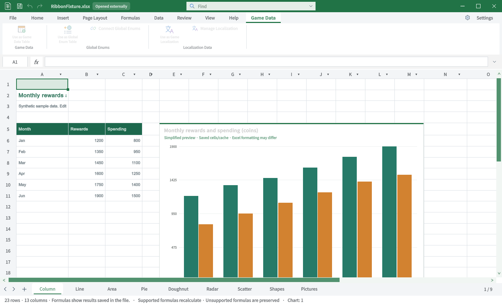

**수정 후 실제 실행**

화면 근거: 대응 원본 사진 없음 또는 정확한 버전의 원본 미확보; 제품 전용 기능이므로 Excel 원본과 직접 대응하지 않음

### TC-RIB-35 · 게임 테이블 도구

분류: 제품 전용 · 결과: **부분 확인**

| 항목 | 내용 |
| --- | --- |
| 실행 절차 | EnumGear 선택 |
| 기대값 | 게임 테이블 전용 도구·사용 예제 |
| 실제 결과 | 최신 Unity에서 해당 제품 전용 화면을 재촬영했습니다. 전체 명령·플레이 잠금·저장 실패의 재검증은 남아 있습니다. |
| 수정 내용 | 이번 회차 수정 없음. 이전 기록의 근거와 제한을 보존합니다. |
| 재검증 | 전체 명령의 최신 실행 재검증은 미실행입니다. |
| 원본 출처·버전 | Excel 대응 원본 없음·제품 고유 기능 · 제품 전용 기능: Excel 대응 원본 없음 |

**수정 전**

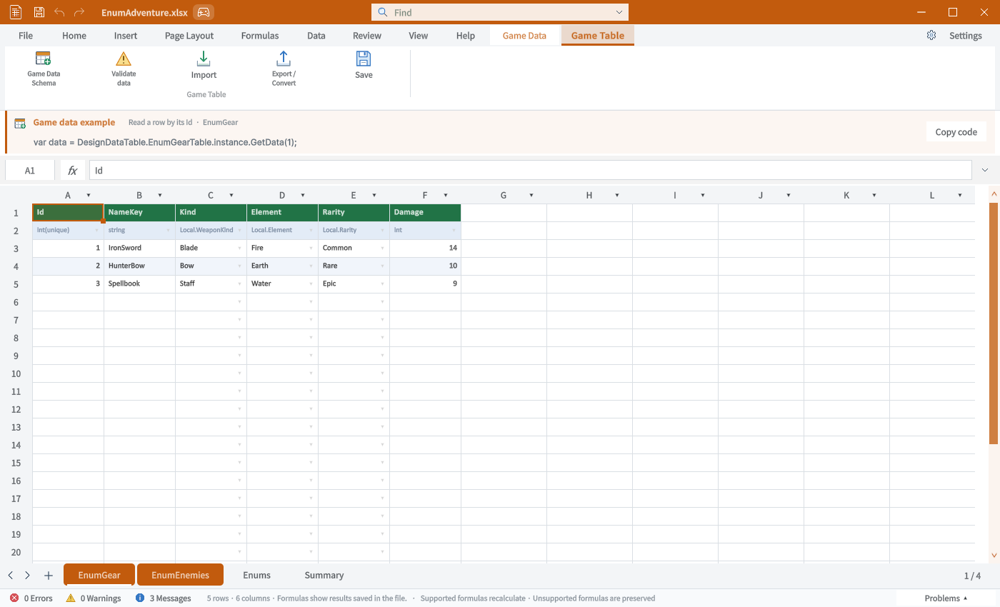

**수정 후 실제 실행**

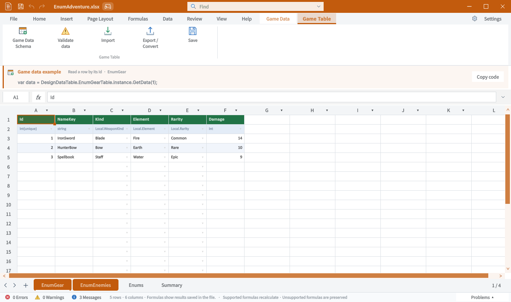

화면 근거: 대응 원본 사진 없음 또는 정확한 버전의 원본 미확보; 제품 전용 기능이므로 Excel 원본과 직접 대응하지 않음

### TC-RIB-36 · 열거형 도구

분류: 제품 전용 · 결과: **부분 확인**

| 항목 | 내용 |
| --- | --- |
| 실행 절차 | Enums 시트 선택 |
| 기대값 | Enum 전용 도구·사용 예제 |
| 실제 결과 | 최신 Unity에서 해당 제품 전용 화면을 재촬영했습니다. 전체 명령·플레이 잠금·저장 실패의 재검증은 남아 있습니다. |
| 수정 내용 | 이번 회차 수정 없음. 이전 기록의 근거와 제한을 보존합니다. |
| 재검증 | 전체 명령의 최신 실행 재검증은 미실행입니다. |
| 원본 출처·버전 | Excel 대응 원본 없음·제품 고유 기능 · 제품 전용 기능: Excel 대응 원본 없음 |

**수정 전**

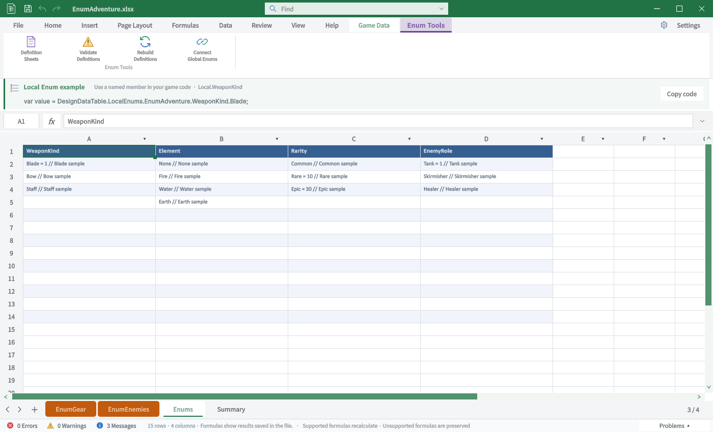

**수정 후 실제 실행**

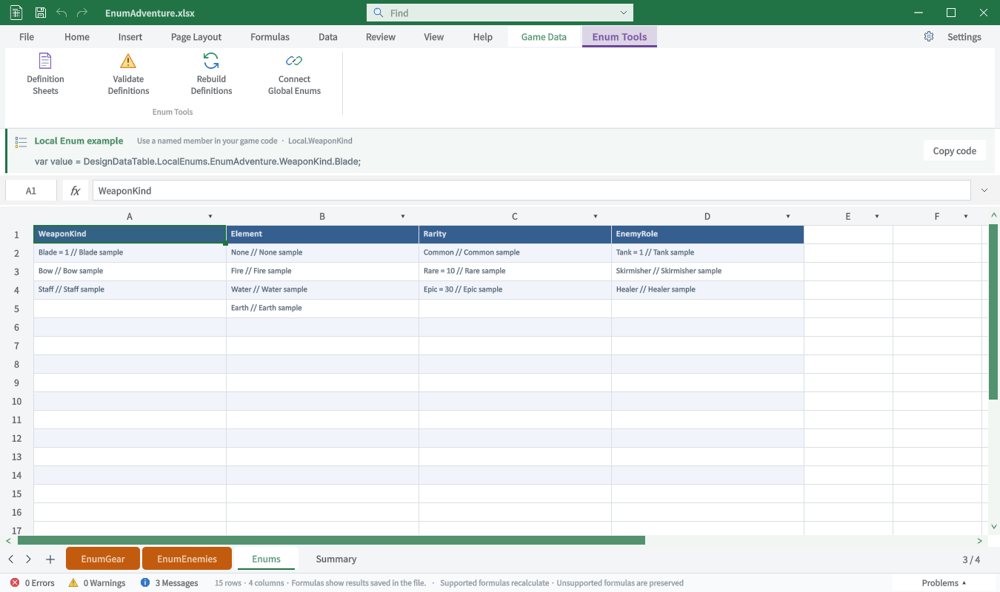

화면 근거: 대응 원본 사진 없음 또는 정확한 버전의 원본 미확보; 제품 전용 기능이므로 Excel 원본과 직접 대응하지 않음

### TC-RIB-37 · 로컬라이징

분류: 제품 전용 · 결과: **부분 확인**

| 항목 | 내용 |
| --- | --- |
| 실행 절차 | ArcadeText 선택 |
| 기대값 | 번역 전용 도구·대체 언어·예제 |
| 실제 결과 | 최신 Unity에서 해당 제품 전용 화면을 재촬영했습니다. 전체 명령·플레이 잠금·저장 실패의 재검증은 남아 있습니다. |
| 수정 내용 | 이번 회차 수정 없음. 이전 기록의 근거와 제한을 보존합니다. |
| 재검증 | 전체 명령의 최신 실행 재검증은 미실행입니다. |
| 원본 출처·버전 | Excel 대응 원본 없음·제품 고유 기능 · 제품 전용 기능: Excel 대응 원본 없음 |

**수정 전**

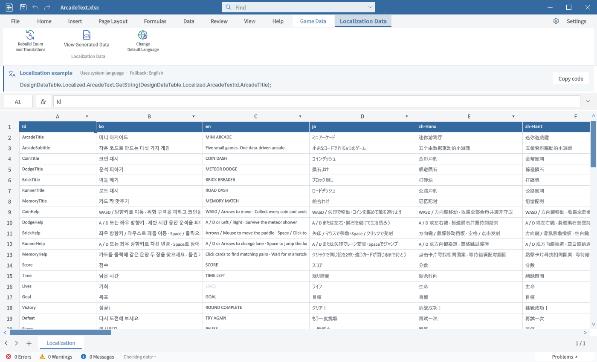

**수정 후 실제 실행**

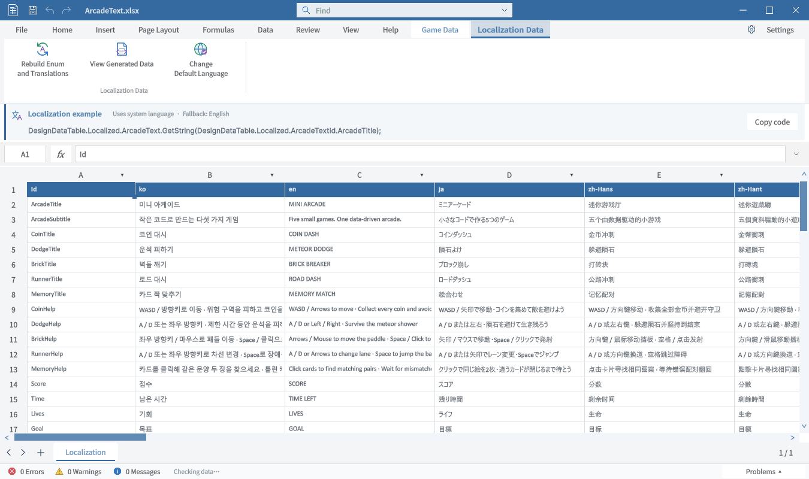

화면 근거: 대응 원본 사진 없음 또는 정확한 버전의 원본 미확보; 제품 전용 기능이므로 Excel 원본과 직접 대응하지 않음

### TC-RIB-38 · 서머리 도구

분류: 제품 전용 · 결과: **부분 확인**

| 항목 | 내용 |
| --- | --- |
| 실행 절차 | Summary 시트 선택 |
| 기대값 | 서머리 전용 도구와 안내 |
| 실제 결과 | 최신 Unity에서 해당 제품 전용 화면을 재촬영했습니다. 전체 명령·플레이 잠금·저장 실패의 재검증은 남아 있습니다. |
| 수정 내용 | 이번 회차 수정 없음. 이전 기록의 근거와 제한을 보존합니다. |
| 재검증 | 전체 명령의 최신 실행 재검증은 미실행입니다. |
| 원본 출처·버전 | Excel 대응 원본 없음·제품 고유 기능 · 제품 전용 기능: Excel 대응 원본 없음 |

**수정 전**

**수정 후 실제 실행**

화면 근거: 대응 원본 사진 없음 또는 정확한 버전의 원본 미확보; 제품 전용 기능이므로 Excel 원본과 직접 대응하지 않음

### TC-RIB-39 · 설정

분류: 제품 전용 · 결과: **부분 확인**

| 항목 | 내용 |
| --- | --- |
| 실행 절차 | 환경 설정 열기 |
| 기대값 | 우측 설정 위치와 읽기 쉬운 패널 |
| 실제 결과 | 최신 Unity에서 해당 제품 전용 화면을 재촬영했습니다. 전체 명령·플레이 잠금·저장 실패의 재검증은 남아 있습니다. |
| 수정 내용 | 이번 회차 수정 없음. 이전 기록의 근거와 제한을 보존합니다. |
| 재검증 | 전체 명령의 최신 실행 재검증은 미실행입니다. |
| 원본 출처·버전 | Excel 대응 원본 없음·제품 고유 기능 · 제품 전용 기능: Excel 대응 원본 없음 |

**수정 전**

**수정 후 실제 실행**

화면 근거: 대응 원본 사진 없음 또는 정확한 버전의 원본 미확보; 제품 전용 기능이므로 Excel 원본과 직접 대응하지 않음

### TC-RIB-40 · 빠른 실행 도구

분류: 기준 목록 보충 · 결과: **부분 확인**

| 항목 | 내용 |
| --- | --- |
| 실행 절차 | 해당 전용 탭 또는 진입점을 현재 리본에서 확인합니다. |
| 기대값 | 저장·Undo·Redo·제목 표시 |
| 실제 결과 | 자료가 구형 별칭·부분 화면이거나 해당 기능의 실제 실행 증거가 부족합니다. 독립 최신 탭으로 확정하거나 통과 처리하지 않았습니다. |
| 수정 내용 | 이번 회차 수정 없음. 이전 기록의 근거와 제한을 보존합니다. |
| 재검증 | 전체 명령의 최신 실행 재검증은 미실행입니다. |
| 원본 출처·버전 | Excel365 원본의 빠른 실행 도구 일부 · https://www.officetooltips.com/excel/tips/how_to_change_format_for_diagram_shapes_in_excel |

**Excel 원본**

**수정 전**

**수정 후 실제 실행**

### TC-RIB-41 · 인쇄 미리보기

분류: 기준 목록 보충 · 결과: **부분 확인**

| 항목 | 내용 |
| --- | --- |
| 실행 절차 | 해당 전용 탭 또는 진입점을 현재 리본에서 확인합니다. |
| 기대값 | Print Preview 전용 탭·인쇄 설정 |
| 실제 결과 | 자료가 구형 별칭·부분 화면이거나 해당 기능의 실제 실행 증거가 부족합니다. 독립 최신 탭으로 확정하거나 통과 처리하지 않았습니다. |
| 수정 내용 | 이번 회차 수정 없음. 이전 기록의 근거와 제한을 보존합니다. |
| 재검증 | 전체 명령의 최신 실행 재검증은 미실행입니다. |
| 원본 출처·버전 | 해당 Excel 원본 미확보 · 제품 전용 기능: Excel 대응 원본 없음 |

**수정 전**

화면 근거: 대응 원본 사진 없음 또는 정확한 버전의 원본 미확보; 해당 기능의 최신 실제 실행 화면 미확보 또는 미구현

### TC-RIB-42 · 배경 제거

분류: 기준 목록 보충 · 결과: **부분 확인**

| 항목 | 내용 |
| --- | --- |
| 실행 절차 | 해당 전용 탭 또는 진입점을 현재 리본에서 확인합니다. |
| 기대값 | 그림 선택 후 배경 제거 전용 탭 |
| 실제 결과 | 자료가 구형 별칭·부분 화면이거나 해당 기능의 실제 실행 증거가 부족합니다. 독립 최신 탭으로 확정하거나 통과 처리하지 않았습니다. |
| 수정 내용 | 이번 회차 수정 없음. 이전 기록의 근거와 제한을 보존합니다. |
| 재검증 | 전체 명령의 최신 실행 재검증은 미실행입니다. |
| 원본 출처·버전 | 해당 Excel 원본 미확보 · 제품 전용 기능: Excel 대응 원본 없음 |

**수정 전**

화면 근거: 대응 원본 사진 없음 또는 정확한 버전의 원본 미확보; 해당 기능의 최신 실제 실행 화면 미확보 또는 미구현

### TC-RIB-43 · 구형 차트 레이아웃

분류: 기준 목록 보충 · 결과: **부분 확인**

| 항목 | 내용 |
| --- | --- |
| 실행 절차 | 해당 전용 탭 또는 진입점을 현재 리본에서 확인합니다. |
| 기대값 | 기준 목록 TabChartToolsLayout 명령군 |
| 실제 결과 | 자료가 구형 별칭·부분 화면이거나 해당 기능의 실제 실행 증거가 부족합니다. 독립 최신 탭으로 확정하거나 통과 처리하지 않았습니다. |
| 수정 내용 | 이번 회차 수정 없음. 이전 기록의 근거와 제한을 보존합니다. |
| 재검증 | 전체 명령의 최신 실행 재검증은 미실행입니다. |
| 원본 출처·버전 | 해당 Excel 원본 미확보 · 제품 전용 기능: Excel 대응 원본 없음 |

**수정 전**

화면 근거: 대응 원본 사진 없음 또는 정확한 버전의 원본 미확보; 해당 기능의 최신 실제 실행 화면 미확보 또는 미구현

### TC-RIB-44 · 구형 피벗 차트 레이아웃

분류: 기준 목록 보충 · 결과: **부분 확인**

| 항목 | 내용 |
| --- | --- |
| 실행 절차 | 해당 전용 탭 또는 진입점을 현재 리본에서 확인합니다. |
| 기대값 | 기준 목록 TabPivotChartToolsLayout 명령군 |
| 실제 결과 | 자료가 구형 별칭·부분 화면이거나 해당 기능의 실제 실행 증거가 부족합니다. 독립 최신 탭으로 확정하거나 통과 처리하지 않았습니다. |
| 수정 내용 | 이번 회차 수정 없음. 이전 기록의 근거와 제한을 보존합니다. |
| 재검증 | 전체 명령의 최신 실행 재검증은 미실행입니다. |
| 원본 출처·버전 | 해당 Excel 원본 미확보 · 제품 전용 기능: Excel 대응 원본 없음 |

**수정 전**

화면 근거: 대응 원본 사진 없음 또는 정확한 버전의 원본 미확보; 해당 기능의 최신 실제 실행 화면 미확보 또는 미구현

### TC-RIB-45 · BI 시각화 도구

분류: 기준 목록 보충 · 결과: **부분 확인**

| 항목 | 내용 |
| --- | --- |
| 실행 절차 | 해당 전용 탭 또는 진입점을 현재 리본에서 확인합니다. |
| 기대값 | 기준 목록 TabBIVisualTools의 활성 조건과 명령 |
| 실제 결과 | 자료가 구형 별칭·부분 화면이거나 해당 기능의 실제 실행 증거가 부족합니다. 독립 최신 탭으로 확정하거나 통과 처리하지 않았습니다. |
| 수정 내용 | 이번 회차 수정 없음. 이전 기록의 근거와 제한을 보존합니다. |
| 재검증 | 전체 명령의 최신 실행 재검증은 미실행입니다. |
| 원본 출처·버전 | 해당 Excel 원본 미확보 · 제품 전용 기능: Excel 대응 원본 없음 |

**수정 전**

화면 근거: 대응 원본 사진 없음 또는 정확한 버전의 원본 미확보; 해당 기능의 최신 실제 실행 화면 미확보 또는 미구현

### TC-RIB-46 · 접근성 작성 도구

분류: 기준 목록 보충 · 결과: **부분 확인**

| 항목 | 내용 |
| --- | --- |
| 실행 절차 | 해당 전용 탭 또는 진입점을 현재 리본에서 확인합니다. |
| 기대값 | 기준 목록 TabAccessibleAuthoring의 활성 조건과 명령 |
| 실제 결과 | 자료가 구형 별칭·부분 화면이거나 해당 기능의 실제 실행 증거가 부족합니다. 독립 최신 탭으로 확정하거나 통과 처리하지 않았습니다. |
| 수정 내용 | 이번 회차 수정 없음. 이전 기록의 근거와 제한을 보존합니다. |
| 재검증 | 전체 명령의 최신 실행 재검증은 미실행입니다. |
| 원본 출처·버전 | 해당 Excel 원본 미확보 · 제품 전용 기능: Excel 대응 원본 없음 |

**수정 전**

화면 근거: 대응 원본 사진 없음 또는 정확한 버전의 원본 미확보; 해당 기능의 최신 실제 실행 화면 미확보 또는 미구현

## 남은 사항

전체46TC 원본 레이아웃·아이콘·크기·영역·단축키 최종 일치 및 전수 실제 QA는 계속 진행합니다. 차트 빠른 레이아웃8조합은 Excel 번호별 프리셋과 동일하다고 검증하지 않았습니다. 종류·이동은 현재 목록 메뉴이며 Excel의 전체 미리보기/확인 대화상자,새 차트 시트 이동,모든 차트 종류·복합/3D·데이터 선택 전용 UI,전체 요소 메뉴가 남아 있습니다. 원본 전체 리본의 픽셀/버전/DPI 최종 대조도 미완료입니다.

페이지 배경·전체 테마 갤러리/가져오기·고급 인쇄,도형 맞춤/그룹,표 머리글/합계/범위/필터,나머지 일반·상황별 탭 영역,File/전체 상황별 탭 단축키,IME 강한 스트레스·저장/닫기·9개 언어 문서/촬영·제품 커밋/패키징/배포를 원래 목록에 유지합니다. 제품 코드 배포와 보고서 공개는 구분합니다.

교훈 검토: 전역 변경 없음. 기존 실제 실행·포커스 보호·원본 대조 규칙을 적용했습니다. 로컬 이름 충돌과 이동/복사 파트 보존을 회귀에 추가했습니다. 미리보기 라벨은 실제 캡처로 확인한 후 원본 차트 속성을 바꾸지 않고 수정했습니다.

## 작업 시간

- 제안 시간: 전체 최초4–6시간(2026-10-31 23:42:56 KST 시작)은 초과했습니다. 이번 차트 묶음35–55분,2026-11-01 08:00:39 KST 시작.
- 실제로 완료된 시간: 차트 구현·실제 API/입력·저장·Unity 범위 검증은2026-11-01 08:45 KST 기준 약44분 진행했습니다. 공개 배포 완료 시각은 별도 확인합니다. 전체46TC 완료 시각은 없습니다.
- XERJ: 사용 — XERJ DrawChartDesignRibbon 검색이 무관한 후보5건을 반환해 현재 코드·참조는 rg로 보완했습니다. 실제 Unity 실행과 XLSX 저장 결과로 검증했습니다.
