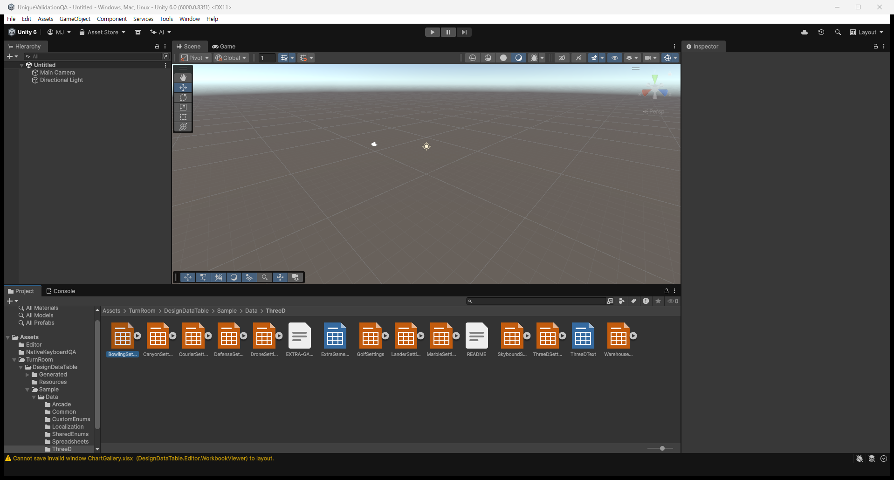

## 작업 결과

아이콘 표시의 임포트 부작용을 제거하고 실제 실행에서 검증했습니다.

## 변경 내용

### 재현 조건

Unity6000.0.83f1·Windows·TurnRoom 및 별도 실제 Unity 검사 프로젝트

### 재현 순서

ThreeD 등 XLSX 폴더를 열고 로그의 같은 원본 임포트 반복을 관찰합니다.

### 기대 동작

폴더 표시와 아이콘 그리기로 재임포트가 발생하지 않아야 합니다.

### 실제 동작

수정 전350회·39개 원본·최대9회 반복. 수정 후 표시2000회와5분 로그에서 재임포트0.

### 원인

Project 창의 XLSX 아이콘 그리기가 메모리 색상 캐시의 누락·불일치를 전체 XLSX ForceUpdate 재임포트 예약으로 연결했습니다. 임포트 뒤 다시 그려지는 경로에서 반복될 수 있었습니다. 수정 전 로그4500줄에서350회·39개 원본·동일 파일 최대9회 반복을 확인했습니다. 별도 프로세스나 도메인에서 공유되지 않는 메모리 캐시만으로 갱신 완료를 판단하지 않도록 변경했습니다.

### 적용 내용

아이콘 그리기에서 임포트 예약을 제거했습니다. 색상·등록 변경만 명시적으로 갱신하고, 저장된 썸네일의 색상 상태를 비교합니다. 임포트 워커에서는 갱신을 예약하지 않으며, 실행 중 재진입은 합쳐 처리합니다. 임포터 버전7, 기존 원본·검색용 테이블 식별자는 유지합니다.

## 검증

실제 Unity6000.0.83f1의11조건 실패0. 아이콘2000회 표시0임포트·동일색 캐시 초기화0·색상 변경34회·복원34회·원본SHA-256 동일. 실행 중 에디터 로그의5분 관찰에서0임포트. 기존3370조건·25씬·24테이블·Windows 빌드 통과. 공식31통과·3경고·0실패. 최종 패키지 1577개·61,700,014바이트, SHA-256 `59f20fdfe82a786ee9ff5b02c7abfe472f913f474d926da4bf6dc198c4d01bbe`.

[실제 임포트 계측](../assets/project-icon-loop-20261101/ProjectIconLoopQA.json) · [실행 중 로그 관찰](../assets/project-icon-loop-20261101/ProjectIconLiveLog.json) · [패키지 무결성](../assets/project-icon-loop-20261101/ArchiveVerification.json) · [주석 차이 검증](../assets/project-icon-loop-20261101/CommentOnlySnapshotVerification.json)

PNG 원본221,674바이트를 유지했습니다. 작은 글자와 실제 상태를 보존하며 이미지 편집·재구성은 하지 않았습니다. 직접 갱신 콜백은 검사기에서 명시적으로 처리해 컨트롤 임포트의 대기 콜백을 측정과 분리했습니다.

## 남은 사항

기존 전체 제출 준비는 미완료입니다. 이전 문서 이미지 검증468건을 처리하거나 최신 전체 계수를 재산정하지 않았습니다. 도형 정렬 미구현·일시정지 Excel 목표도 유지합니다. 실제 폴더 캡처 하단에 기존 ChartGallery 레이아웃 저장 경고가 있어 모든 창 복원이 해결됐다고 주장하지 않습니다. 첫 검사 대기 정체·대기 콜백 집계 실패·자동 한국어 주석 갱신으로 생긴 패키지346파일 차이를 보존했습니다.346파일은 주석행 이외가 같았고 동결 원본 복원 후 재내보냈습니다. 테스트의 전체3370조건 실행본과 최종본은 이 검증된 주석 차이만 있습니다. 사용자 프로젝트의 주석 언어 설정은 변경하지 않았습니다.

## 작업 시간

- 제안 시간: 2026-11-01 16:26:47 KST 시작,10–20분 예상. 검사 대기·컨트롤 콜백 집계·주석 자동 번역에 따른 패키지 차이 검증으로 초과를 진행 중 안내했습니다.
- 실제로 완료된 시간: 코드·실행·패키지 검증 기록 2026-11-01 17:05:11 KST. 시작부터38분. 공개 게시 확인은 최종 채팅에 기록하며 기존 문서 검증은 여전히 미완료입니다.
- XERJ: 사용 — XERJ 서버를 복구하고 QueueNativeIconRefresh 검색을 호출했습니다. 현재 구현 누락으로 rg와 현재 소스·실행 로그를 대조했습니다.
