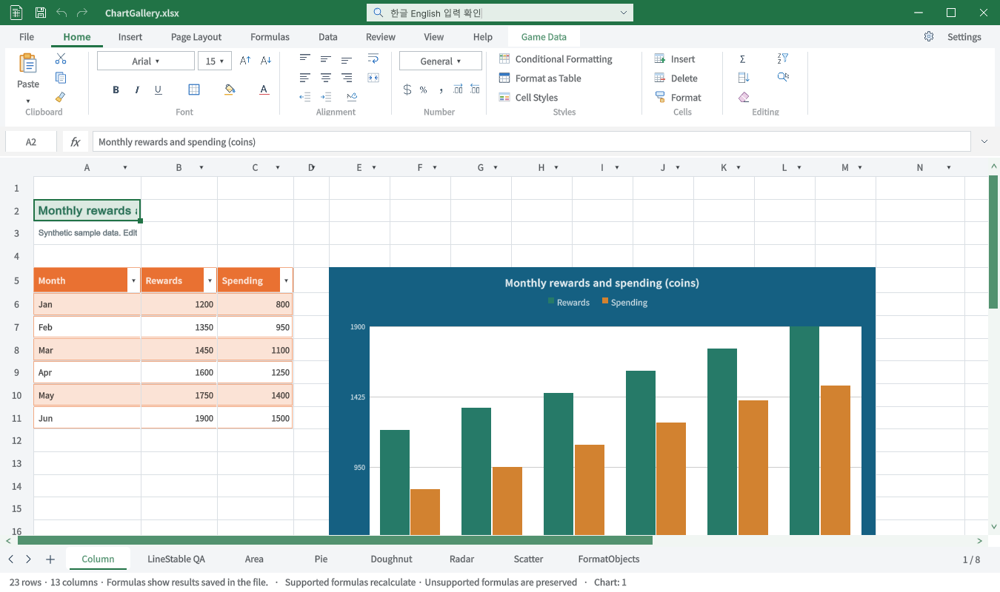
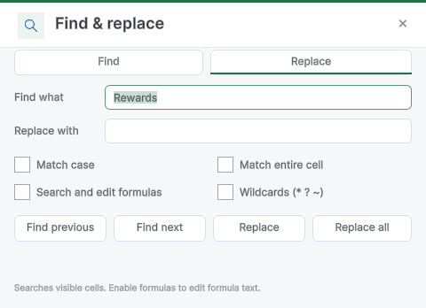

## 작업 결과

이번 요청인 제목 검색창 수정과 실제 입력 QA를 완료했습니다. Windows·Unity6000.0.83f1의 전용 QA 프로젝트에서 실행했습니다. 이전 제출·서식·시트 메뉴42TC는 당시 결과로 유지하며 이번 회차에서 전부 재실행했다고 보고하지 않습니다.

- 같은 빌드·같은 파일·영문 모드·400개 물리 키 이벤트로200자를 넣은 단일 A/B 측정: 기존21,989.97ms → 수정757.69ms.
- 최종 통합본200자×3회:733.13 /480.28 /587.54ms. 총600자 누락0.
- 실제 한글 조합 한→Backspace→하, 재조합·공백 확정·영어 전환을 확인했습니다. Unicode 문자열 주입만으로 IME 통과를 판정하지 않았습니다.

## 변경 내용

### 재현 조건

Windows·Unity6000.0.83f1·ChartGallery.xlsx·QA 전용 프로젝트

### 재현 순서

제목 검색창 클릭 후 실제 한영 전환·문자 입력·Backspace/Delete·200자 연속입력을 수행합니다.

### 기대 동작

입력이 검색창에만 적용되고 삭제·IME 조합이 안정적이어야 합니다.

### 실제 동작

수정 전 삭제 후 검색어 길이가 유지되고 실제200자 A/B 입력에21.99초가 걸렸습니다. 수정 후 삭제·IME 통과, 최종200자3회0.48~0.73초.

### 원인

현재 소스의 그리드/셀 키보드 컨텍스트와 IME·수식 포커스 처리 경로가 제목 입력을 함께 처리했고, 즉시 모드 경로의 실제 연속입력 지연을 같은 빌드A/B로 재현했습니다. 제목 입력을 유지형 필드와 독립 포커스 경로로 분리한 뒤 재검증했습니다.

### 적용 내용

| 대상 | 수정 |
| --- | --- |
| 제목 검색 입력 | 기존 매 GUI 이벤트의 IMGUI 텍스트 입력을 유지형 UI Toolkit TextField로 교체. 편집 가능한 UXML·USS를 기존 에셋 폴더에 보관 |
| 한영·삭제 | 검색창 포커스에서 셀 입력·수식 포커스·객체·그리드 IME 처리를 제외. 매 프레임 모델 재주입으로 조합을 취소하지 않도록 수정 |
| 키보드 범위 | Backspace/Delete·선택·붙여넣기를 검색창에 유지. Enter/CtrlF/CtrlH는 문서 검색으로 연결, CtrlS는 해당 문서를 저장 |
| 검색 창 유지 | 기존 공개 WorkbookToolWindow 호스트 사용. 검색 결과 셀 이동 후에도 Find 창 유지 |
| 비용 절감 | 네이티브 포커스·창 식별·검색 스타일 조회 재사용. 제목 입력 중 반복적인 파일 분류 조회 감소 |
| 문서 |9개 언어 검색 안내와 현재 실제 화면 갱신. 다른 오래된 문서 이미지는 갱신 완료로 처리하지 않음 |

중간에 시도한 셀·차트 표시 생략은 더 느리고 삭제 문제도 남아 제거했습니다. 실패 기록은 기존TC39–42와 이전 보고서에 보존합니다.

## 검증

Windows native SendInput으로 식별한 QA Unity 창에만 실제 키 입력을 전달했습니다. 셀값·Dirty·수식/인라인 편집 상태·세션 해시·차트7개와 도형2개를 함께 검사했습니다.

최종 QA 어셈블리58587f00-4a7d-418d-bcce-6ec5f9fdc38f. A/B는 별도 동일 빌드57c7d9f9에서 입력 컨트롤만 전환한1쌍 측정입니다. 이후 검색창·단축키 연결을 수정한 최종본은 별도3회 반복했습니다. 환경 전체나 다른 PC에서 동일 성능을 보장하는 수치는 아닙니다.

실제 Enter→Find Next에서A2→B5로 이동했고 Find가 유지됐습니다. CtrlF/H도 실제 Find/Replace를 열었습니다. CtrlS는 XLSX를 직접 다시 읽어 SEARCH SAVE QA 저장을 확인한 뒤 원본을 SHA-256 동일하게 복원했습니다.

[최종 입력 반복](../assets/title-search-final-20261101/release-native-summary.json) · [동일 조건 A/B](../assets/title-search-final-20261101/ab-native-summary.json) · [실제 셀 검색](../assets/title-search-final-20261101/find-final-summary.json) · [단축키](../assets/title-search-final-20261101/search-shortcuts-final.json) · [저장 검증](../assets/title-search-final-20261101/save-readback-restore.json) · [현재 소스와 실행 프로젝트13파일 대조](../assets/title-search-final-20261101/source-digests.json) · [3어셈블리 컴파일](../assets/title-search-final-20261101/static-compile.json) · [문서 검사](../assets/title-search-final-20261101/documentation-summary.json)

교훈 검토: 실제 물리키 IME와 Unicode 주입을 구분하고, 같은 측정 방법의 A/B와 최종 반복을 구분했습니다. 기존 전역 지침으로 이미 요구되는 내용이므로 전역 지침 변경 없음. 프로젝트 상세 근거는 본 보고서에 보존합니다.

## 남은 사항

이번 검색창 입력 QA에 남은 미실행 항목은 없습니다.

- 이번 수정을 포함한 스토어 패키지 재내보내기·심사 제출은 이번 회차에서 실행하지 않았습니다. 소스 반영과 패키지 제출을 구분합니다.
- 전체 문서 검사에는 기존 이미지 해시/재촬영 등479건이 남았습니다. 새 검색 화면 관련 오류는0건이며 전체 문서/제출 메뉴얼T04는 완료로 바꾸지 않습니다.
- 전체 Excel 탭 동등 구현 목표와 기존 도형 정렬 등 다른 제한은 이번 검색창 수정의 완료 범위가 아닙니다.
- 검증 환경은Windows·Unity6000.0.83f1입니다. 다른 OS·모든 IME 종류·장시간 모든 파일 성능을 보장하지 않습니다.

## 작업 시간

- 제안 시간: 최근 재개 시 추가8–12분(2026-11-01 20:13:08 KST). 최초17:54:08에는10–15분,19:22:10 재개에도10–15분을 안내했으며 사용자 중단 후 다시 재개했습니다.
- 실제로 완료된 시간: 최근 재개2026-11-01 20:13:08 KST부터 기능·실행 QA·보고서 원본 준비까지87분54초, 2026-11-01 21:41:02 KST. 제안8–12분을 초과했습니다. 공개 배포 확인 종료 시각은 최종 응답에 기록합니다. 중간 사용자 중단 시간까지 모두 작업 시간으로 계산하지 않았습니다.
- XERJ: 사용 — XERJ에서 TitleSearchOwnsInput 관련 후보를 검색한 뒤 현재 소스와 실제 실행으로 검증했습니다. 자동 인덱스 최신성을 가정하지 않았습니다.
