## 작업 결과

원래46TC와5개 전체 작업을 그대로 유지합니다. 이번에는 목록 메뉴를 종류 미리보기/확인·이동 선택 대화상자로 바꾸고 실제 차트 전용 시트와 범주별 Affinity8종을 적용했습니다. 세부 검사 통과를 전체46TC 완료로 계산하지 않으며 목표는 active입니다.

## 변경 내용

### 적용 내용

|변경|현재 동작|
|---|---|
|종류 변경|범주8개·실제 변환 미리보기·확인/취소. 방향키와 Enter 지원. 선택만으로 원본은 변경되지 않음.|
|차트 이동|새 차트 시트 / 기존 워크시트의 개체 위치를 구분해 확인 후 적용.|
|차트 전용 시트|실제 OOXML chartsheet·전용 drawing·관계/콘텐츠 형식 저장. 셀 격자 대신 차트를 표시.|
|저장·이력|차트 시트 Ctrl+S/Undo/Redo 활성화. 이동 Undo/Redo는 같은 차트의 위치와 선택도 따라 복원.|
|Affinity8종|컬러·흰색 벡터 원본 V13과 출력 중앙 보관. 기본96+추가72=168종.|
|간결한 문서|9개 언어 기능 표2행·실제 캡처3장 반영. 기존 QA/촬영 원본은 보존.|

반복 이동에서 삭제한 파트 경로를 재사용해 네이티브 문서 읽기가 실패하는 것을 확인했습니다. 새 파트 할당이 삭제 목록을 건너뛰게 하고, 비어 있는 차트 시트의 공유되지 않은 드로잉을 제거했습니다. 일반 시트 삭제 후 재추가 저장도 검사했습니다.

실제 UI에서 긴 팔레트용 문구가 확인 버튼에 나타나는 문제와 어두운 Unity 라디오 글자색을 확인해 수정했습니다. 원본 편집이 발생한 경우에는 기존 컨텍스트 호스트가 먼저 닫히며 외부 편집은 유지됩니다. 경고가 표시되지 않았는데 표시됐다고 보고하지 않습니다.

최종 화면 검수에서 전용 시트 왕복 후 차트가480×280px로 줄어드는 것을 발견했습니다. 원본의 두 셀 앵커 표시 크기 대신 기본 Width/Height를 복사하던 경로를 수정했습니다. 새 원본으로 실제 렌더 경계를 확인한 결과 왕복 전후738×494.667px가 유지됐습니다. 문서 최종 사진은 편집하지 않은 원본 ChartGallery 샘플과 바이트가 같은 사본에서 재촬영했습니다.

## 검증

실제 Windows Unity6000.0.83f1의 소유한 격리 QA 프로젝트에서 실행했습니다. 각 실행의 MVID·시각과 실제 입력 관찰을 JSON에 보존합니다. 개별 수치를46TC 통과 수로 합산하지 않습니다.

|검증|결과|근거|
|---|---|---|
|차트 이동/전용 시트/10회 반복·저장 왕복|31통과/0실패(R4)|[chart-sheet-api-r3.json](../assets/ribbon-chart-dialogs-20261101/chart-sheet-api-r4.json)|
|기존 차트 기능 영향 회귀|235통과/0실패(R5)|[chart-regression-r4.json](../assets/ribbon-chart-dialogs-20261101/chart-regression-r5.json)|
|실제 대화상자·키·저장·이력·Unity 범위|22통과/0실패|[chart-dialog-ui-r2.json](../assets/ribbon-chart-dialogs-20261101/chart-dialog-ui-r2.json)|
|실제168종 컬러/흰색 아틀라스·UV·별칭|680통과/0실패|[runtime-icons-r1.json](../assets/ribbon-chart-dialogs-20261101/runtime-icons-r1.json)|
|Affinity 저장→닫기→재열기→재출력|두 원본 각72타일 전체 RGBA 동일|[affinity-reopen-r1.json](../assets/ribbon-chart-dialogs-20261101/affinity-reopen-r1.json)|
|새 안내/캡처만 검증|9개 언어48검사 통과|[focused-docs-r1.json](../assets/ribbon-chart-dialogs-20261101/focused-docs-final-r2.json)|
|전체 문서 검증|미통과:335항목|[full-docs-incomplete-r1.json](../assets/ribbon-chart-dialogs-20261101/full-docs-incomplete-r2.json)|

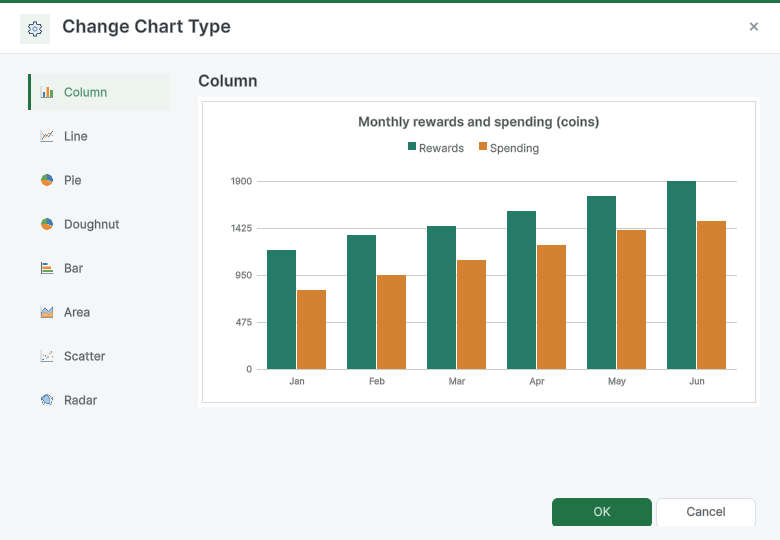

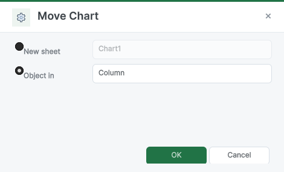

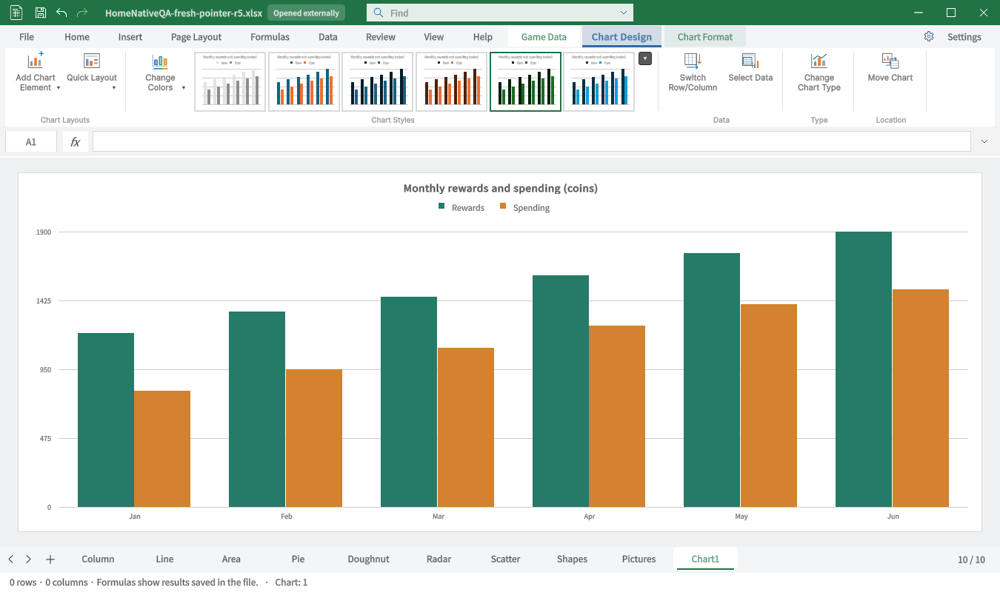

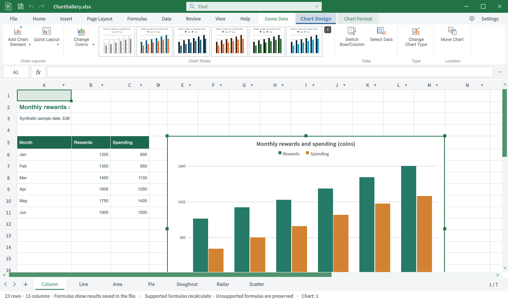

Affinity3.3.1에서 범주8종을 실제 벡터로 제작했습니다. V13의 기존64개 추가 타일은 V12와 픽셀 동일입니다. 저장 후 닫고 프로젝트 경로에서 새 네이티브 세션으로 재열어 두 원본의512×576 전체 RGBA가 일치했습니다. 각 원본400편집 레이어·래스터0개입니다. 파이/도넛은 베지어 경로와 투명 경계/중앙을 사용합니다. [실제 네이티브 아틀라스](../assets/ribbon-chart-dialogs-20261101/affinity-atlas-v13.png) · [기존64종 보존](../assets/ribbon-chart-dialogs-20261101/affinity-preserve-r1.json).

초기 실제 차트 시트 키 검사에서는 저장/Undo/Redo3개가 실행되지 않았습니다. 워크시트 셀 편집 조건과 문서 명령을 분리해 재통과했습니다. 반복 시트 이동 R2는18검사 후 삭제된 파트를 참조해 실패했고, 수정 후 R3의29검사를 통과했습니다. [단축키 실패 원본](../assets/ribbon-chart-dialogs-20261101/chart-sheet-shortcut-failed-r1.json) · [반복 이동 실패](../assets/ribbon-chart-dialogs-20261101/chart-sheet-failed-r2.json) · [버튼 문구 수정 전](../assets/ribbon-chart-dialogs-20261101/type-before-label-r1.png) · [라디오 대비 수정 전](../assets/ribbon-chart-dialogs-20261101/move-before-contrast-r1.png).

전체 문서 검사는324개 소스 해시 불일치와11개 재촬영 대기 항목으로 미통과입니다. 이번3장만 새로 촬영했고 기존151개 원본 기록·해시를 보존했습니다. 현재3장과9개 언어2행만 검증한48검사를 전체 문서 통과로 확대하지 않습니다.

대조 기준: [Microsoft 차트 이동](https://support.microsoft.com/en-us/excel/move-or-resize-a-chart), [Chart.Location](https://learn.microsoft.com/en-us/office/vba/api/excel.chart.location), [Chartsheet 구조](https://learn.microsoft.com/en-us/office/open-xml/spreadsheet/working-with-sheets), [사용 가능한 차트 종류](https://support.microsoft.com/en-us/excel/available-chart-types-in-office). 기존 TC 원본 사진은 아래46개에 유지했습니다. 이번 환경에는 Excel COM이 없어 새 Excel 실행 사진·정확한 버전/DPI 대조는 미확인입니다. 따라서 전체 원본과 동일하다고 판정하지 않았습니다.

[이전 회차 전체 검증·실패 기록](2026-10-31-result-20261031234704537-v1.0.0.html) · [이번 원본 크기·SHA256](../assets/ribbon-chart-dialogs-20261101/evidence-manifest.json). 실제 창은 직접 캡처했고 합성/변형하지 않았습니다. 새 래스터 첨부는 모두200KB 미만입니다.

### 최종 화면에서 발견한 크기 손실과 재검증

[실제 전후 렌더 경계·저장4검사](../assets/ribbon-chart-dialogs-20261101/chart-geometry-ui-r1.json) · [수정 전 작아진 왕복 화면](../assets/ribbon-chart-dialogs-20261101/chart-design-r8.png) · [새 원본의 실제 왕복 후 화면](../assets/ribbon-chart-dialogs-20261101/chart-geometry-after-r1.png). 수정 전 저장 파일의 절대 앵커는480×280px였습니다. 수정 후 원본738×494.666656px와 왕복 후738×494.666565px로0.001px 이내를 확인했습니다. 새 크기 검사2개를 포함해 전용 시트 API31검사와 기존 차트235회귀를 재통과했습니다.

문서 최종3장은 고객용 ChartGallery 원본과 SHA256이 같은 사본에서 다시 촬영했습니다. 기존151개 기록과 이번 중간3개도 보존했고 최종3개를 추가했습니다. 촬영된 언어는 영어이며9개 언어 UI 레이아웃을 모두 확인했다는 의미가 아닙니다.

### TC-RIB-01 · 파일

분류: 일반 · 결과: **부분 확인**

| 항목 | 내용 |
| --- | --- |
| 실행 절차 | 파일 메뉴를 엽니다. |
| 기대값 | 열기·저장·닫기와 Excel Backstage 그룹을 비교합니다. |
| 실제 결과 | 원본은 보호 메뉴 일부뿐입니다. 현재는 새 문서·열기·다른 이름 저장·복구·새로 고침 팝업입니다. |
| 수정 내용 | 이번 회차 수정 없음. 이전 기록의 근거와 제한을 보존합니다. |
| 재검증 | 전체 명령의 최신 실행 재검증은 미실행입니다. |
| 원본 출처·버전 | Excel 보호 메뉴 부분 자료 · https://support.microsoft.com/en-us/excel/restrict-changes-to-files-in-excel |

**Excel 원본**

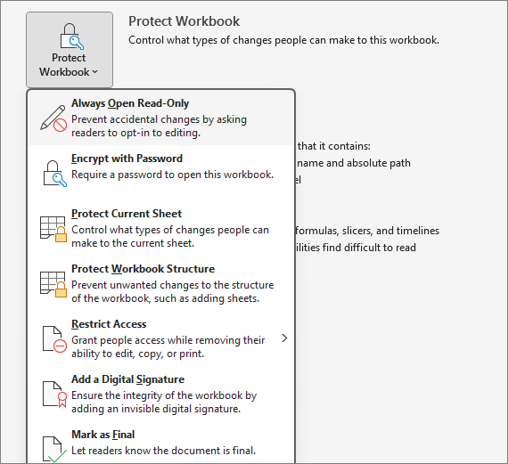

**수정 전**

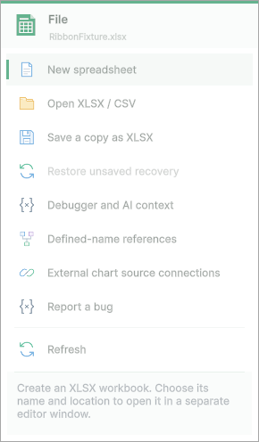

화면 근거: 해당 기능의 최신 실제 실행 화면 미확보 또는 미구현

### TC-RIB-02 · 홈

분류: 일반 · 결과: **부분 확인**

| 항목 | 내용 |
| --- | --- |
| 실행 절차 | 일반 시트에서 홈 탭을 선택합니다. |
| 기대값 | 클립보드·글꼴·맞춤·표시 형식·스타일·셀·편집 그룹을 대조합니다. |
| 실제 결과 | Home7개 그룹 배치·42개 접근 키·Ctrl+F1·임시 리본·Tab/Shift+Tab/방향키/Enter/Space 이동 구현. 전체 홈 레이아웃·명령 최종 일치는 미완료. |
| 수정 내용 | Affinity V9 맞춤6종 재제작, 기본96개 중6개만 변경. 추가16종은 ExtrasV11 유지. 보조 문자 누수·임시 리본 클릭/접기·이름 편집 유지 수정. 포커스 검사2곳 유지. |
| 재검증 | 홈111검사(R5),물리 접근키13건(R13),Enter 이동11건(R3),Space 이동11건(R5),임시 리본13건(R4). 실패 R2/R4 기록 보존. 각 증거의 MVID/시각으로 검증 버전을 구분. |
| 원본 출처·버전 | Microsoft Windows Excel Home 키 팁 실제 원본1350×200. 정확한 Excel 빌드와 DPI는 미확인. https://support.microsoft.com/en-us/accessibility/excel/keyboard-shortcuts-in-excel |

**Excel 원본**

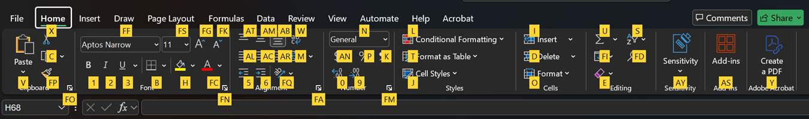

**수정 전**

**수정 후 실제 실행**

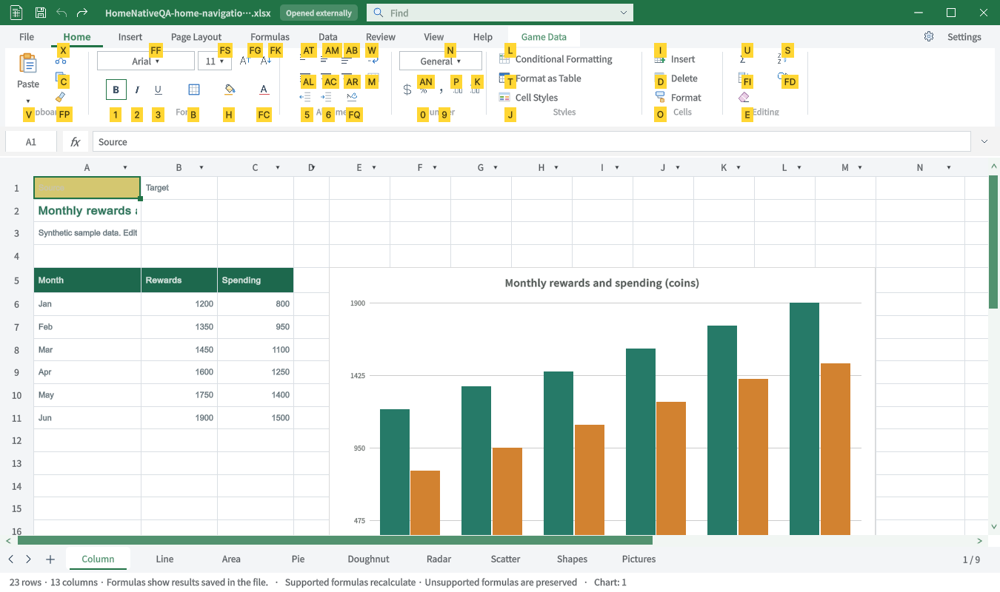

화면 근거: 전체 Home 명령 전수 검증 및 나머지 아이콘의 원본 대조·수정이 남음.

### TC-RIB-03 · 삽입

분류: 일반 · 결과: **부분 확인**

| 항목 | 내용 |
| --- | --- |
| 실행 절차 | 삽입 탭에서 도형 타일을 클릭합니다. |
| 기대값 | 표·도형·그림·차트·링크·텍스트·기호와 추가 삽입 그룹을 대조합니다. |
| 실제 결과 | 도형187종을9개 분류의 스크롤 드롭다운으로 변경했습니다. 203건 분류·템플릿·실제 항목 클릭 검사 통과. 모든187종의 마우스 배치 전수는 미실행입니다. |
| 수정 내용 | 도형187종을9개 분류의 스크롤 드롭다운으로 변경했습니다. |
| 재검증 | 203건 분류·템플릿·실제 항목 클릭 검사 통과. 모든187종의 마우스 배치 전수는 미실행입니다. 최신R7 실제 화면 촬영 성공. 촬영만으로 해당 TC의 기능 통과를 의미하지 않습니다. |
| 원본 출처·버전 | 부분 원본·정확한 빌드 미확인 · https://techcommunity.microsoft.com/blog/nonprofittechies/getting-familiar-with-microsoft-excel/3756412/ |

**Excel 원본**

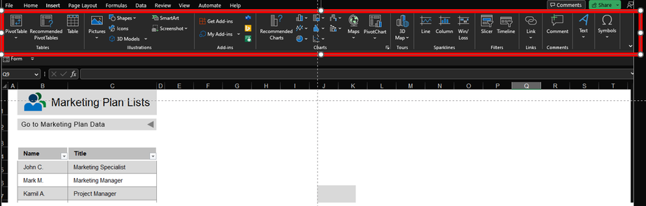

**수정 전**

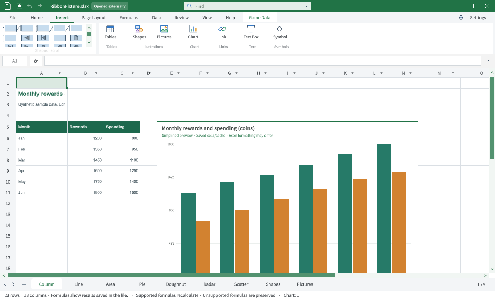

**수정 후 실제 실행**

### TC-RIB-04 · 페이지 레이아웃

분류: 일반 · 결과: **부분 확인**

| 항목 | 내용 |
| --- | --- |
| 실행 절차 | 페이지 레이아웃을 선택합니다. |
| 기대값 | 테마·페이지 설정·배율 그룹을 비교합니다. |
| 실제 결과 | 단일 버튼을 테마·페이지 설정·배율3영역으로 구현. 실제 여백/방향/용지/인쇄 영역/나누기/반복 제목/맞춤·배율 API 연결. 테마는 번들 Office(ECMA) 적용이며 배경은 아직 비활성. |
| 수정 내용 | Affinity16종 V12 추가,32px 큰 아이콘·9개 언어39문구·캡션 조정. 페이지 맞춤 네이티브 저장·반복 행열 동시 보존·자동 경계 보존·부분 테마 적용. 확정 후 Redo/확정 전 Ctrl+F1 초안 처리 수정. |
| 재검증 | API43(R2),실제 메뉴·입력·저장/Undo/Redo18(R3),초안4(R3),저장 XML2,영향 회귀13(R5) 통과. 초기 실패와 QA 개정 이유 보존. 전체 페이지 기능·픽셀/언어 최종 대조는 남음. |
| 원본 출처·버전 | 구형 Windows 원본 일부 · https://support.microsoft.com/en-us/excel/fit-to-one-page-in-excel |

**Excel 원본**

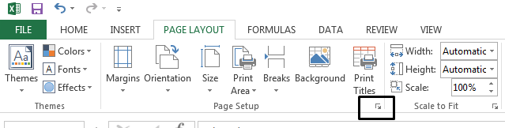

**수정 전**

**수정 후 실제 실행**

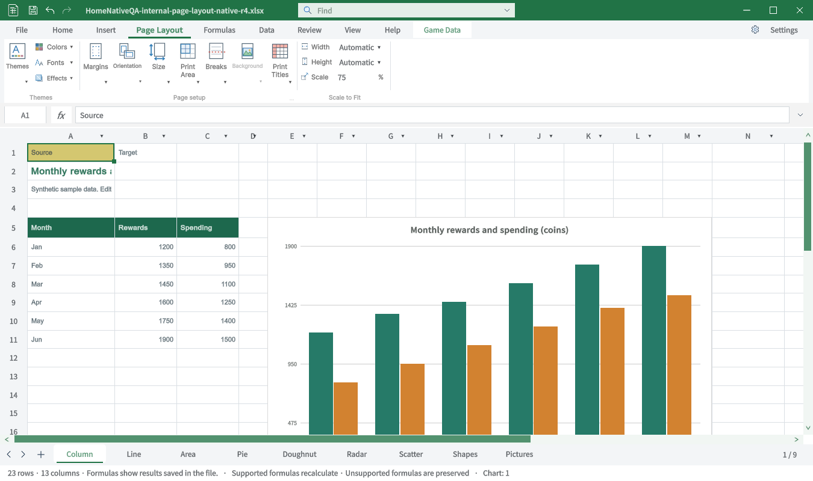

화면 근거: 배경·전체 테마 갤러리/가져오기·고급 인쇄/용지·9개 언어 실제 레이아웃 및 최종 픽셀 대조 미완료

### TC-RIB-05 · 수식

분류: 일반 · 결과: **부분 확인**

| 항목 | 내용 |
| --- | --- |
| 실행 절차 | 수식 탭을 선택합니다. |
| 기대값 | 함수 라이브러리·이름·수식 분석·계산을 비교합니다. |
| 실제 결과 | 도움말·이름 관리자·이름 참조·재계산은 보이지만 함수 분류 갤러리와 분석 도구가 없습니다. |
| 수정 내용 | 이번 회차 수정 없음. 이전 기록의 근거와 제한을 보존합니다. |
| 재검증 | 전체 명령의 최신 실행 재검증은 미실행입니다. 최신R7 실제 화면 촬영 성공. 촬영만으로 해당 TC의 기능 통과를 의미하지 않습니다. |
| 원본 출처·버전 | 함수 라이브러리 부분 원본 · https://support.microsoft.com/en-us/excel/using-functions-and-nested-functions-in-excel-formulas |

**Excel 원본**

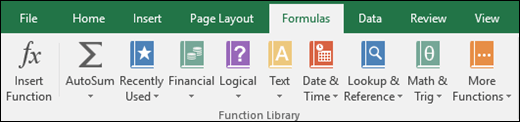

**수정 전**

**수정 후 실제 실행**

### TC-RIB-06 · 데이터

분류: 일반 · 결과: **부분 확인**

| 항목 | 내용 |
| --- | --- |
| 실행 절차 | 데이터 탭을 선택합니다. |
| 기대값 | 정렬·필터와 데이터 가져오기·쿼리 그룹을 비교합니다. |
| 실제 결과 | 정렬·필터·외부 차트 연결만 보입니다. 원본의 Get Data·쿼리 새로 고침 구성이 없습니다. |
| 수정 내용 | 이번 회차 수정 없음. 이전 기록의 근거와 제한을 보존합니다. |
| 재검증 | 전체 명령의 최신 실행 재검증은 미실행입니다. 최신R7 실제 화면 촬영 성공. 촬영만으로 해당 TC의 기능 통과를 의미하지 않습니다. |
| 원본 출처·버전 | Excel2016 Get & Transform 부분 원본 · https://support.microsoft.com/en-us/excel/about-power-query-in-excel |

**Excel 원본**

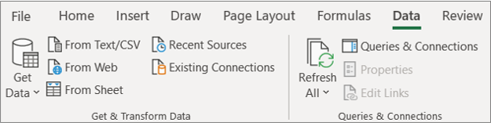

**수정 전**

**수정 후 실제 실행**

### TC-RIB-07 · 검토

분류: 일반 · 결과: **부분 확인**

| 항목 | 내용 |
| --- | --- |
| 실행 절차 | 검토 탭을 선택합니다. |
| 기대값 | 맞춤법·접근성·변경·댓글·보호와 통계를 대조합니다. |
| 실제 결과 | 현재는 통계 버튼만 보입니다. 비교 원본은 Excel 웹이므로 Windows 동일 버전 비교는 아닙니다. |
| 수정 내용 | 이번 회차 수정 없음. 이전 기록의 근거와 제한을 보존합니다. |
| 재검증 | 전체 명령의 최신 실행 재검증은 미실행입니다. 최신R7 실제 화면 촬영 성공. 촬영만으로 해당 TC의 기능 통과를 의미하지 않습니다. |
| 원본 출처·버전 | Excel 웹 원본·Windows와 구별 · https://learn.microsoft.com/en-us/answers/questions/5190624/review-tab-options-greyed-out-in-excel-365-files-w |

**Excel 원본**

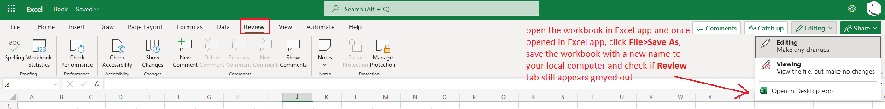

**수정 전**

**수정 후 실제 실행**

### TC-RIB-08 · 보기

분류: 일반 · 결과: **부분 확인**

| 항목 | 내용 |
| --- | --- |
| 실행 절차 | 보기 탭을 선택합니다. |
| 기대값 | 통합 문서 보기·표시·확대/축소·창 그룹을 대조합니다. |
| 실제 결과 | 고정·해제·개체·시트·보기 메뉴는 보이지만 원본의 보기/확대 그룹 구성과 다릅니다. |
| 수정 내용 | 이번 회차 수정 없음. 이전 기록의 근거와 제한을 보존합니다. |
| 재검증 | 전체 명령의 최신 실행 재검증은 미실행입니다. 최신R7 실제 화면 촬영 성공. 촬영만으로 해당 TC의 기능 통과를 의미하지 않습니다. |
| 원본 출처·버전 | 부분 원본·정확한 빌드 미확인 · https://techcommunity.microsoft.com/discussions/excelgeneral/view-ribbon-tab-checkboxes-no-longer-aligned/3989915 |

**Excel 원본**

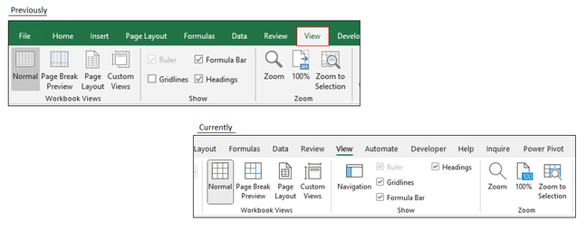

**수정 전**

**수정 후 실제 실행**

### TC-RIB-09 · 도움말

분류: 일반 · 결과: **부분 확인**

| 항목 | 내용 |
| --- | --- |
| 실행 절차 | 도움말을 선택합니다. |
| 기대값 | 도움말 탭의 실제 명령을 대조합니다. |
| 실제 결과 | 현재 디버그·버그 보고·수식 버튼 표시. 원본에는 Help 탭 이름만 보여 명령 대조는 미실행입니다. |
| 수정 내용 | 이번 회차 수정 없음. 이전 기록의 근거와 제한을 보존합니다. |
| 재검증 | 전체 명령의 최신 실행 재검증은 미실행입니다. 최신R7 실제 화면 촬영 성공. 촬영만으로 해당 TC의 기능 통과를 의미하지 않습니다. |
| 원본 출처·버전 | 전체 Help 리본 아님 · https://techcommunity.microsoft.com/blog/nonprofittechies/getting-familiar-with-microsoft-excel/3756412/ |

**Excel 원본**

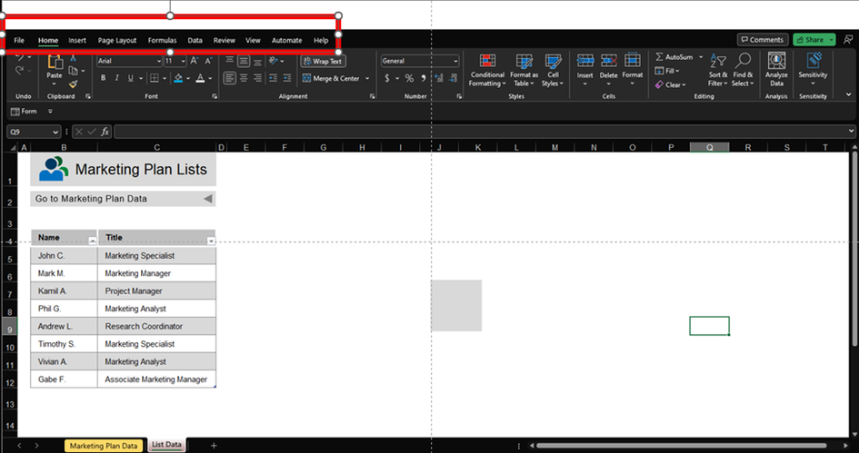

**수정 전**

**수정 후 실제 실행**

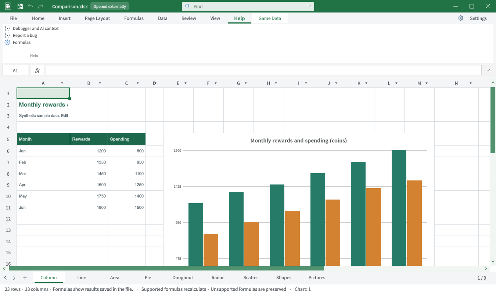

### TC-RIB-10 · 그리기

분류: 일반 · 결과: **실패**

| 항목 | 내용 |
| --- | --- |
| 실행 절차 | 그리기 탭 진입점을 찾습니다. |
| 기대값 | 펜·잉크·다시 재생 등의 탭을 제공합니다. |
| 실제 결과 | 현재 해당 기능/전용 탭은 구현되지 않았습니다. 이전 삽입/홈 화면을 해당 기능의 실행 증거로 취급하지 않습니다. |
| 수정 내용 | 이번 회차 수정 없음. 이전 기록의 근거와 제한을 보존합니다. |
| 재검증 | 전체 명령의 최신 실행 재검증은 미실행입니다. |
| 원본 출처·버전 | Excel Draw 화면·사진 촬영 자료 · https://learn.microsoft.com/en-us/answers/questions/5070058/cant-exit-the-drawing-tool-in-excel |

**Excel 원본**

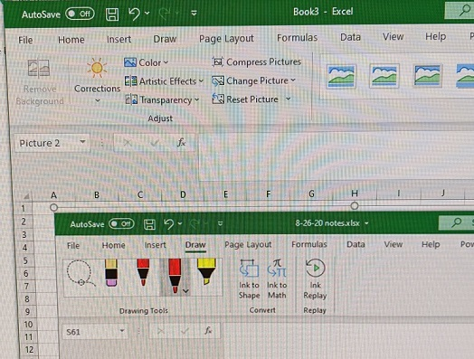

**수정 전**

화면 근거: 해당 기능의 최신 실제 실행 화면 미확보 또는 미구현

### TC-RIB-11 · 자동화

분류: 일반 · 결과: **실패**

| 항목 | 내용 |
| --- | --- |
| 실행 절차 | 자동화 탭 진입점을 찾습니다. |
| 기대값 | Office Scripts 목록과 스크립트 진입점을 대조합니다. |
| 실제 결과 | 현재 해당 기능/전용 탭은 구현되지 않았습니다. 이전 삽입/홈 화면을 해당 기능의 실행 증거로 취급하지 않습니다. |
| 수정 내용 | 이번 회차 수정 없음. 이전 기록의 근거와 제한을 보존합니다. |
| 재검증 | 전체 명령의 최신 실행 재검증은 미실행입니다. |
| 원본 출처·버전 | Excel Automate 원본 · https://techcommunity.microsoft.com/blog/microsoft365insiderblog/automate-tasks-with-office-scripts-in-excel-for-windows-and-mac/4216151 |

**Excel 원본**

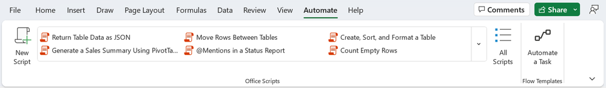

**수정 전**

화면 근거: 해당 기능의 최신 실제 실행 화면 미확보 또는 미구현

### TC-RIB-12 · 개발 도구

분류: 일반 · 결과: **실패**

| 항목 | 내용 |
| --- | --- |
| 실행 절차 | 개발 도구 탭 진입점을 찾습니다. |
| 기대값 | 컨트롤·코드·디자인 모드 그룹을 대조합니다. |
| 실제 결과 | 현재 해당 기능/전용 탭은 구현되지 않았습니다. 이전 삽입/홈 화면을 해당 기능의 실행 증거로 취급하지 않습니다. |
| 수정 내용 | 이번 회차 수정 없음. 이전 기록의 근거와 제한을 보존합니다. |
| 재검증 | 전체 명령의 최신 실행 재검증은 미실행입니다. |
| 원본 출처·버전 | Developer 컨트롤 부분 원본 · https://support.microsoft.com/en-us/excel/form-controls |

**Excel 원본**

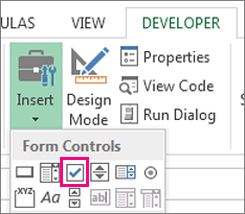

**수정 전**

화면 근거: 해당 기능의 최신 실제 실행 화면 미확보 또는 미구현

### TC-RIB-13 · 추가 기능

분류: 일반 · 결과: **실패**

| 항목 | 내용 |
| --- | --- |
| 실행 절차 | 삽입의 추가 기능 그룹을 확인합니다. |
| 기대값 | 추가 기능 진입점을 대조합니다. |
| 실제 결과 | 현재 해당 기능/전용 탭은 구현되지 않았습니다. 이전 삽입/홈 화면을 해당 기능의 실행 증거로 취급하지 않습니다. |
| 수정 내용 | 이번 회차 수정 없음. 이전 기록의 근거와 제한을 보존합니다. |
| 재검증 | 전체 명령의 최신 실행 재검증은 미실행입니다. |
| 원본 출처·버전 | 삽입 Add-ins 그룹 부분 원본 · https://techcommunity.microsoft.com/blog/nonprofittechies/getting-familiar-with-microsoft-excel/3756412/ |

**Excel 원본**

**수정 전**

화면 근거: 해당 기능의 최신 실제 실행 화면 미확보 또는 미구현

### TC-RIB-14 · 표 디자인

분류: 특수 · 결과: **부분 확인**

| 항목 | 내용 |
| --- | --- |
| 실행 절차 | ChartGallery A5:C11 안 C11을 선택합니다. |
| 기대값 | 표 내부에서 전용 탭·스타일 갤러리·옵션을 제공합니다. |
| 실제 결과 | ChartGallery7개 시트에 모두 실제 표 등록. 셀 선택 시 표 디자인 등장과 편집 가능한 이름·스타일 갤러리 확인. 표 범위/머리글/합계행/필터 UI는 아직 남음. |
| 수정 내용 | 6개 누락 표 추가, 원본 값·서식·차트7개 보존. 재패키징 원본/검사 갱신. 네이티브 이름 편집·로컬 참조 갱신/Undo 구현. |
| 재검증 | 6764 상태/셀 검사,표 내부115좌표와 유효 경계·저장 재열기·7개 실제 탭 촬영. 이름 API38검사 및 실제 입력7검사,임시 리본 이름 입력 유지13검사 포함. 전체TC 통과 아님. |
| 원본 출처·버전 | Windows 표 디자인 및 피벗 분석 원본 · https://support.microsoft.com/en-us/excel/where-are-the-table-tools |

**Excel 원본**

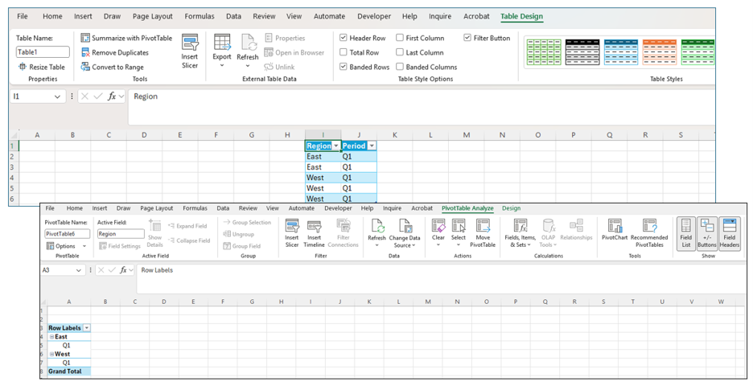

**수정 전**

**수정 후 실제 실행**

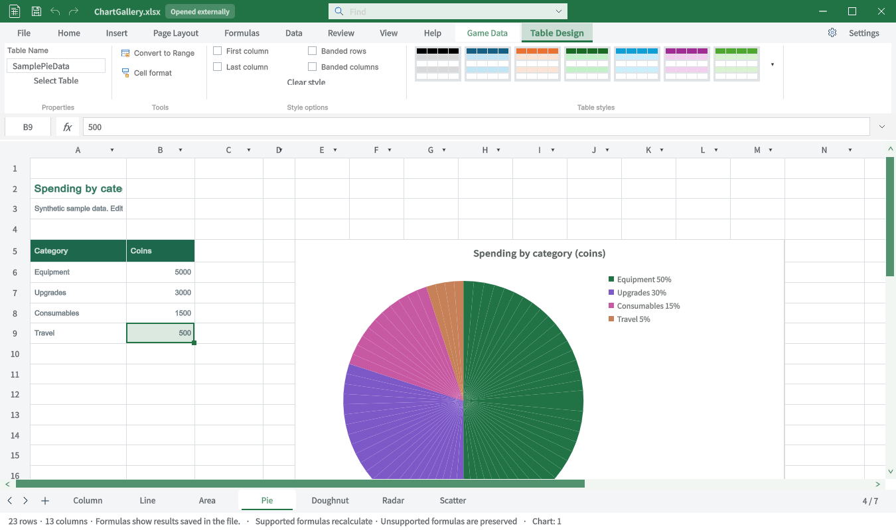

화면 근거: 표 디자인 나머지 기능과 원본 배치 전수 검증 남음

### TC-RIB-15 · 도형 서식

분류: 특수 · 결과: **부분 확인**

| 항목 | 내용 |
| --- | --- |
| 실행 절차 | 도형 개체를 선택합니다. |
| 기대값 | 도형 삽입·도형 스타일·WordArt·접근성·정렬·크기를 대조합니다. |
| 실제 결과 | 원본 순서의 그룹,3개 미리보기+32종 목록,색상·회전·정렬 순서 메뉴와 Affinity 아이콘을 적용했습니다. 문구 잘림도 수정했습니다. 스타일199검사 및 최신 실제 타일 선택·Undo3건 통과. 도형 효과·다중 객체 맞춤/그룹은 미구현입니다. |
| 수정 내용 | 원본 순서의 그룹,3개 미리보기+32종 목록,색상·회전·정렬 순서 메뉴와 Affinity 아이콘을 적용했습니다. 문구 잘림도 수정했습니다. |
| 재검증 | 스타일199검사 및 최신 실제 타일 선택·Undo3건 통과. 도형 효과·다중 객체 맞춤/그룹은 미구현입니다. 최신R7 실제 화면 촬영 성공. 촬영만으로 해당 TC의 기능 통과를 의미하지 않습니다. |
| 원본 출처·버전 | OfficeToolTips 직접 촬영 Excel365 원본·빌드 미확인 · https://www.officetooltips.com/excel/tips/how_to_change_format_for_diagram_shapes_in_excel |

**Excel 원본**

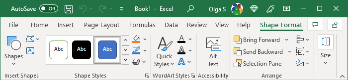

**수정 전**

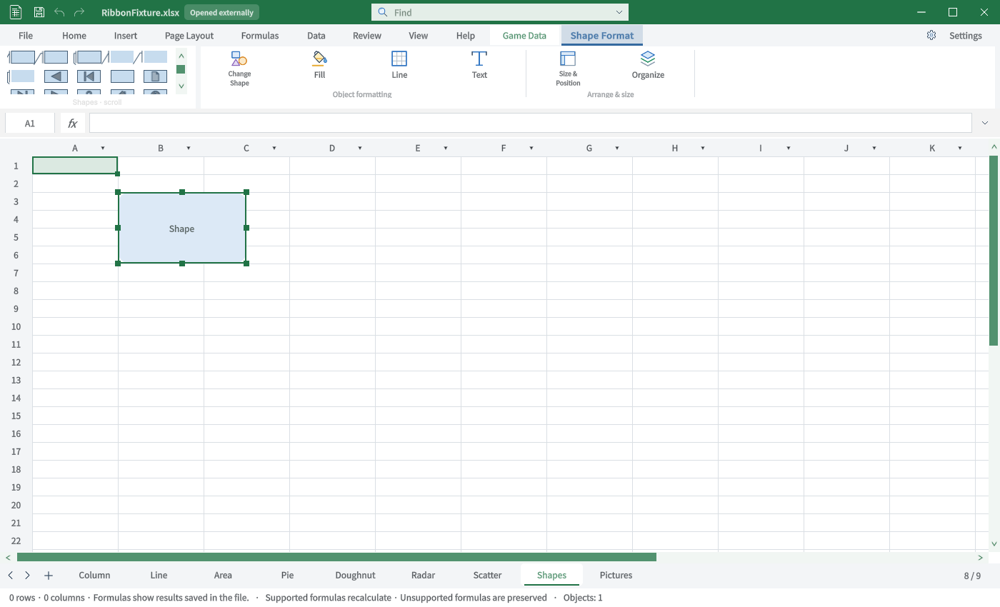

**수정 후 실제 실행**

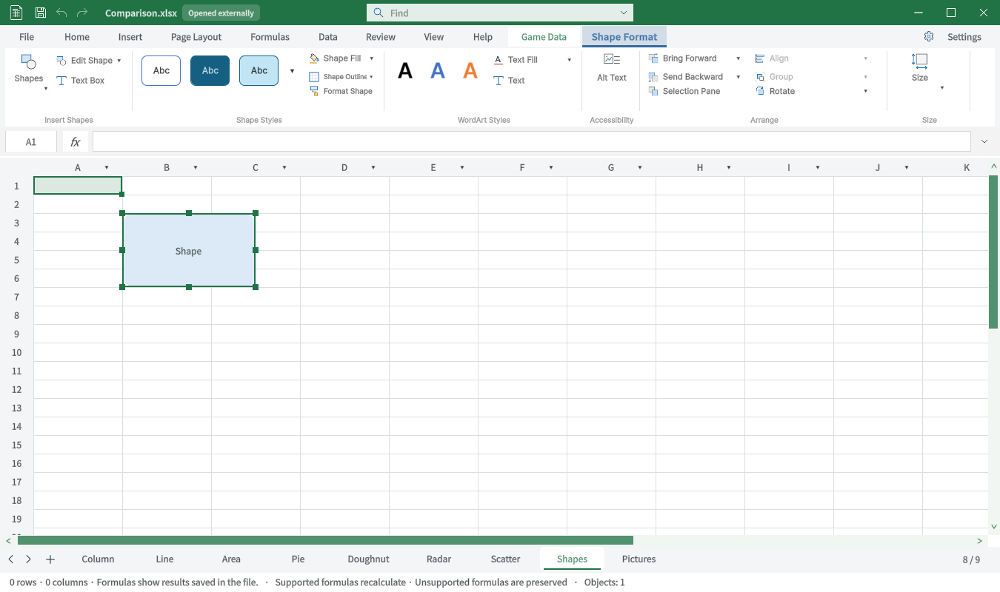

### TC-RIB-16 · 그림 서식

분류: 특수 · 결과: **부분 확인**

| 항목 | 내용 |
| --- | --- |
| 실행 절차 | 삽입된 그림을 선택합니다. |
| 기대값 | 보정·그림 스타일·접근성·정렬·크기를 비교합니다. |
| 실제 결과 | 조정·그림 스타일·접근성·배치·크기 그룹과6개 테두리 미리보기를 구성했습니다. 52검사에서 이미지 바이트·자르기·Undo·저장 재열기 보존 확인. Office 전체 그림 효과와 색 보정은 미구현입니다. |
| 수정 내용 | 조정·그림 스타일·접근성·배치·크기 그룹과6개 테두리 미리보기를 구성했습니다. |
| 재검증 | 52검사에서 이미지 바이트·자르기·Undo·저장 재열기 보존 확인. Office 전체 그림 효과와 색 보정은 미구현입니다. 최신R7 실제 화면 촬영 성공. 촬영만으로 해당 TC의 기능 통과를 의미하지 않습니다. |
| 원본 출처·버전 | 부분 원본·정확한 빌드 미확인 · https://learn.microsoft.com/en-us/answers/questions/5267157/where-are-microsoft-365-excel-picture-format-tools |

**Excel 원본**

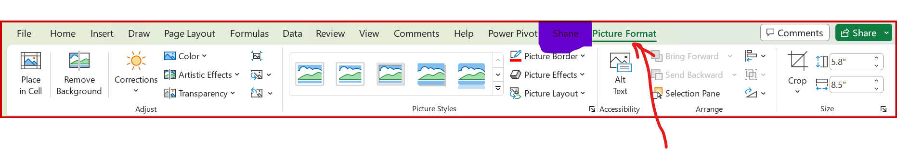

**수정 전**

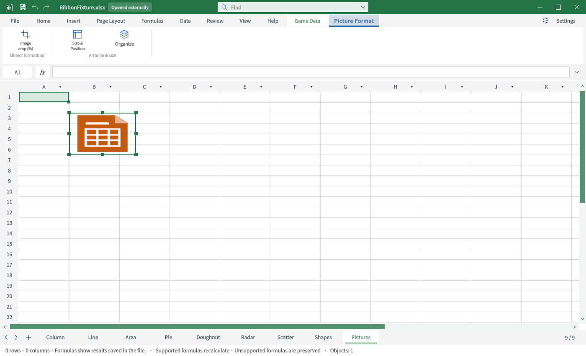

**수정 후 실제 실행**

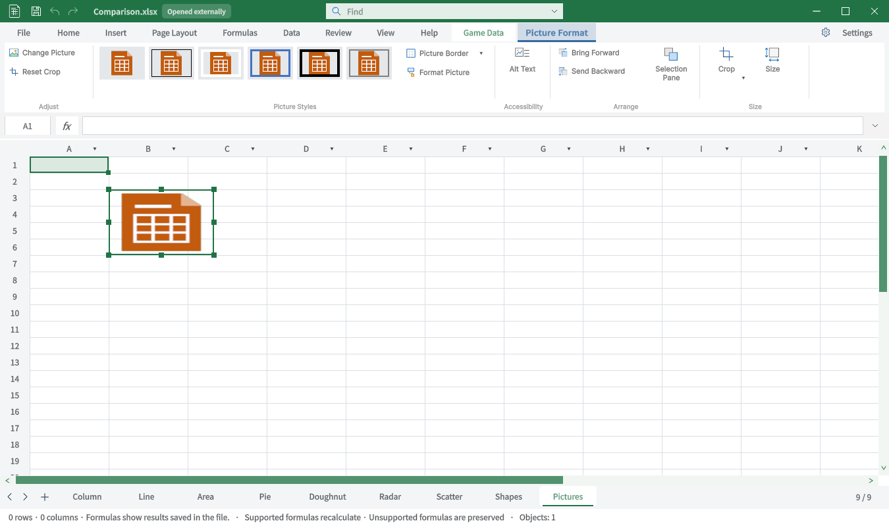

### TC-RIB-17 · 차트 디자인

분류: 특수 · 결과: **부분 확인**

| 항목 | 내용 |
| --- | --- |
| 실행 절차 | 차트를 선택한 뒤 디자인 탭에서 스타일2를 클릭합니다. |
| 기대값 | 썸네일 스타일 목록·데이터·차트 요소를 대조합니다. |
| 실제 결과 | 종류8범주·실제 변환 미리보기·확인/취소 대화상자,새 차트 시트/기존 개체 위치 이동 대화상자를 구현했습니다. 실제 차트 전용 시트를 저장·표시하며 기존 리본5그룹/6스타일/48목록을 유지합니다. |
| 수정 내용 | Affinity 범주8종 V13,문서 저장/이력과 셀 편집 조건 분리,이동 Undo/Redo 위치·선택 복원,삭제된 파트 재사용·빈 드로잉 누적 방지,버튼 번역/라디오 대비 수정. 두 셀 차트의 실제 크기 손실을 수정하고 전후 렌더 경계 검증을 추가했습니다. |
| 재검증 | 전용 시트31/API·235영향 회귀·22실제UI/저장/Unity범위·680아틀라스/별칭 검사 통과. 초기 실패·절차 개정 보존. 전체 Excel 유형·레이아웃·최종 원본 일치는 남음. 최종 기존 차트235(R5)·실제 크기/저장/원본 사본4검사도 통과. |
| 원본 출처·버전 | 부분 원본·정확한 빌드 미확인 · https://learn.microsoft.com/en-us/answers/questions/5423242/chart-design-not-available-i-have-tried-everything |

**Excel 원본**

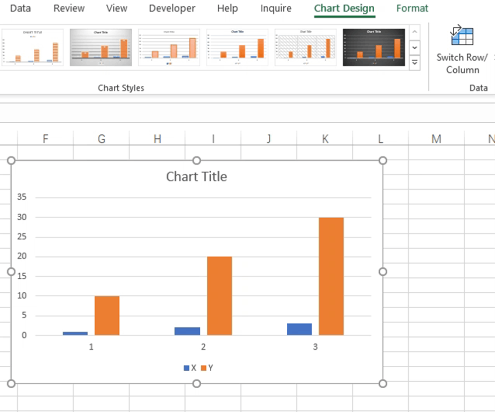

**수정 전**

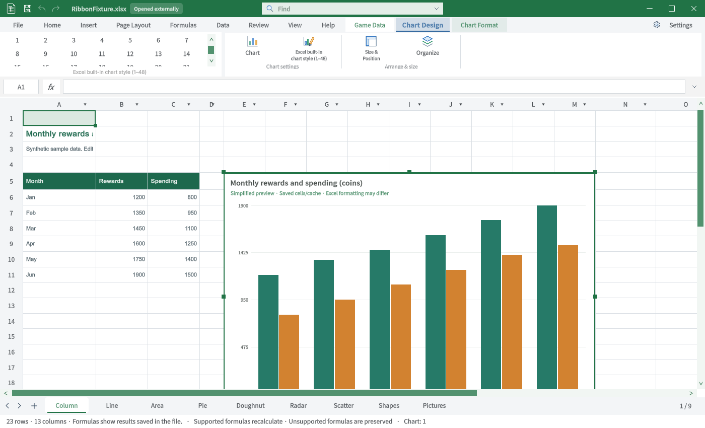

**수정 후 실제 실행**

화면 근거: 전체 차트 세부 유형·복합/3D·번호별 레이아웃·데이터/요소 메뉴·새 Excel 실행 사진/정확한 버전/DPI 최종 대조 미완료

### TC-RIB-18 · 차트 서식

분류: 특수 · 결과: **부분 확인**

| 항목 | 내용 |
| --- | --- |
| 실행 절차 | 차트를 선택한 뒤 서식 탭을 선택합니다. |
| 기대값 | 현재 선택·서식·스타일·정렬을 비교합니다. |
| 실제 결과 | 현재 선택·도형 스타일·텍스트·접근성·배치·크기 그룹과 차트 영역 서식 팝업을 연결했습니다. 326개 통합 검사에 차트 제목·범례·격자·색상·저장 검증 포함. 전체 차트 요소 선택/효과 메뉴는 미완성입니다. |
| 수정 내용 | 현재 선택·도형 스타일·텍스트·접근성·배치·크기 그룹과 차트 영역 서식 팝업을 연결했습니다. |
| 재검증 | 326개 통합 검사에 차트 제목·범례·격자·색상·저장 검증 포함. 전체 차트 요소 선택/효과 메뉴는 미완성입니다. 최신R7 실제 화면 촬영 성공. 촬영만으로 해당 TC의 기능 통과를 의미하지 않습니다. |
| 원본 출처·버전 | 구형 Current Selection 부분 원본 · https://support.microsoft.com/en-us/office/graphics-visuals/change-the-shape-fill-outline-or-effects-of-chart-elements |

**Excel 원본**

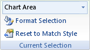

**수정 전**

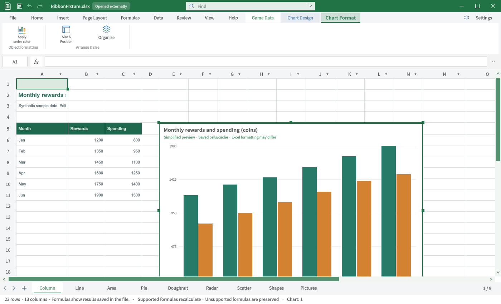

**수정 후 실제 실행**

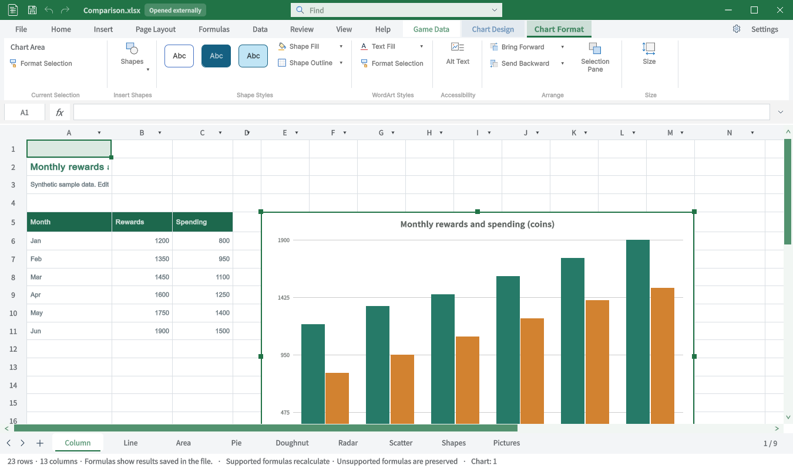

### TC-RIB-19 · 피벗 테이블 분석

분류: 특수 · 결과: **실패**

| 항목 | 내용 |
| --- | --- |
| 실행 절차 | 피벗 삽입·선택 경로를 확인합니다. |
| 기대값 | 피벗 개체 선택 시 분석 탭 |
| 실제 결과 | 현재 해당 기능/전용 탭은 구현되지 않았습니다. 이전 삽입/홈 화면을 해당 기능의 실행 증거로 취급하지 않습니다. |
| 수정 내용 | 이번 회차 수정 없음. 이전 기록의 근거와 제한을 보존합니다. |
| 재검증 | 전체 명령의 최신 실행 재검증은 미실행입니다. |
| 원본 출처·버전 | 원본 일부 · https://support.microsoft.com/en-us/excel/where-are-the-table-tools |

**Excel 원본**

**수정 전**

화면 근거: 해당 기능의 최신 실제 실행 화면 미확보 또는 미구현

### TC-RIB-20 · 피벗 테이블 디자인

분류: 특수 · 결과: **실패**

| 항목 | 내용 |
| --- | --- |
| 실행 절차 | 피벗 삽입·선택 경로를 확인합니다. |
| 기대값 | 피벗 스타일·레이아웃 |
| 실제 결과 | 현재 해당 기능/전용 탭은 구현되지 않았습니다. 이전 삽입/홈 화면을 해당 기능의 실행 증거로 취급하지 않습니다. |
| 수정 내용 | 이번 회차 수정 없음. 이전 기록의 근거와 제한을 보존합니다. |
| 재검증 | 전체 명령의 최신 실행 재검증은 미실행입니다. |
| 원본 출처·버전 | 원본 일부 · https://support.microsoft.com/en-us/excel/design-the-layout-and-format-of-a-pivottable |

**Excel 원본**

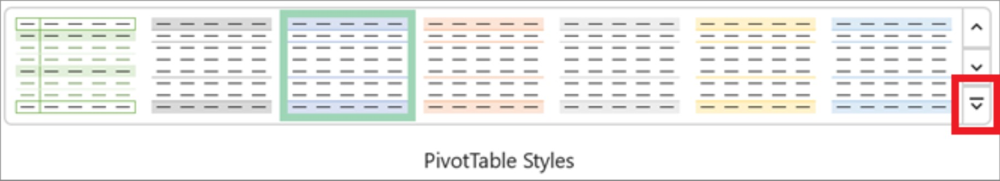

**수정 전**

화면 근거: 해당 기능의 최신 실제 실행 화면 미확보 또는 미구현

### TC-RIB-21 · 피벗 차트 분석

분류: 특수 · 결과: **실패**

| 항목 | 내용 |
| --- | --- |
| 실행 절차 | 피벗 삽입·선택 경로를 확인합니다. |
| 기대값 | 피벗 차트 선택 시 분석 탭 |
| 실제 결과 | 현재 해당 기능/전용 탭은 구현되지 않았습니다. 이전 삽입/홈 화면을 해당 기능의 실행 증거로 취급하지 않습니다. |
| 수정 내용 | 이번 회차 수정 없음. 이전 기록의 근거와 제한을 보존합니다. |
| 재검증 | 전체 명령의 최신 실행 재검증은 미실행입니다. |
| 원본 출처·버전 | W3Schools 직접 작성 Field Buttons 부분 원본 · https://www.w3schools.com/excel/excel_pivot_charts.php |

**Excel 원본**

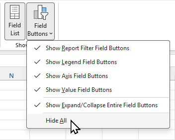

**수정 전**

화면 근거: 해당 기능의 최신 실제 실행 화면 미확보 또는 미구현

### TC-RIB-22 · 피벗 차트 디자인

분류: 특수 · 결과: **실패**

| 항목 | 내용 |
| --- | --- |
| 실행 절차 | 피벗 삽입·선택 경로를 확인합니다. |
| 기대값 | 피벗 차트 스타일·데이터 |
| 실제 결과 | 현재 해당 기능/전용 탭은 구현되지 않았습니다. 이전 삽입/홈 화면을 해당 기능의 실행 증거로 취급하지 않습니다. |
| 수정 내용 | 이번 회차 수정 없음. 이전 기록의 근거와 제한을 보존합니다. |
| 재검증 | 전체 명령의 최신 실행 재검증은 미실행입니다. |
| 원본 출처·버전 | 해당 원본 미확보 · 제품 전용 기능: Excel 대응 원본 없음 |

**수정 전**

화면 근거: 대응 원본 사진 없음 또는 정확한 버전의 원본 미확보; 해당 기능의 최신 실제 실행 화면 미확보 또는 미구현

### TC-RIB-23 · 피벗 차트 서식

분류: 특수 · 결과: **실패**

| 항목 | 내용 |
| --- | --- |
| 실행 절차 | 피벗 삽입·선택 경로를 확인합니다. |
| 기대값 | 피벗 차트 서식 |
| 실제 결과 | 현재 해당 기능/전용 탭은 구현되지 않았습니다. 이전 삽입/홈 화면을 해당 기능의 실행 증거로 취급하지 않습니다. |
| 수정 내용 | 이번 회차 수정 없음. 이전 기록의 근거와 제한을 보존합니다. |
| 재검증 | 전체 명령의 최신 실행 재검증은 미실행입니다. |
| 원본 출처·버전 | 해당 원본 미확보 · 제품 전용 기능: Excel 대응 원본 없음 |

**수정 전**

화면 근거: 대응 원본 사진 없음 또는 정확한 버전의 원본 미확보; 해당 기능의 최신 실제 실행 화면 미확보 또는 미구현

### TC-RIB-24 · 슬라이서

분류: 특수 · 결과: **실패**

| 항목 | 내용 |
| --- | --- |
| 실행 절차 | 슬라이서 삽입·선택 경로를 확인합니다. |
| 기대값 | 슬라이서 선택 시 전용 도구와 스타일을 제공합니다. |
| 실제 결과 | 현재 해당 기능/전용 탭은 구현되지 않았습니다. 이전 삽입/홈 화면을 해당 기능의 실행 증거로 취급하지 않습니다. |
| 수정 내용 | 이번 회차 수정 없음. 이전 기록의 근거와 제한을 보존합니다. |
| 재검증 | 전체 명령의 최신 실행 재검증은 미실행입니다. |
| 원본 출처·버전 | 삽입·개체 부분 원본 · https://learn.microsoft.com/en-us/answers/questions/545181/slicer-in-excel-on-o365-has-disappeared |

**Excel 원본**

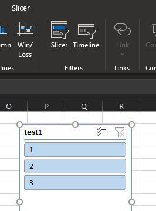

**수정 전**

화면 근거: 해당 기능의 최신 실제 실행 화면 미확보 또는 미구현

### TC-RIB-25 · 시간 표시 막대

분류: 특수 · 결과: **실패**

| 항목 | 내용 |
| --- | --- |
| 실행 절차 | Timeline 삽입·선택 경로를 확인합니다. |
| 기대값 | Timeline 스타일 갤러리를 제공합니다. |
| 실제 결과 | 현재 해당 기능/전용 탭은 구현되지 않았습니다. 이전 삽입/홈 화면을 해당 기능의 실행 증거로 취급하지 않습니다. |
| 수정 내용 | 이번 회차 수정 없음. 이전 기록의 근거와 제한을 보존합니다. |
| 재검증 | 전체 명령의 최신 실행 재검증은 미실행입니다. |
| 원본 출처·버전 | Timeline Styles 부분 원본 · https://support.microsoft.com/en-us/excel/create-a-pivottable-timeline-to-filter-dates |

**Excel 원본**

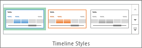

**수정 전**

화면 근거: 해당 기능의 최신 실제 실행 화면 미확보 또는 미구현

### TC-RIB-26 · 스파크라인

분류: 특수 · 결과: **실패**

| 항목 | 내용 |
| --- | --- |
| 실행 절차 | 스파크라인 삽입·선택 경로를 확인합니다. |
| 기대값 | 스파크라인 스타일 갤러리를 제공합니다. |
| 실제 결과 | 현재 해당 기능/전용 탭은 구현되지 않았습니다. 이전 삽입/홈 화면을 해당 기능의 실행 증거로 취급하지 않습니다. |
| 수정 내용 | 이번 회차 수정 없음. 이전 기록의 근거와 제한을 보존합니다. |
| 재검증 | 전체 명령의 최신 실행 재검증은 미실행입니다. |
| 원본 출처·버전 | Sparkline Style 부분 원본 · https://support.microsoft.com/en-us/excel/analyze-trends-in-data-using-sparklines |

**Excel 원본**

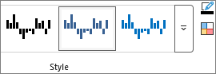

**수정 전**

화면 근거: 해당 기능의 최신 실제 실행 화면 미확보 또는 미구현

### TC-RIB-27 · SmartArt 디자인

분류: 특수 · 결과: **실패**

| 항목 | 내용 |
| --- | --- |
| 실행 절차 | SmartArt 삽입·선택 경로를 확인합니다. |
| 기대값 | 레이아웃·색상·스타일을 제공합니다. |
| 실제 결과 | 현재 해당 기능/전용 탭은 구현되지 않았습니다. 이전 삽입/홈 화면을 해당 기능의 실행 증거로 취급하지 않습니다. |
| 수정 내용 | 이번 회차 수정 없음. 이전 기록의 근거와 제한을 보존합니다. |
| 재검증 | 전체 명령의 최신 실행 재검증은 미실행입니다. |
| 원본 출처·버전 | Excel SmartArt 디자인 부분 원본 · https://learn.microsoft.com/en-us/answers/questions/5368523/smartart-in-excel-can-t-find-text-pane-no-arrow-on |

**Excel 원본**

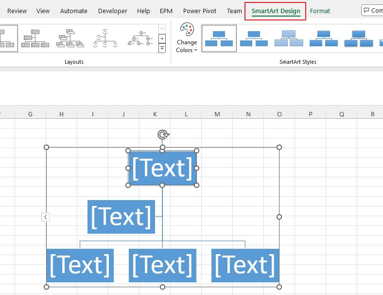

**수정 전**

화면 근거: 해당 기능의 최신 실제 실행 화면 미확보 또는 미구현

### TC-RIB-28 · SmartArt 서식

분류: 특수 · 결과: **실패**

| 항목 | 내용 |
| --- | --- |
| 실행 절차 | SmartArt 관련 서식 경로를 확인합니다. |
| 기대값 | 관련 개체의 서식·스타일을 제공합니다. |
| 실제 결과 | 현재 해당 기능/전용 탭은 구현되지 않았습니다. 이전 삽입/홈 화면을 해당 기능의 실행 증거로 취급하지 않습니다. |
| 수정 내용 | 이번 회차 수정 없음. 이전 기록의 근거와 제한을 보존합니다. |
| 재검증 | 전체 명령의 최신 실행 재검증은 미실행입니다. |
| 원본 출처·버전 | SmartArt 파생 개체의 Shape Format · https://learn.microsoft.com/en-us/answers/questions/5368523/smartart-in-excel-can-t-find-text-pane-no-arrow-on |

**Excel 원본**

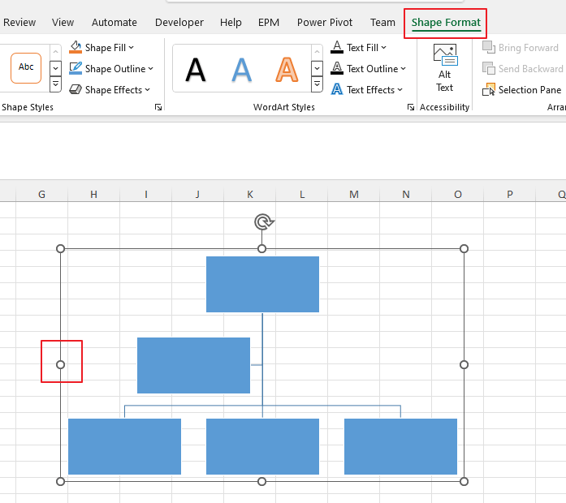

**수정 전**

화면 근거: 해당 기능의 최신 실제 실행 화면 미확보 또는 미구현

### TC-RIB-29 · 그래픽 서식

분류: 특수 · 결과: **실패**

| 항목 | 내용 |
| --- | --- |
| 실행 절차 | 관련 개체 삽입·선택 경로를 확인합니다. |
| 기대값 | SVG 선택 시 그래픽 서식 |
| 실제 결과 | 현재 해당 기능/전용 탭은 구현되지 않았습니다. 이전 삽입/홈 화면을 해당 기능의 실행 증거로 취급하지 않습니다. |
| 수정 내용 | 이번 회차 수정 없음. 이전 기록의 근거와 제한을 보존합니다. |
| 재검증 | 전체 명령의 최신 실행 재검증은 미실행입니다. |
| 원본 출처·버전 | Excel 원본 미확보 · 제품 전용 기능: Excel 대응 원본 없음 |

**수정 전**

화면 근거: 대응 원본 사진 없음 또는 정확한 버전의 원본 미확보; 해당 기능의 최신 실제 실행 화면 미확보 또는 미구현

### TC-RIB-30 · 3D 모델 서식

분류: 특수 · 결과: **실패**

| 항목 | 내용 |
| --- | --- |
| 실행 절차 | 관련 개체 삽입·선택 경로를 확인합니다. |
| 기대값 | 3D 모델 선택 시 보기·정렬 |
| 실제 결과 | 현재 해당 기능/전용 탭은 구현되지 않았습니다. 이전 삽입/홈 화면을 해당 기능의 실행 증거로 취급하지 않습니다. |
| 수정 내용 | 이번 회차 수정 없음. 이전 기록의 근거와 제한을 보존합니다. |
| 재검증 | 전체 명령의 최신 실행 재검증은 미실행입니다. |
| 원본 출처·버전 | Excel 원본 미확보 · 제품 전용 기능: Excel 대응 원본 없음 |

**수정 전**

화면 근거: 대응 원본 사진 없음 또는 정확한 버전의 원본 미확보; 해당 기능의 최신 실제 실행 화면 미확보 또는 미구현

### TC-RIB-31 · 수식 디자인

분류: 특수 · 결과: **실패**

| 항목 | 내용 |
| --- | --- |
| 실행 절차 | 관련 개체 삽입·선택 경로를 확인합니다. |
| 기대값 | 수식 개체 선택 시 디자인 |
| 실제 결과 | 현재 해당 기능/전용 탭은 구현되지 않았습니다. 이전 삽입/홈 화면을 해당 기능의 실행 증거로 취급하지 않습니다. |
| 수정 내용 | 이번 회차 수정 없음. 이전 기록의 근거와 제한을 보존합니다. |
| 재검증 | 전체 명령의 최신 실행 재검증은 미실행입니다. |
| 원본 출처·버전 | SpreadsheetPlanet 직접 작성 Excel Microsoft365 Windows 원본 · https://spreadsheetplanet.com/insert-equation-excel/ |

**Excel 원본**

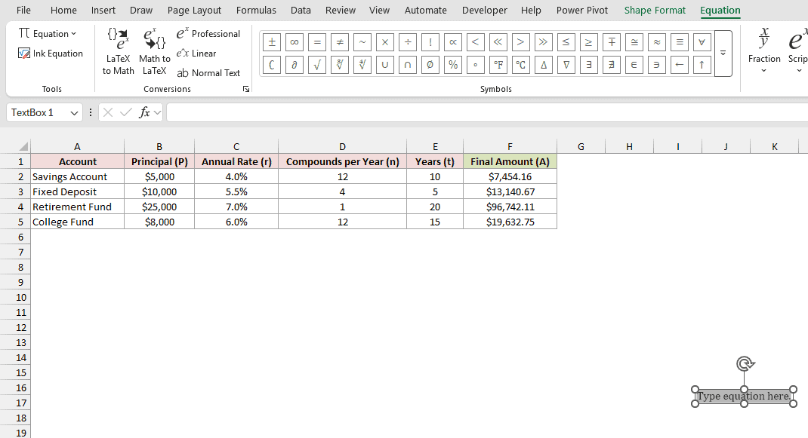

**수정 전**

화면 근거: 해당 기능의 최신 실제 실행 화면 미확보 또는 미구현

### TC-RIB-32 · 머리글·바닥글

분류: 특수 · 결과: **실패**

| 항목 | 내용 |
| --- | --- |
| 실행 절차 | 머리글·바닥글 전용 편집 경로를 확인합니다. |
| 기대값 | 페이지 번호·날짜·파일명 등의 요소를 비교합니다. |
| 실제 결과 | 현재 해당 기능/전용 탭은 구현되지 않았습니다. 이전 삽입/홈 화면을 해당 기능의 실행 증거로 취급하지 않습니다. |
| 수정 내용 | 이번 회차 수정 없음. 이전 기록의 근거와 제한을 보존합니다. |
| 재검증 | 전체 명령의 최신 실행 재검증은 미실행입니다. |
| 원본 출처·버전 | Header/Footer Elements 부분 원본 · https://support.microsoft.com/en-us/excel/headers-and-footers-in-a-worksheet |

**Excel 원본**

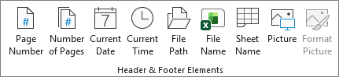

**수정 전**

화면 근거: 해당 기능의 최신 실제 실행 화면 미확보 또는 미구현

### TC-RIB-33 · 쿼리 편집

분류: 특수 · 결과: **실패**

| 항목 | 내용 |
| --- | --- |
| 실행 절차 | 쿼리 개체의 전용 편집 진입을 확인합니다. |
| 기대값 | 쿼리 선택·편집 탭을 제공합니다. |
| 실제 결과 | 현재 해당 기능/전용 탭은 구현되지 않았습니다. 이전 삽입/홈 화면을 해당 기능의 실행 증거로 취급하지 않습니다. |
| 수정 내용 | 이번 회차 수정 없음. 이전 기록의 근거와 제한을 보존합니다. |
| 재검증 | 전체 명령의 최신 실행 재검증은 미실행입니다. |
| 원본 출처·버전 | Data Get & Transform 부분 자료 · https://support.microsoft.com/en-us/excel/about-power-query-in-excel |

**Excel 원본**

**수정 전**

화면 근거: 해당 기능의 최신 실제 실행 화면 미확보 또는 미구현

### TC-RIB-34 · 게임 데이터

분류: 제품 전용 · 결과: **부분 확인**

| 항목 | 내용 |
| --- | --- |
| 실행 절차 | 게임 데이터 탭 선택 |
| 기대값 | 등록 종류별 그룹과 창 색상 일관성 |
| 실제 결과 | 최신 Unity에서 해당 제품 전용 화면을 재촬영했습니다. 전체 명령·플레이 잠금·저장 실패의 재검증은 남아 있습니다. |
| 수정 내용 | 이번 회차 수정 없음. 이전 기록의 근거와 제한을 보존합니다. |
| 재검증 | 전체 명령의 최신 실행 재검증은 미실행입니다. |
| 원본 출처·버전 | Excel 대응 원본 없음·제품 고유 기능 · 제품 전용 기능: Excel 대응 원본 없음 |

**수정 전**

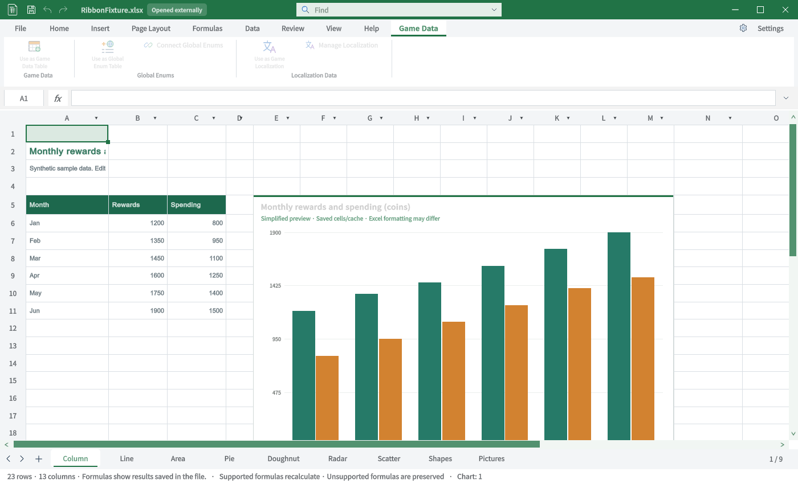

**수정 후 실제 실행**

화면 근거: 대응 원본 사진 없음 또는 정확한 버전의 원본 미확보; 제품 전용 기능이므로 Excel 원본과 직접 대응하지 않음

### TC-RIB-35 · 게임 테이블 도구

분류: 제품 전용 · 결과: **부분 확인**

| 항목 | 내용 |
| --- | --- |
| 실행 절차 | EnumGear 선택 |
| 기대값 | 게임 테이블 전용 도구·사용 예제 |
| 실제 결과 | 최신 Unity에서 해당 제품 전용 화면을 재촬영했습니다. 전체 명령·플레이 잠금·저장 실패의 재검증은 남아 있습니다. |
| 수정 내용 | 이번 회차 수정 없음. 이전 기록의 근거와 제한을 보존합니다. |
| 재검증 | 전체 명령의 최신 실행 재검증은 미실행입니다. |
| 원본 출처·버전 | Excel 대응 원본 없음·제품 고유 기능 · 제품 전용 기능: Excel 대응 원본 없음 |

**수정 전**

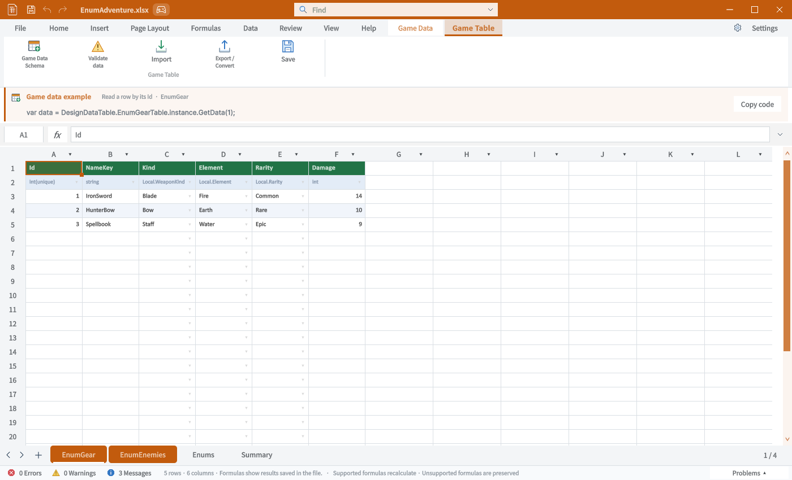

**수정 후 실제 실행**

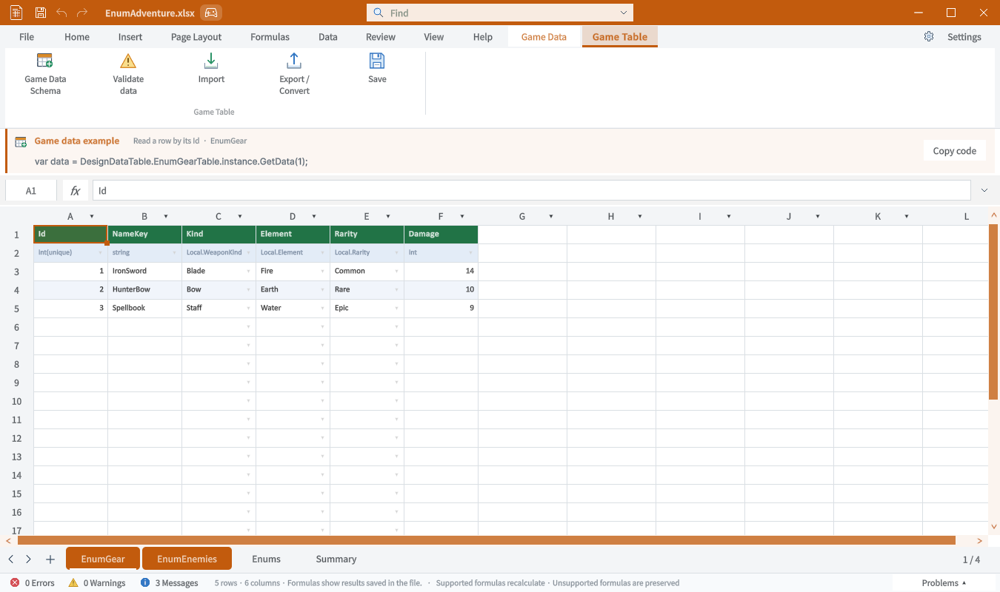

화면 근거: 대응 원본 사진 없음 또는 정확한 버전의 원본 미확보; 제품 전용 기능이므로 Excel 원본과 직접 대응하지 않음

### TC-RIB-36 · 열거형 도구

분류: 제품 전용 · 결과: **부분 확인**

| 항목 | 내용 |
| --- | --- |
| 실행 절차 | Enums 시트 선택 |
| 기대값 | Enum 전용 도구·사용 예제 |
| 실제 결과 | 최신 Unity에서 해당 제품 전용 화면을 재촬영했습니다. 전체 명령·플레이 잠금·저장 실패의 재검증은 남아 있습니다. |
| 수정 내용 | 이번 회차 수정 없음. 이전 기록의 근거와 제한을 보존합니다. |
| 재검증 | 전체 명령의 최신 실행 재검증은 미실행입니다. |
| 원본 출처·버전 | Excel 대응 원본 없음·제품 고유 기능 · 제품 전용 기능: Excel 대응 원본 없음 |

**수정 전**

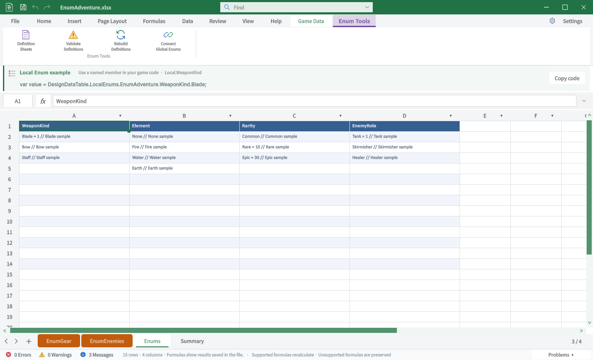

**수정 후 실제 실행**

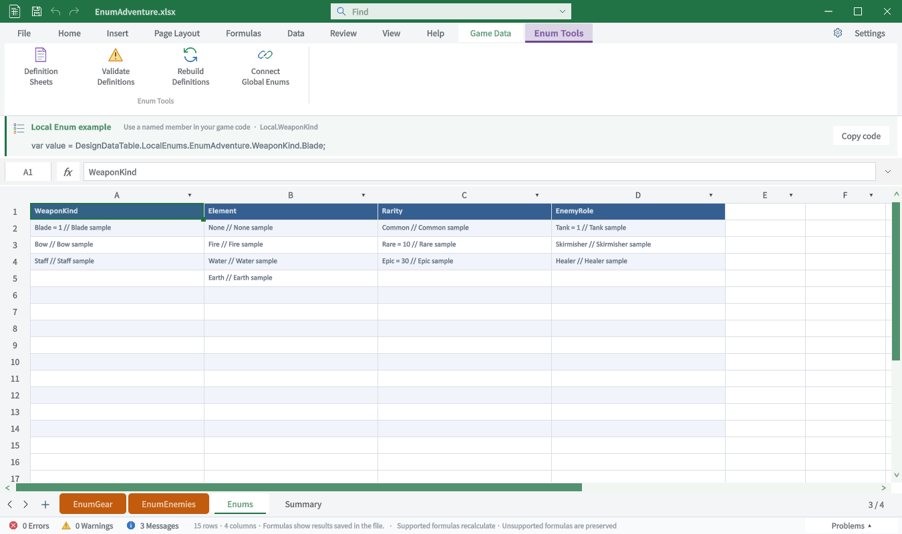

화면 근거: 대응 원본 사진 없음 또는 정확한 버전의 원본 미확보; 제품 전용 기능이므로 Excel 원본과 직접 대응하지 않음

### TC-RIB-37 · 로컬라이징

분류: 제품 전용 · 결과: **부분 확인**

| 항목 | 내용 |
| --- | --- |
| 실행 절차 | ArcadeText 선택 |
| 기대값 | 번역 전용 도구·대체 언어·예제 |
| 실제 결과 | 최신 Unity에서 해당 제품 전용 화면을 재촬영했습니다. 전체 명령·플레이 잠금·저장 실패의 재검증은 남아 있습니다. |
| 수정 내용 | 이번 회차 수정 없음. 이전 기록의 근거와 제한을 보존합니다. |
| 재검증 | 전체 명령의 최신 실행 재검증은 미실행입니다. |
| 원본 출처·버전 | Excel 대응 원본 없음·제품 고유 기능 · 제품 전용 기능: Excel 대응 원본 없음 |

**수정 전**

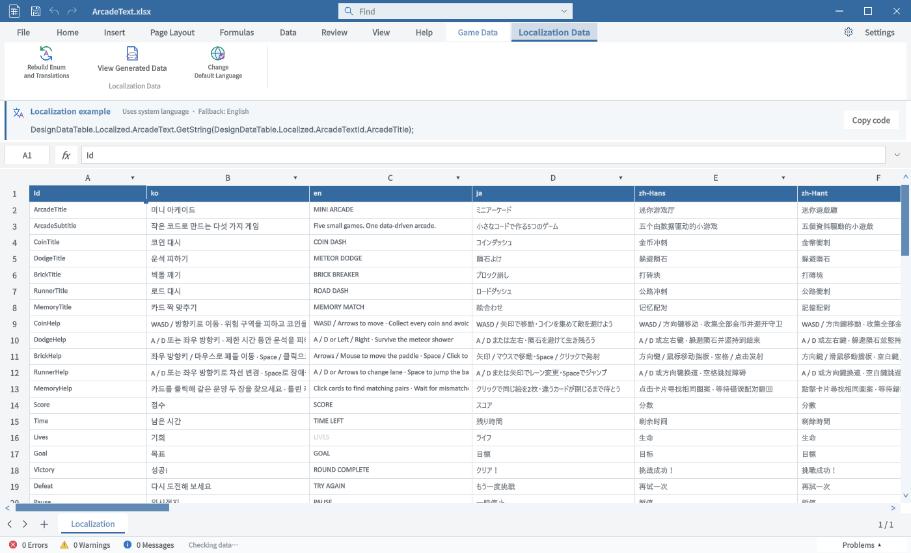

**수정 후 실제 실행**

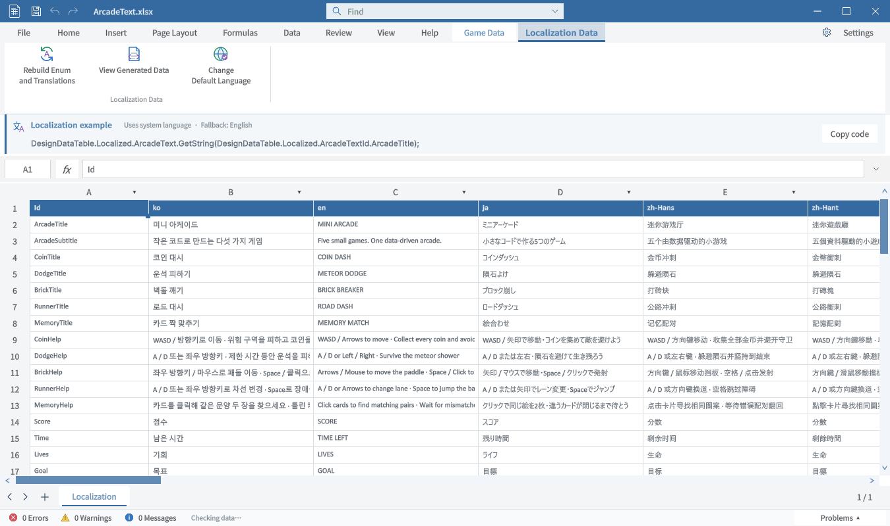

화면 근거: 대응 원본 사진 없음 또는 정확한 버전의 원본 미확보; 제품 전용 기능이므로 Excel 원본과 직접 대응하지 않음

### TC-RIB-38 · 서머리 도구

분류: 제품 전용 · 결과: **부분 확인**

| 항목 | 내용 |
| --- | --- |
| 실행 절차 | Summary 시트 선택 |
| 기대값 | 서머리 전용 도구와 안내 |
| 실제 결과 | 최신 Unity에서 해당 제품 전용 화면을 재촬영했습니다. 전체 명령·플레이 잠금·저장 실패의 재검증은 남아 있습니다. |
| 수정 내용 | 이번 회차 수정 없음. 이전 기록의 근거와 제한을 보존합니다. |
| 재검증 | 전체 명령의 최신 실행 재검증은 미실행입니다. |
| 원본 출처·버전 | Excel 대응 원본 없음·제품 고유 기능 · 제품 전용 기능: Excel 대응 원본 없음 |

**수정 전**

**수정 후 실제 실행**

화면 근거: 대응 원본 사진 없음 또는 정확한 버전의 원본 미확보; 제품 전용 기능이므로 Excel 원본과 직접 대응하지 않음

### TC-RIB-39 · 설정

분류: 제품 전용 · 결과: **부분 확인**

| 항목 | 내용 |
| --- | --- |
| 실행 절차 | 환경 설정 열기 |
| 기대값 | 우측 설정 위치와 읽기 쉬운 패널 |
| 실제 결과 | 최신 Unity에서 해당 제품 전용 화면을 재촬영했습니다. 전체 명령·플레이 잠금·저장 실패의 재검증은 남아 있습니다. |
| 수정 내용 | 이번 회차 수정 없음. 이전 기록의 근거와 제한을 보존합니다. |
| 재검증 | 전체 명령의 최신 실행 재검증은 미실행입니다. |
| 원본 출처·버전 | Excel 대응 원본 없음·제품 고유 기능 · 제품 전용 기능: Excel 대응 원본 없음 |

**수정 전**

**수정 후 실제 실행**

화면 근거: 대응 원본 사진 없음 또는 정확한 버전의 원본 미확보; 제품 전용 기능이므로 Excel 원본과 직접 대응하지 않음

### TC-RIB-40 · 빠른 실행 도구

분류: 기준 목록 보충 · 결과: **부분 확인**

| 항목 | 내용 |
| --- | --- |
| 실행 절차 | 해당 전용 탭 또는 진입점을 현재 리본에서 확인합니다. |
| 기대값 | 저장·Undo·Redo·제목 표시 |
| 실제 결과 | 자료가 구형 별칭·부분 화면이거나 해당 기능의 실제 실행 증거가 부족합니다. 독립 최신 탭으로 확정하거나 통과 처리하지 않았습니다. |
| 수정 내용 | 이번 회차 수정 없음. 이전 기록의 근거와 제한을 보존합니다. |
| 재검증 | 전체 명령의 최신 실행 재검증은 미실행입니다. |
| 원본 출처·버전 | Excel365 원본의 빠른 실행 도구 일부 · https://www.officetooltips.com/excel/tips/how_to_change_format_for_diagram_shapes_in_excel |

**Excel 원본**

**수정 전**

**수정 후 실제 실행**

### TC-RIB-41 · 인쇄 미리보기

분류: 기준 목록 보충 · 결과: **부분 확인**

| 항목 | 내용 |
| --- | --- |
| 실행 절차 | 해당 전용 탭 또는 진입점을 현재 리본에서 확인합니다. |
| 기대값 | Print Preview 전용 탭·인쇄 설정 |
| 실제 결과 | 자료가 구형 별칭·부분 화면이거나 해당 기능의 실제 실행 증거가 부족합니다. 독립 최신 탭으로 확정하거나 통과 처리하지 않았습니다. |
| 수정 내용 | 이번 회차 수정 없음. 이전 기록의 근거와 제한을 보존합니다. |
| 재검증 | 전체 명령의 최신 실행 재검증은 미실행입니다. |
| 원본 출처·버전 | 해당 Excel 원본 미확보 · 제품 전용 기능: Excel 대응 원본 없음 |

**수정 전**

화면 근거: 대응 원본 사진 없음 또는 정확한 버전의 원본 미확보; 해당 기능의 최신 실제 실행 화면 미확보 또는 미구현

### TC-RIB-42 · 배경 제거

분류: 기준 목록 보충 · 결과: **부분 확인**

| 항목 | 내용 |
| --- | --- |
| 실행 절차 | 해당 전용 탭 또는 진입점을 현재 리본에서 확인합니다. |
| 기대값 | 그림 선택 후 배경 제거 전용 탭 |
| 실제 결과 | 자료가 구형 별칭·부분 화면이거나 해당 기능의 실제 실행 증거가 부족합니다. 독립 최신 탭으로 확정하거나 통과 처리하지 않았습니다. |
| 수정 내용 | 이번 회차 수정 없음. 이전 기록의 근거와 제한을 보존합니다. |
| 재검증 | 전체 명령의 최신 실행 재검증은 미실행입니다. |
| 원본 출처·버전 | 해당 Excel 원본 미확보 · 제품 전용 기능: Excel 대응 원본 없음 |

**수정 전**

화면 근거: 대응 원본 사진 없음 또는 정확한 버전의 원본 미확보; 해당 기능의 최신 실제 실행 화면 미확보 또는 미구현

### TC-RIB-43 · 구형 차트 레이아웃

분류: 기준 목록 보충 · 결과: **부분 확인**

| 항목 | 내용 |
| --- | --- |
| 실행 절차 | 해당 전용 탭 또는 진입점을 현재 리본에서 확인합니다. |
| 기대값 | 기준 목록 TabChartToolsLayout 명령군 |
| 실제 결과 | 자료가 구형 별칭·부분 화면이거나 해당 기능의 실제 실행 증거가 부족합니다. 독립 최신 탭으로 확정하거나 통과 처리하지 않았습니다. |
| 수정 내용 | 이번 회차 수정 없음. 이전 기록의 근거와 제한을 보존합니다. |
| 재검증 | 전체 명령의 최신 실행 재검증은 미실행입니다. |
| 원본 출처·버전 | 해당 Excel 원본 미확보 · 제품 전용 기능: Excel 대응 원본 없음 |

**수정 전**

화면 근거: 대응 원본 사진 없음 또는 정확한 버전의 원본 미확보; 해당 기능의 최신 실제 실행 화면 미확보 또는 미구현

### TC-RIB-44 · 구형 피벗 차트 레이아웃

분류: 기준 목록 보충 · 결과: **부분 확인**

| 항목 | 내용 |
| --- | --- |
| 실행 절차 | 해당 전용 탭 또는 진입점을 현재 리본에서 확인합니다. |
| 기대값 | 기준 목록 TabPivotChartToolsLayout 명령군 |
| 실제 결과 | 자료가 구형 별칭·부분 화면이거나 해당 기능의 실제 실행 증거가 부족합니다. 독립 최신 탭으로 확정하거나 통과 처리하지 않았습니다. |
| 수정 내용 | 이번 회차 수정 없음. 이전 기록의 근거와 제한을 보존합니다. |
| 재검증 | 전체 명령의 최신 실행 재검증은 미실행입니다. |
| 원본 출처·버전 | 해당 Excel 원본 미확보 · 제품 전용 기능: Excel 대응 원본 없음 |

**수정 전**

화면 근거: 대응 원본 사진 없음 또는 정확한 버전의 원본 미확보; 해당 기능의 최신 실제 실행 화면 미확보 또는 미구현

### TC-RIB-45 · BI 시각화 도구

분류: 기준 목록 보충 · 결과: **부분 확인**

| 항목 | 내용 |
| --- | --- |
| 실행 절차 | 해당 전용 탭 또는 진입점을 현재 리본에서 확인합니다. |
| 기대값 | 기준 목록 TabBIVisualTools의 활성 조건과 명령 |
| 실제 결과 | 자료가 구형 별칭·부분 화면이거나 해당 기능의 실제 실행 증거가 부족합니다. 독립 최신 탭으로 확정하거나 통과 처리하지 않았습니다. |
| 수정 내용 | 이번 회차 수정 없음. 이전 기록의 근거와 제한을 보존합니다. |
| 재검증 | 전체 명령의 최신 실행 재검증은 미실행입니다. |
| 원본 출처·버전 | 해당 Excel 원본 미확보 · 제품 전용 기능: Excel 대응 원본 없음 |

**수정 전**

화면 근거: 대응 원본 사진 없음 또는 정확한 버전의 원본 미확보; 해당 기능의 최신 실제 실행 화면 미확보 또는 미구현

### TC-RIB-46 · 접근성 작성 도구

분류: 기준 목록 보충 · 결과: **부분 확인**

| 항목 | 내용 |
| --- | --- |
| 실행 절차 | 해당 전용 탭 또는 진입점을 현재 리본에서 확인합니다. |
| 기대값 | 기준 목록 TabAccessibleAuthoring의 활성 조건과 명령 |
| 실제 결과 | 자료가 구형 별칭·부분 화면이거나 해당 기능의 실제 실행 증거가 부족합니다. 독립 최신 탭으로 확정하거나 통과 처리하지 않았습니다. |
| 수정 내용 | 이번 회차 수정 없음. 이전 기록의 근거와 제한을 보존합니다. |
| 재검증 | 전체 명령의 최신 실행 재검증은 미실행입니다. |
| 원본 출처·버전 | 해당 Excel 원본 미확보 · 제품 전용 기능: Excel 대응 원본 없음 |

**수정 전**

화면 근거: 대응 원본 사진 없음 또는 정확한 버전의 원본 미확보; 해당 기능의 최신 실제 실행 화면 미확보 또는 미구현

## 남은 사항

전체46TC의 원본 레이아웃·아이콘·크기·그룹 영역·단축키 최종 일치와 전수 실제 QA는 계속 진행합니다. 종류/이동 대화상자는 이번에 구현했지만 전체 Excel 종류·세부 유형/복합/3D·번호별 빠른 레이아웃·모든 데이터 선택/요소 메뉴·원본 대화상자 정확한 버전/DPI/픽셀 대조는 남았습니다.

페이지 배경·전체 테마/고급 인쇄,도형 맞춤·그룹,표 머리글/합계/범위/필터,나머지 일반·상황별 탭 영역·File/전체 상황별 탭 단축키,IME/저장·닫기 스트레스와 기존 문서335검증 항목의 재촬영·9개 언어 시각 검증,제품 커밋/패키징/배포는 원래 범위에 유지합니다. 보고서 배포와 제품 배포를 구분합니다.

교훈 검토: 전역 변경 없음. 기존 실제 실행·원본 대조·검증되지 않은 촬영 해시 갱신 금지를 적용했습니다. 네이티브 파일명 입력은 컨트롤 읽기 왕복으로 확인했고, 파트 삭제 후 재할당과 차트 시트 문서 단축키를 회귀에 추가했습니다. 전역 재사용 규칙은 기존 지침과 중복되므로 추가하지 않았습니다.

## 작업 시간

- 제안 시간: 전체 최초4–6시간(2026-10-31 23:42:56 KST 시작)은 초과했습니다. 이번 대화상자/전용 시트 묶음35–55분,2026-11-01 08:50:32 KST 시작. 최종 크기 손실을 발견해 예상 종료 전에10–15분 추가 필요를 안내했습니다.
- 실제로 완료된 시간: 2026-11-01 09:52:06 KST 기준 61분 진행. 최초35–55분 예상은 초과했고 크기 손실의 추가 수정/검증을 수행했습니다. 이 시각은 공개 배포 완료 시각이 아니며 전체46TC 완료 시각은 없습니다.
- XERJ: 사용 — XERJ 연결을 복구한 뒤 AddSheet 심볼/구현 검색을 현재 소스로 대조했습니다. 나머지 관계·호출은 rg와 실제 실행 근거로 보완했습니다.
