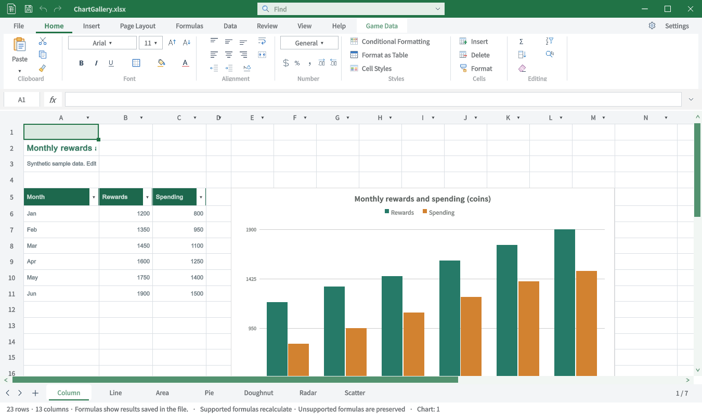
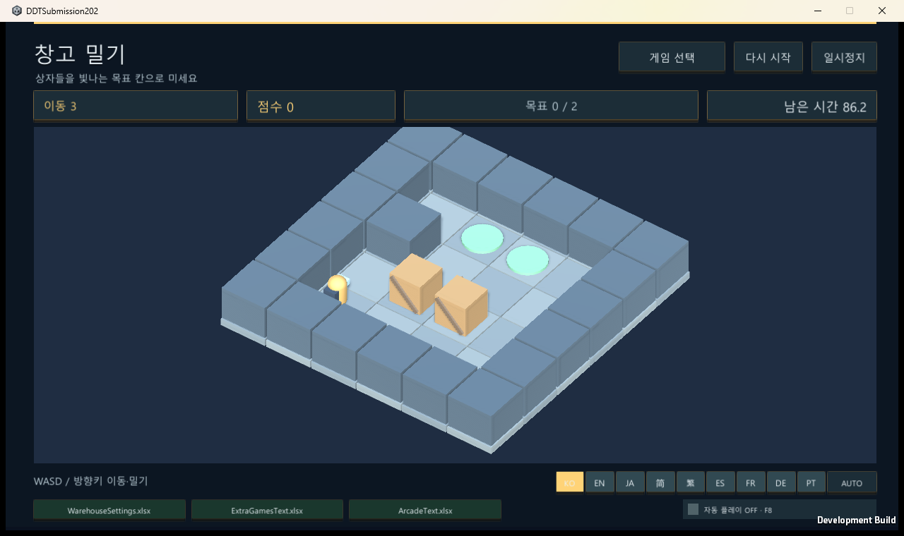
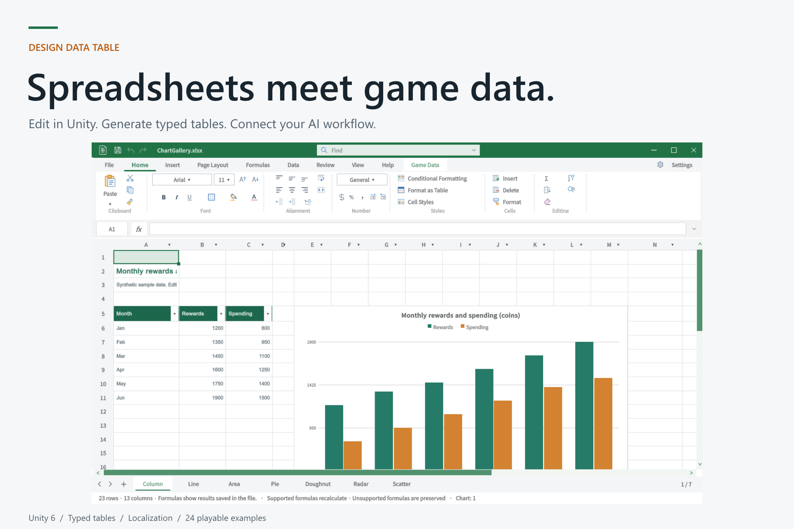
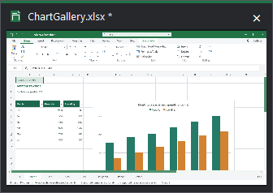
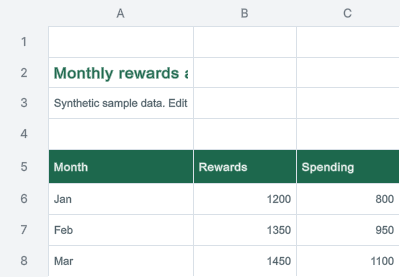
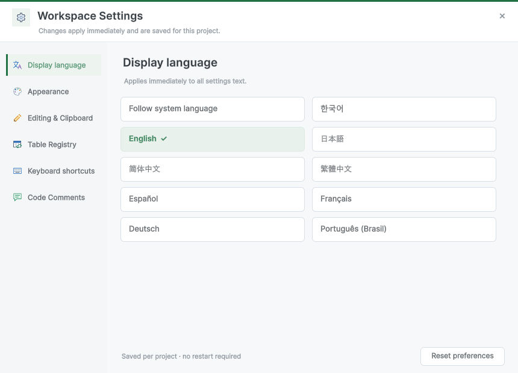
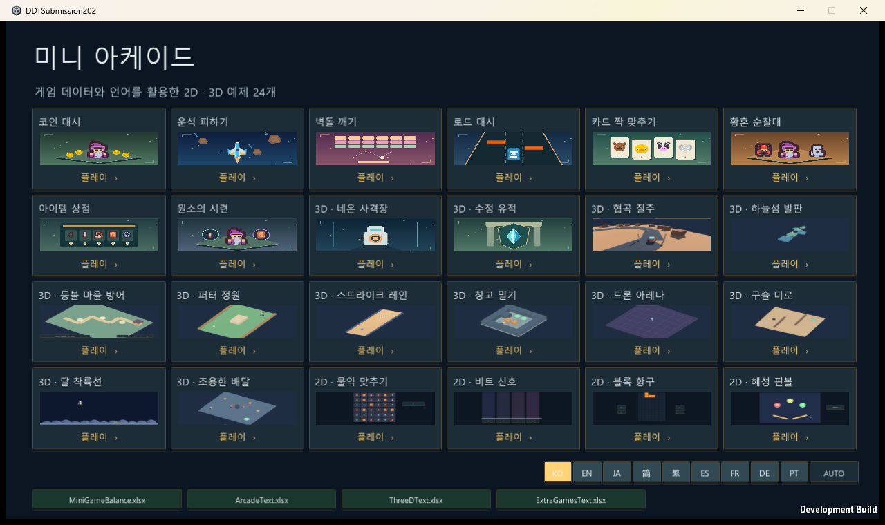
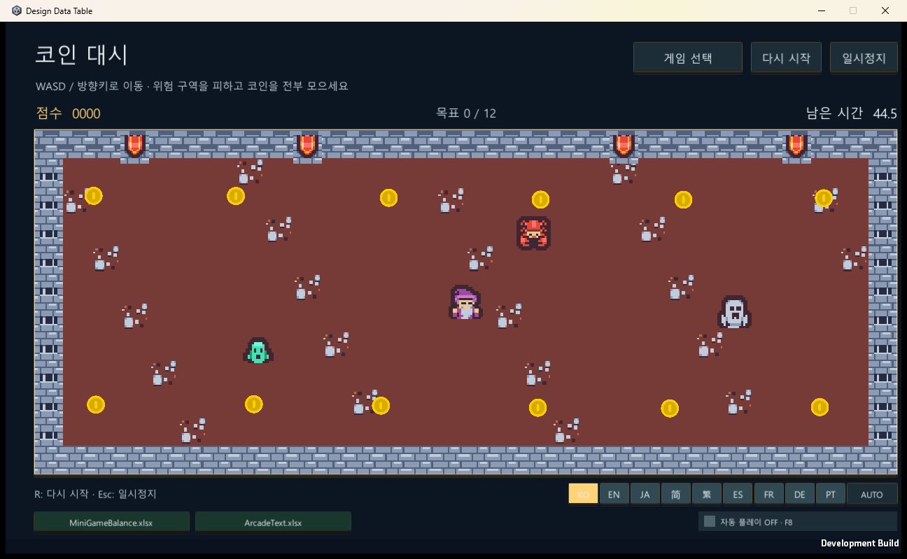

## 작업 결과

요청한 공개 API 교체와2.0.2 제출 자료 정리를 완료했습니다. 포털 업로드와 심사 요청은 수행하지 않았습니다.

제출 폴더: `C:/Projects/TurnRoom/WorkFiles/Deliverables/DesignDataTable-2.0.2/Submission`

- 고객용 패키지61,819,532바이트·1578개 파일을 Unity에서 네이티브로 내보냈습니다.
- 간단한 스토어 원고·릴리즈6개 항목·새 키 이미지·Affinity 원본·검증 JSON·SHA-256 목록을 한 폴더로 모았습니다.
- 공식 검사31통과·3경고·0실패입니다. 경고는 아래에 공개했습니다.

## 변경 내용

### 적용 내용

| 대상 | 변경 |
| --- | --- |
| 창·설정·팝업 | 비공개 ContainerWindow·HostView·m_Parent·ShowPopupWithMode 접근을 공개 EditorWindow와 같은 프로세스의 공식 Win32 창 API로 교체 |
| 문서 선반 | Unity 상태바 내부 삽입을 공개 EditorWindow 선반으로 교체. 하단 상태바 위에 별도 얇은 행으로 표시 |
| 호버·창 애니메이션 | 기존 데이터·Undo·미리보기 기능을 유지하고 창 준비·숨김·최종 배치·최대화 경로 수정 |
| AI PNG | GUIView.GrabPixels를 공개 SendEvent 렌더링·Win32 캡처로 교체 |
| 스포이트 | Unity 비공개 EyeDropper 대신 사용자가 시작한 화면1픽셀 선택. 투명도 유지·Esc 취소 |
| 프로젝트 아이콘 | 비공개 ObjectListArea 후크 제거. 원본 XLSX의 공개 ScriptedImporter 아이콘 사용 |
| 제출 정리 | 누락 아이콘 메타40개 추가, 메뉴를 Tools/TurnRoom 아래로 정리, 혼합 줄바꿈 정리 |
| 스토어 이미지 | 예전 리본이 들어간 커버·카드·소셜 교체. 실제 Affinity3.3.1에서 새 원본3개·PNG 저장. 기존 아이콘은 그대로 재사용 |

[공식 제출 지침2.5.g](https://assetstore.unity.com/publishing/submission-guidelines)는 리플렉션 등으로 발견한 Unity Editor 내부 API 사용을 금지합니다. 자사 생성 데이터·직렬화 필드와 선택적 공개 Addressables API를 읽는 리플렉션은 분리해 검토했습니다.

## 검증

Unity6000.0.83f1·Windows에서 수행했습니다.3370은 독립적인 사용자 시나리오 수가 아니라 씬 하위 오브젝트 검사 등을 포함한 검증 조건 수입니다.

-347개 고객용 C# 소스의 명시적 내부 API 패턴 검사와 남은 리플렉션 호출을 검토했습니다. 세 어셈블리 컴파일과 비공개 Unity 타입 참조 검사를 확인했습니다.
- 실제 에디터에서 최소화·호버·물리 클릭 복원·미저장 값·Undo·최대화·400×277PNG·색상 선택/취소와10회 반복을 확인했습니다.
-25씬에 누락 스크립트가 없고24개 바이너리 테이블을 읽었습니다. Windows 플레이어 빌드가 성공했습니다.
- 실제 Play 모드에서24개 허브 카드의 레이캐스트 대상·Button.onClick 실행·전환 씬이 일치했습니다. 모든 게임의 승리 조건·장시간 플레이까지 검사한 것은 아닙니다.
- Windows 마우스 클릭은 런타임 화면·클라이언트 좌표로 보정한 뒤 HubCard0→Coin Dash 전환을 계측했습니다. 계측용 플레이어만 백그라운드 업데이트를 켰으며 해당 코드·설정은 고객 패키지에 포함되지 않습니다. 기존 고정 좌표 시도는 통과 근거에서 제외했습니다.
- PNG와 편집 원본의 실제 파일·크기·시각 품질을 확인했습니다. 허브 화면231KB와 커버223KB는 글자 판독을 유지하도록 원본을 사용했습니다. 이미지 편집·출력은 Affinity에서 수행했고 실행 화면은 해당 프로그램에서 직접 캡처했습니다.

[패키지 검사](../assets/submission-202-20261101/ArchiveVerification.json) · [공식 검사](../assets/submission-202-20261101/OfficialValidator.json) · [공개 API 실행](../assets/submission-202-20261101/PublicApiNativeQA.json) · [24카드 실행](../assets/submission-202-20261101/SampleHubQA.json) · [실제 마우스 계측](../assets/submission-202-20261101/NativePointerQA.json) · [제출 파일 목록](../assets/submission-202-20261101/SubmissionHandoff.json)

교훈 검토: 도구 사용과 실제 출력·클릭 검증을 구분하고, 실패한 좌표·검게 나온 캡처를 통과 근거로 사용하지 않았습니다. 기존 전역 지침과 중복되므로 전역 지침 변경 없음. SDK의 프로젝트 파일 접근 거부는 실제 Affinity 저장·내보내기 창으로 처리했으며 바탕화면에 중간 파일을 두지 않았습니다.

### TC-SUB-01 · 배포 범위와 무결성

분류: 2.0.2 제출·공개 API 회귀 · 결과: **통과**

| 항목 | 내용 |
| --- | --- |
| 실행 절차 | Unity 네이티브 패키지의 파일·메타·GUID·직렬화 참조를 동결 원본과 비교합니다. |
| 기대값 | 의도한 고객용 파일만 포함되고 오류가 없어야 합니다. |
| 실제 결과 | 1578개 파일·8037개 직렬화 참조, 오류0. 개발·QA 파일 제외. |
| 원본 출처·버전 | [검증 JSON](../assets/submission-202-20261101/ArchiveVerification.json) |

화면 근거: Excel 레이아웃 대조가 아닌 제출·공개 API 회귀 검사입니다. 원본 이미지가 없는 항목은 실행 JSON으로 확인하며, 현재 화면은 해당 기능의 실제 캡처만 제공합니다.

### TC-SUB-02 · 내부 API 교체와 컴파일

분류: 2.0.2 제출·공개 API 회귀 · 결과: **통과**

| 항목 | 내용 |
| --- | --- |
| 실행 절차 | 고객용 C#347개를 검사하고 세 어셈블리를 컴파일·참조 검사합니다. |
| 기대값 | 명시적 Unity 내부 API 패턴이 제거되고 컴파일이 성공해야 합니다. |
| 실제 결과 | 명시적 패턴0, 세 어셈블리 컴파일 성공. 남은 자사 데이터·공개 API 리플렉션 검토. |
| 원본 출처·버전 | [검증 JSON](../assets/submission-202-20261101/InternalApiCompliance.json) |

화면 근거: Excel 레이아웃 대조가 아닌 제출·공개 API 회귀 검사입니다. 원본 이미지가 없는 항목은 실행 JSON으로 확인하며, 현재 화면은 해당 기능의 실제 캡처만 제공합니다.

### TC-SUB-03 · 씬 로드와 누락 스크립트

분류: 2.0.2 제출·공개 API 회귀 · 결과: **통과**

| 항목 | 내용 |
| --- | --- |
| 실행 절차 | 25개 샘플 씬을 실제 Unity에서 열고 각 하위 오브젝트의 스크립트를 확인합니다. |
| 기대값 | 모든 씬이 열리고 누락 스크립트가 없어야 합니다. |
| 실제 결과 | 25개 씬 로드·누락 스크립트 검사 통과. |
| 원본 출처·버전 | [검증 JSON](../assets/submission-202-20261101/NativeSubmissionQA.json) |

화면 근거: Excel 레이아웃 대조가 아닌 제출·공개 API 회귀 검사입니다. 원본 이미지가 없는 항목은 실행 JSON으로 확인하며, 현재 화면은 해당 기능의 실제 캡처만 제공합니다.

### TC-SUB-04 · 생성 바이너리 데이터

분류: 2.0.2 제출·공개 API 회귀 · 결과: **통과**

| 항목 | 내용 |
| --- | --- |
| 실행 절차 | 24개 생성 테이블의 Load(byte[])로 실제 바이너리를 읽습니다. |
| 기대값 | 읽기 오류가 없어야 합니다. |
| 실제 결과 | 24개 테이블 역직렬화 통과. |
| 원본 출처·버전 | [검증 JSON](../assets/submission-202-20261101/NativeSubmissionQA.json) |

화면 근거: Excel 레이아웃 대조가 아닌 제출·공개 API 회귀 검사입니다. 원본 이미지가 없는 항목은 실행 JSON으로 확인하며, 현재 화면은 해당 기능의 실제 캡처만 제공합니다.

### TC-SUB-05 · 편집·Undo·Redo·저장

분류: 2.0.2 제출·공개 API 회귀 · 결과: **통과**

| 항목 | 내용 |
| --- | --- |
| 실행 절차 | 복사본 셀을 수정하고 Undo/Redo·저장·재열기를 실행합니다. |
| 기대값 | 수정과 Undo 상태가 일치하고 저장값이 다시 열려야 합니다. |
| 실제 결과 | 실제 Unity 검사 통과. |
| 원본 출처·버전 | [검증 JSON](../assets/submission-202-20261101/NativeSubmissionQA.json) |

화면 근거: Excel 레이아웃 대조가 아닌 제출·공개 API 회귀 검사입니다. 원본 이미지가 없는 항목은 실행 JSON으로 확인하며, 현재 화면은 해당 기능의 실제 캡처만 제공합니다.

### TC-SUB-06 · 미저장 값의 최소화·클릭 복원

분류: 2.0.2 제출·공개 API 회귀 · 결과: **통과**

| 항목 | 내용 |
| --- | --- |
| 실행 절차 | 수정한 문서를 최소화한 뒤 실제 선반 클릭으로 복원하고 Undo합니다. |
| 기대값 | 값·Dirty·Undo가 보존되어야 합니다. |
| 실제 결과 | PUBLIC API DRAFT 유지, 복원 후 Undo로 깨끗한 상태 복구. |
| 원본 출처·버전 | [검증 JSON](../assets/submission-202-20261101/PublicApiNativeQA.json) |

**수정 후 실제 실행**

화면 근거: Excel 레이아웃 대조가 아닌 제출·공개 API 회귀 검사입니다. 원본 이미지가 없는 항목은 실행 JSON으로 확인하며, 현재 화면은 해당 기능의 실제 캡처만 제공합니다.

### TC-SUB-07 · 최소화·복원 반복

분류: 2.0.2 제출·공개 API 회귀 · 결과: **통과**

| 항목 | 내용 |
| --- | --- |
| 실행 절차 | 깨끗한 문서의 최소화와 복원을10회 반복합니다. |
| 기대값 | 잘못된 Dirty나 값 변화가 없어야 합니다. |
| 실제 결과 | 10회 반복 통과. |
| 원본 출처·버전 | [검증 JSON](../assets/submission-202-20261101/PublicApiNativeQA.json) |

화면 근거: Excel 레이아웃 대조가 아닌 제출·공개 API 회귀 검사입니다. 원본 이미지가 없는 항목은 실행 JSON으로 확인하며, 현재 화면은 해당 기능의 실제 캡처만 제공합니다.

### TC-SUB-08 · 호버 카드와 포커스

분류: 2.0.2 제출·공개 API 회귀 · 결과: **통과**

| 항목 | 내용 |
| --- | --- |
| 실행 절차 | 선반 위에 실제 포인터를 두고 미리보기·포커스를 확인합니다. |
| 기대값 | 카드가 보이고 원래 포커스를 빼앗지 않아야 합니다. |
| 실제 결과 | 실제 카드 표시와 원래 native foreground 유지 확인. |
| 원본 출처·버전 | [검증 JSON](../assets/submission-202-20261101/PublicApiNativeQA.json) |

**수정 후 실제 실행**

화면 근거: Excel 레이아웃 대조가 아닌 제출·공개 API 회귀 검사입니다. 원본 이미지가 없는 항목은 실행 JSON으로 확인하며, 현재 화면은 해당 기능의 실제 캡처만 제공합니다.

### TC-SUB-09 · 최대화·원래 크기 복원

분류: 2.0.2 제출·공개 API 회귀 · 결과: **통과**

| 항목 | 내용 |
| --- | --- |
| 실행 절차 | 실제 창을 최대화하고 다시 복원합니다. |
| 기대값 | 확대와 원래 창 크기 복원이 일치해야 합니다. |
| 실제 결과 | 1920×1032 확대 후1350×800 원래 크기 복원. |
| 원본 출처·버전 | [검증 JSON](../assets/submission-202-20261101/PublicApiNativeQA.json) |

화면 근거: Excel 레이아웃 대조가 아닌 제출·공개 API 회귀 검사입니다. 원본 이미지가 없는 항목은 실행 JSON으로 확인하며, 현재 화면은 해당 기능의 실제 캡처만 제공합니다.

### TC-SUB-10 · AI PNG 출력

분류: 2.0.2 제출·공개 API 회귀 · 결과: **통과**

| 항목 | 내용 |
| --- | --- |
| 실행 절차 | 실제 워크북 범위를 공개 렌더링과 native 캡처로 출력합니다. |
| 기대값 | 실제 표가 나오고 포커스·임시 창이 남지 않아야 합니다. |
| 실제 결과 | 400×277 실제 PNG, foreground 동일, 임시 창 제거. |
| 원본 출처·버전 | [검증 JSON](../assets/submission-202-20261101/PublicApiNativeQA.json) |

**수정 후 실제 실행**

화면 근거: Excel 레이아웃 대조가 아닌 제출·공개 API 회귀 검사입니다. 원본 이미지가 없는 항목은 실행 JSON으로 확인하며, 현재 화면은 해당 기능의 실제 캡처만 제공합니다.

### TC-SUB-11 · 스포이트 선택·취소

분류: 2.0.2 제출·공개 API 회귀 · 결과: **통과**

| 항목 | 내용 |
| --- | --- |
| 실행 절차 | 실제 빨간 영역을 선택한 뒤 다시 선택을 시작해 Esc로 취소합니다. |
| 기대값 | 색상·투명도·변경 이벤트와 취소가 정확해야 합니다. |
| 실제 결과 | 빨강 선택·알파0.6 유지·변경1회. Esc 추가 변경0회. |
| 원본 출처·버전 | [검증 JSON](../assets/submission-202-20261101/PublicApiNativeQA.json) |

화면 근거: Excel 레이아웃 대조가 아닌 제출·공개 API 회귀 검사입니다. 원본 이미지가 없는 항목은 실행 JSON으로 확인하며, 현재 화면은 해당 기능의 실제 캡처만 제공합니다.

### TC-SUB-12 · 설정 창 표시

분류: 2.0.2 제출·공개 API 회귀 · 결과: **통과**

| 항목 | 내용 |
| --- | --- |
| 실행 절차 | 교체한 공개 API로 설정 창을 열고 실제 화면을 확인합니다. |
| 기대값 | 제목·설정 항목과 밝은 표면이 표시되어야 합니다. |
| 실제 결과 | 실제 Workspace Settings 창 렌더링 확인. 첫 클릭·Esc 동작 전체를 통과했다고 확대 해석하지 않았습니다. |
| 원본 출처·버전 | [검증 JSON](../assets/submission-202-20261101/PublicApiNativeQA.json) |

**수정 후 실제 실행**

화면 근거: Excel 레이아웃 대조가 아닌 제출·공개 API 회귀 검사입니다. 원본 이미지가 없는 항목은 실행 JSON으로 확인하며, 현재 화면은 해당 기능의 실제 캡처만 제공합니다.

### TC-SUB-13 · 공식 Asset Store 검사

분류: 2.0.2 제출·공개 API 회귀 · 결과: **통과**

| 항목 | 내용 |
| --- | --- |
| 실행 절차 | 원본 Asset Store Tools12.0.0 검사를 고객용 두 경로에 실행합니다. |
| 기대값 | 컴파일 오류·검사 실패0, 남은 경고를 공개해야 합니다. |
| 실제 결과 | 31통과·3경고·0실패, RanToCompletion. |
| 원본 출처·버전 | [검증 JSON](../assets/submission-202-20261101/OfficialValidator.json) |

화면 근거: Excel 레이아웃 대조가 아닌 제출·공개 API 회귀 검사입니다. 원본 이미지가 없는 항목은 실행 JSON으로 확인하며, 현재 화면은 해당 기능의 실제 캡처만 제공합니다.

### TC-SUB-14 · 허브24개 선택

분류: 2.0.2 제출·공개 API 회귀 · 결과: **통과**

| 항목 | 내용 |
| --- | --- |
| 실행 절차 | 실제 Unity Play에서 각 카드 중심을 레이캐스트하고 Button.onClick을 실행해 씬을 확인합니다. |
| 기대값 | 카드와 연결된24개 씬이 각각 일치해야 합니다. |
| 실제 결과 | 24개 카드 모두 hit·연결된 씬 일치. 좁은640×480 초기 시도는 별도 실패 기록으로 보존. |
| 원본 출처·버전 | [검증 JSON](../assets/submission-202-20261101/SampleHubQA.json) |

**수정 후 실제 실행**

화면 근거: Excel 레이아웃 대조가 아닌 제출·공개 API 회귀 검사입니다. 원본 이미지가 없는 항목은 실행 JSON으로 확인하며, 현재 화면은 해당 기능의 실제 캡처만 제공합니다.

### TC-SUB-15 · Windows 실제 클릭

분류: 2.0.2 제출·공개 API 회귀 · 결과: **통과**

| 항목 | 내용 |
| --- | --- |
| 실행 절차 | 실행 중 플레이어의 클라이언트·런타임 좌표로 실제 클릭하고 선택 대상을 계측합니다. |
| 기대값 | HubCard0가 선택되어 Coin Dash가 열려야 합니다. |
| 실제 결과 | 런타임 mouse(140,571), hit=HubCard0, 이후 Coin Dash 확인. |
| 원본 출처·버전 | [검증 JSON](../assets/submission-202-20261101/NativePointerQA.json) |

**수정 후 실제 실행**

화면 근거: Excel 레이아웃 대조가 아닌 제출·공개 API 회귀 검사입니다. 원본 이미지가 없는 항목은 실행 JSON으로 확인하며, 현재 화면은 해당 기능의 실제 캡처만 제공합니다.

### TC-SUB-16 · Windows 플레이어 빌드·표시

분류: 2.0.2 제출·공개 API 회귀 · 결과: **통과**

| 항목 | 내용 |
| --- | --- |
| 실행 절차 | 현재 동결본을 Windows로 빌드하고 게임 화면을 캡처합니다. |
| 기대값 | 빌드가 성공하고 실제 게임 UI가 표시되어야 합니다. |
| 실제 결과 | 네이티브 빌드 성공, Warehouse·Pinball 실제 화면 확인. |
| 원본 출처·버전 | [검증 JSON](../assets/submission-202-20261101/NativeSubmissionQA.json) |

**수정 후 실제 실행**

화면 근거: Excel 레이아웃 대조가 아닌 제출·공개 API 회귀 검사입니다. 원본 이미지가 없는 항목은 실행 JSON으로 확인하며, 현재 화면은 해당 기능의 실제 캡처만 제공합니다.

### TC-SUB-17 · Affinity 키 이미지와 원본

분류: 2.0.2 제출·공개 API 회귀 · 결과: **통과**

| 항목 | 내용 |
| --- | --- |
| 실행 절차 | 실제 Affinity에서 커버·카드·소셜을 제작·저장·PNG 출력하고 크기와 실제 이미지를 확인합니다. |
| 기대값 | 예전 UI가 없어야 하며 편집 원본과 지정 크기 PNG가 있어야 합니다. |
| 실제 결과 | Cover1950×1300, Card420×280, Social1200×630, 원본3개 저장. 아이콘160×160은 기존 것을 재사용. |
| 원본 출처·버전 | [검증 JSON](../assets/submission-202-20261101/SubmissionHandoff.json) |

**수정 후 실제 실행**

화면 근거: Excel 레이아웃 대조가 아닌 제출·공개 API 회귀 검사입니다. 원본 이미지가 없는 항목은 실행 JSON으로 확인하며, 현재 화면은 해당 기능의 실제 캡처만 제공합니다.

### TC-SUB-18 · 제출 파일 정리

분류: 2.0.2 제출·공개 API 회귀 · 결과: **통과**

| 항목 | 내용 |
| --- | --- |
| 실행 절차 | Submission 폴더의 원고·미디어·원본·검증·해시를 확인합니다. |
| 기대값 | 한 폴더에서 제출 파일과 지원 범위를 파악할 수 있어야 합니다. |
| 실제 결과 | 파일30개·SHA256SUMS·검사 메모·간단한 스토어 원고를 정리. |
| 원본 출처·버전 | [검증 JSON](../assets/submission-202-20261101/SubmissionHandoff.json) |

화면 근거: Excel 레이아웃 대조가 아닌 제출·공개 API 회귀 검사입니다. 원본 이미지가 없는 항목은 실행 JSON으로 확인하며, 현재 화면은 해당 기능의 실제 캡처만 제공합니다.

## 남은 사항

- 포털 업로드·최종 제출·Unity 심사 승인은 미실행입니다. 준비한 문구와 제출 메모를 검토해 포털에서 제출하시면 됩니다.
- 공식 경고3종: 원본 XLSX34개, NPOT 텍스처47개, 문서 JPG72개. Tools 이미지 형식 예외2.4.3.a와 필요한 경우에 한한다는2.4.3.h 문구를 제출 메모에 적었습니다. 승인으로 간주하지 않았습니다.
- Windows 네이티브 기능을 검증했습니다. 다른 OS·Unity 버전·렌더 파이프라인·모든 장시간 게임 플레이는 이번 검증 범위가 아닙니다.
- 전체 Excel46TC 동일 구현 목표는 사용자 요청대로 계속 일시정지입니다. 이 준비 작업을 해당 목표의 완료로 보고하지 않습니다.
- 제출본은 검증된 동결 스냅샷입니다. 이후 작업 공간에서 생성된 PDF1개와 줄바꿈만 다른 생성 C#2개를 덮어쓰지 않았습니다.
- 공개 게시 확인은 최종 답변 전 수행하고 최신 작업 메뉴얼에 결과를 남깁니다.

## 작업 시간

- 제안 시간: 초기20–30분,11:36:01 KST 시작. 공개 API 교체 추가60–90분,11:57:08 KST 시작. 샘플 계측·Affinity 저장 문제로 예상 초과를 진행 중 안내했습니다.
- 실제로 완료된 시간: 기능·검증·제출 파일 준비 완료: 2026-11-01 14:05:45 KST. 초기 시작 기준2시간29분44초, 교체 승인 기준2시간8분37초. 예상 시간을 초과했습니다. 인터넷 게시 확인까지의 최종 시간은 최신 메뉴얼과 최종 채팅에 별도로 기록합니다.
- XERJ: 사용 — Tools/Search/Xerj.ps1로 Sort·WorkbookAutomationPreview를 검색한 뒤 현재 소스와 실행 결과로 확인했습니다. 자동 인덱스 갱신은 주장하지 않습니다.
