## 작업 결과

실제 Unity에서 시트 메뉴 표시와 메뉴 선택을 확인하고, 편집 콜백으로 이름 변경·삽입·삭제 후 저장·재열기를 검증했습니다.

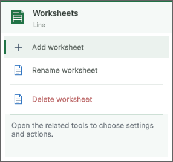

## 변경 내용

### 적용 내용

시트 입력을 그리드·스크롤뷰보다 먼저 처리합니다. ContextClick·오른쪽 MouseDown·더블클릭을 처리하고 클릭한 시트 이름을 콜백에 고정합니다. 메뉴에는 삽입·이름 변경·삭제가 표시되며 삭제는 기존 확인 창과 마지막 시트·필수 Summary 보호를 유지합니다. 플러스 버튼도 같은 시트 작업 경로로 통일했습니다.

## 검증

제품3어셈블리 컴파일 통과. 실제 실행 MVID11627b4f-709e-44ca-96ea-709289ba1200. 메뉴 키 선택으로 이름 변경 도구가 열렸습니다. 편집 콜백으로 Line→Line QA, Sheet QA 삽입·삭제 후 저장·재열기에서 Line QA와8시트·Dirty false를 확인했습니다. 스크롤 후 FormatObjects 우클릭 메뉴와 Scatter 더블클릭 도구 표시를 확인했습니다. 초기 타이밍 실패·비활성 창 팝업 닫힘·컴파일 초기 실패는 증거에 보존했습니다. 이전31TC는 이전 회차 결과이며 이번 재실행으로 표시하지 않습니다.

### TC-SUB-01 · 배포 범위와 무결성

분류: 2.0.2 제출·공개 API 회귀 · 결과: **통과**

| 항목 | 내용 |
| --- | --- |
| 실행 절차 | Unity 네이티브 패키지의 파일·메타·GUID·직렬화 참조를 동결 원본과 비교합니다. |
| 기대값 | 의도한 고객용 파일만 포함되고 오류가 없어야 합니다. |
| 실제 결과 | 최신1577파일·8037참조, 오류0. SHA-256 59f20fdfe82a786ee9ff5b02c7abfe472f913f474d926da4bf6dc198c4d01bbe |
| 원본 출처·버전 | [최신 아카이브](../assets/project-icon-loop-20261101/ArchiveVerification.json) |

화면 근거: Excel 레이아웃 대조가 아닌 제출·공개 API 회귀 검사입니다. 원본 이미지가 없는 항목은 실행 JSON으로 확인하며, 현재 화면은 해당 기능의 실제 캡처만 제공합니다.

### TC-SUB-02 · 내부 API 교체와 컴파일

분류: 2.0.2 제출·공개 API 회귀 · 결과: **통과**

| 항목 | 내용 |
| --- | --- |
| 실행 절차 | 고객용 C#347개를 검사하고 세 어셈블리를 컴파일·참조 검사합니다. |
| 기대값 | 명시적 Unity 내부 API 패턴이 제거되고 컴파일이 성공해야 합니다. |
| 실제 결과 | 명시적 패턴0, 세 어셈블리 컴파일 성공. 남은 자사 데이터·공개 API 리플렉션 검토. |
| 원본 출처·버전 | [검증 JSON](../assets/submission-202-final-20261101/InternalApiCompliance.json) |

화면 근거: Excel 레이아웃 대조가 아닌 제출·공개 API 회귀 검사입니다. 원본 이미지가 없는 항목은 실행 JSON으로 확인하며, 현재 화면은 해당 기능의 실제 캡처만 제공합니다.

### TC-SUB-03 · 씬 로드와 누락 스크립트

분류: 2.0.2 제출·공개 API 회귀 · 결과: **통과**

| 항목 | 내용 |
| --- | --- |
| 실행 절차 | 25개 샘플 씬을 실제 Unity에서 열고 각 하위 오브젝트의 스크립트를 확인합니다. |
| 기대값 | 모든 씬이 열리고 누락 스크립트가 없어야 합니다. |
| 실제 결과 | 25개 씬 로드·누락 스크립트 검사 통과. |
| 원본 출처·버전 | [검증 JSON](../assets/submission-202-final-20261101/NativeSubmissionQA.json) |

화면 근거: Excel 레이아웃 대조가 아닌 제출·공개 API 회귀 검사입니다. 원본 이미지가 없는 항목은 실행 JSON으로 확인하며, 현재 화면은 해당 기능의 실제 캡처만 제공합니다.

### TC-SUB-04 · 생성 바이너리 데이터

분류: 2.0.2 제출·공개 API 회귀 · 결과: **통과**

| 항목 | 내용 |
| --- | --- |
| 실행 절차 | 24개 생성 테이블의 Load(byte[])로 실제 바이너리를 읽습니다. |
| 기대값 | 읽기 오류가 없어야 합니다. |
| 실제 결과 | 24개 테이블 역직렬화 통과. |
| 원본 출처·버전 | [검증 JSON](../assets/submission-202-final-20261101/NativeSubmissionQA.json) |

화면 근거: Excel 레이아웃 대조가 아닌 제출·공개 API 회귀 검사입니다. 원본 이미지가 없는 항목은 실행 JSON으로 확인하며, 현재 화면은 해당 기능의 실제 캡처만 제공합니다.

### TC-SUB-05 · 편집·Undo·Redo·저장

분류: 2.0.2 제출·공개 API 회귀 · 결과: **통과**

| 항목 | 내용 |
| --- | --- |
| 실행 절차 | 복사본 셀을 수정하고 Undo/Redo·저장·재열기를 실행합니다. |
| 기대값 | 수정과 Undo 상태가 일치하고 저장값이 다시 열려야 합니다. |
| 실제 결과 | 실제 Unity 검사 통과. |
| 원본 출처·버전 | [검증 JSON](../assets/submission-202-final-20261101/NativeSubmissionQA.json) |

화면 근거: Excel 레이아웃 대조가 아닌 제출·공개 API 회귀 검사입니다. 원본 이미지가 없는 항목은 실행 JSON으로 확인하며, 현재 화면은 해당 기능의 실제 캡처만 제공합니다.

### TC-SUB-06 · 미저장 값의 최소화·클릭 복원

분류: 2.0.2 제출·공개 API 회귀 · 결과: **통과**

| 항목 | 내용 |
| --- | --- |
| 실행 절차 | 수정한 문서를 최소화한 뒤 실제 선반 클릭으로 복원하고 Undo합니다. |
| 기대값 | 값·Dirty·Undo가 보존되어야 합니다. |
| 실제 결과 | PUBLIC API DRAFT 유지, 복원 후 Undo로 깨끗한 상태 복구. |
| 원본 출처·버전 | [검증 JSON](../assets/submission-202-final-20261101/PublicApiNativeQA.json) |

**수정 후 실제 실행**

화면 근거: Excel 레이아웃 대조가 아닌 제출·공개 API 회귀 검사입니다. 원본 이미지가 없는 항목은 실행 JSON으로 확인하며, 현재 화면은 해당 기능의 실제 캡처만 제공합니다.

### TC-SUB-07 · 최소화·복원 반복

분류: 2.0.2 제출·공개 API 회귀 · 결과: **통과**

| 항목 | 내용 |
| --- | --- |
| 실행 절차 | 깨끗한 문서의 최소화와 복원을10회 반복합니다. |
| 기대값 | 잘못된 Dirty나 값 변화가 없어야 합니다. |
| 실제 결과 | 10회 반복 통과. |
| 원본 출처·버전 | [검증 JSON](../assets/submission-202-final-20261101/PublicApiNativeQA.json) |

화면 근거: Excel 레이아웃 대조가 아닌 제출·공개 API 회귀 검사입니다. 원본 이미지가 없는 항목은 실행 JSON으로 확인하며, 현재 화면은 해당 기능의 실제 캡처만 제공합니다.

### TC-SUB-08 · 호버 카드와 포커스

분류: 2.0.2 제출·공개 API 회귀 · 결과: **통과**

| 항목 | 내용 |
| --- | --- |
| 실행 절차 | 선반 위에 실제 포인터를 두고 미리보기·포커스를 확인합니다. |
| 기대값 | 카드가 보이고 원래 포커스를 빼앗지 않아야 합니다. |
| 실제 결과 | 실제 카드 표시와 원래 native foreground 유지 확인. |
| 원본 출처·버전 | [검증 JSON](../assets/submission-202-final-20261101/PublicApiNativeQA.json) |

**수정 후 실제 실행**

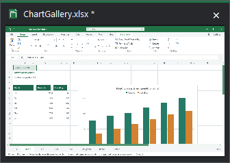

화면 근거: Excel 레이아웃 대조가 아닌 제출·공개 API 회귀 검사입니다. 원본 이미지가 없는 항목은 실행 JSON으로 확인하며, 현재 화면은 해당 기능의 실제 캡처만 제공합니다.

### TC-SUB-09 · 최대화·원래 크기 복원

분류: 2.0.2 제출·공개 API 회귀 · 결과: **통과**

| 항목 | 내용 |
| --- | --- |
| 실행 절차 | 실제 창을 최대화하고 다시 복원합니다. |
| 기대값 | 확대와 원래 창 크기 복원이 일치해야 합니다. |
| 실제 결과 | 1920×1032 확대 후1350×800 원래 크기 복원. |
| 원본 출처·버전 | [검증 JSON](../assets/submission-202-final-20261101/PublicApiNativeQA.json) |

화면 근거: Excel 레이아웃 대조가 아닌 제출·공개 API 회귀 검사입니다. 원본 이미지가 없는 항목은 실행 JSON으로 확인하며, 현재 화면은 해당 기능의 실제 캡처만 제공합니다.

### TC-SUB-10 · AI PNG 출력

분류: 2.0.2 제출·공개 API 회귀 · 결과: **통과**

| 항목 | 내용 |
| --- | --- |
| 실행 절차 | 실제 워크북 범위를 공개 렌더링과 native 캡처로 출력합니다. |
| 기대값 | 실제 표가 나오고 포커스·임시 창이 남지 않아야 합니다. |
| 실제 결과 | 400×277 실제 PNG, foreground 동일, 임시 창 제거. |
| 원본 출처·버전 | [검증 JSON](../assets/submission-202-final-20261101/PublicApiNativeQA.json) |

**수정 후 실제 실행**

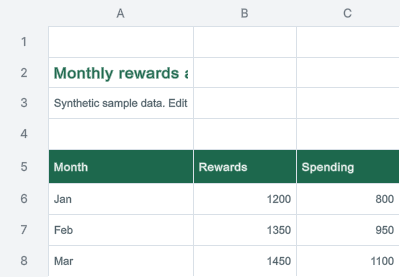

화면 근거: Excel 레이아웃 대조가 아닌 제출·공개 API 회귀 검사입니다. 원본 이미지가 없는 항목은 실행 JSON으로 확인하며, 현재 화면은 해당 기능의 실제 캡처만 제공합니다.

### TC-SUB-11 · 스포이트 선택·취소

분류: 2.0.2 제출·공개 API 회귀 · 결과: **통과**

| 항목 | 내용 |
| --- | --- |
| 실행 절차 | 실제 빨간 영역을 선택한 뒤 다시 선택을 시작해 Esc로 취소합니다. |
| 기대값 | 색상·투명도·변경 이벤트와 취소가 정확해야 합니다. |
| 실제 결과 | 빨강 선택·알파0.6 유지·변경1회. Esc 추가 변경0회. |
| 원본 출처·버전 | [검증 JSON](../assets/submission-202-final-20261101/PublicApiNativeQA.json) |

화면 근거: Excel 레이아웃 대조가 아닌 제출·공개 API 회귀 검사입니다. 원본 이미지가 없는 항목은 실행 JSON으로 확인하며, 현재 화면은 해당 기능의 실제 캡처만 제공합니다.

### TC-SUB-12 · 설정 창 표시

분류: 2.0.2 제출·공개 API 회귀 · 결과: **통과**

| 항목 | 내용 |
| --- | --- |
| 실행 절차 | 교체한 공개 API로 설정 창을 열고 실제 화면을 확인합니다. |
| 기대값 | 제목·설정 항목과 밝은 표면이 표시되어야 합니다. |
| 실제 결과 | 실제 Workspace Settings 창 렌더링 확인. 첫 클릭·Esc 동작 전체를 통과했다고 확대 해석하지 않았습니다. |
| 원본 출처·버전 | [검증 JSON](../assets/submission-202-final-20261101/PublicApiNativeQA.json) |

**수정 후 실제 실행**

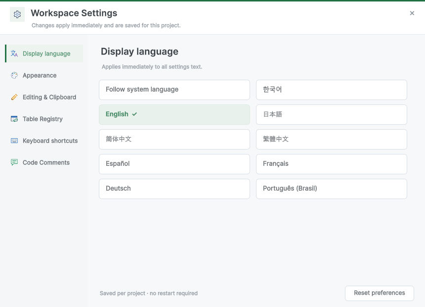

화면 근거: Excel 레이아웃 대조가 아닌 제출·공개 API 회귀 검사입니다. 원본 이미지가 없는 항목은 실행 JSON으로 확인하며, 현재 화면은 해당 기능의 실제 캡처만 제공합니다.

### TC-SUB-13 · 공식 Asset Store 검사

분류: 2.0.2 제출·공개 API 회귀 · 결과: **통과**

| 항목 | 내용 |
| --- | --- |
| 실행 절차 | 원본 Asset Store Tools12.0.0 검사를 고객용 두 경로에 실행합니다. |
| 기대값 | 컴파일 오류·검사 실패0, 남은 경고를 공개해야 합니다. |
| 실제 결과 | 31통과·3경고·0실패, RanToCompletion. |
| 원본 출처·버전 | [검증 JSON](../assets/submission-202-final-20261101/OfficialValidator.json) |

화면 근거: Excel 레이아웃 대조가 아닌 제출·공개 API 회귀 검사입니다. 원본 이미지가 없는 항목은 실행 JSON으로 확인하며, 현재 화면은 해당 기능의 실제 캡처만 제공합니다.

### TC-SUB-14 · 허브24개 선택

분류: 2.0.2 제출·공개 API 회귀 · 결과: **통과**

| 항목 | 내용 |
| --- | --- |
| 실행 절차 | 실제 Unity Play에서 각 카드 중심을 레이캐스트하고 Button.onClick을 실행해 씬을 확인합니다. |
| 기대값 | 카드와 연결된24개 씬이 각각 일치해야 합니다. |
| 실제 결과 | 24개 카드 모두 hit·연결된 씬 일치. 좁은640×480 초기 시도는 별도 실패 기록으로 보존. |
| 원본 출처·버전 | [검증 JSON](../assets/submission-202-final-20261101/SampleHubQA.json) |

**수정 후 실제 실행**

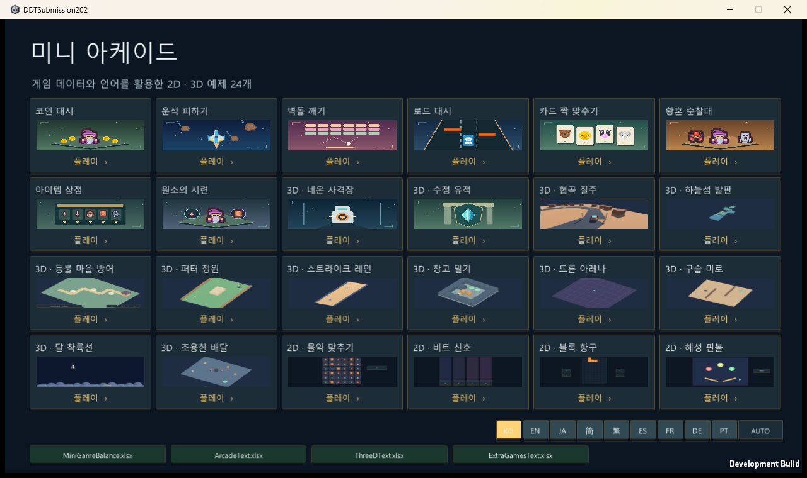

화면 근거: Excel 레이아웃 대조가 아닌 제출·공개 API 회귀 검사입니다. 원본 이미지가 없는 항목은 실행 JSON으로 확인하며, 현재 화면은 해당 기능의 실제 캡처만 제공합니다.

### TC-SUB-15 · Windows 실제 클릭

분류: 2.0.2 제출·공개 API 회귀 · 결과: **통과**

| 항목 | 내용 |
| --- | --- |
| 실행 절차 | 실행 중 플레이어의 클라이언트·런타임 좌표로 실제 클릭하고 선택 대상을 계측합니다. |
| 기대값 | HubCard0가 선택되어 Coin Dash가 열려야 합니다. |
| 실제 결과 | 런타임 mouse(140,571), hit=HubCard0, 이후 Coin Dash 확인. |
| 원본 출처·버전 | [검증 JSON](../assets/submission-202-final-20261101/NativePointerQA.json) |

**수정 후 실제 실행**

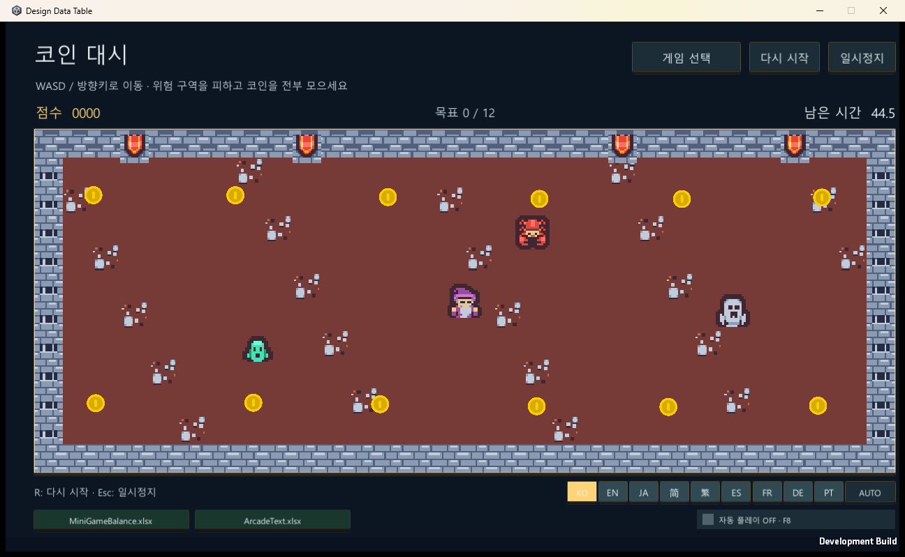

화면 근거: Excel 레이아웃 대조가 아닌 제출·공개 API 회귀 검사입니다. 원본 이미지가 없는 항목은 실행 JSON으로 확인하며, 현재 화면은 해당 기능의 실제 캡처만 제공합니다.

### TC-SUB-16 · Windows 플레이어 빌드·표시

분류: 2.0.2 제출·공개 API 회귀 · 결과: **통과**

| 항목 | 내용 |
| --- | --- |
| 실행 절차 | 현재 동결본을 Windows로 빌드하고 게임 화면을 캡처합니다. |
| 기대값 | 빌드가 성공하고 실제 게임 UI가 표시되어야 합니다. |
| 실제 결과 | 네이티브 빌드 성공, Warehouse·Pinball 실제 화면 확인. |
| 원본 출처·버전 | [검증 JSON](../assets/submission-202-final-20261101/NativeSubmissionQA.json) |

**수정 후 실제 실행**

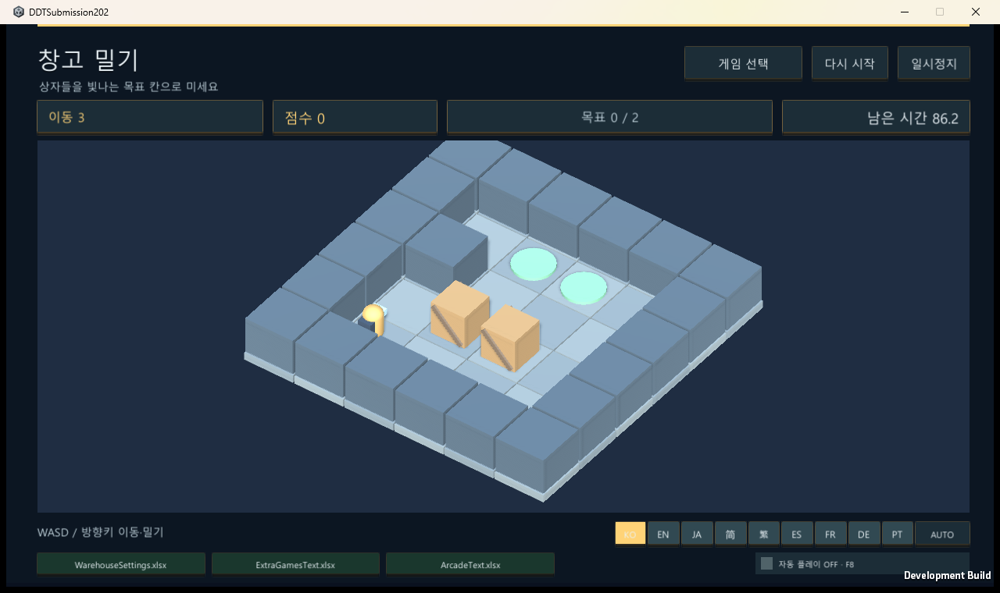

화면 근거: Excel 레이아웃 대조가 아닌 제출·공개 API 회귀 검사입니다. 원본 이미지가 없는 항목은 실행 JSON으로 확인하며, 현재 화면은 해당 기능의 실제 캡처만 제공합니다.

### TC-SUB-17 · Affinity 키 이미지와 원본

분류: 2.0.2 제출·공개 API 회귀 · 결과: **통과**

| 항목 | 내용 |
| --- | --- |
| 실행 절차 | 실제 Affinity에서 커버·카드·소셜을 제작·저장·PNG 출력하고 크기와 실제 이미지를 확인합니다. |
| 기대값 | 예전 UI가 없어야 하며 편집 원본과 지정 크기 PNG가 있어야 합니다. |
| 실제 결과 | Cover1950×1300, Card420×280, Social1200×630, 원본3개 저장. 아이콘160×160은 기존 것을 재사용. |
| 원본 출처·버전 | [검증 JSON](../assets/submission-202-final-20261101/SubmissionHandoff.json) |

**수정 후 실제 실행**

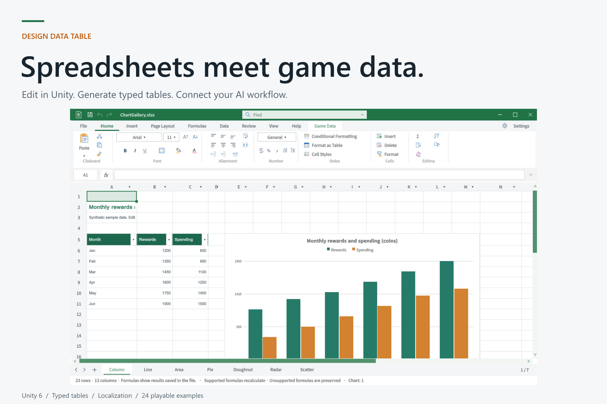

화면 근거: Excel 레이아웃 대조가 아닌 제출·공개 API 회귀 검사입니다. 원본 이미지가 없는 항목은 실행 JSON으로 확인하며, 현재 화면은 해당 기능의 실제 캡처만 제공합니다.

### TC-SUB-18 · 제출 파일 정리

분류: 2.0.2 제출·공개 API 회귀 · 결과: **통과**

| 항목 | 내용 |
| --- | --- |
| 실행 절차 | Submission 폴더의 원고·미디어·원본·검증·해시를 확인합니다. |
| 기대값 | 한 폴더에서 제출 파일과 지원 범위를 파악할 수 있어야 합니다. |
| 실제 결과 | 파일30개·SHA256SUMS·검사 메모·간단한 스토어 원고를 정리. |
| 원본 출처·버전 | [검증 JSON](../assets/submission-202-final-20261101/SubmissionHandoff.json) |

화면 근거: Excel 레이아웃 대조가 아닌 제출·공개 API 회귀 검사입니다. 원본 이미지가 없는 항목은 실행 JSON으로 확인하며, 현재 화면은 해당 기능의 실제 캡처만 제공합니다.

### TC-SUB-19 · 중복 메뉴 등록

분류: 추가 시작 오류 · 결과: **통과**

| 항목 | 내용 |
| --- | --- |
| 실행 절차 | 같은 메뉴 경로의 MenuItem 선언과 실제 Unity 재시작 로그를 검사합니다. |
| 기대값 | 메뉴 선언1개, 중복 등록 오류0. |
| 실제 결과 | 같은 메서드의 중복 선언 제거, 최종 Unity 검사에서 중복 메뉴 오류 없음. |
| 원본 출처·버전 | [검증 JSON](../assets/submission-202-final-20261101/StartupErrorQA.json) |

화면 근거: 코드·운영체제 파일 잠금 검사로, 원본 Excel 이미지 대조 대상이 아닙니다.

### TC-SUB-20 · 매핑된 생성 소스 저장

분류: 추가 시작 오류 · 결과: **통과**

| 항목 | 내용 |
| --- | --- |
| 실행 절차 | 현재 저장 함수로 읽기 전용 메모리 매핑된 소스를 갱신합니다. |
| 기대값 | 교체 성공·기존 매핑 보존·임시 파일0. |
| 실제 결과 | 직접 덮어쓰기 실패를 재현했고 교체 저장 성공, 기존 매핑 첫 문자 o 유지, 임시 파일0. |
| 원본 출처·버전 | [검증 JSON](../assets/submission-202-final-20261101/GeneratedSourceLockQA.json) |

화면 근거: 코드·운영체제 파일 잠금 검사로, 원본 Excel 이미지 대조 대상이 아닙니다.

### TC-SUB-21 · 시작 레이아웃·최소화 복원

분류: 추가 오류·서식 실제 QA · 결과: **부분 확인**

| 항목 | 내용 |
| --- | --- |
| 실행 절차 | 정상 종료·재시작 로그를 확인하고 실제 문서를 최소화·복원합니다. |
| 기대값 | 잘못된 서랍 경고 없이 실제 호스트가 생성되고 복원되어야 합니다. |
| 실제 결과 | 이전 회차에서 최소화·복원과 시작 로그를 확인했으나 새 폴더 캡처에 ChartGallery 레이아웃 저장 경고가 남아 전체 복원은 추가 확인이 필요합니다. |
| 원본 출처·버전 | [실행 근거](../assets/submission-202-final-20261101/StartupErrorQA.json) |

화면 근거: Excel 원본 실행·촬영은 COM 클래스 미등록으로 수행하지 못했습니다. 현재 Unity 실행과 공개 GUI 이벤트·저장 결과를 대조한 검사이며 전체 Excel 화면 동일성 검사로 보고하지 않습니다.

### TC-SUB-22 · 표 스타일 색상 반영

분류: 추가 오류·서식 실제 QA · 결과: **통과**

| 항목 | 내용 |
| --- | --- |
| 실행 절차 | 직접 서식으로 가려진 표에 정리 적용 버튼의 GUI 이벤트를 보냅니다. |
| 기대값 | 새 헤더·줄무늬 색상이 실제 표시되어야 합니다. |
| 실제 결과 | 기존FF1D684D에서FFE97132 주황으로 변경, 저장·재열기 유지. |
| 원본 출처·버전 | [실행 근거](../assets/submission-202-final-20261101/FormatTabsQA.json) |

**수정 후 실제 실행**

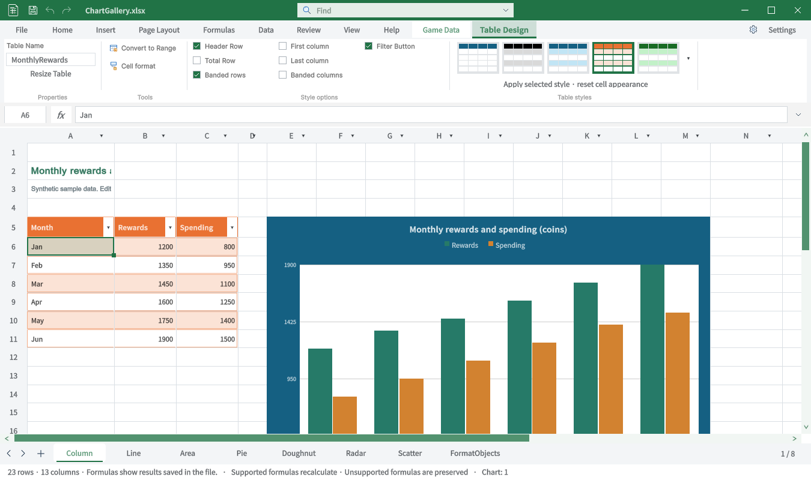

화면 근거: Excel 원본 실행·촬영은 COM 클래스 미등록으로 수행하지 못했습니다. 현재 Unity 실행과 공개 GUI 이벤트·저장 결과를 대조한 검사이며 전체 Excel 화면 동일성 검사로 보고하지 않습니다.

### TC-SUB-23 · 표 스타일 Undo·Redo

분류: 추가 오류·서식 실제 QA · 결과: **통과**

| 항목 | 내용 |
| --- | --- |
| 실행 절차 | 정리 적용 전후 스냅샷과 Undo/Redo를 비교합니다. |
| 기대값 | 한 단계 Undo와 Redo로 정확한 상태가 복원되어야 합니다. |
| 실제 결과 | 최종 실제 GUI 검사와 매트릭스의 세션 스냅샷 일치. 초기 실패도 근거에 보존. |
| 원본 출처·버전 | [실행 근거](../assets/submission-202-final-20261101/FormatTabsQA.json) |

화면 근거: Excel 원본 실행·촬영은 COM 클래스 미등록으로 수행하지 못했습니다. 현재 Unity 실행과 공개 GUI 이벤트·저장 결과를 대조한 검사이며 전체 Excel 화면 동일성 검사로 보고하지 않습니다.

### TC-SUB-24 · 전체 프리셋 저장 회귀

분류: 추가 오류·서식 실제 QA · 결과: **통과**

| 항목 | 내용 |
| --- | --- |
| 실행 절차 | Office60·사용자6·차트48·도형32·그림6종을 적용·저장·재열기합니다. |
| 기대값 | 스타일·색상·값·수식·Undo 상태가 기대값과 일치해야 합니다. |
| 실제 결과 | 227조건 통과, 실패0. |
| 원본 출처·버전 | [실행 근거](../assets/submission-202-final-20261101/FormatTabsQA.json) |

화면 근거: Excel 원본 실행·촬영은 COM 클래스 미등록으로 수행하지 못했습니다. 현재 Unity 실행과 공개 GUI 이벤트·저장 결과를 대조한 검사이며 전체 Excel 화면 동일성 검사로 보고하지 않습니다.

### TC-SUB-25 · 차트·도형·그림 실제 서식

분류: 추가 오류·서식 실제 QA · 결과: **통과**

| 항목 | 내용 |
| --- | --- |
| 실행 절차 | 각 전용 탭의 프리셋에 실제 Unity GUI 마우스 이벤트를 보냅니다. |
| 기대값 | 선택 속성과 실제 화면이 변하고 저장되어야 합니다. |
| 실제 결과 | 차트스타일6, 차트프레임156082, 도형채우기156082, 그림윤곽4472C4·3px 확인. |
| 원본 출처·버전 | [실행 근거](../assets/submission-202-final-20261101/FormatTabsQA.json) |

**수정 후 실제 실행**

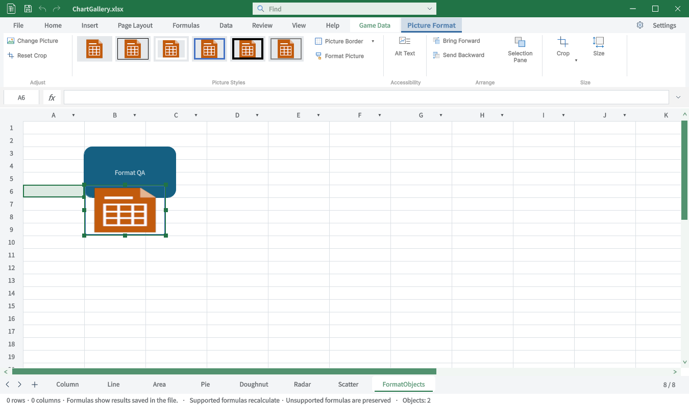

화면 근거: Excel 원본 실행·촬영은 COM 클래스 미등록으로 수행하지 못했습니다. 현재 Unity 실행과 공개 GUI 이벤트·저장 결과를 대조한 검사이며 전체 Excel 화면 동일성 검사로 보고하지 않습니다.

### TC-SUB-26 · 도형 그룹 버튼 연결

분류: 추가 오류·서식 실제 QA · 결과: **통과**

| 항목 | 내용 |
| --- | --- |
| 실행 절차 | 도형 서식의 그룹 버튼을 클릭합니다. |
| 기대값 | 기존 개체·그룹 선택 창을 열어야 합니다. |
| 실제 결과 | 실제 Objects 창700×680 표시. 모든 그룹 변환의 완료를 뜻하지 않음. |
| 원본 출처·버전 | [실행 근거](../assets/submission-202-final-20261101/FormatTabsQA.json) |

**수정 후 실제 실행**

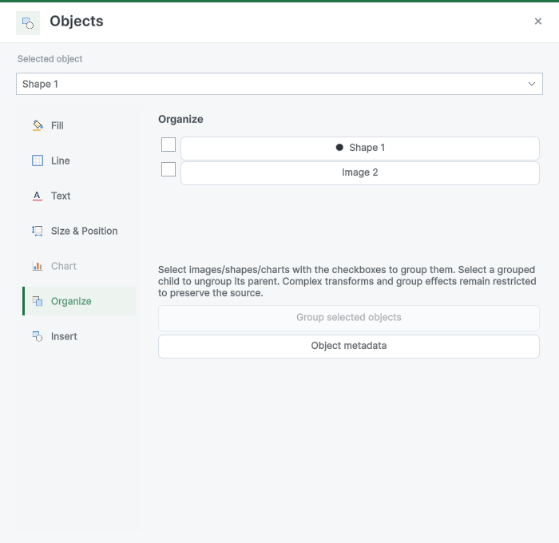

화면 근거: Excel 원본 실행·촬영은 COM 클래스 미등록으로 수행하지 못했습니다. 현재 Unity 실행과 공개 GUI 이벤트·저장 결과를 대조한 검사이며 전체 Excel 화면 동일성 검사로 보고하지 않습니다.

### TC-SUB-27 · 가이드 이미지 최신성

분류: 추가 오류·서식 실제 QA · 결과: **실패**

| 항목 | 내용 |
| --- | --- |
| 실행 절차 | 9개 언어 가이드를 재생성하고 기존 이미지의 실제 소스 해시를 검사합니다. |
| 기대값 | 현재 이미지의 소스와 재촬영 상태가 확인되어야 합니다. |
| 실제 결과 | 468건이 남아 미통과. 재촬영한4개만 실제 근거로 교체. |
| 원본 출처·버전 | [실행 근거](../assets/submission-202-final-20261101/GuideVerification.json) |

화면 근거: Excel 원본 실행·촬영은 COM 클래스 미등록으로 수행하지 못했습니다. 현재 Unity 실행과 공개 GUI 이벤트·저장 결과를 대조한 검사이며 전체 Excel 화면 동일성 검사로 보고하지 않습니다.

### TC-SUB-28 · 아이콘2000회 표시

분류: Project 폴더 재임포트 · 결과: **통과**

| 항목 | 내용 |
| --- | --- |
| 실행 절차 | 캐시를 비우고 실제 아이콘 경로를1000회씩 두 번 호출하며 임포트를 계측합니다. |
| 기대값 | 표시·이후 대기로 임포트가 발생하지 않아야 합니다. |
| 실제 결과 | 첫 표시0·마지막 표시/대기0, 새 임포트 예약 없음. |
| 원본 출처·버전 | [실행 계측](../assets/project-icon-loop-20261101/ProjectIconLoopQA.json) |

**수정 전**

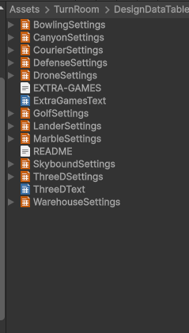

**수정 후 실제 실행**

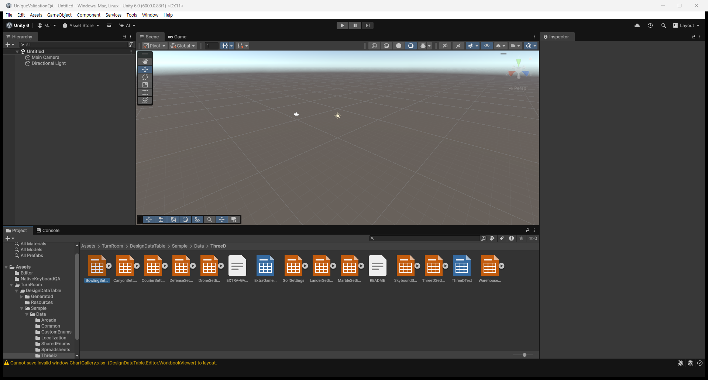

화면 근거: Unity Project 폴더의 동작 검사입니다. 실제 화면과 임포트 관찰자로 확인했으며 사진만으로 반복 중단을 판단하지 않았습니다.

### TC-SUB-29 · 캐시 초기화·동일색

분류: Project 폴더 재임포트 · 결과: **통과**

| 항목 | 내용 |
| --- | --- |
| 실행 절차 | 메모리 캐시를 비우고 명시적 갱신 콜백을 처리합니다. |
| 기대값 | 저장된 색상과 같으면 재임포트하지 않아야 합니다. |
| 실제 결과 | 재임포트0, 저장된 네이티브 아이콘 상태 재사용. |
| 원본 출처·버전 | [실행 계측](../assets/project-icon-loop-20261101/ProjectIconLoopQA.json) |

화면 근거: Unity Project 폴더의 동작 검사입니다. 실제 화면과 임포트 관찰자로 확인했으며 사진만으로 반복 중단을 판단하지 않았습니다.

### TC-SUB-30 · 색상 변경·복원 유한성

분류: Project 폴더 재임포트 · 결과: **통과**

| 항목 | 내용 |
| --- | --- |
| 실행 절차 | 4종 색상을 변경·복원하고 실제 결과를 비교합니다. |
| 기대값 | 34개 파일당 최대1회씩 갱신하고 요청한 색상이어야 합니다. |
| 실제 결과 | 변경34회·복원34회, 모든 색상 일치·XLSX 원본 해시 동일. |
| 원본 출처·버전 | [실행 계측](../assets/project-icon-loop-20261101/ProjectIconLoopQA.json) |

화면 근거: Unity Project 폴더의 동작 검사입니다. 실제 화면과 임포트 관찰자로 확인했으며 사진만으로 반복 중단을 판단하지 않았습니다.

### TC-SUB-31 · 실제 폴더·에디터 로그

분류: Project 폴더 재임포트 · 결과: **통과**

| 항목 | 내용 |
| --- | --- |
| 실행 절차 | 동일 ThreeD 폴더를 열고 실행 중 에디터 로그를 관찰합니다. |
| 기대값 | 폴더가 표시되고 반복 임포트가 멈춰야 합니다. |
| 실제 결과 | 실제 폴더 표시. 수정 후 측정한5분의 XLSX 임포트0회. |
| 원본 출처·버전 | [실행 계측](../assets/project-icon-loop-20261101/ProjectIconLoopQA.json) |

**수정 전**

**수정 후 실제 실행**

화면 근거: Unity Project 폴더의 동작 검사입니다. 실제 화면과 임포트 관찰자로 확인했으며 사진만으로 반복 중단을 판단하지 않았습니다.

### TC-SUB-32 · 우클릭·메뉴 선택

분류: 시트 메뉴 · 결과: **통과**

| 항목 | 내용 |
| --- | --- |
| 실행 절차 | 전용 실제 Unity6000.0.83f1 검사 프로젝트에서 해당 이벤트와 작업을 실행합니다. |
| 기대값 | 대상 시트에 메뉴·작업이 적용되고 저장 결과가 유지됩니다. |
| 실제 결과 | Line 시트 메뉴 표시·DownArrow/Return으로 이름 변경 도구 표시. |
| 원본 출처·버전 | [실행 기록](../assets/sheet-context-20261101/context-r8.json) |

**수정 후 실제 실행**

화면 근거: Excel 원본 대조가 아닌 사용자 제보 기능 검사입니다. 물리 마우스 활성화 후 공개 SendEvent를 사용했으며 데이터 변경은 편집 콜백을 직접 호출했습니다.

### TC-SUB-33 · 시트 편집·저장 재열기

분류: 시트 메뉴 · 결과: **통과**

| 항목 | 내용 |
| --- | --- |
| 실행 절차 | 전용 실제 Unity6000.0.83f1 검사 프로젝트에서 해당 이벤트와 작업을 실행합니다. |
| 기대값 | 대상 시트에 메뉴·작업이 적용되고 저장 결과가 유지됩니다. |
| 실제 결과 | 편집 콜백으로 이름 변경·삽입·삭제, 저장·재열기 후8시트·이름 유지·Dirty false. |
| 원본 출처·버전 | [실행 기록](../assets/sheet-context-20261101/reopen-r1.json) |

**수정 후 실제 실행**

화면 근거: Excel 원본 대조가 아닌 사용자 제보 기능 검사입니다. 물리 마우스 활성화 후 공개 SendEvent를 사용했으며 데이터 변경은 편집 콜백을 직접 호출했습니다.

### TC-SUB-34 · 스크롤·더블클릭

분류: 시트 메뉴 · 결과: **통과**

| 항목 | 내용 |
| --- | --- |
| 실행 절차 | 전용 실제 Unity6000.0.83f1 검사 프로젝트에서 해당 이벤트와 작업을 실행합니다. |
| 기대값 | 대상 시트에 메뉴·작업이 적용되고 저장 결과가 유지됩니다. |
| 실제 결과 | 스크롤된 FormatObjects 우클릭 메뉴와 Scatter 더블클릭 이름 변경 도구 표시. |
| 원본 출처·버전 | [실행 기록](../assets/sheet-context-20261101/double-visible-r1.json) |

**수정 후 실제 실행**

화면 근거: Excel 원본 대조가 아닌 사용자 제보 기능 검사입니다. 물리 마우스 활성화 후 공개 SendEvent를 사용했으며 데이터 변경은 편집 콜백을 직접 호출했습니다.

## 남은 사항

기존 전체 문서·도형 정렬·창 복원 잔여는 유지합니다. 시트 복제·이동·숨김은 이번 메뉴에 추가하지 않았습니다. 삭제 확인 창·모든 보호 조합의 물리 클릭은 이번 회차 미실행입니다. 기존 배포 패키지는 이번 소스 변경으로 재내보내지 않았습니다. 교훈 검토: 실제 메뉴 표시와 데이터 콜백 검증을 구분하는 기존 전역 규칙을 적용했으며 새 전역 규칙은 추가하지 않았습니다.

## 작업 시간

- 제안 시간: 2026-11-01 17:18:47 KST 시작,10–15분.
- 실제로 완료된 시간: 구현·실행 검증 2026-11-01 17:32:14 KST. 공개 배포 확인 시각은 최종 채팅에 기록합니다.
- XERJ: 사용 — 서버를 복구해 HandleSheetTabContext를 검색했으나 현재 구현이 누락돼 rg와 현재 소스로 대조했습니다.
