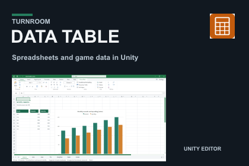
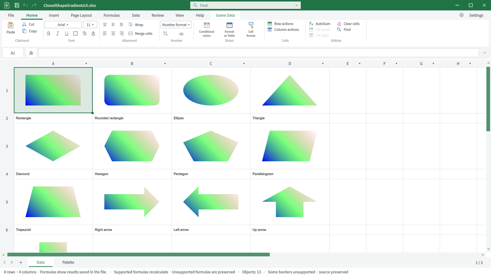
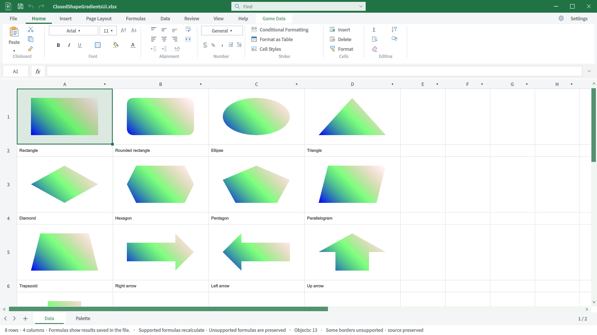

## 작업 결과

Design Data Table 2.0.2의 구현·최종 패키지 설치·미디어 검증을 마쳤고 판매 초안 저장값을 다시 열어 확인했습니다. 최종 제출은 하지 않았습니다.

## 변경 내용

### 적용 내용

신규 설치의 이전 폴더 경로 초기화를 수정하고 기존 설정 파일을 보존했습니다. Find 창의 언어를 추가했으며, 9개 언어 가이드의 실제 화면 57장을 갱신·검증했습니다.

[신규 설치 초기화 오류 수정 근거](2026-11-02-bug-20261102000558023-v1.0.0.html)

## 검증

실제 XLSX/CSV 생성·수정·저장·재열기·덮어쓰기 방지 등 20개 검사 통과. 새 프로젝트의 패키지 설치와 샘플 제거 후 본체 컴파일 통과. 초기 설치 오류 재발 0건, 기존 registry 파일 보존 확인.

[실제 실행 영상 · 1920×1080 / 24 FPS / 60초](../assets/release-20261102/video.mp4) · 1,440프레임과 전체 디코딩, 자막 가독성을 검증했습니다.

Affinity 3.3.1.4940 커버/카드 8개는 저장→닫기→재열기 후 렌더 픽셀이 같았습니다. 애니메이션 GIF의 실제 내보내기 경로는 검증하지 못해 정지 전후 화면을 제공합니다.

[소스 및 최종 산출물 커밋](https://github.com/MDJ0126/TurnRoom/commit/11f6b815)

판매 초안 재열기: 버전 2.0.2, 마케팅 이미지3개, 영상2개, 실제 화면14개. 제출 버튼 활성화까지 확인했으며 누르지 않았습니다. 브라우저에서도 실제60초 전체 재생이 오류 없이 끝났습니다.

## 남은 사항

일부 스프레드시트 호환 기능·수식·개체 표현의 제한은 제품 가이드 범위를 따릅니다. 과거 문서와 다른 데이터를 사용했으므로 화면 전체의 픽셀 동일성은 주장하지 않습니다.

최종 제출·스토어 심사는 수행하지 않습니다. 판매 가격은 기존/포털 기본값을 유지하며 제출 전에 소유자가 확정해야 합니다. 포털 파일 수가 0으로 표시된 범위는 서버 집계 완료로 간주하지 않습니다.

포털 관찰값: Nov 02, 2026 00:00 UTC, 0 files, 62.9 MB. 업로드 수신 성공·실제 설치 검증과 서버 파일 집계 완료를 구분합니다.

교훈: 배포 파일/해시 고정 후 설치·업로드 규칙을 전역 지침에 추가·동기화·푸시했습니다(8eb390e). 일반화하지 않은 제품별 오류·과거 실패는 별도 근거에 보존했습니다.

## 작업 시간

- 제안 시간: 최대10시간. 2026-11-01 23:52:12 KST 시작, 2026-11-02 09:52:12 KST 마감.
- 실제로 완료된 시간: 4개 제품 공동 작업 경과 9시간 36분 4초. 제품·패키지·미디어·판매 초안 확인 기준 시각 2026-11-02 09:28:16 KST. 제품별 독립 소요 시간은 분리 기록하지 않았습니다. 공개 보고서 배포 확인은 이후 전체 종료 기록으로 구분합니다.
- XERJ: 사용 — XERJ로 공통 Editor·Workbook 관련 심볼을 검색하고 현재 소스와 대조했습니다. Runtime·신제품 및 SDK는 인덱스 범위 밖이어서 rg를 병행했습니다.
