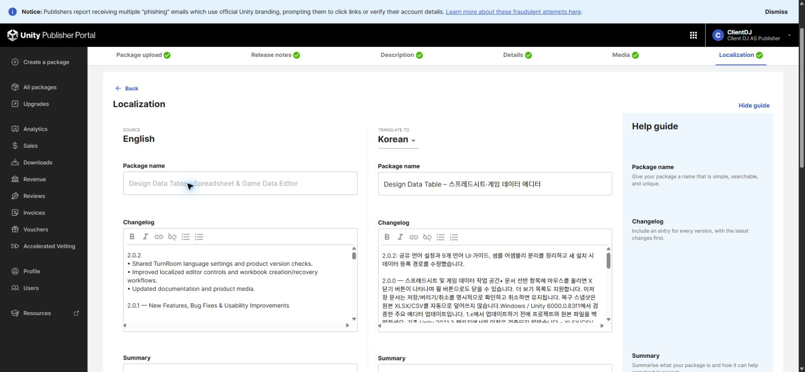
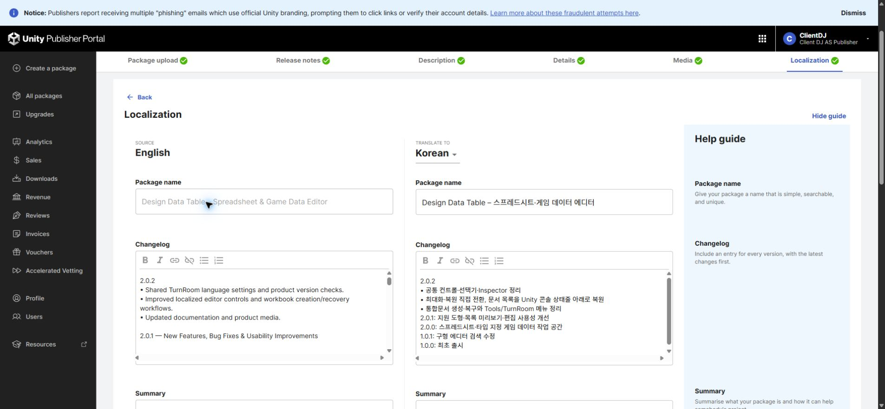
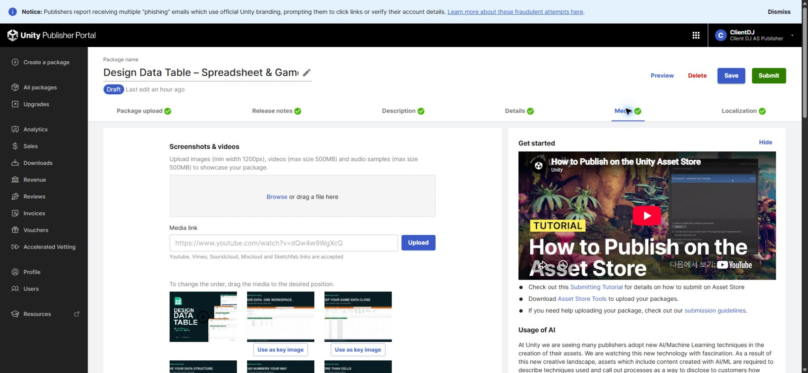

## 작업 결과

판매 초안 저장은 완료했습니다. 최종 제출은 미실행이며 릴리스 준비 검증은 계속 필요합니다.

## 변경 내용

### 적용 내용

영어·한국어·일본어·중국어 판매 정보와 변경 이력을 저장했습니다. 공통 테마 UI·Inspector, 최대화·복원 직접 전환과 콘솔 상태줄 아래 문서 목록을 반영했습니다. 

수정 전 실제 포털 화면입니다.

저장 후 실제 포털 화면입니다. 캡처 원본을 이미지 편집 없이 보존했습니다.

## 검증

새로 페이지를 열어 4개 언어의 저장값을 대조했고 모두 일치했습니다. Pixel Camera·Entity Forge의 첫 변경 이력 저장 실패는 보존하고 짧은 출시 기록으로 수정 후 재검증했습니다. 원인은 미확인입니다.

갤러리 14장, 영상 1개, 키 이미지 3개를 실제 포털에서 확인했습니다. 갤러리 변경 없음.

52개 어셈블리의 잘못된 core→Samples/Development 참조 0건. 배포 파일의 개발 에셋 참조·자동 패키지 설치 코드 후보·비표준 제품 메뉴 경로 0건. 정적 검사 결과이며 실제 설치 검증을 뜻하지 않습니다.

후보 파일 1617개, 62412882 bytes. SHA-256 `4b15d5aa0e205b914d9f418ba891fe1427e6c112d8d1fae02ed9c5b829b1cdbc`. 아카이브의 에셋·메타데이터 재읽기 및 생성 당시 소스 동일성 확인. 튜토리얼 파일은 네이티브 의존성 가지치기 없이 유지했습니다.

[정제된 검증 근거](../assets/store-review-20261103/verification.json)

교훈 검토: 기존 산출물 고정·저장 후 재읽기·미실행 QA 구분 지침으로 충족하므로 전역 지침 변경 없음. 적용 범위는 이번 판매 초안과 후보 패키지 검사입니다.

## 남은 사항

포털 업로드 패키지는 최신 소스와 다릅니다. 새 후보는 파일 방식으로 생성·재읽기한 산출물이며 Unity 네이티브 내보내기·새 프로젝트 설치·샘플 제거 후 컴파일·공식 Validator는 미실행입니다. 실행 중이던 대상 Unity 호스트가 종료되어 GUI 신규 실행 없이 진행할 수 없습니다. 공식 Validator는 진행창 표시 또는 별도 Unity 실행을 사용하므로 화면 조작 금지 조건에서 보류했습니다. 갤러리 목표 16장 중 14장으로 2장이 부족합니다. 신규 오디오 포함 홍보 영상의 실제 청취·포털 교체·재확인이 남아 있습니다. 따라서 제출 준비 완료로 판정하지 않으며 Submit은 누르지 않았습니다.

## 작업 시간

- 제안 시간: 최초 10~20분, 제출 전 추가 검토 10~20분
- 실제로 완료된 시간: 2026-11-03 01:48:38 KST 시작. 03:03 KST 기준 약 74분 경과. 브라우저 다운로드 도구 약 20분 정체 포함, 예상 초과. 보고서 배포 확인 중이며 잔여 릴리스 검증은 미완료.
- XERJ: 실패 — XERJ 노드 미실행; rg 및 현재 소스·실제 포털 저장값으로 대체 검증
