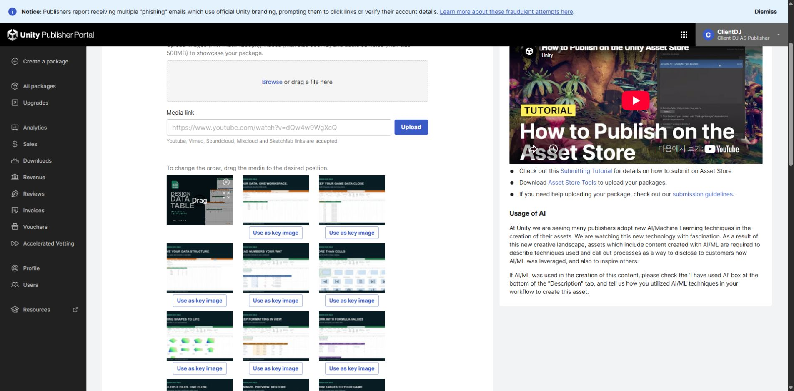
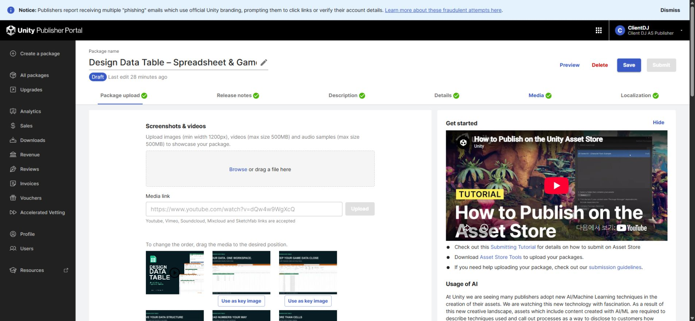
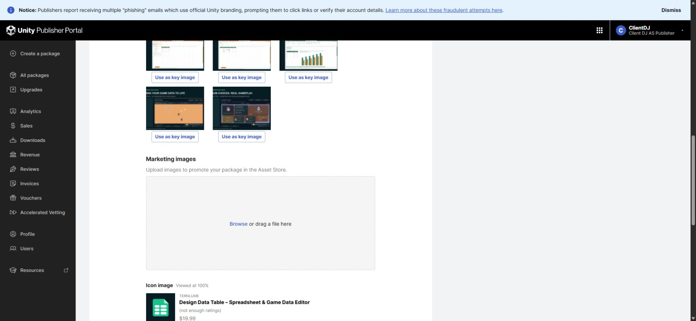

## 작업 결과

DDT 판매 미디어 교체를 적용했습니다. 영상 1개가 첫 항목이며 이미지 16장과 키 이미지 3개가 저장되었습니다. 가격을 유지했고 Submit은 실행하지 않았습니다.

[최종 영상](../assets/media-repair-20261103/video.mp4)

## 변경 내용

### 적용 내용

기존 14장에 실제 샘플을 보여주는 Affinity 카드 2장을 추가했습니다. 시작·종료 타이틀과 배경 음악을 포함한 70초 영상으로 교체했습니다.

기존 실제 녹화로 새 편집본을 만들었습니다. 이번 작업에서 Unity를 새로 녹화하지 않았습니다.

## 검증

네 제품의 새 페이지에서 각각 영상 1개·갤러리 16개·키 이미지 3개·업로드 대기 0을 확인했습니다. 포털 영상의 재생과 포스터를 확인했습니다. 최종 영상 전체 디코드·검은 구간·음량을 검사했습니다. DDT/Pixora/Pixel Camera는 약 -21.05 LUFS, -2.07 dBTP, Entity Forge는 -20.92 LUFS, -4.04 dBTP입니다. 실제 Affinity 원본을 저장·닫기·다시 열어 이번 최종 40개 출력의 크기와 픽셀 체크섬 일치를 확인했습니다.

[저장값과 검증 범위](../assets/media-repair-20261103/verification.json)

## 남은 사항

소리의 직접 청취는 이 세션의 오디오 입력 미지원으로 실행하지 못했습니다. 신호 검사 통과를 청취 통과로 처리하지 않았으며 최종 제출은 보류했습니다. Entity Forge의 기존 녹화는 현재 버전 성능 검증 자료가 아닙니다.

교훈 검토: 기존 전역의 원본·실행 대조 규칙과 중복되므로 전역 변경은 없습니다. 프로젝트 ProductReleaseChecklist에는 슬롯 수만으로 통과하지 않고 포스터·최신 로고·패딩·실제 음원까지 대조하도록 구체화했습니다.

## 작업 시간

- 제안 시간: 최초 조사 10~20분, 이후 마지막 검증·공개 약10분 추가 예상. 실제 작업은 예상보다 지연되었습니다.
- 실제로 완료된 시간: 2026-11-03 03:16:50 KST 시작. 포털 최종 저장 확인 04:33 KST, 원본 재열기 검증 확인 04:37 KST. 약80분 경과 시점의 기록이며 공개 배포 시각은 채팅에서 별도 확인합니다.
- XERJ: 실패 — XERJ 노드 미실행 확인. 필요한 소스는 rg, 미디어는 실제 원본과 포털로 대조했습니다.
