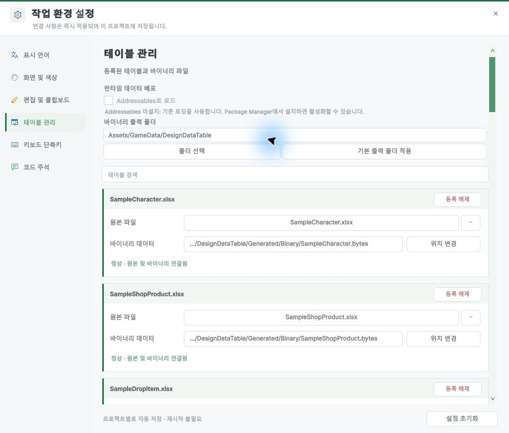
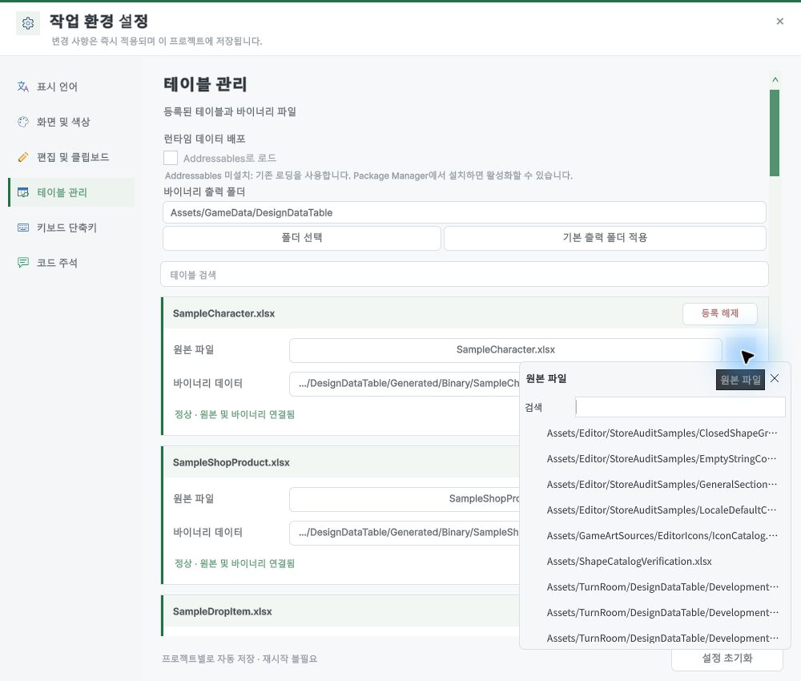
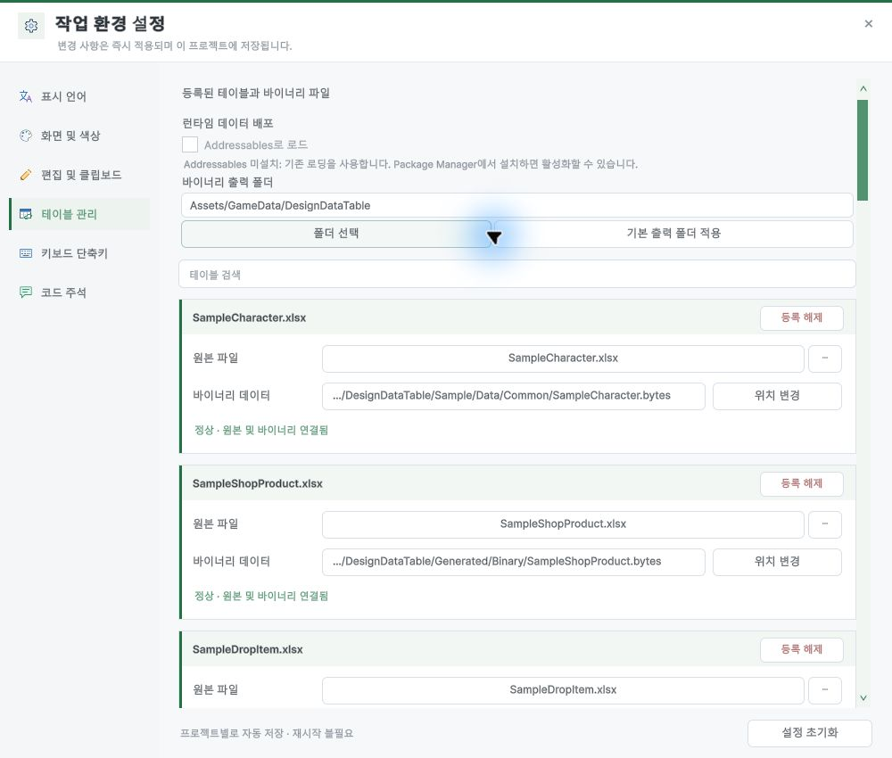

## 작업 결과

테이블 카드에서 바이너리 위치를 항상 볼 수 있고, ‘위치 변경’으로 해당 파일을 이동할 수 있습니다. Unity Tools 메뉴에 Table Management를 추가했습니다.

## 변경 내용

### 적용 내용

- 새 테이블의 기본 출력은 `Assets/GameData/DesignDataTable`입니다. 기본 폴더는 프로젝트 단위로 바꿀 수 있습니다.
- 재생성에서는 연결된 에셋의 실제 경로를 우선합니다. Addressables를 끄면 Resources 아래 폴더도 고를 수 있습니다.
- 원본의 `…`와 폴더 선택을 설정창 내부 선택 패널로 바꿨습니다.

### 대화 기록
- 사용자(시각 미기록): “바이너리 파일을 생성할 때 내가 원하는 위치에 생성되도록 해줘.” 및 `…` 클릭 시 설정이 사라지는 현상을 전달했습니다.
- 사용자(시각 미기록): “상세설정은 없어도 될 듯 그냥 항시 바이너리 보이게 해주고” 및 Unity 메뉴 진입을 추가로 요청했습니다.
- AI: 실제 Unity에서 경로 표시, 원본 선택 패널, 샘플 이동을 확인했습니다.

## 검증

- Unity 6000.0.83f1에서 Tools 메뉴로 테이블 관리를 열었습니다. `…`를 열고 Esc로 선택 패널만 닫혔습니다.
- SampleCharacter.bytes를 실제로 이동하고 원래 경로로 복원했습니다. 이동본의 SHA-256과 Unity GUID가 원본과 같았습니다.
- DDT Runtime, DDT Editor 및 공용 Editor 어셈블리 컴파일 통과. 9개 언어 가이드에서 새 테이블 관리 화면을 참조하고 캡처 해시를 확인했습니다.

## 남은 사항

- 실제 새 테이블 생성·이동 뒤 재생성·Addressables 콘텐츠 빌드는 미실행입니다. 확인용 프로젝트에 Addressables가 설치되지 않았습니다.
- 전체 문서 검증기는 다른 장의 캡처와 현재 소스 해시 불일치 등을 보고했습니다. 이번 테이블 관리 화면은 다시 캡처했고 나머지 캡처 기록은 유지했습니다.
- Fantasya에는 설치하지 않았습니다. 사용자 제보 화면은 외부 게시에 포함하지 않았습니다.
- 공통화할 코드 변경이 없어 Unity 샘플 저장소 환류 및 전역 지침 변경은 없습니다.

## 작업 시간

- 제안 시간: 10~20분
- 실제로 완료된 시간: 구현 및 수행한 검증 기록: 13분 14초, 2026-11-09 22:42:14 KST. 전체 런타임·배포 검증은 이 시각 기준 미완료.
- XERJ: 미사용 — 코드 검색 근거가 제공되지 않았습니다.
