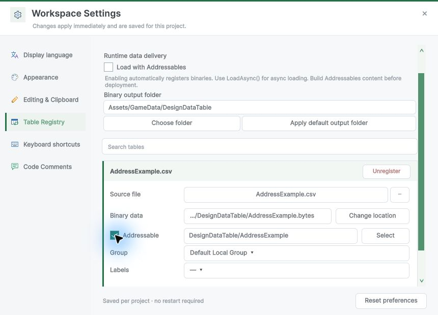
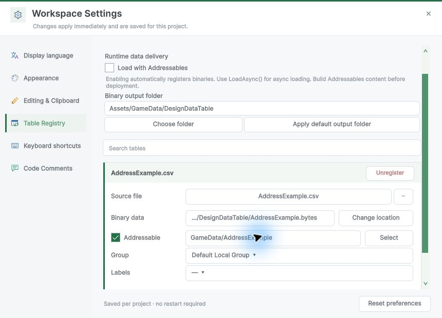
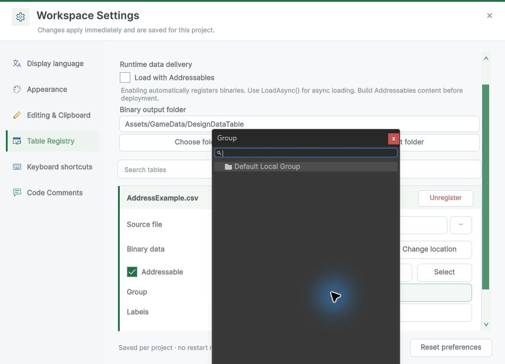
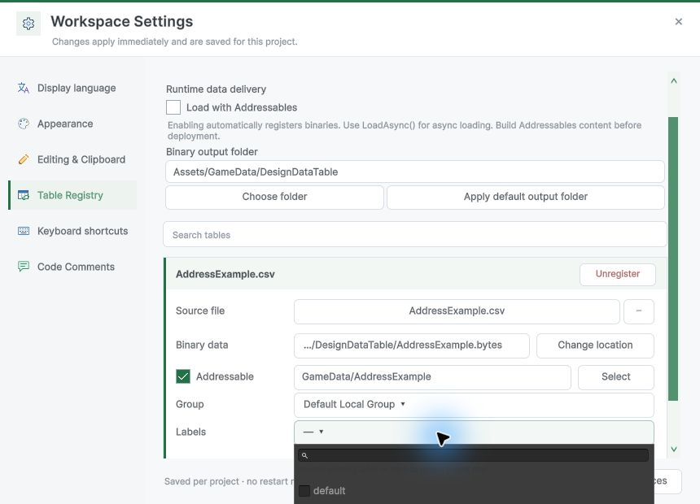
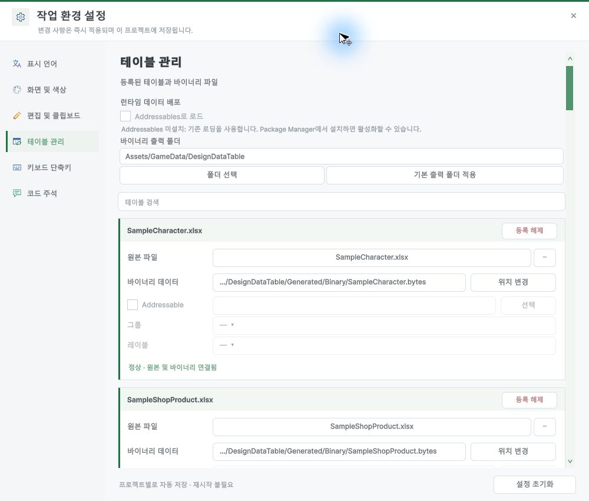

## 작업 결과

카드에서 주소를 편집하고 Unity Addressables Groups에서 항목을 선택할 수 있습니다. 패키지가 없어도 같은 항목이 비활성으로 보입니다.

## 변경 내용

### 적용 내용

- 첫 줄에 Addressable 체크박스·주소·선택을 배치했습니다. 아래에서 그룹과 레이블을 설정합니다.
- 주소는 Enter로 저장합니다. 프로젝트 전체 Addressables 로딩이 켜져 있으면 필요한 등록을 실수로 해제하지 않도록 체크를 고정합니다.

### 대화 기록
- 사용자(시각 미기록): 주소 수정, 미설치 시 비활성 표시, 기존 DDT 디자인을 유지하는 Unity Inspector 형식을 요청했습니다.
- 사용자(시각 미기록): 화면을 첨부하며 “체크박스있고 주소 입력 그리고 그룹 셀렉트”를 요청했습니다.
- AI: 체크박스와 주소, 선택 버튼을 같은 줄에 배치하고 그룹 및 레이블을 아래에 배치했습니다.

## 검증

- Unity 6000.0.83f1과 Addressables 2.9.1에서 주소 저장과 재열기, 개별 체크 등록·해제, 그룹 및 레이블 팝업 표시, Select가 Unity Groups를 여는 것을 확인했습니다.
- 주소 변경 후 Unity 그룹 에셋과 DDT 등록의 GUID 기반 로딩 키를 대조했습니다.
- 패키지 미설치 TurnRoom에서 비활성 표시를 확인했습니다.

## 남은 사항

다른 Addressables 버전과 플레이어 런타임 빌드는 미실행입니다. Fantasya에는 설치하지 않았습니다. 다른 가이드 장의 기존 캡처 불일치는 보존했습니다. 전역 지침 변경 없음.

## 작업 시간

- 제안 시간: 10~20분
- 실제로 완료된 시간: 2026-11-09 23:08:26 KST 착수. 실제 Unity 확인과 기록 완료. 공개 확인은 작성 시점 대기.
- XERJ: 미사용 — 코드 검색 근거가 제공되지 않았습니다.
