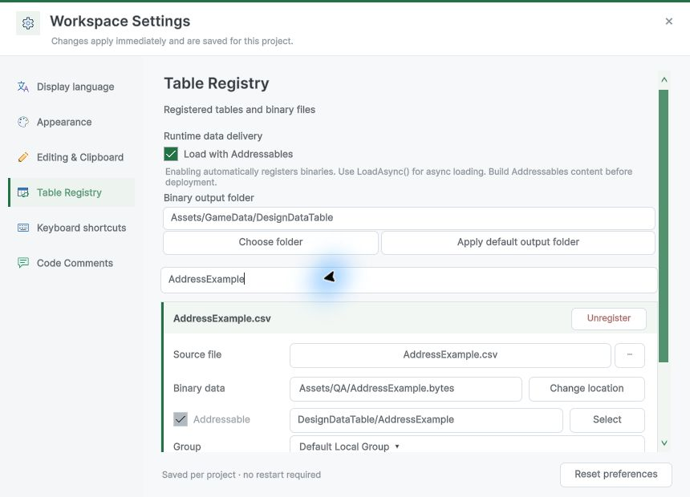
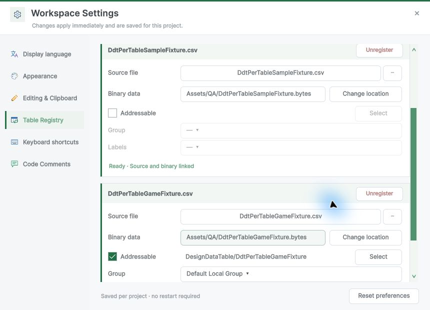
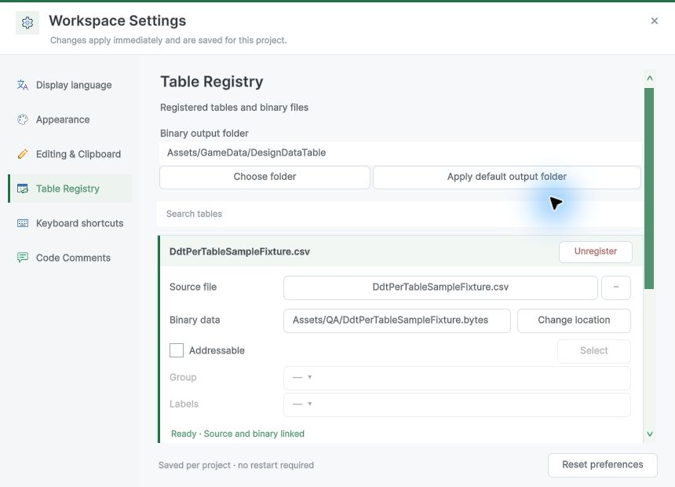
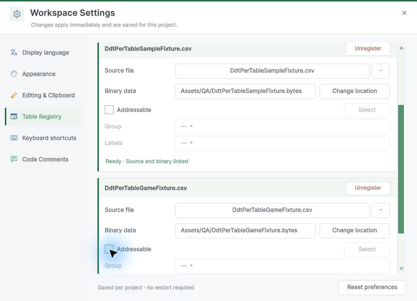
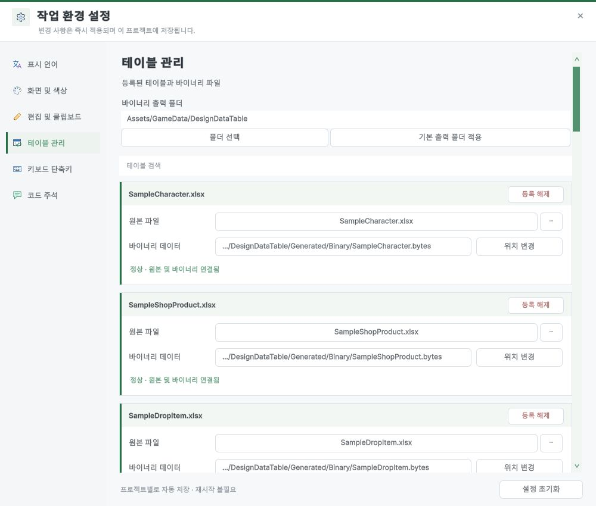

## 작업 결과

Unity 6000.0.83f1에서 Addressables 테이블과 직접 참조 샘플을 함께 로드했습니다. 체크 해제 시 직접 참조로 돌아갑니다.

## 변경 내용

### 적용 내용

기존 키가 있는 테이블의 설정은 보존합니다. 기본 생성은 직접 참조를 사용하고 패키지가 없으면 관련 입력을 숨깁니다.

### 대화 기록

사용자: “그럼 전체 일괄 적용은 빼고 테이블별 체크박스로 바꿔줘. 체크한 테이블만 어드레서블로 불러오고 나머지는 기존 방식 그대로. 샘플 예제는 자동 등록하지 말고.”

Codex: 테이블별 기존 키를 보존하고 샘플의 자동 등록 경로를 제거했습니다.

## 검증

격리 Unity에서 실제 Addressables 콘텐츠 빌드 후 게임(ID 42)과 샘플(ID 17)을 동기·비동기로 로드했습니다. 샘플이 그룹에 추가되지 않았고 게임 체크 해제 후 직접 로드도 성공했습니다. 미설치 화면과 영어 그룹·레이블 팝업을 새로 촬영했습니다.

## 남은 사항

별도 플레이어 빌드는 미실행입니다. 9개 언어 가이드의 새 캡처는 검증됐고 기존 캡처의 원본 해시 불일치 102건은 남아 있습니다. 이 작업으로 추가할 공통 전역 지침은 없습니다.

## 작업 시간

- 제안 시간: 10~20분. 2026-11-09 23:43:52 KST 시작.
- 실제로 완료된 시간: 2026-11-09 23:49:55 KST에 최종 Unity 화면 확인. 소요 6분 3초. 이후 가이드 검증과 게시를 별도 진행.
- XERJ: 미사용 — 코드 검색 근거가 제공되지 않았습니다.
