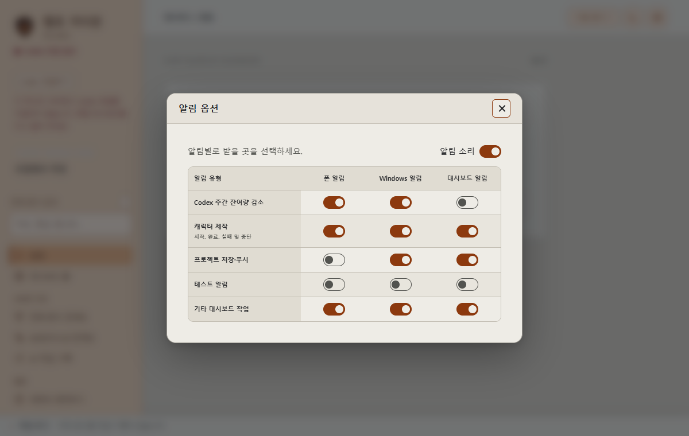

## 작업 결과

로컬 커밋 462e6ee8에 구현했습니다. 브라우저에서 유형별 설정을 바꿔도 다른 채널 값이 유지되고, Codex 알림이 중복 없이 기록됨을 확인했습니다.

## 변경 내용

### 재현 조건

Windows, Node.js 요청 핸들러와 Chromium 헤드리스 대시보드 검수

### 재현 순서

알림 옵션을 열고 Codex 대시보드 수신과 저장·푸시 폰 수신을 각각 바꿉니다. 새로고침하고 주간 잔여량 감소를 입력해 기록과 팝업을 확인합니다.

### 기대 동작

각 채널의 설정을 독립적으로 저장하고 Codex 알림은 공통 알림 목록에 기록합니다.

### 실제 동작

기존 알림 옵션에 소리만 남고 Codex 알림은 기록과 소리를 비활성화하는 별도 표시 조건을 사용했습니다.

### 원인

기기별 설정 코드가 제거됐고 Codex 알림에 공통 기록을 건너뛰는 옵션을 전달했습니다.

### 적용 내용

알림 유형의 공통 목록을 만들고 설정 표와 서버 검증에 사용합니다. 폰·Windows·대시보드별 토글을 저장하고 같은 기준으로 전달을 제어합니다. 수신을 끈 상태에서도 알림 기록을 유지합니다.

## 검증

Node 요청 핸들러에서 15개 설정 저장, 재시작 유지, Windows 테스트 알림 예약의 켜기·끄기를 확인했습니다. Chromium에서 설정 변경과 새로고침, 꺼진 Codex 팝업의 기록, 다시 켠 뒤 팝업 표시 및 중복 방지를 확인했습니다. 대시보드 빌드와 안내 관계도 요약을 검사했습니다.

## 남은 사항

실제 Windows 카드·소리와 등록 휴대폰 수신은 미검증입니다. 프로젝트와 보고서 원격 반영 상태는 별도 확인합니다.

## 작업 시간

- 제안 시간: 작성 시 기록되지 않았습니다.
- 실제로 완료된 시간: 2026-11-29 KST 작업. 소요 시간은 별도로 측정하지 않았습니다.
- XERJ: 미사용 — 코드 검색 근거가 제공되지 않았습니다.
