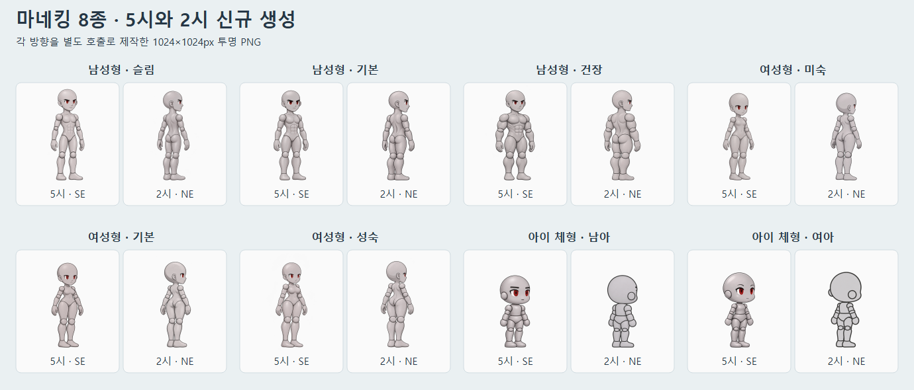

## 작업 결과

캠프 가디언 원격 main에서 커밋 144a59e8을 확인했습니다. 새 두 방향 이미지는 별도 사용 시험용으로 전달했습니다.

## 변경 내용

### 적용 내용

키 작은 마네킹 6종의 5방향·8방향 PNG와 두 레이아웃의 윤곽선 파일, 카탈로그·대시보드 연결을 삭제했습니다. 남성형 3종, 여성형 3종, 아동형 2종의 5시와 2시를 개별 생성했습니다. 실제 생성 원본을 균일 배율로 줄이고 투명 영역으로 정사각형을 맞췄습니다. 방향이나 눈 노출이 어긋난 2시 시안은 다시 제작했습니다.

## 검증

로컬 및 원격에서 삭제 범위를 확인했고 대시보드 빌드와 제작 목록 8종 검사를 통과했습니다. 투명 PNG 16장의 크기, 알파 값, 접지 위치 및 ZIP 항목 수를 검사하고 미리보기를 검토했습니다.

## 남은 사항

신규 1024px 두 방향 참조는 프로젝트의 8방향 마네킹에 연결하지 않았습니다. 실제 장비 제작에서 마네킹 추종률이 개선되는지는 아직 확인하지 않았습니다. 생성 채색은 체형과 방향마다 차이가 있습니다. Pages 공개 접근은 대기하지 않았습니다.

## 작업 시간

- 제안 시간: 별도 소요 시간 약정 없음
- 실제로 완료된 시간: 2026-11-28 KST, 16장 생성, 2시 수정, 삭제 검증과 원격 반영을 진행했습니다.
- XERJ: 미사용 — 생성 원본, 빌드 출력 및 Git 원격을 직접 확인했습니다.
