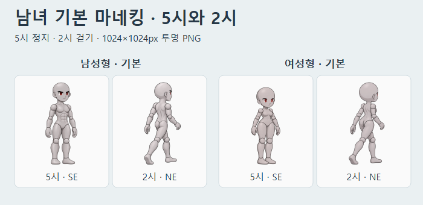

## 작업 결과

프로젝트 원격 main에 커밋 c85caf53을 반영했습니다. 남녀 기본형의 방향별 1024px 투명 PNG 네 장을 별도로 제공했습니다.

## 변경 내용

### 적용 내용

로컬 제작 목록의 기본 외 6종과 원격 SD 2종을 제거했습니다. 활성 캐릭터 설정에서 제거된 선택을 남녀 기본형으로 옮겼습니다. 5시 파일 두 장을 유지했고, 2시에서 여성은 사용자가 고른 시안을 쓰고 남성은 해당 보행 자세를 따라 새로 생성했습니다.

## 검증

대시보드 빌드와 기본형 선택지 두 종, 기존 캐릭터 설정이 유효한 마네킹을 가리키는 것을 확인했습니다. 원격 프로젝트 커밋과 4장 ZIP, 투명도·1024×1024 크기, 5시 파일의 내용 일치를 검사했습니다.

## 남은 사항

두 방향 1024px 참조는 별도 파일입니다. 실제 캐릭터 제작 및 Pages 공개 접근은 미확인입니다.

## 작업 시간

- 제안 시간: 별도 소요 시간 약정 없음
- 실제로 완료된 시간: 2026-11-28 KST에 제작·검수·원격 반영했습니다.
- XERJ: 미사용 — 생성 자료와 로컬 빌드, 원격 Git으로 확인했습니다.
