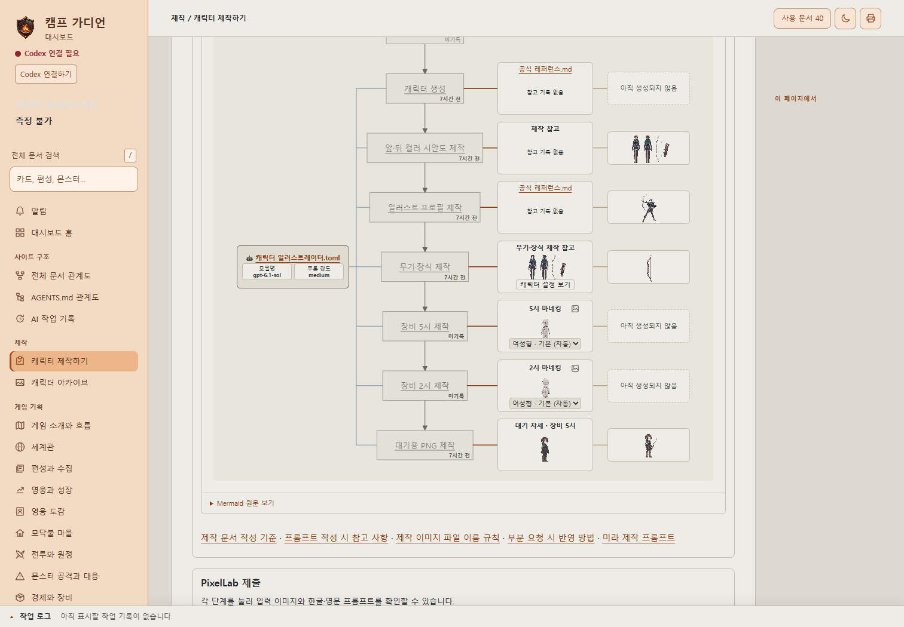

## 작업 결과

프로젝트 원격 main 반영을 확인했습니다. 커밋 495a4805.

## 변경 내용

### 적용 내용

장비 5시와 2시를 개별 요청·등록 단계로 분리했습니다. 방향별 남녀 기본형 PNG를 연결하고 현재 단계의 마네킹만 첫 이미지로 첨부하도록 했습니다. 5시 결과가 512px 대기 참조로 이어지고 기존 장비 시트도 기존 대기 작업에서 읽을 수 있습니다. 원격의 별도 바디·의복 단계는 유지했습니다.

## 검증

격리된 제작 요청에서 5시만, 2시만, 둘 모두의 마네킹 배정을 검사했습니다. 1247×1261 실물 PNG를 1024×1024 등록용으로 바꾼 뒤 512×512 대기 참조까지 검증했습니다. 대시보드 빌드 및 헤드리스 브라우저에서 각 카드의 서로 다른 1024px 이미지 로드를 확인하고 촬영했습니다. 원격 main을 대조했습니다.

## 남은 사항

새 흐름으로 실제 캐릭터를 ImageGen에 제출하는 테스트는 수행하지 않았습니다. 공개 Pages 확인은 수행하지 않았습니다.

## 작업 시간

- 제안 시간: 사전 소요 시간 약정 없음
- 실제로 완료된 시간: 2026-11-28 KST에 요청·등록·화면을 검수하고 반영했습니다.
- XERJ: 미사용 — 로컬 큐·PNG 검사·브라우저와 Git 원격을 직접 확인했습니다.
