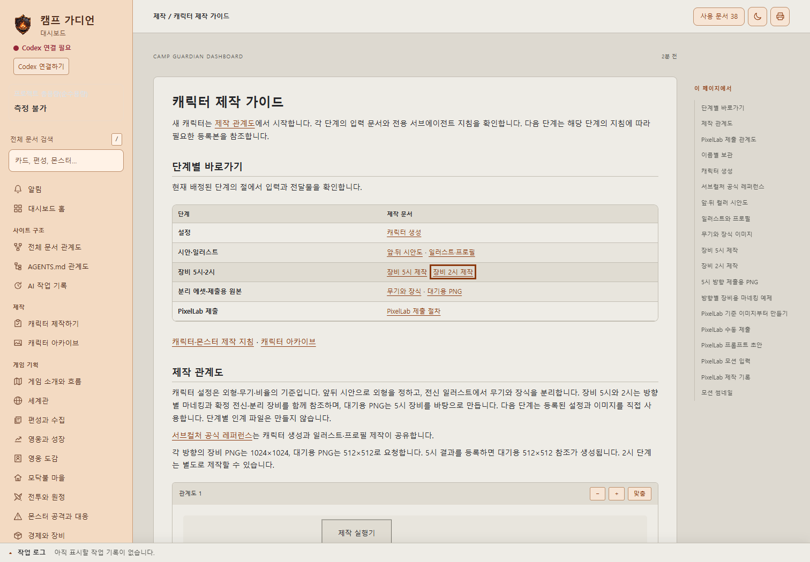

## 작업 결과

프로젝트 원격 main 2cc61a2d에 반영했습니다.

## 변경 내용

### 적용 내용

장비 5시 제작과 장비 2시 제작 Markdown 두 개를 추가하고 합본 한 개를 삭제했습니다. 원격의 아트 제작 경로, 제작 관계도, 대기용 PNG 제작, 캐릭터 제작 가이드 문서를 수정했습니다. 기존 5시·2시 노드는 각자 분리된 문서를 가리킵니다. 대기용 PNG 연결은 5시 문서를 사용합니다.

## 검증

대시보드 빌드에서 합본 참조가 없고 새 두 문서가 포함됨을 확인했습니다. 헤드리스 브라우저에서 각 문서 모달을 한 번씩 열어 확인하고 실제 화면을 촬영했습니다. 프로젝트 원격 main을 검증했습니다.

## 남은 사항

다른 Markdown의 일괄 한글화는 이번 범위에 포함하지 않았습니다. 공개 Pages 확인은 대기하지 않았습니다.

## 작업 시간

- 제안 시간: 별도 소요 시간 약정 없음
- 실제로 완료된 시간: 2026-11-28 KST에 문서 분리·브라우저 검수·프로젝트 반영을 진행했습니다.
- XERJ: 미사용 — 프로젝트 빌드, 브라우저 및 원격 Git을 직접 대조했습니다.
