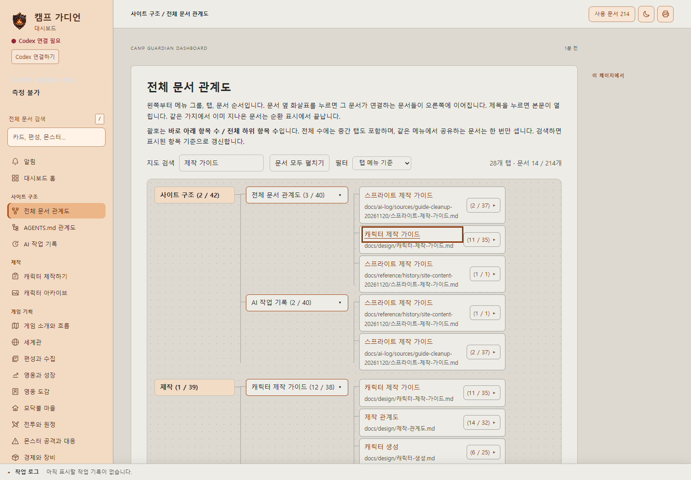

## 작업 결과

프로젝트 원격 main에서 66dda092와 후속 과거 링크 복구 0a312378을 확인했습니다.

## 변경 내용

### 적용 내용

로컬 기준 Markdown 214개와 원격 기준 779개를 대조했습니다. 로컬 파일명 169개와 원격 파일명 216개를 바꿨습니다. 원격은 경로가 같은 Markdown 557개의 제목 또는 링크도 갱신했습니다. 순수 Markdown 추가·삭제는 없으며 이름 변경은 문서 이동입니다. AGENTS.md, 루트 README.md, SKILL.md 및 원격의 AGENTS-reference.md는 자동 인식·고정 경로를 유지했습니다. 대시보드 빌드, 제작 지침, PixelLab 경로, 전체 문서 관계도 라우팅을 조정했습니다.

## 검증

로컬 대시보드를 빌드하고 관계도 214개, 내부 Markdown 링크 396개와 문서 절 링크 19개를 대조했습니다. 브라우저에서 한글 경로의 제작 가이드를 열었습니다. 원격은 과거에 삭제된 인계 문서 두 링크를 확인된 Git 이력의 원문으로 연결했습니다. 프로젝트 원격 반영을 확인했습니다.

## 남은 사항

공개 Pages 배포 화면과 실제 캐릭터 생성 동작은 확인하지 않았습니다. 스팀과 고도 등 제품명 및 기술 식별자는 문서의 의미와 연결을 유지했습니다.

## 작업 시간

- 제안 시간: 별도 소요 시간 약정 없음
- 실제로 완료된 시간: 2026-11-28 KST에 문서 이름·링크 이동과 관계도 검수를 수행했습니다.
- XERJ: 미사용 — Git 문서 목록과 로컬 대시보드 빌드, 브라우저 화면을 직접 대조했습니다.
