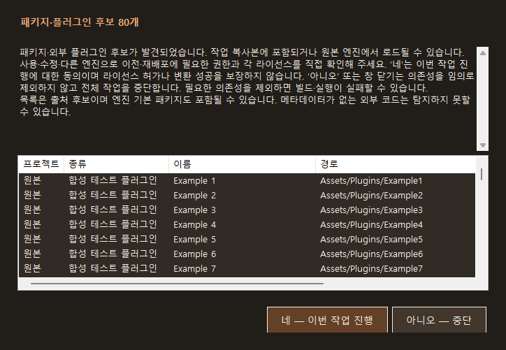
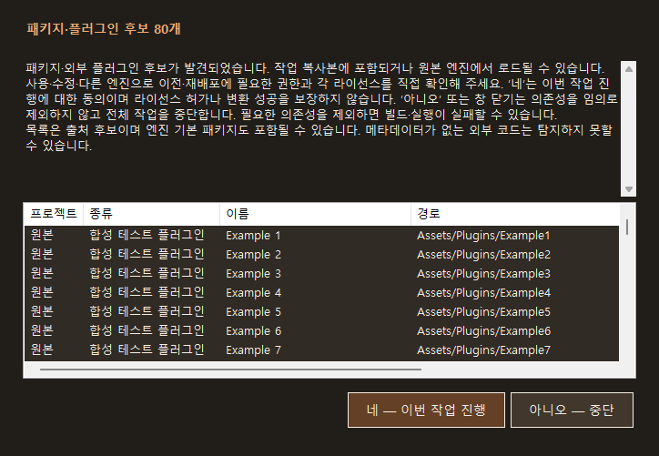

## 핵심 상태
- QA 수정·검증 완료 · 로컬 배포 예정.
- 원본 사용자 프로젝트에 쓰지 않고 합성 복사본·읽기 전용 실제 입력으로 검사했습니다. Unity·Unreal·게임은 실행하지 않았습니다.
- 이전 배포 Core DLL 자체로 10개 재현 항목을 실행하여 8개 실패를 확인했습니다. 두 .meta 사례를 한 종류로 묶으면 Core 문제는 7종이며, 최소 창의 버튼 잘림 1종을 더해 8종을 수정했습니다.
- 수정 후 확장 QA 18개, 기존 엔진 없는 회귀 검사 403개가 통과했습니다. 모든 프로젝트·플러그인·엔진 버전의 포팅 성공을 인증하는 결과는 아닙니다.

## 확인하고 수정한 문제
### 1. 대상 프로젝트 안에 부분 코드 결과를 쓸 수 있었습니다
- 이전 동작: 코드 내보내기는 원본 안의 출력을 막았지만 선택한 대상 프로젝트 안에는 새 폴더를 만들었습니다.
- 수정: 원본·대상 모두에서 같은 경로와 내부 경로를 차단합니다. 대상 내부·중첩 Content 출력에서 파일을 만들지 않는 것을 확인했습니다.

### 2. 플러그인 설명자의 Name 누락으로 검사가 예외 종료됐습니다
- 이전 동작: Plugins 배열의 항목에 Name이 없으면 KeyNotFoundException이 나왔습니다.
- 수정: Name과 Enabled의 자료형을 확인하고 해당 설명자 경로가 있는 차단 진단으로 돌려줍니다. 전체 ProjectInspector에서도 예외로 종료되지 않는 것을 확인했습니다.

### 3. 바이너리·번들의 Unity .meta 변경을 놓쳤습니다
- 이전 동작: Assets/Plugins 밖의 DLL과 플랫폼 번들에서 본문은 같고 .meta만 바뀌면 기존 동의로 진행할 수 있었습니다.
- 수정: DLL의 .meta와 번들 폴더의 .meta를 지문에 포함합니다. 두 종류 모두 변경 후 재동의를 요구했습니다.

### 4. 사용자 Assets/bin의 C# 파일을 목록에서 누락했습니다
- 이전 동작: bin이라는 폴더 이름만으로 조사에서 제외하여 합성 사용자 스크립트가 발견되지 않았습니다.
- 수정: 프로젝트·플러그인·csproj 설정을 근거로 빌드 폴더를 구분합니다. Assets/bin/UserOwned.cs가 실제 조사 결과에 포함되는 것을 확인했습니다.

### 5. 같은 동의 객체를 여러 작업에 재사용할 수 있었습니다
- 이전 동작: 직접 API를 호출하면 하나의 승인 객체로 독립 코드 출력 작업을 두 번 시작할 수 있었습니다.
- 수정: 작업 시작 경계에서 원자적으로 한 번만 사용하도록 했습니다. 두 번째 작업과 동시 시도 하나는 출력 전에 거부합니다. 한 작업 안의 반복 변경 검사는 계속 허용합니다. UI는 매번 직접 선택하도록 유지합니다.

### 6. 정의되지 않은 엔진 값이 Unreal처럼 처리됐습니다
- 이전 동작: Engine 99 입력이 검사에서 거부되지 않았습니다.
- 수정: Core 검사와 CLI 진입점에서 엔진 열거값을 확인합니다. 잘못된 값은 경로 조사나 변환 전에 거부합니다.

### 7. Unreal 프로젝트 Binaries의 DLL을 후보 목록에서 놓쳤습니다
- 이전 동작: Plugins/Source 밖의 Binaries/Win64/VendorSDK.dll은 후보가 없었습니다.
- 수정: 프로젝트 Binaries의 모듈·네이티브 라이브러리를 후보로 표시하고 .modules/.target도 변경 지문에 포함합니다. 프로젝트 자체 바이너리도 후보에 포함될 수 있습니다. 외부 코드나 라이선스를 자동 판정하는 기능은 아닙니다.

### 8. 최소 크기 경고창에서 버튼 하단이 잘렸습니다
- 이전 동작: 최소 크기의 오프스크린 렌더링과 버튼 경계 검사에서 하단 잘림을 재현했습니다.
- 수정: 버튼 영역의 위 여백을 줄이고 자동 줄바꿈을 막았습니다. 기본 크기·최소 크기 렌더링, 기본 아니오, AcceptButton 없음, 실제 WinForms OnClick 호출의 Yes/No 결과 전달을 확인했습니다. 실제 사용자 마우스·키보드나 모달 조작을 자동화한 것은 아닙니다.

## 실제 입력과 검사 성능
- EngineMigratorUnity를 읽기 전용으로 조사했습니다. 파일 60개·C# 2개·패키지/플러그인 후보 155개, 의존성 검사 차단 0개를 확인했습니다. 추적한 원본 C#·버전·manifest 파일 4개의 검사 전후 해시는 같았습니다. 프로젝트 전체 파일의 무변경 검증으로 확대해서 해석하지 않습니다.
- 첫 검사 213.65초, 반복 경로 조회와 디렉터리 열거를 줄인 후 같은 입력 검사는 131.87초였습니다. 원본 후보 목록과 지문은 일치했습니다.
- 이 수치는 한 번씩 실행한 관측값입니다. 파일 시스템 캐시·다른 작업의 영향을 분리한 벤치마크가 아니므로 일반적인 속도 향상을 보장하지 않습니다. 큰 패키지 캐시에서는 검사에 수 분이 걸릴 수 있습니다.
- 파일 해시 처리 중에도 취소 토큰을 확인하도록 했고, 파일 링크 속성 검사를 보강했습니다. 이 환경에서는 실제 심볼릭 링크를 만드는 권한이 없어 실물 파일 링크 회귀 검사는 미확인입니다.

## 검증 근거
- 이전 배포 Core SHA-256: A8B8E8115BFADAE8C8FE944797AE59AC6F4647E0024B5B63B33E8E99004973A2.
- 이전 배포 DLL 재현: artifacts/qa-20261029/published-before.json — 10개 중 8개 실패. 모두 이번 작업 소유의 합성 폴더에서 실행했습니다.
- 수정 후 독립 QA: artifacts/qa-20261029/after-final.json — 18개 통과. 취소·거절·동시 승인 사용·반복 검증·잘못된 JSON 형식도 포함합니다.
- 기존 회귀: artifacts/qa-regression-20261029.log — 403개 통과. 이 로그는 엔진 프로젝트 포팅을 실행하지 않았다고 명시합니다.
- UI 비교: artifacts/qa-20261029/ui/before.json, ui-verification.txt 및 기본/최소 렌더링 PNG.
- 실제 입력: artifacts/qa-20261029/real-input 및 real-input-optimized, scan-comparison.json. HTML/JSON 검사 결과를 보존했습니다.
- Unity·Unreal의 기존 활성 Public 프로필 TCP/UDP 규칙은 읽기 전용 사전 검사에서 모두 통과했습니다. 샌드박스 CIM 접근 제한은 호스트의 동일 읽기 전용 조회로 확인했습니다. 규칙 변경·UAC·엔진 실행은 하지 않았습니다.
- 컴퓨터 유즈를 사용하지 않았고 .engine-execution-blocked를 유지했습니다.

## 미확인·남은 사항
- 이번 버전의 실제 Unity → Unreal → Unity 실행과 화면·물리·애니메이션 동등성은 미검증입니다. 과거 버전의 실제 왕복 기록을 이번 버전의 실행 통과로 표시하지 않았습니다.
- 임의 외부 플러그인·메타데이터 없는 외부 코드의 완전한 발견과 모든 라이선스 판정은 하지 않습니다. 동의는 기술적 변환 지원이나 권리 허가를 뜻하지 않습니다.
- 실제 모달 창의 사용자 입력, 모든 DPI/해상도, 실물 파일 심볼릭 링크는 별도 확인이 필요합니다.
- 방화벽 사전 확인은 통과했지만 보안창이 영구적으로 해결됐다는 GUI 검증은 아닙니다.
- 공개 인터넷 게시·원격 커밋·푸시는 수행하지 않았습니다. 이번 요청의 배포는 Windows 로컬 실행 폴더와 ZIP 배포본을 의미합니다.

## 시간과 검색
- 제안 시간: QA·수정·필수 검증·HTML 보고·로컬 배포까지 45~75분.
- 작업 시작: 2026-10-29 18:40:08 KST.
- 실제로 완료된 시간: QA 보고 원본 작성까지 29분 19초, 2026-10-29 19:09:27 KST. HTML 사이트 생성·검사는 이어서 확인합니다.
- XERJ: 미사용 — 연결 도구와 프로젝트 검색 스크립트가 없어 rg·현재 소스·실제 실행 결과를 확인했습니다.

## 다음 단계
- 이 QA 결과를 HTML로 먼저 기록한 뒤 새 로컬 실행 폴더·ZIP을 만들고, 배포 exe와 압축 파일을 검증합니다.
- 배포 완료 결과는 같은 작업의 v1.0.1 보고서로 추가합니다. 이 v1.0.0 작성 시점에는 새 배포를 완료한 것으로 표시하지 않습니다.
