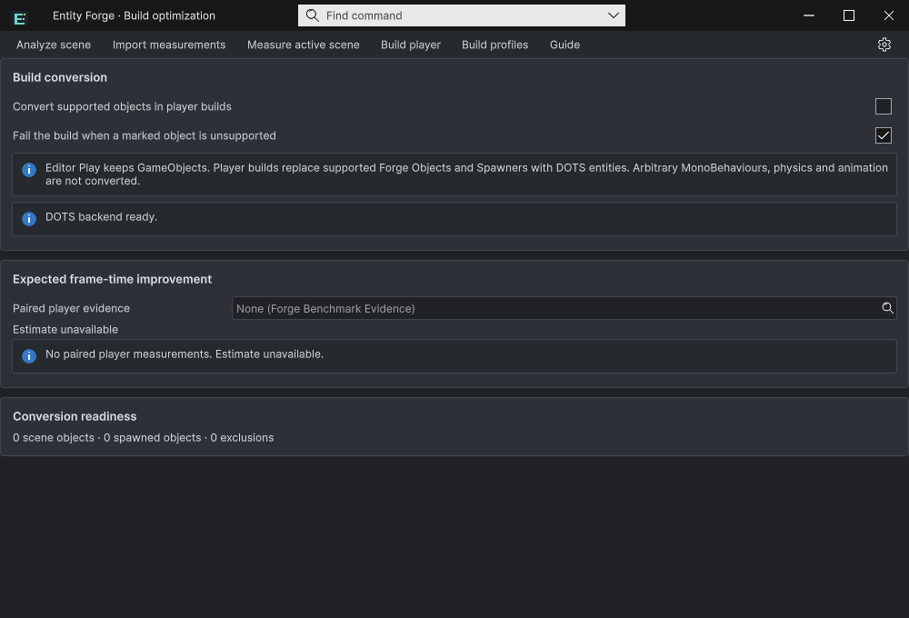
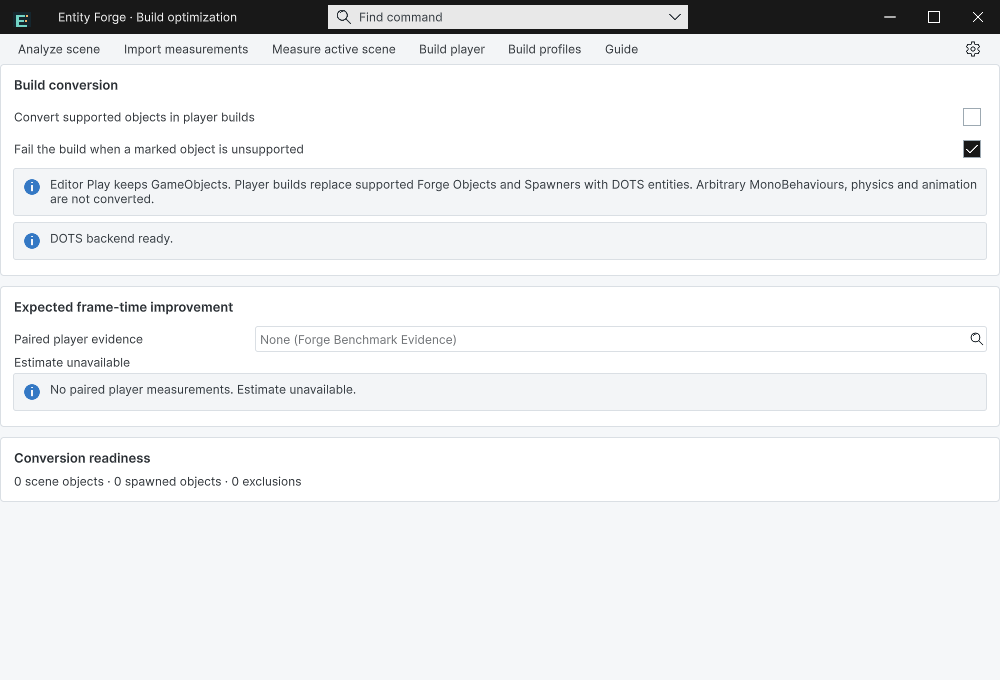
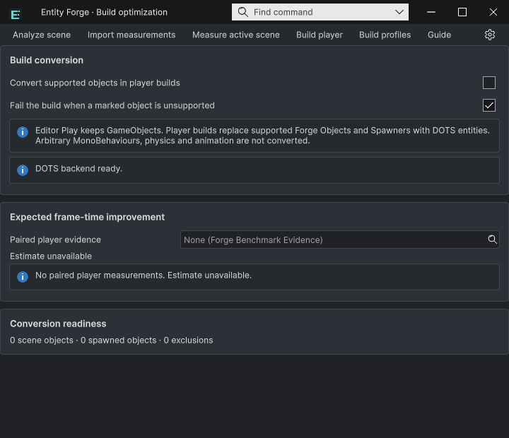
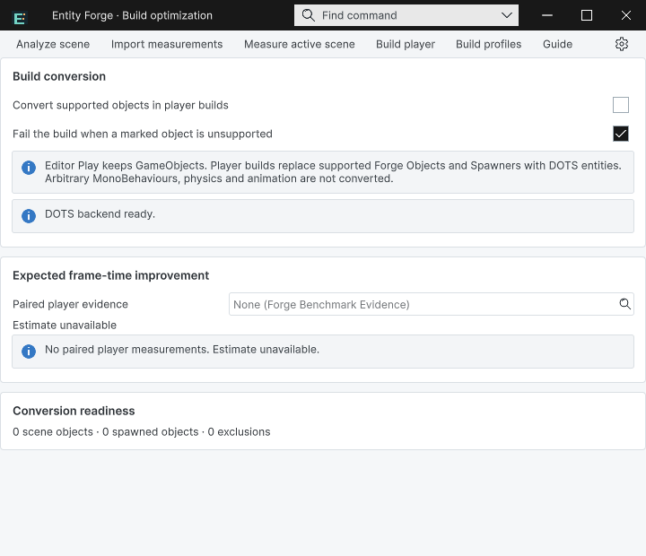

## 작업 결과

Entity Forge 창에 Unity 기본 제목줄과 도킹 탭이 겹쳐 나오던 문제를 수정했습니다. 실제 Unity에서 7개 창 수명 검사와 라이트·다크, 1000px·720px 화면을 확인했습니다.

## 변경 내용

### 재현 조건

Windows / Unity 6000.0.83f1 / TurnRoom 프로젝트의 실제 그래픽 에디터

### 재현 순서

Entity Forge를 기본 EditorWindow 컨테이너로 복구한 뒤 엽니다. 창을 닫고 다시 열고, Open을 세 번 반복하며, 실제 스크립트 도메인 재로드 후 재열기를 실행합니다.

### 기대 동작

공통 제품 제목줄만 표시하고 Unity 기본 제목줄·도킹 탭은 표시하지 않습니다. 창은 하나만 유지합니다.

### 실제 동작

수정 전 첨부 화면에서 기본 제목줄·탭과 공통 제목줄이 함께 보였습니다. 첫 회귀에서도 NormalWindow와 customFrame=false가 재현되었습니다. 수정 후 모든 최종 상태는 PopupMenu, customFrame=true, docked=false, windowCount=1입니다.

### 원인

기존 기본 창을 재사용해 ShowPopup을 호출하는 경로와 개발 QA의 ShowUtility 경로가 있었습니다. OnEnable 검사만으로는 패널 연결 전 검사가 끝나는 경우를 처리하지 못했습니다. 실제 기본 창 복구 재현 JSON으로 확인했습니다.

### 적용 내용

- 기존 공통 프레임 창만 재사용하고, 기본 컨테이너는 새 독립 팝업으로 이전합니다. 위치·테마·창 ID를 이어받습니다.
- OnEnable에 더해 패널이 연결된 UI 스케줄러에서도 복원 상태를 검사합니다.
- 개발 검증 코드도 제품 Open 진입점을 사용합니다.
- 현재 소스와 일치하는 실제 화면 4개를 기록하고 9개 언어 가이드와 프리뷰 패키지를 갱신했습니다.

## 검증

- 실제 Unity API 실행 7개 검사 통과: 최초 팝업, 닫기, 재열기, Open 3회 재사용, 기본 창 이전, 실제 스크립트 도메인 재로드, 재로드 후 Open.
- 도메인 a1e551ea54a0472598b2c45a052f45b8 → de1a626d204d4f77ac0f17a0c46cd1d3. 시간 대기만으로 재로드 성공을 주장하지 않았습니다. 재로드 중 패널 준비 전 상태도 보존했습니다.
- 실제 화면 4개를 직접 검사했습니다. 기본 OS 제목줄·Unity 탭이 없고 공통 제목줄 하나만 표시됩니다. 영어 UI이며 모든 번역 배치를 검사했다는 뜻은 아닙니다.
- 4개 어셈블리 정적 컴파일, 9개 가이드의 171개 로컬 링크·이미지·캡처/소스 해시 검사 통과.
- 프리뷰 패키지 325개 에셋의 소스·메타데이터 읽기 대조 통과. 이는 새 Unity 설치 검증을 뜻하지 않습니다.

이미지는 Unity 네이티브 화면을 편집 없이 PNG로 저장한 원본입니다. 각각 73~77KB로 이미 200KB 이하이며 손실 압축·크기 조절을 하지 않았습니다. [수명 검사](../assets/frame-20261101/lifecycle.json) · [화면·소스 해시](../assets/frame-20261101/verified-captures.json) · [보존한 실패 재현](../assets/frame-20261101/failed-migration-before-fix.json)

## 남은 사항

이번 창 장식 수정·재열기·스크립트 재로드 범위는 완료했습니다. 제품 전체의 새 프로젝트 설치·선택 패널 물리 입력·모든 번역 배치·최종 기능 QA는 기존 제품 메뉴얼에서 별도로 추적합니다. Windows/Unity 6000.0.83f1 외 버전은 이번 검증 범위가 아닙니다. 교훈은 Architecture.md에 패널 연결 후 복원과 기존 컨테이너 재현으로 기록했습니다. 기존 전역 근거 검증 규칙으로 다루므로 전역 지침 중복 추가는 없습니다.

## 작업 시간

- 제안 시간: 최초 수정 15~30분; 재개 후 마무리 10~20분
- 실제로 완료된 시간: 수정·실제 재발 회귀·문서·패키지 검사 완료: 2026-11-01 20:21:17 Asia/Seoul. 최초 19:21:53 이후 중단 구간을 포함한 경과 59분; 이번 재개 20:12:30 이후 9분. 공개 배포 확인은 후속 기록합니다.
- XERJ: 실패 — Xerj.ps1 Status 노드 미실행. Search 복구는 data/node.lock 사용 중으로 실패해 현재 소스 직접 대조와 rg를 사용했습니다.
