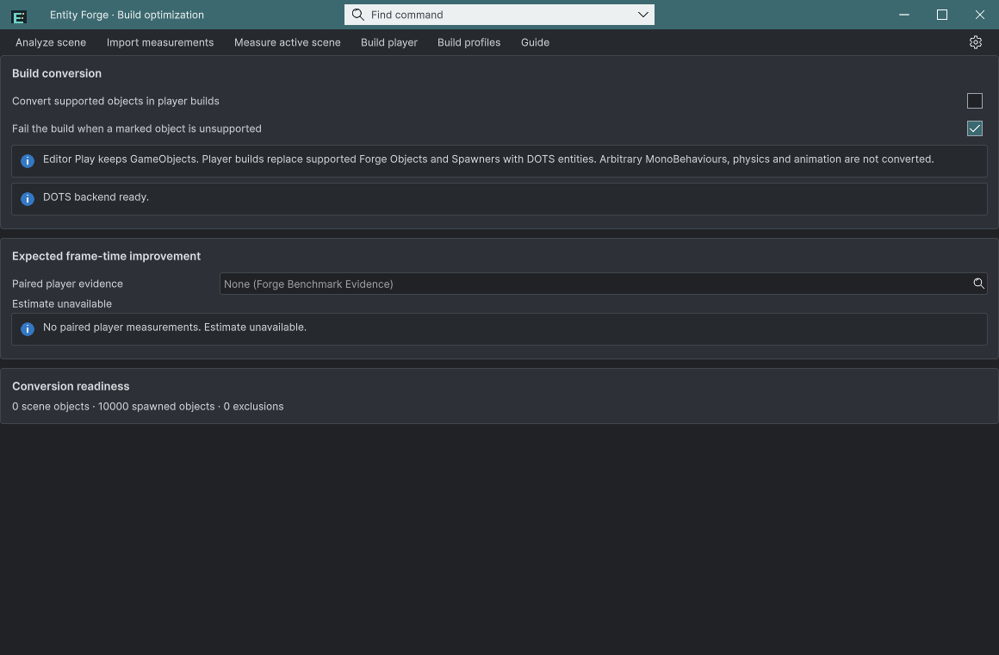

## 작업 결과

프리팹 컴포넌트를 선택할 수 있고, 씬 전환 시 이전 씬의 준비 상태와 개선율이 남지 않습니다.

## 변경 내용

### 재현 조건

Unity 6000.0.83f1 / Windows / Templete 1.6.1 / Entity Forge 0.1.0-preview 새 설치

### 재현 순서

Forge Spawner의 Prefab 선택기를 엽니다. BenchmarkGrid를 분석한 후 다른 씬으로 전환합니다.

### 기대 동작

지원 프리팹을 선택해 ForgeObject 참조를 반환하며, 다른 씬 분석 자료를 재사용하지 않습니다.

### 실제 동작

직접 컴포넌트 타입 검색은 빈 결과였고, 변경 전 분석 캐시는 이전 BenchmarkGrid의 10000개 상태를 남겼습니다.

### 원인

설치 버전 AssetDatabase의 컴포넌트 타입 검색 결과는 비었으나 prefab GameObject의 GetComponent는 값을 반환했습니다. 분석 캐시에 activeSceneChangedInEditMode 무효화가 없었습니다.

### 적용 내용

Prefab 검색 후 루트 GetComponent를 반환하고 프리팹 파일명을 표시합니다. Scene 객체는 스폰 프리팹 필드에서 제외합니다. 검색 Enter는 내부 TextInput보다 먼저 처리하고, OnEnable 및 씬 전환에서 분석을 무효화합니다.

## 검증

실제 마우스·키보드 검색/Enter 및 Escape 후 바인딩 값 readback, 합성 공유 Evidence 선택 회귀, 씬 전환 후 analysis=null 및 이전 10000개 라벨 제거가 통과했습니다. [실제 입력](../assets/install-20261101/native-input-final.json) · [씬 전환](../assets/install-20261101/scene-invalidation.json)

## 남은 사항

이 버그의 확인 범위는 완료했습니다. 다른 플랫폼과 번역 레이아웃은 미검증이며 추가 공통 규칙은 만들지 않았습니다.

## 작업 시간

- 제안 시간: 40~70분 (2026-11-01 20:31:03 Asia/Seoul 시작)
- 실제로 완료된 시간: 기능·최종 검증 기록 시각 2026-11-01 21:25:26 Asia/Seoul, 실제 경과 54.4분. 공개 배포·외부 접근 확인은 후속 최종 메뉴얼에 기록합니다.
- XERJ: 실패 — Xerj.ps1 Status 노드 미실행; 이전 Search 복구는 data/node.lock 사용 중으로 실패. 현재 소스 직접 대조와 rg로 계속했습니다.
