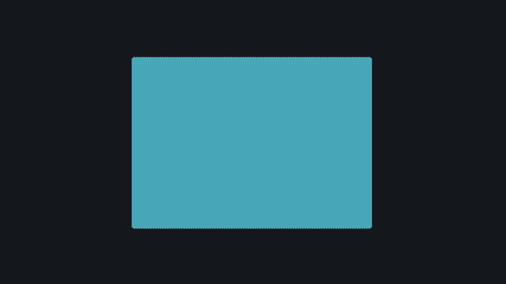
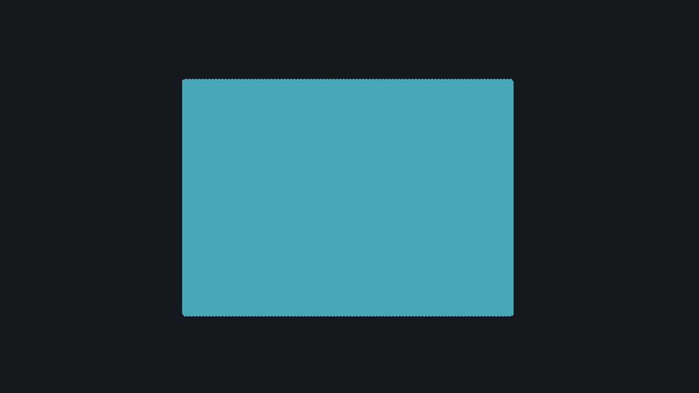

## 작업 결과

GameObject 이동·회전·스폰·수명을 빌드 시 DOTS로 처리하는 프리뷰와 실측 기반 예상치 도구를 구현했습니다. 실제 샘플 비교에서 프레임 시간이 약 72.6% 감소했습니다. 제품 전체 완료는 아직 아니며, 사용자 화면 사용 금지에 따라 실제 에디터 UI와 새 프로젝트 설치 검증을 보류합니다.

## 변경 내용

### 적용 내용

- Forge Object·Spawner는 Editor Play에서 GameObject로 실행하고, 활성화한 플레이어 빌드의 임시 씬만 변환합니다. 원본 씬을 직접 덮어쓰지 않습니다.
- Burst IJobChunk 이동·회전·수명, 유한 스폰과 메시 인스턴스 렌더링을 사용합니다. 임의 MonoBehaviour·물리·애니메이션을 자동 번역하는 도구는 아닙니다.
- 지원하지 않는 컴포넌트·외부 참조·투명 정렬 등은 이유를 표시하고 엄격 모드에서 빌드를 차단합니다. 씬 캐시 재사용을 막기 위해 Build player와 비교 도구는 CleanBuildCache를 사용합니다.
- 같은 입력·실행 모드·실제 개체 수를 검증한 플레이어 자료만 예상치에 사용합니다. 자료가 없거나 오래되면 산정 불가, 느려지면 음수입니다.
- Templete 공통 창·Inspector·헬프박스·테마를 재사용합니다. 정적 창 배치와 문구는 UXML/USS, 버튼 8개는 Inspector UnityEvent 자산으로 분리했습니다.
- 실제 Affinity의 7개 벡터 레이어 원본과 투명 PNG, 10개 샘플, 9개 언어 가이드를 프로젝트에 보관했습니다.

## 검증

- Unity 6000.0.83f1 / Entities 1.3.15 실제 실행: 38개 FORGE PASS 기록. 이동·네이티브 Transform 회전·일괄/시간제 스폰·수명·외부 참조 보존·투명 재질 제외·10개 샘플 원본 보존을 확인했습니다.
- 동일 입력, 정상 렌더링 Windows x64 플레이어: GameObject 10,000개 8.149ms → Entity 10,000개 2.232ms. 각 600프레임, 프레임 시간 감소 72.6%. 단일 샘플의 과거 측정이며 일반 프로젝트의 보장 수치나 FPS 증가율이 아닙니다.
- 실제 비교 자료 저장 후 현재 입력 지문 재검증 valid=True. 초기 잘못된 캐시·헤드리스·임시 파일 해시 차이 자료는 유효한 예상치로 채택하지 않았습니다.
- 실제 Affinity 3.3.1.4940에서 저장→닫기→재열기→네이티브 재출력의 PNG 바이트가 동일했습니다. 256×256, 1,105바이트, 투명 모서리; 실제 16/24/32/48px 라이트/다크 렌더를 확인했습니다.
- 최신 소스 4개 어셈블리 정적 컴파일 및 UXML 문법·이벤트 메서드 8개 대응, 가이드 9개·로컬 링크 171개 확인. 정적 검사는 실제 UI 호출 성공을 뜻하지 않습니다.

두 이미지는 Unity 자체 캡처의 미편집 PNG이며 각각 200KB 이하입니다. 제품 에디터 UI의 최종 화면 캡처는 미실행입니다.

[검사 요약 JSON](../assets/preview-20261101/verification.json) · [실제 Affinity 작은 크기 검토](../assets/preview-20261101/logo-small-review.png)

## 남은 사항

- 실제 제품 에디터 UI의 라이트/다크·좁은 폭·Inspector 이벤트 호출과 현재 화면 캡처가 남았습니다. 사용자가 컴퓨터를 사용하며 화면 조작을 금지했으므로 Unity·플레이어·Affinity 신규 실행과 재시작을 하지 않습니다.
- 캡처 후 9개 언어 가이드의 실제 화면과 ScreenshotManifest를 갱신해야 합니다. 현재 pending을 보존했습니다.
- 프리뷰 패키지의 파일/메타데이터 정적 검사는 실제 Unity 가져오기나 새 프로젝트 설치 검증이 아닙니다. 새 설치와 전체 final QA가 남아 있습니다.
- 교훈 검토: 기존 개인정보 규칙에 도구 출력·프로세스 인자 필터링을 통합했고 ada3197로 Sync.ps1 커밋·푸시를 확인했습니다. Affinity 저장 제한은 기존에 검증된 네이티브 메모리 렌더 경로로 해결했습니다. 이미 실행 중인 다른 대화가 지침을 자동 적용했다고 주장하지 않습니다.

## 작업 시간

- 제안 시간: 2~4시간
- 실제로 완료된 시간: 전체 미완료. 작성 기준 1시간 39분 27초 진행; 2026-11-01 18:26:28 Asia/Seoul. 완료 시각 미기록: 실제 화면·설치 검증 보류.
- XERJ: 사용 — CreateDocumentChrome 공통 API를 XERJ로 검색하고 현재 소스로 대조했습니다. 신규 제품은 기존 인덱스 범위 밖이며 후속 연결 오류는 rg와 직접 소스 확인으로 대체했습니다.
