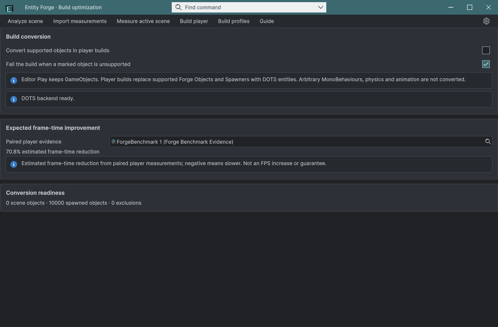
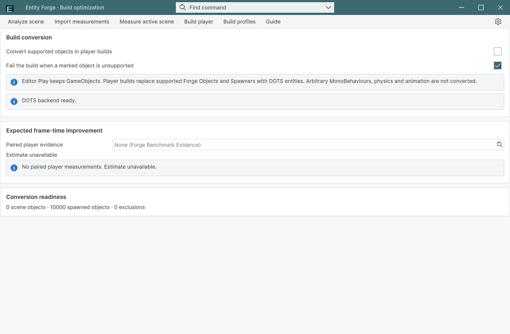
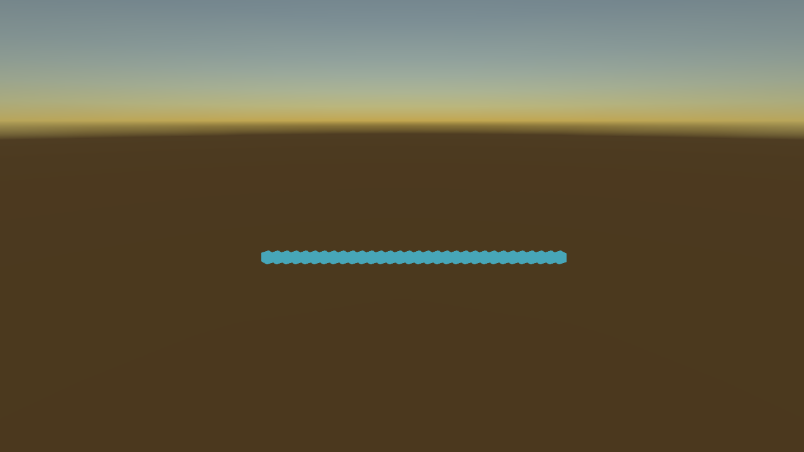

## 작업 결과

독립 새 프로젝트에 Entity Forge 패키지와 Entities 1.3.15를 설치했습니다. 실제 GameObject/DOTS 릴리스 플레이어 동작을 대조했고, 10,000개 동일 부하에서 70.8% 프레임 시간 감소를 측정·표시했습니다.

## 변경 내용

### 적용 내용

- 공통 Templete 1.6.1과 제품 고유 편집 가능한 테마를 적용했습니다. 기존 제품의 기본 Inspector body 스타일은 유지합니다.
- 프리팹의 ForgeObject 컴포넌트 선택과 실제 검색/Enter 반환을 수정하고, 씬 전환·재로드 시 이전 분석을 무효화했습니다.
- 최신 영어 실행 화면 4개와 검증 범위를 9개 언어 가이드에 반영했습니다.
- 개발 코드·다른 제품을 제외한 네이티브 Unity 패키지를 확정했습니다.

## 검증

- Unity 6000.0.83f1 / Windows x64 / Built-in / Entities 1.3.15의 새 프로젝트에서 실제 ImportPackage와 제품 의존성 설치를 실행했습니다.
- 샘플 10개 변환, 원본 씬 해시 보존, 8개 Inspector 영구 이벤트, 미지원 물리·오래된 근거·다른 씬 거부와 위험한 캐시 빌드 차단을 확인했습니다.
- 실제 일반/DOTS 기능 플레이어 26개 단언 통과: frame 10/30/90 개체 51/58/32, 이동·회전 일치와 생성 후 만료. 기능용 고정 시간 검사는 성능 측정과 분리했습니다.
- 최종 비교: 일반 8.751 ms → DOTS 2.557 ms, 70.8% 프레임 시간 감소. 각 180프레임 준비 후 600프레임, 1280×720 정상 렌더링, 10,000개. FPS 증가율이나 보장값이 아닙니다.
- 에디터 새 프로세스 재시작 후 저장된 근거와 개선율을 다시 검증하고, 해당 근거를 사용하는 일반 변환 빌드도 성공했습니다.
- 패키지 325파일 및 설치본 소스/메타데이터 650개 대조 통과. SHA256 8c094117cfed554e373564fbc7db2abb279d89aba4e46448a990adb39c896fe4.
- 실제 입력: 마우스 선택, Escape 취소, 검색 입력과 Enter 후 ForgeObject 프리팹 바인딩 값 확인. 라이트/다크·넓은/좁은 실제 화면과 9개 가이드 171개 링크·이미지/소스 해시 검사 통과.

이미지는 실제 실행 원본 PNG를 편집 없이 복사했습니다. 모두 200KB 이하이며 원본과 게시본 바이트가 같습니다. [측정 UI](../assets/install-20261101/estimate-ui.json) · [기능 대조](../assets/install-20261101/functional-verification.json) · [설치 대조](../assets/install-20261101/installed-package-readback.json) · [입력 반환](../assets/install-20261101/native-input-final.json) · [재시작](../assets/install-20261101/reopened-estimate.json) · [일반 변환 빌드](../assets/install-20261101/estimated-build.json)

## 남은 사항

이번 지원 범위의 구현·설치·실행 검증은 완료했습니다. 임의 MonoBehaviour·물리·Animator 전체 변환은 지원하지 않습니다. 다른 Unity 버전·플랫폼·렌더 파이프라인과 9개 번역 UI 배치 전체는 미검증입니다. 성능은 해당 기기와 부하의 측정값입니다. 실패한 숨김 플레이어의 검은 캡처와 비동기 QA 겹침을 보존하고 정상 렌더링·순차 QA로 재검증했습니다. 교훈은 프로젝트 Architecture.md에 통합했으며 기존 전역 근거·실제 입력·로그 보호 규칙과 중복되어 전역 지침 변경은 없습니다.

## 작업 시간

- 제안 시간: 40~70분 (2026-11-01 20:31:03 Asia/Seoul 시작)
- 실제로 완료된 시간: 기능·최종 검증 기록 시각 2026-11-01 21:25:26 Asia/Seoul, 실제 경과 54.4분. 공개 배포·외부 접근 확인은 후속 최종 메뉴얼에 기록합니다.
- XERJ: 실패 — Xerj.ps1 Status 노드 미실행; 이전 Search 복구는 data/node.lock 사용 중으로 실패. 현재 소스 직접 대조와 rg로 계속했습니다.
