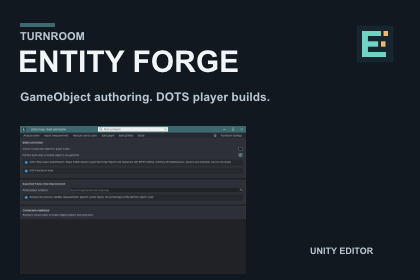
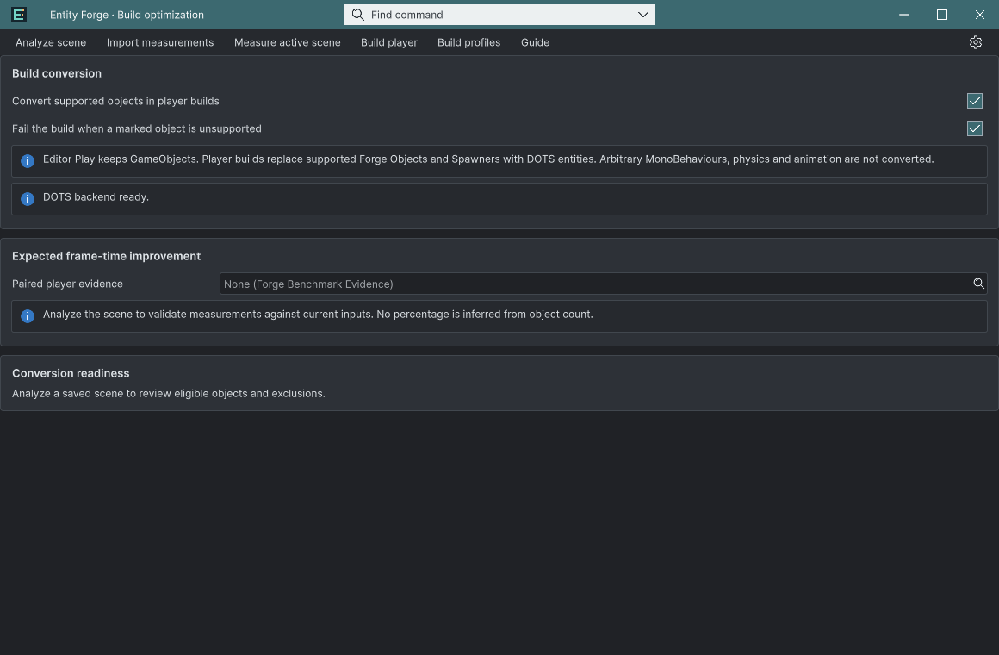
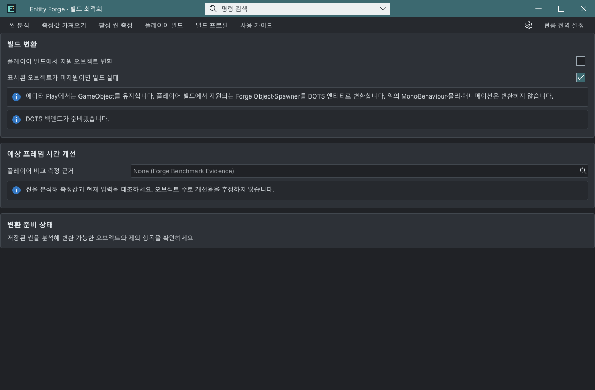

## 작업 결과

Entity Forge 0.1.1-preview의 구현·최종 패키지 설치·미디어 검증을 마쳤고 판매 초안 저장값을 다시 열어 확인했습니다. 최종 제출은 하지 않았습니다.

## 변경 내용

### 적용 내용

창·Inspector·상태/오류의 9개 언어와 열린 UI의 공통 언어 전환을 마무리했습니다. 샘플 Editor 어셈블리를 분리하고 실제 변환 플레이어를 촬영했습니다.

## 검증

9개 언어의 현재 창 표시 영역과 명암 테마를 직접 확인했습니다. Inspector Velocity X에 실제 입력한 1.25를 모델에서 읽고 0으로 복원했습니다. 기존 실제 플레이어 26개 검사 근거와 현재 Runtime/DOTS 통합 6개 파일이 일치하며, 현재 변환 플레이어 빌드·렌더링과 새 패키지 설치도 확인했습니다.

[실제 실행 영상 · 1920×1080 / 24 FPS / 60초](../assets/release-20261102/video.mp4) · 1,440프레임과 전체 디코딩, 자막 가독성을 검증했습니다.

Affinity 3.3.1.4940 커버/카드 8개는 저장→닫기→재열기 후 렌더 픽셀이 같았습니다. 애니메이션 GIF의 실제 내보내기 경로는 검증하지 못해 정지 전후 화면을 제공합니다.

[소스 및 최종 산출물 커밋](https://github.com/MDJ0126/TurnRoom/commit/11f6b815)

판매 초안 재열기: 버전 0.1.1-preview, 마케팅 이미지3개, 영상1개, 실제 화면1개. 제출 버튼 활성화까지 확인했으며 누르지 않았습니다. 브라우저에서도 실제60초 전체 재생이 오류 없이 끝났습니다.

## 남은 사항

Unity 6000.0.83f1·Windows x64·Built-in, DOTS 변환은 Entities1.3.15 필요. 지원 대상만 player 빌드에서 변환하며 Editor Play는 GameObject를 유지합니다. 과거 26개 검사를 이번에 모두 다시 실행했다는 뜻은 아니며, 새 성능 향상률을 주장하지 않습니다.

최종 제출·스토어 심사는 수행하지 않습니다. 판매 가격은 기존/포털 기본값을 유지하며 제출 전에 소유자가 확정해야 합니다. 포털 파일 수가 0으로 표시된 범위는 서버 집계 완료로 간주하지 않습니다.

포털 관찰값: Nov 01, 2026 23:57 UTC, 0 files, 9.6 MB. 업로드 수신 성공·실제 설치 검증과 서버 파일 집계 완료를 구분합니다.

교훈: 배포 파일/해시 고정 후 설치·업로드 규칙을 전역 지침에 추가·동기화·푸시했습니다(8eb390e). 일반화하지 않은 제품별 오류·과거 실패는 별도 근거에 보존했습니다.

## 작업 시간

- 제안 시간: 최대10시간. 2026-11-01 23:52:12 KST 시작, 2026-11-02 09:52:12 KST 마감.
- 실제로 완료된 시간: 4개 제품 공동 작업 경과 9시간 36분 4초. 제품·패키지·미디어·판매 초안 확인 기준 시각 2026-11-02 09:28:16 KST. 제품별 독립 소요 시간은 분리 기록하지 않았습니다. 공개 보고서 배포 확인은 이후 전체 종료 기록으로 구분합니다.
- XERJ: 사용 — XERJ로 공통 Editor·Workbook 관련 심볼을 검색하고 현재 소스와 대조했습니다. Runtime·신제품 및 SDK는 인덱스 범위 밖이어서 rg를 병행했습니다.
