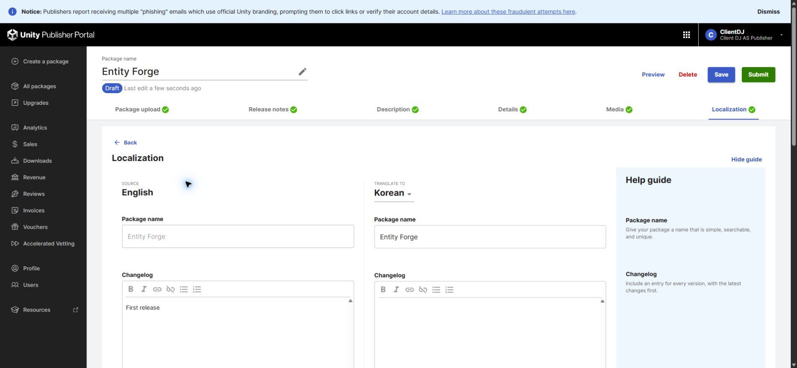
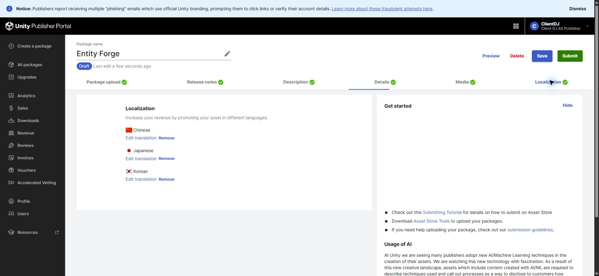
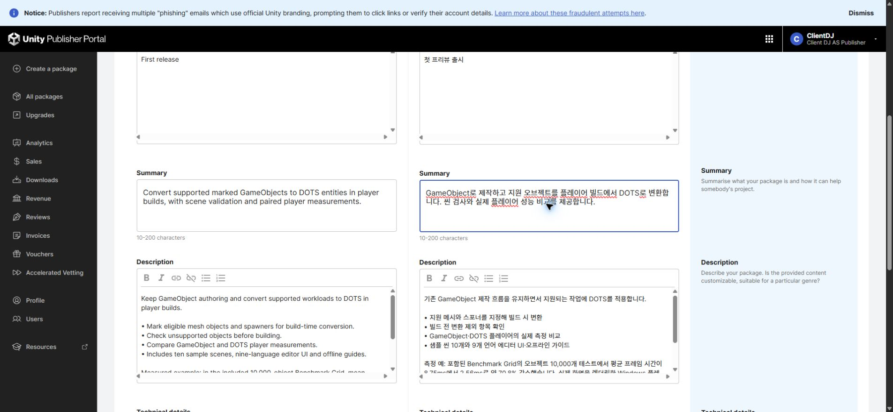
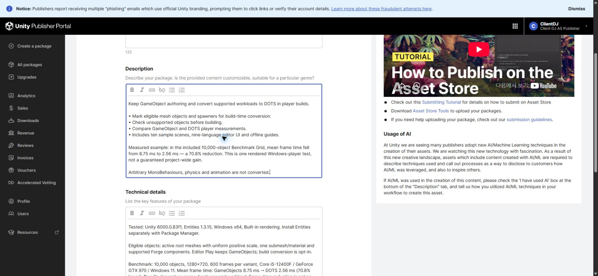

## 작업 결과

판매 초안을 저장하고 재열기·서버 값 대조를 마쳤습니다. 최종 제출은 누르지 않았습니다.

## 변경 내용

### 적용 내용

미등록이던 한국어·일본어·중국어 판매 번역을 추가했습니다. 제목·요약·설명·기술정보·변경 이력·AI 고지를 각 언어로 저장했습니다. 제품 내부9개 언어와 포털의 판매 언어는 별도로 구분합니다.

영어와 번역3개에 실제 측정 예시를 추가했습니다. 동봉 Benchmark Grid의10,000개 오브젝트에서 평균 프레임 시간8.75→2.56ms, 약70.8% 감소입니다. 기능은 빌드 시 변환·제외 항목 검사·실제 플레이어 비교·샘플10개로 정리했습니다.

## 검증

입력 직후의 화면에 그치지 않고 포털 문서를 새로 불러온 뒤3개 번역의6개 필드를 원본과 대조했습니다. 제품별18개, 전체72개 필드가 일치했습니다. 일부 제목과 변경 이력이 처음에는 남지 않아 실패 기록을 보존하고 별도 저장·새 로딩으로 재검증했습니다.

[한국어 저장값](../assets/store-localization-20261102/ko-readback.json) · [일본어 저장값](../assets/store-localization-20261102/ja-readback.json) · [중국어 저장값](../assets/store-localization-20261102/zh-readback.json) · [최종 검증](../assets/store-localization-20261102/verification.json)

조건은 Unity6000.0.83f1·Entities1.3.15·Windows x64·Built-in,1280×720, 각600프레임, Core i5-12400F·GeForce GTX970·Windows11입니다. 기존 실제 렌더링 플레이어의 원시600개 값을 다시 평균내어 확인했습니다. 이번에 새 성능 측정을 했다는 뜻은 아닙니다. 프레임 시간 감소는 FPS 증가율이 아니며 모든 프로젝트에 보장되는 수치가 아닙니다.

[원시 GameObject 측정](../assets/store-localization-20261102/baseline.json) · [원시 DOTS 측정](../assets/store-localization-20261102/dots.json) · [재계산 결과](../assets/store-localization-20261102/benchmark-verification.json)

## 남은 사항

스토어 최종 제출·심사는 별도입니다. 포털이 제공하는 번역 언어는 한국어·일본어·중국어이며 제품 UI의9개 언어와 다릅니다. 긴 변경 이력이 저장되지 않은 원인은 미확인으로 남겼고, 새 프리뷰 제품은 간결한 첫 출시 문구가 실제 저장됨을 확인했습니다. 기능 설명은 본문·기술정보에 유지했습니다. Affinity GIF 출력은 미검증이므로 실제 원본 정지 화면을 제공합니다.

교훈 검토: 기존 전역 판매 페이지 규칙에 포털 언어별 필드와 전체 새로고침 후 값 대조를 통합했습니다. Sync.ps1 Push와 설치본·저장소 해시 일치를 확인했습니다(5562033b). 다른 실행 중 대화의 자동 반영은 주장하지 않습니다.

## 작업 시간

- 제안 시간: 30~60분
- 실제로 완료된 시간: 공동 작업 25분 4초. 판매 저장 검증 완료2026-11-02 13:35:17 KST, 보고서 작성 확인 2026-11-02 13:40:18 KST. 시작2026-11-02 13:15:15 KST. 공개 배포는 이어서 확인합니다.
- XERJ: 사용 — TemplateTextCatalog를 XERJ로 검색하고 현재 소스와 대조했습니다. 판매 페이지는 실제 포털 DOM·저장값, 성능은 원시 측정 JSON을 확인했습니다.
