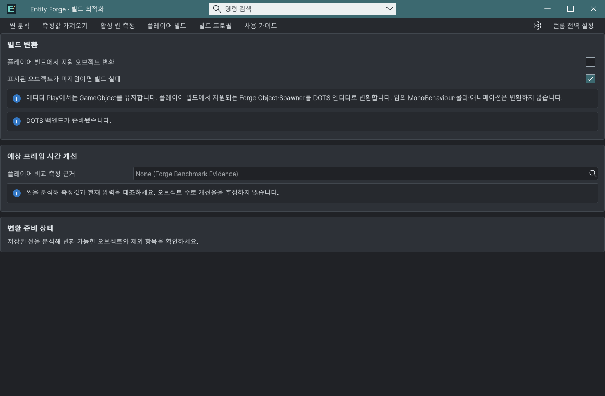

## 작업 결과

제출 전 최종 검토는 완료했습니다. 제품이 모든 제출 기준을 충족했다고 승인한 상태는 아닙니다. 식별한 누락·수정 필요 사항 때문에 지금 바로 제출하는 것은 권하지 않습니다.

## 변경 내용

### 적용 내용

기존 업로드에 빠져 있던 제목줄 공통 수정3개 파일을 네 제품과 공통 패키지에 반영해 재포장했습니다. 이전 파일과 실패 기록을 보존했고 최종 해시를 고정한 뒤 새 설치·업로드에 사용했습니다. 포털 가격은 사용자 확인대로 DDT19.99달러, 나머지4.99달러입니다.

이번 작업은 제출 전 점검·패키지 갱신이며 새 UI 디자인 변경은 없습니다.

## 검증

Unity6000.0.83f1의 새 프로젝트에서 공동15검사 통과. 최신3개 공통 소스도 설치 파일과 hash가 일치합니다. 제품별 패키지 전 파일과meta 대조, SDK 실제 업로드 hash 대조 통과.

Asset Store Tools11.3.1 실제 검사: 26 Pass / 3 Warning / 0 Fail. 네 제품 합계98 Pass·18 Warning·0 Fail입니다. 오류0을 제출 지침 충족과 혼동하지 않았습니다.

번역12개72필드, 버전·의존성·AI 고지·키 이미지3개씩과 기존 실제영상·스크린샷을 포털에서 다시 읽었습니다.

[제품별 실제 검사·경고 대상·업로드 근거](../assets/submission-final-20261102/review.json)

공식 근거: [제출 지침](https://assetstore.unity.com/publishing/submission-guidelines) 2.5.1.a·2.5.1.e, [검증·업로드 절차](https://docs.unity.com/en-us/asset-store/publishing/asset-packages/upload).

화면 근거 정정: 앞선 포털 캡처 일부가 빈 화면/로딩 상태여서 해당 이미지를 이 보고서의 검증 근거에서 제외했습니다. 실제 제품 에디터 화면과 포털 저장값 JSON을 사용합니다. 이전 보고서는 이력으로 보존합니다. [이전 검토 보고서](https://mdj0126.github.io/codex-config/projects/entityforge/reports/2026-11-02-result-20261102054158437-v1.0.0.html)

## 남은 사항

공통 제출 전 수정: 최상위 TurnRoom 메뉴를 기존 Unity 메뉴 또는 Tools 아래로 정리해야 합니다. 공식 지침2.5.1.a와 실제 SDK 메뉴 경고·고객 포함 소스가 근거입니다. 이번 요청의 최종 점검에서 식별했으며, 메뉴·문서 진입 경로 변경을 구현했다고 보고하지 않습니다.

Entity Forge의 ForgeDependencies.cs:16은 Client.Add("com.unity.entities@1.3.15")로 외부 UPM 패키지를 코드에서 설치합니다. 공식2.5.1.e와 충돌하므로 직접 설치 대신 Package Manager 안내 방식으로 바꿔야 합니다.

소스의 줄바꿈 경고는 남아 있습니다. 문서·샘플 JPEG는 Tools 카테고리 예외2.4.3.a, DDT XLSX는 네이티브 입력 형식, Pixora 아트 원본 ZIP은 source 아카이브로 구분했습니다. 경고를 삭제하거나0건으로 바꾸지 않았습니다. 포털 파일 집계355개 / 실제 패키지355개는 서로 구분하며 미반영을 완료로 처리하지 않습니다. 최종 제출과 심사는 하지 않았습니다.

교훈 검토: 기존 배포 규칙에 마지막 소스 수정과 실제 검증·업로드 산출물의 대조를 통합했습니다. Sync.ps1 Push와 설치본·설정 저장소의 일치를 확인했습니다(84be49dc).

## 작업 시간

- 제안 시간: 10~20분
- 실제로 완료된 시간: 공동 검토 38분 56초. 시작2026-11-02 14:02:53 KST, 검토 확인 2026-11-02 14:41:48 KST. 재포장·새 설치·업로드와 공식 경고 대조로 최초10~20분 예상보다 지연됐습니다. 공개 배포는 이어서 확인합니다.
- XERJ: 사용 — TitleNameLeft와 BindingFlags.NonPublic 검색 후 실제 고객 소스와 대조했습니다. 오래된 WindowFrame 후보는 현재 소스가 아니므로 배제하고 rg·공식 SDK 코드 및 메타 GUID로 경고 대상을 검증했습니다.
