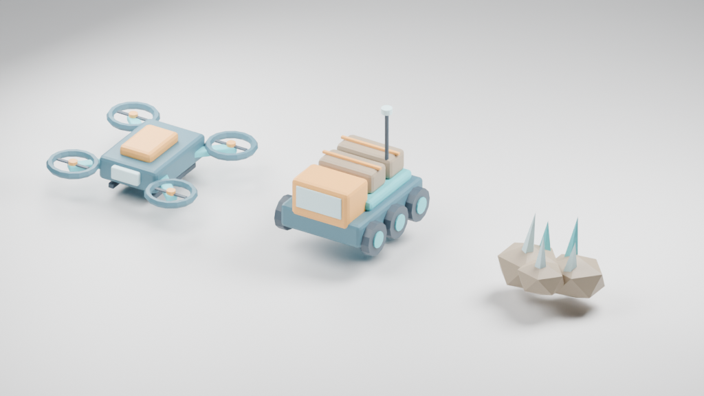

## 작업 결과

일반 Unity Build/Build And Run 옵션 연결, Forge 컴포넌트 없는 호환 메시 자동 탐지, 원래 GameObject·스크립트·물리를 보존하는 DOTS 렌더링 프록시를 구현했습니다. 기존 명시적 Forge Object/Spawner 시뮬레이션 경로는 유지합니다. 임의 MonoBehaviour를 ECS 코드로 자동 번역하지 않습니다.

## 변경 내용

### 적용 내용

Blender 5.2.3 LTS에서 드론·화물 로버·광석을 실제 모델링하고 .blend 원본을 재열어 렌더링했습니다. 중복 예제 10개는 원본 백업을 남기고 격납고·차량 이동·물리 혼합 예제 3개로 교체했습니다. 일반 빌드는 기존 출력 경로·씬·실행 플래그를 유지하고 필요한 CleanBuildCache만 추가하도록 연결했습니다. 자동 변환은 임포트 시 활성화하지 않습니다.

이 이미지는 Blender 결과이며 Unity 실행 화면이 아닙니다. Unity 새 화면 및 전후 캡처는 사용자의 포커스 금지로 미실행입니다.

## 검증

Unity 설치본의 Roslyn/참조를 사용한 Runtime·DOTS·Editor·샘플 Runtime·샘플 Editor·개발 Editor 6개 어셈블리 컴파일 성공. 새 씬 3개의 YAML 오브젝트 ID 중복 없음. UI 번역 403항목×9언어 누락 검사, 문서 9개 링크·이미지 126개 확인. 기존 캡처 해시를 보존하고 현재 화면 검증은 pending-source-change로 명시했습니다. 파일 방식 unitypackage는 생성 후 압축 해제하여 모든 포함 파일·메타·경로를 현재 소스와 대조했습니다. 네이티브 Unity export/import 검증은 아닙니다.

[비GUI 검사 근거](../assets/2026-11-02-automatic/verification.json)

## 남은 사항

실제 일반 Build/Build And Run 실행, 새 프로젝트 네이티브 설치, 셰이더/메시 Unity 표시, 실제 언어 전환, 새 자동 모드의 기준/변환 플레이어 성능 측정은 미실행입니다. 이전 버전의 성능 퍼센트는 새 모드의 검증으로 사용하지 않았습니다. 원래 GameObject를 보존하므로 성능 향상은 보장하지 않습니다. 기존 개발 QA의 10개 씬 시나리오는 과거 증거이며 현재 3개 예제의 실행 통과 근거가 아닙니다. 기존 전역 지침이 포커스/산출물 규칙을 이미 포함하여 전역 변경 없음.

## 작업 시간

- 제안 시간: 최초 40~70분, 사용자 단축 요청 후 총 20~35분으로 수정. 수정 예상 범위 초과.
- 실제로 완료된 시간: 2026-11-02 15:49:45 KST 시작. 구현·비GUI 검사 약 40분. 공개 배포 확인 시각은 후속 기록. 전체 Unity 실행 검증 완료 시각은 미정.
- XERJ: 실패 — Xerj.ps1 Status에서 검색 노드 미실행 확인. rg와 현재 소스 대조로 대체.
