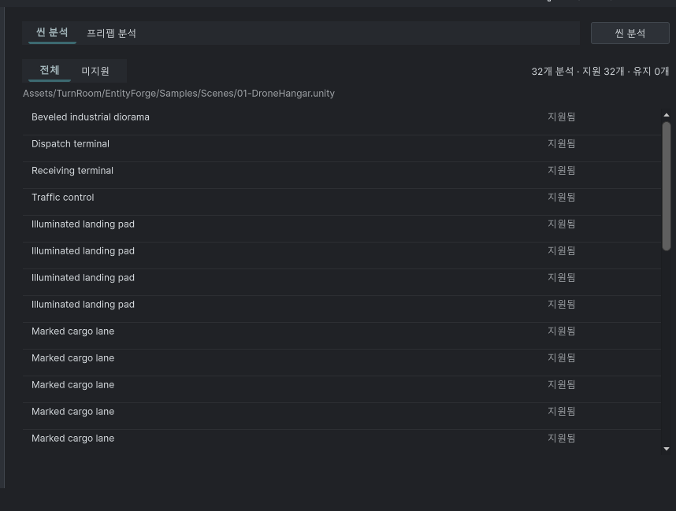

## 작업 결과

씬·프리팹 전환은 상단 탭으로 유지하며 아래 전체·미지원 탭 줄을 제거했습니다. 목록 필터는 왼쪽의 표시 선택 상자 한 개입니다. 현재 씬 설명과 프리팹 안내는 완료 후에도 계속 표시합니다.

## 변경 내용

### 적용 내용

UI Toolkit DropdownField를 UXML로 작성하고 선택값을 기존 unsupportedOnly 필터 상태에 연결했습니다. 공유 UITemplate.Apply의 선택 패널 처리를 사용합니다. 이전 필터 범위 예외 수정과 행 선택·호버·대상 이동 코드는 유지했습니다. Unity 진행 다이얼로그는 완료 시 닫히며 인라인 100% 게이지는 다시 추가하지 않았습니다. 9개 언어 문서의 설명 숨김 안내도 현재 요구로 고쳤습니다.

사용자 기준 원본 55,472바이트를 편집 없이 보존했습니다. 수정 후 실제 화면은 포커스 제한으로 미확보이며 전후 시각 검증 완료로 표시하지 않습니다.

## 검증

7개 어셈블리 설치 Unity 참조 컴파일 및 마지막 소스 해시 대조 통과. DropdownField 한 개/기존 필터 버튼 제거, 선택값과 필터 연결, 분석 결과와 무관한 설명 표시 조건을 검사했습니다. UI 456키×9언어와 치환 인자·문서 9개/126개 링크 검사 통과. 388개 에셋 미리보기 패키지 원본/메타 byte readback 통과. [검사 JSON](../assets/2026-11-02-single-filter/verification.json)

## 남은 사항

화면 포커스 금지 조건으로 Unity를 조작하지 않았습니다. 실제 필터 선택/취소/반환값, 완료 전후 배치·9언어 레이아웃은 네이티브 미검증입니다. 수정 후 캡처와 문서 시각 검증은 보류하며 기존 캡처 해시는 보존합니다. 교훈 검토: 탭은 작업 모드 전환에, 결과 조건은 필터에 배치한다는 이번 제품 결정을 메뉴얼에 기록했습니다. 새로운 전역 규칙 추가 없음.

## 작업 시간

- 제안 시간: 3~7분
- 실제로 완료된 시간: 2026-11-02 20:18:26 KST 시작. 20:21:22 KST 구현·비GUI 검사·패키지 검증 완료(2분56초). 공개 배포 확인 별도. 네이티브 실행 검증 완료 시각 없음.
- XERJ: 실패 — Xerj.ps1 Status 노드 미실행 확인 후 rg·현재 소스·컴파일과 구조 검사로 대체.
