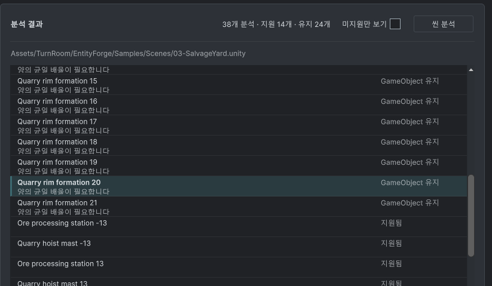

## 작업 결과

중첩된 이름/상태 줄과 사유 둘째 줄을 제거하고 이름·상태·사유의 단일 행으로 변경했습니다. 이전의 16px 제목/13px 사유/34px 행 규칙이 중복되어 있던 부분을 제거했습니다.

## 변경 내용

### 적용 내용

UXML의 행에 Label 3개를 직접 배치하고 가로 정렬했습니다. ListView fixed-item-height와 행의 최소/최대 높이를 30px로 맞췄습니다. Label은 같은 기준선에 24px 높이로 정렬하고 줄바꿈 없이 말줄임/클리핑합니다. 전체 경로·사유와 상태는 툴팁으로 확인할 수 있습니다. 선택/호버와 대상 이동은 유지합니다.

## 검증

[정적 검사 근거](../assets/single-row/verification.json). 실제 XML 파서로 직접 자식 Label 3개를 확인했습니다. 중복 행 규칙 제거와 30px 일치, 7개 어셈블리 컴파일 및 현재 소스 해시, 문서 9개/링크126개 검사 통과. 패키지 400개 에셋 원본 바이트 대조 통과. SHA-256 35c5370e3d365b4429439d6db86a2ea5ed4821fdca56cf9429be3d04daba965a. 화면 조작·에디터 명령·빌드는 실행하지 않았습니다.

수정 전 사용자 제공 실제 화면입니다. 사유가 이름 아래 두 번째 줄에 표시되고 행 경계와 겹칩니다. 원본을 편집하지 않았습니다.

## 남은 사항

사용자 화면 조작 금지로 수정 후 실제 배치·스크롤·밝은/어두운 화면 검증은 미실행입니다. 실제 화면을 확인한 것으로 보고하지 않습니다. 교훈 검토: 가상 목록 고정 높이와 실제 행 높이 및 내부 텍스트 구조를 함께 대조합니다. 기존 복합 입력/실제 UI 검증 지침과 중복되어 전역 변경 없이 프로젝트 메뉴얼에 반영합니다.

## 작업 시간

- 제안 시간: 3~5분 · 시작 2026-11-03 00:33:16 KST
- 실제로 완료된 시간: 소스·컴파일·문서·패키지 반영 2분 26초 · 2026-11-03 00:35:42 KST. 공개 게시 배포는 이후 확인.
- XERJ: 실패 — Xerj.ps1 Status: XERJ node is not running. rg와 UXML/USS/C# 소스를 확인했습니다.
