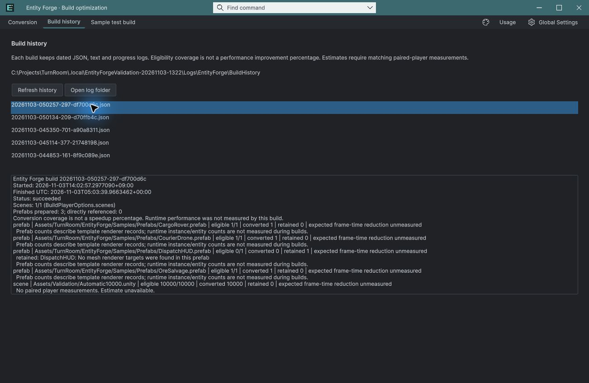

## 작업 결과

최종 기록 succeeded / 실제 빌드 Succeeded errors=0 대조 통과

## 변경 내용

### 재현 조건

Unity 6000.0.83f1, Entities 1.3.15, 새 프로젝트

### 재현 순서

일반 오브젝트 10,000개 씬을 BuildPipeline으로 빌드한 뒤 최종 Unity 결과와 날짜별 JSON/로그를 대조

### 기대 동작

최종 빌드 결과와 저장한 상태가 일치

### 실제 동작

이전 기록 unknown, 수정 후 succeeded

### 원인

OnPostprocessBuild에서 아직 Unknown인 BuildReport 결과를 즉시 저장했습니다. 빌드 종료 뒤 최종화하도록 변경했습니다.

### 적용 내용

대기 중 BuildReport를 보존하고 BuildPipeline 종료 뒤 최종화합니다. 성공 모드 설정도 실제 성공 시에만 저장합니다. 이전 빌드의 최종화가 다음 빌드 시작과 겹치는 경우도 먼저 처리합니다.

## 검증

실제 재빌드 Succeeded errors=0, JSON status=succeeded, 씬 1/1, 자동 변환 10,000개. 빌드 기록 탭에서 해당 날짜 항목을 클릭해 같은 로그를 확인했습니다. 현재 7개 어셈블리 컴파일과 402개 패키지 대조 통과. [검증 근거](../assets/ci-final-state-20261103/verification.json)

## 남은 사항

이 보고서는 최종 상태 기록 수정만 다룹니다. 전체 성능 개선 및 출시 UI QA는 미완료입니다. [자동 변환 실측 결과](2026-11-03-result-20261103045838631-v1.0.0.html). 교훈 검토: 최종 상태를 실제 실행 결과로 대조한다는 기존 전역 지침과 중복되어 전역 변경 없음.

## 작업 시간

- 제안 시간: 최초 검증 20~40분; 추가 CI 오류 수정 3~5분
- 실제로 완료된 시간: 수정 후 재빌드 41.87초, 전체 실행 검증 기록 43분 · 2026-11-03 14:05:35 KST. 공개 확인 별도.
- XERJ: 실패 — XERJ node is not running. rg와 실제 빌드 로그 대조.
